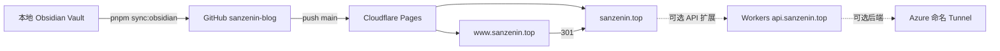

# sanzenin.top 部署记录

> 核验日期：2026-11-16

## 正式入口

| 用途 | 地址 | 状态 |
| --- | --- | --- |
| 博客主站 | https://sanzenin.top/ | 已上线，HTTPS |
| 备用域名 | https://www.sanzenin.top/ | 301 到主站并保留路径与查询 |
| GitHub 仓库 | https://github.com/wlz6/sanzenin-blog | 公开 |
| Pages 项目 | `sanzenin-blog` | Git 自动部署 |

## 架构

博客主体是 Astro 静态产物，由 Cloudflare Pages 构建和分发。前端运行时不需要 Workers、Azure 或数据库在线。

## 域名与 DNS

- Spaceship 的 Nameserver 已改为 `ariella.ns.cloudflare.com` 与 `khalid.ns.cloudflare.com`。
- `sanzenin.top` 与 `www.sanzenin.top` 都使用 Cloudflare Pages 的 CNAME 记录，代理已开启。
- 两个 Pages 自定义域名均为 `Active`，SSL 已启用。
- `www` 通过 Cloudflare Redirect Rule 返回 301，路径和查询字符串保留。
- `api.sanzenin.top` 当前未创建记录，也没有部署 Worker。

## 自动部署

Cloudflare Pages 项目直接连接 `wlz6/sanzenin-blog` 的 `main` 分支：

- Build command：`pnpm build`
- Build output：`dist`
- Production branch：`main`
- 环境变量：`NODE_VERSION=26`、`PNPM_VERSION=12.6.0`、`GIT_TERMINAL_PROMPT=0`

提交 `cafecba` 已通过 Git 推送自动触发部署 `7fb01b36`；该部署状态为 success，并上传了完整静态产物。

## Obsidian 同步

`pnpm sync:obsidian` 会读取 Obsidian Vault 并生成：

- `shirones/content/posts/obsidian/*.md`
- `public/obsidian/*`

默认 Vault 路径为 `/mnt/c/Users/Sanzenin/Documents/Obsidian Vault`，可用 `OBSIDIAN_VAULT` 覆盖。脚本只读取原笔记，不修改 Vault。当前同步 95 篇笔记和 83 个实际引用的附件，归档共 96 篇文章（含欢迎页）。

详细规则见 [Obsidian 同步说明](obsidian-sync.md)。

## Azure 与 Workers

Azure `student-vm-my` 继续运行现有环境，但没有为博客启动 Docker 容器或 Tunnel。后端按需模板位于 `deploy/azure/`；Workers 预留说明位于 `deploy/workers/`。当前静态博客不依赖这两部分。

Azure 学生信用额度为 USD 100（约 CNY 671.995），到期日 2027-09-28。本月实际费用约 CNY 10.1063，主要来自静态公网 IPv4；VM 和 P6 盘命中免费计量。未配置预算告警。

## 验证基线

- `astro check`：0 errors / 0 warnings
- `pnpm build`：成功，130 个页面，包含 Pagefind 索引
- 首页、归档、文章、关于、分类、标签可访问
- Obsidian 文章与图片资源返回 200
- 站点搜索可返回 FFT 相关笔记
- `www` 301、apex HTTPS、Cloudflare 自定义域名状态均已验证

## 剩余事项

- Obsidian 笔记 `左偏树.md` 引用的一张 `Pasted image 20260114153201.png` 在 Vault 中不存在，页面显示文字占位。
- Azure 公网 IPv4 持续产生少量费用，未配置预算告警；如不再需要公网默认页，可在单独维护窗口评估移除。
- `api.sanzenin.top`、Workers 和 Azure API 容器均未部署，只保留了配置模板。
