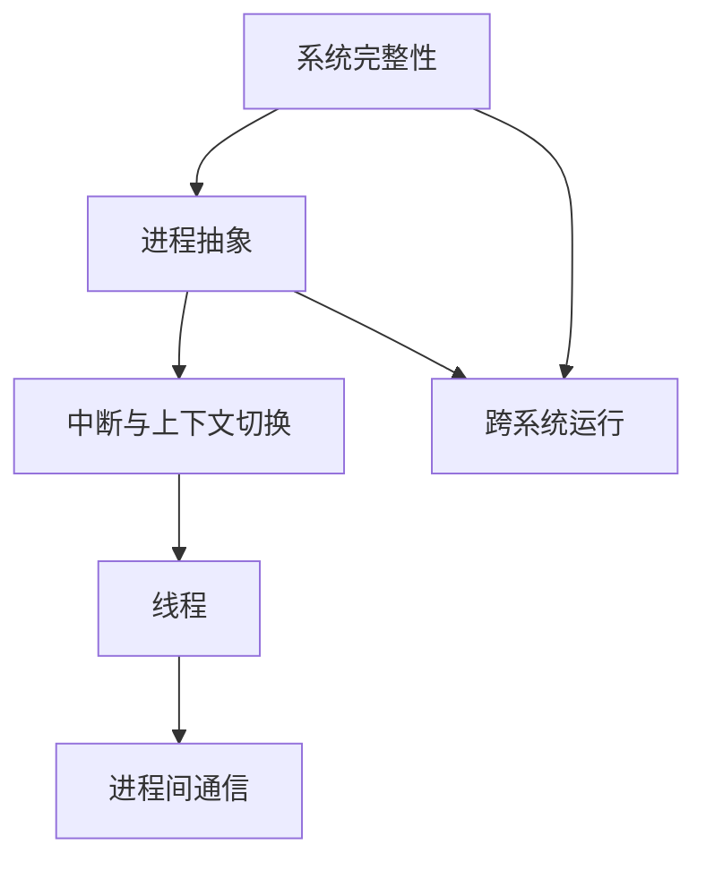

<!-- 由 scripts/sync-obsidian.mjs 从 Obsidian Vault 生成，请勿直接编辑。 -->

# Core Dumped 操作系统笔记目录

这组笔记按“硬件保护机制 -> 进程抽象 -> 上下文切换 -> 线程 -> 进程间通信 -> 跨系统兼容”的顺序阅读。阅读时注意一个主线：操作系统不是只提供功能接口，它还依赖硬件保护机制来限制普通程序能做什么。

1. [01 系统完整性：用户态、内核态与系统调用](/posts/obsidian/01-%E7%B3%BB%E7%BB%9F%E5%AE%8C%E6%95%B4%E6%80%A7-%E7%94%A8%E6%88%B7%E6%80%81-%E5%86%85%E6%A0%B8%E6%80%81%E4%B8%8E%E7%B3%BB%E7%BB%9F%E8%B0%83%E7%94%A8/)
2. [02 进程：地址空间、PCB 与上下文](/posts/obsidian/02-%E8%BF%9B%E7%A8%8B-%E5%9C%B0%E5%9D%80%E7%A9%BA%E9%97%B4-pcb-%E4%B8%8E%E4%B8%8A%E4%B8%8B%E6%96%87/)
3. [03 硬件与多任务：中断、寄存器和上下文切换](/posts/obsidian/03-%E7%A1%AC%E4%BB%B6%E4%B8%8E%E5%A4%9A%E4%BB%BB%E5%8A%A1-%E4%B8%AD%E6%96%AD-%E5%AF%84%E5%AD%98%E5%99%A8%E5%92%8C%E4%B8%8A%E4%B8%8B%E6%96%87%E5%88%87%E6%8D%A2/)
4. [04 线程：共享地址空间与并发执行](/posts/obsidian/04-%E7%BA%BF%E7%A8%8B-%E5%85%B1%E4%BA%AB%E5%9C%B0%E5%9D%80%E7%A9%BA%E9%97%B4%E4%B8%8E%E5%B9%B6%E5%8F%91%E6%89%A7%E8%A1%8C/)
5. [05 进程间通信：共享内存、消息传递与 Socket](/posts/obsidian/05-%E8%BF%9B%E7%A8%8B%E9%97%B4%E9%80%9A%E4%BF%A1-%E5%85%B1%E4%BA%AB%E5%86%85%E5%AD%98-%E6%B6%88%E6%81%AF%E4%BC%A0%E9%80%92%E4%B8%8E-socket/)
6. [06 跨系统运行：CPU 架构、ABI 与可执行文件格式](/posts/obsidian/06-%E8%B7%A8%E7%B3%BB%E7%BB%9F%E8%BF%90%E8%A1%8C-cpu-%E6%9E%B6%E6%9E%84-abi-%E4%B8%8E%E5%8F%AF%E6%89%A7%E8%A1%8C%E6%96%87%E4%BB%B6%E6%A0%BC%E5%BC%8F/)

## 主题关系

