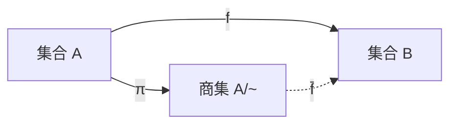

<!-- 由 scripts/sync-obsidian.mjs 从 Obsidian Vault 生成，请勿直接编辑。 -->

# 00-集合论与映射

这一章整理后续群论中用到的集合论与映射知识，主要包括：
1. 等价关系、等价类与集合划分；
2. 映射的单射、满射、双射与可逆性；
3. 选择公理与常见等价命题；
4. 商集上的映射定义与良定性检验。

---

## 1. 集合与基本运算

### 1.1 集合、子集与外延公理
- 数学对象 $a$ 属于集合 $A$ 记作 $a \in A$；不属于记作 $a \notin A$。
- 子集包含：$A \subseteq B \iff \forall x (x \in A \implies x \in B)$。
- 集合相等：由外延公理，两个集合相等当且仅当互为子集：
  $$A = B \iff A \subseteq B \text{ 且 } B \subseteq A$$
  因此证明两集合相等的通用范式是双向验证包含关系：先任取 $x \in A$ 推导 $x \in B$，再任取 $y \in B$ 推导 $y \in A$。

### 1.2 交、并、差与补集
- 并集：$A \cup B = \{x \mid x \in A \lor x \in B\}$。
- 交集：$A \cap B = \{x \mid x \in A \land x \in B\}$。
- 差集：$A \setminus B = \{x \in A \mid x \notin B\}$。
- 全集 $U$ 下的绝对补集：$A^c = U \setminus A$。
- 对称差：$A \Delta B = (A \setminus B) \cup (B \setminus A) = (A \cup B) \setminus (A \cap B)$。
- De Morgan 律：
  $$(A \cup B)^c = A^c \cap B^c, \qquad (A \cap B)^c = A^c \cup B^c$$
- 分配律：
  $$A \cap (B \cup C) = (A \cap B) \cup (A \cap C)$$
  $$A \cup (B \cap C) = (A \cup B) \cap (A \cup C)$$

### 1.3 幂集与笛卡尔积
- 幂集：集合 $A$ 的全部子集构成的集合族记作 $\mathcal{P}(A) = \{S \mid S \subseteq A\}$。若 $|A| = n$，则 $|\mathcal{P}(A)| = 2^n$。
- 笛卡尔积：$A \times B = \{(a, b) \mid a \in A, b \in B\}$。笛卡尔积是有序对集合，代数系统中的二元运算（如映射 $\cdot: G \times G \to G$）与二元关系均基于笛卡尔积定义。

---

## 2. 关系、等价关系与集合划分

### 2.1 二元关系
集合 $A$ 上的二元关系 $R$ 是笛卡尔积的一个子集 $R \subseteq A \times A$。若 $(a, b) \in R$，记作 $a R b$。
常见基本性质：
- 自反性：$\forall a \in A,\ a R a$；
- 对称性：$\forall a, b \in A,\ a R b \implies b R a$；
- 传递性：$\forall a, b, c \in A,\ a R b \land b R c \implies a R c$；
- 反对称性：$\forall a, b \in A,\ a R b \land b R a \implies a = b$。

### 2.2 等价关系与等价类
同时满足自反性、对称性与传递性的二元关系称为**等价关系**，通常记作 $\sim$。
- **等价类**：元素 $a \in A$ 所在的等价类定义为：
  $$[a] = \{x \in A \mid x \sim a\}$$
  其中 $a$ 称为该等价类的一个代表元。
- **商集**：由关于 $\sim$ 的全体等价类构成的集合族记作：
  $$A/\sim = \{[a] \mid a \in A\}$$
- **自然投影**：映射 $\pi: A \to A/\sim$ 定义为 $\pi(a) = [a]$，$\pi$ 恒为满射。

### 2.3 等价类的二分性质

#### 定理 0.1（等价类相交即全同）
设 $\sim$ 是 $A$ 上的等价关系，$a, b \in A$。下列命题等价：
1. $a \sim b$；
2. $[a] \cap [b] \neq \emptyset$；
3. $[a] = [b]$。

**证明：**
- **(1) $\implies$ (3)**：设 $a \sim b$。任取 $x \in [a]$，有 $x \sim a$。由传递性 $x \sim b$，故 $x \in [b]$，即 $[a] \subseteq [b]$。由对称性 $b \sim a$，同理可得 $[b] \subseteq [a]$。两边互含，故 $[a] = [b]$。
- **(3) $\implies$ (2)**：由自反性 $a \in [a]$。若 $[a] = [b]$，则 $a \in [b]$，从而 $a \in [a] \cap [b]$，交集非空。
- **(2) $\implies$ (1)**：若存在 $c \in [a] \cap [b]$，则 $c \sim a$ 且 $c \sim b$。由对称性 $a \sim c$，再由传递性 $a \sim c \land c \sim b \implies a \sim b$。 $\blacksquare$

> [!NOTE] 推论
> 任意两个等价类要么完全相同，要么互不相交。不存在部分重叠的情况。

### 2.4 等价关系与划分的对应定理
集合 $A$ 的一个划分是指一族非空子集 $\mathcal{P} = \{A_i\}_{i \in I}$，满足：
1. 非空：$\forall i \in I, A_i \neq \emptyset$；
2. 两两不交：$i \neq j \implies A_i \cap A_j = \emptyset$；
3. 全覆盖：$\bigcup_{i \in I} A_i = A$。

#### 定理 0.2（等价关系与集合划分的对应）
1. 若 $\sim$ 是 $A$ 上的等价关系，则商集 $A/\sim$ 是 $A$ 的一个划分。
2. 反之，若 $\mathcal{P}$ 是 $A$ 的一个划分，定义关系 $x \sim_{\mathcal{P}} y \iff \exists P \in \mathcal{P}, x, y \in P$，则 $\sim_{\mathcal{P}}$ 是 $A$ 上的等价关系，且其商集恰为 $\mathcal{P}$。

**证明：**
1. 由自反性，每个 $a \in [a]$，故等价类非空且全并为 $A$；由定理 0.1，不同等价类两两不交。因此 $A/\sim$ 构成划分。
2. 自反性由划分的覆盖性保证；对称性由定义的对称性保证；传递性：若 $x, y \in P_1$ 且 $y, z \in P_2$，则 $y \in P_1 \cap P_2$。因划分两两不交，必有 $P_1 = P_2$，故 $x, z \in P_1$，即 $x \sim_{\mathcal{P}} z$。 $\blacksquare$

---

## 3. 映射、像与原像

### 3.1 映射定义与基本概念
映射 $f: A \to B$ 指：对定义域 $A$ 中的每个元素 $x$，在陪域 $B$ 中存在唯一确定的元素 $f(x)$ 与之对应。
- 定义域记作 $\operatorname{dom}(f) = A$，陪域记作 $\operatorname{cod}(f) = B$。
- 像集：$\operatorname{Im} f = f(A) = \{f(x) \mid x \in A\}$。
- 子集 $S \subseteq A$ 的像：$f(S) = \{f(x) \mid x \in S\}$。
- 子集 $T \subseteq B$ 的原像（逆像）：$f^{-1}(T) = \{x \in A \mid f(x) \in T\}$。
  当 $T = \{b\}$ 时，$f^{-1}(\{b\})$ 称为点 $b$ 的纤维。原像记号对任意映射均有定义，不依赖可逆性。

### 3.2 像与原像的运算性质

#### 定理 0.3（原像对集合运算的保持性质）
设 $f: A \to B$，$T \subseteq B$，$\{T_i\}_{i \in I}$ 为 $B$ 的子集族。则：
1. $f^{-1}\left(\bigcup_{i \in I} T_i\right) = \bigcup_{i \in I} f^{-1}(T_i)$；
2. $f^{-1}\left(\bigcap_{i \in I} T_i\right) = \bigcap_{i \in I} f^{-1}(T_i)$；
3. $f^{-1}(B \setminus T) = A \setminus f^{-1}(T)$。

**证明：**
以 (2) 为例：
$$x \in f^{-1}\left(\bigcap_{i \in I} T_i\right) \iff f(x) \in \bigcap_{i \in I} T_i \iff \forall i \in I, f(x) \in T_i \iff \forall i \in I, x \in f^{-1}(T_i) \iff x \in \bigcap_{i \in I} f^{-1}(T_i)$$
式 (1) 与 (3) 同理可证。 $\blacksquare$

#### 定理 0.4（像的运算性质与单射判定）
设 $f: A \to B$，$S_1, S_2 \subseteq A$。则：
1. $f(S_1 \cup S_2) = f(S_1) \cup f(S_2)$；
2. $f(S_1 \cap S_2) \subseteq f(S_1) \cap f(S_2)$；
3. $f$ 是单射 $\iff$ 对任意 $S_1, S_2 \subseteq A$，恒有 $f(S_1 \cap S_2) = f(S_1) \cap f(S_2)$。

**证明：**
- (1) 与 (2) 由定义直接推出。
- 证明 (3)：
  - 充分性：设 $f$ 为单射。任取 $y \in f(S_1) \cap f(S_2)$，存在 $x_1 \in S_1, x_2 \in S_2$ 使得 $f(x_1) = y = f(x_2)$。由单射性，$x_1 = x_2 \in S_1 \cap S_2$，故 $y \in f(S_1 \cap S_2)$，等号成立。
  - 必要性：反证法。若 $f$ 不是单射，存在 $a_1 \neq a_2$ 使得 $f(a_1) = f(a_2) = y$。令 $S_1 = \{a_1\}, S_2 = \{a_2\}$，则 $S_1 \cap S_2 = \emptyset \implies f(S_1 \cap S_2) = \emptyset$，但 $f(S_1) \cap f(S_2) = \{y\} \neq \emptyset$，矛盾。故 $f$ 必为单射。 $\blacksquare$

---

## 4. 单射、满射与双射

### 4.1 基本定义与有限集合性质
设 $f: A \to B$。
- **单射**：若 $\forall a_1, a_2 \in A,\ f(a_1) = f(a_2) \implies a_1 = a_2$。
- **满射**：若 $\forall b \in B,\ \exists a \in A \text{ 使得 } f(a) = b$（即 $\operatorname{Im} f = B$）。
- **双射**：$f$ 既是单射又是满射。

有限集合性质（鸽巢原理）：若 $|A| = |B| < \infty$，则对映射 $f: A \to B$：
$$f \text{ 是单射} \iff f \text{ 是满射} \iff f \text{ 是双射}$$
无限集合中此等价性失效。例如 $f: \mathbb{Z} \to \mathbb{Z}, x \mapsto 2x$ 是单射但非满射；$g(x) = \lfloor x/2 \rfloor$ 是满射但非单射。

### 4.2 单射等价定理

#### 定理 0.5（单射等价定理）
设 $A, B$ 非空，$f: A \to B$。下列命题等价：
1. $f$ 是单射；
2. $f$ 存在左逆：存在映射 $g: B \to A$ 使得 $g \circ f = I_A$；
3. $f$ 左可消：对任意集合 $C$ 及映射 $h, k: C \to A$，$f \circ h = f \circ k \implies h = k$。

**证明：**
- **(1) $\implies$ (2)**：设 $f$ 单射。固定选取 $a_0 \in A$。定义 $g: B \to A$：若 $b \in \operatorname{Im} f$，由单射性满足 $f(a) = b$ 的 $a$ 唯一，令 $g(b) = a$；若 $b \notin \operatorname{Im} f$，令 $g(b) = a_0$。则对任意 $x \in A$，$g(f(x)) = x$，即 $g \circ f = I_A$。
- **(2) $\implies$ (3)**：设存在左逆 $g$。若 $f \circ h = f \circ k$，两端左复合 $g$：
  $$g \circ (f \circ h) = g \circ (f \circ k) \implies (g \circ f) \circ h = (g \circ f) \circ k \implies I_A \circ h = I_A \circ k \implies h = k$$
- **(3) $\implies$ (1)**：任取 $a_1, a_2 \in A$ 使得 $f(a_1) = f(a_2)$。设单元素集 $C = \{*\}$，构造映射 $h(*)=a_1, k(*)=a_2$，则 $f \circ h = f \circ k$。由左可消性 $h = k$，故 $a_1 = a_2$。 $\blacksquare$

### 4.3 满射等价定理

#### 定理 0.6（满射等价定理）
设 $A, B$ 非空，$f: A \to B$。下列命题等价：
1. $f$ 是满射；
2. $f$ 存在右逆：存在映射 $g: B \to A$ 使得 $f \circ g = I_B$（此方向需要选择公理）；
3. $f$ 右可消：对任意集合 $D$ 及映射 $h, k: B \to D$，$h \circ f = k \circ f \implies h = k$。

**证明：**
- **(1) $\implies$ (2)**：因 $f$ 为满射，每个纤维 $f^{-1}(\{b\})$ 均非空。根据选择公理，可在每个纤维中选出一个元素 $a_b$。定义 $g(b) = a_b$，则 $f(g(b)) = f(a_b) = b$，即 $f \circ g = I_B$。
- **(2) $\implies$ (3)**：设存在右逆 $g$。若 $h \circ f = k \circ f$，两端右复合 $g$：
  $$(h \circ f) \circ g = (k \circ f) \circ g \implies h \circ (f \circ g) = k \circ (f \circ g) \implies h \circ I_B = k \circ I_B \implies h = k$$
- **(3) $\implies$ (1)**：反证法。若 $f$ 不是满射，取 $b_0 \in B \setminus \operatorname{Im} f$。设 $D = \{0, 1\}$，构造映射：
  $$h(b) = 0 \quad (\forall b \in B), \qquad k(b) = \begin{cases} 0, & b \neq b_0 \\ 1, & b = b_0 \end{cases}$$
  对任意 $a \in A$，$f(a) \neq b_0$，故 $h(f(a)) = k(f(a)) = 0$，即 $h \circ f = k \circ f$。由右可消性得 $h = k$。但 $h(b_0) = 0 \neq 1 = k(b_0)$，矛盾。故 $f$ 必为满射。 $\blacksquare$

### 4.4 双射与可逆性

#### 定理 0.7（双射与可逆性充要条件）
映射 $f: A \to B$ 可逆（即同时存在满足 $g \circ f = I_A$ 与 $f \circ g = I_B$ 的映射 $g$）当且仅当 $f$ 是双射。
此时逆映射唯一，记作 $f^{-1}$。
若 $f: A \to B$ 与 $g: B \to C$ 均为双射，则复合映射 $g \circ f$ 亦为双射，且满足反序求逆：
$$(g \circ f)^{-1} = f^{-1} \circ g^{-1}$$

**证明：**
- $f$ 为双射当且仅当其同时存在左逆 $g_1$ 和右逆 $g_2$。由结合律：
  $$g_1 = g_1 \circ I_B = g_1 \circ (f \circ g_2) = (g_1 \circ f) \circ g_2 = I_A \circ g_2 = g_2$$
  故左逆与右逆必重合且唯一。
- 复合映射求逆直接代入验证：
  $$(f^{-1} \circ g^{-1}) \circ (g \circ f) = f^{-1} \circ (g^{-1} \circ g) \circ f = f^{-1} \circ I_B \circ f = f^{-1} \circ f = I_A$$
  反向复合同样成立，由逆映射唯一性结论得证。 $\blacksquare$

---

## 5. 选择公理与常见等价命题

### 5.1 选择公理的三种等价表述
- **选择函数形式**：设 $\mathcal{X}$ 是一族非空集合，则存在选择函数 $c: \mathcal{X} \to \bigcup_{A \in \mathcal{X}} A$，满足：
  $$\forall A \in \mathcal{X},\ c(A) \in A$$
- **笛卡尔积形式**：由非空集合构成的任意集合族 $\{A_i\}_{i \in I}$ 的笛卡尔积非空：
  $$\prod_{i \in I} A_i \neq \emptyset$$
- **两两不交形式**：设 $\mathcal{X}$ 是一族两两不交的非空集合，则存在集合 $C$，使得对每个 $A \in \mathcal{X}$，恰有 $|C \cap A| = 1$。

### 5.2 直观理解与使用边界
- 有限个非空集合的选择可用一阶逻辑和归纳法证明，不需要选择公理。
- 无限集但有确定排序规则（如正整数集选最小元素），也不需要选择公理。
- 罗素隐喻：无穷双鞋子（分左右）选一只不需要选择公理（规定选左脚即可）；对没有指定选择规则的无限多双袜子，ZF 一般不能保证同时选出一只；可数多双对应可数的二元集合选择原则，比完整选择公理弱，完整选择公理足以保证。

### 5.3 常见等价命题与 Zorn 引理
在 ZF 公理系统下，下列命题与选择公理等价：
1. **满射必有右逆**：任意非空集合间的满射均存在右逆映射。
2. **良序定理**：任意集合上均可定义一个良序关系（每个非空子集必有最小元）。
3. **Zorn 引理**：设 $(P, \le)$ 是非空偏序集。若 $P$ 的每条链（全序子集）在 $P$ 中都有上界，则 $P$ 至少存在一个极大元。
   - 代数应用：证明任意非零含幺环必有极大理想、任意向量空间必有 Hamel 基。
4. **基数三分律**：任意两集合的基数均可比较大小。

### 5.4 逻辑地位与典型推论
- 独立性（以 ZF 一致为前提）：哥德尔的可构造宇宙给出选择公理与 ZF 的相对一致性；柯恩的结果给出其独立性，ZF 既不能证明也不能否定选择公理。主流数学通常在 ZFC 公理体系下展开。
- 典型推论：实数轴上的 Vitali 不可测集、Banach-Tarski 分球悖论。

---

## 6. 商集上的映射与良定性

### 6.1 良定性要求
在商集 $A/\sim$ 上通过代表元定义映射：
$$F: A/\sim \to B, \qquad F([a]) := \Phi(a)$$
由于同一等价类 $[a]$ 可以取不同的代表元（若 $a \sim a'$ 则 $[a] = [a']$），必须验证：
$$a \sim a' \implies \Phi(a) = \Phi(a')$$
若该条件不成立，同一输入会计算出不同输出，规则无法构成映射。这一验证称为良定性检验（代表元无关性）。

### 6.2 商集诱导映射定理

#### 定理 0.8（商集诱导映射定理）
设 $\sim$ 是集合 $A$ 上的等价关系，$\pi: A \to A/\sim$（$a \mapsto [a]$）为自然投影。设 $f: A \to B$ 是映射。
1. 存在映射 $\bar{f}: A/\sim \to B$ 使得 $\bar{f} \circ \pi = f$ 当且仅当：
   $$\forall x, y \in A,\ x \sim y \implies f(x) = f(y)$$
   此时 $\bar{f}$ 唯一，由 $\bar{f}([a]) = f(a)$ 给出。
2. 在条件 (1) 成立的前提下，$\bar{f}$ 是单射 $\iff (\forall x, y \in A, f(x) = f(y) \implies x \sim y)$。
3. $\operatorname{Im} \bar{f} = \operatorname{Im} f$。特别地，若 $f$ 是满射，则 $\bar{f}$ 也是满射。

**证明：**
1. 若 $\bar{f}$ 存在且满足 $\bar{f} \circ \pi = f$，则 $\bar{f}([a]) = \bar{f}(\pi(a)) = f(a)$，定义唯一。若 $x \sim y \implies f(x) = f(y)$，则 $[x] = [y] \implies f(x) = f(y)$，规则良定，且满足 $(\bar{f} \circ \pi)(a) = \bar{f}([a]) = f(a)$。
2. 由单射定义：$\bar{f}([x]) = \bar{f}([y]) \iff f(x) = f(y)$。该式能推出 $[x] = [y]$（即 $x \sim y$）当且仅当 $f(x) = f(y) \implies x \sim y$。
3. $\operatorname{Im}\bar{f} = \{\bar{f}([a]) \mid a \in A\} = \{f(a) \mid a \in A\} = \operatorname{Im} f$。 $\blacksquare$

### 6.3 典型正例与反例
- **正例**：在模 $n$ 剩余类集合 $\mathbb{Z}_n = \mathbb{Z}/n\mathbb{Z}$ 上定义 $F([a]) = [ka]$（$k \in \mathbb{Z}$）。
  若 $[a] = [b]$，则 $a \equiv b \pmod n \implies n \mid (a - b) \implies n \mid k(a - b) \implies [ka] = [kb]$。映射良定。
- **反例 1**：定义 $F: \mathbb{Z}/n\mathbb{Z} \to \mathbb{Z}, F([a]) = a$。
  在模 3 下，$[0] = [3]$，但 $F([0]) = 0 \neq 3 = F([3])$，不良定。
- **反例 2**：在有理数构造中，对集合 $\mathbb{Z} \times (\mathbb{Z} \setminus \{0\})$ 定义等价关系 $(a, b) \sim (c, d) \iff ad = bc$。
  若尝试定义映射 $H([(a, b)]) = a + b$：因 $(1, 2) \sim (2, 4)$，但 $1 + 2 = 3 \neq 6 = 2 + 4$，同一个等价类给出不同结果，不良定。

---

## 7. 常见易混淆点

1. **像交集与原像交集**：原像完全保持交集 $f^{-1}(T_1 \cap T_2) = f^{-1}(T_1) \cap f^{-1}(T_2)$；像只满足单向包含 $f(S_1 \cap S_2) \subseteq f(S_1) \cap f(S_2)$，等号仅在单射时恒成立。
2. **原像记号与逆映射**：集合原像 $f^{-1}(T)$ 对任意映射均合法；元素反函数 $f^{-1}(y)$ 仅在双射时存在。
3. **商集元素与代表元**：商集 $A/\sim$ 的元素是等价类（子集），而不是代表元；$[a] = [b]$ 对应 $a \sim b$，并不代表 $a = b$。
4. **复合映射求逆顺序**：可逆映射复合后求逆必须反序：$(g \circ f)^{-1} = f^{-1} \circ g^{-1}$。

---

## 8. 与后续章节的对应关系

| 本章内容 | 后续章节位置 | 对应代数概念 |
|---|---|---|
| 笛卡尔积与二元运算 | [01-群与子群](/posts/obsidian/01-%E7%BE%A4%E4%B8%8E%E5%AD%90%E7%BE%A4/) | 群公理（二元运算的封闭性与结合律） |
| 等价关系与划分 | [03-陪集-Lagrange-正规子群](/posts/obsidian/03-%E9%99%AA%E9%9B%86-lagrange-%E6%AD%A3%E8%A7%84%E5%AD%90%E7%BE%A4/) | 模 $H$ 同余、陪集划分群、Lagrange 定理 |
| 消去律与可逆性 | [04-商群与同态](/posts/obsidian/04-%E5%95%86%E7%BE%A4%E4%B8%8E%E5%90%8C%E6%80%81/)、[06-置换群-内自同构-Cayley](/posts/obsidian/06-%E7%BD%AE%E6%8D%A2%E7%BE%A4-%E5%86%85%E8%87%AA%E5%90%8C%E6%9E%84-cayley/) | 单同态核判据、变换群置换求逆 |
| 商集良定性与诱导映射 | [04-商群与同态](/posts/obsidian/04-%E5%95%86%E7%BE%A4%E4%B8%8E%E5%90%8C%E6%80%81/)、[05-三大同构定理](/posts/obsidian/05-%E4%B8%89%E5%A4%A7%E5%90%8C%E6%9E%84%E5%AE%9A%E7%90%86/) | 商群乘法良定性、第一同构定理 |
| 选择公理与 Zorn 引理 | 环论与模论 | 极大理想存在性、向量空间基的存在性 |
