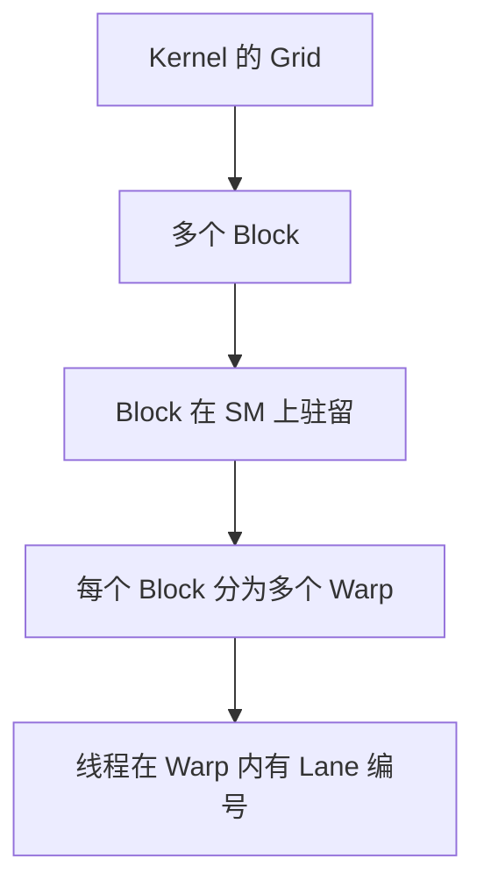
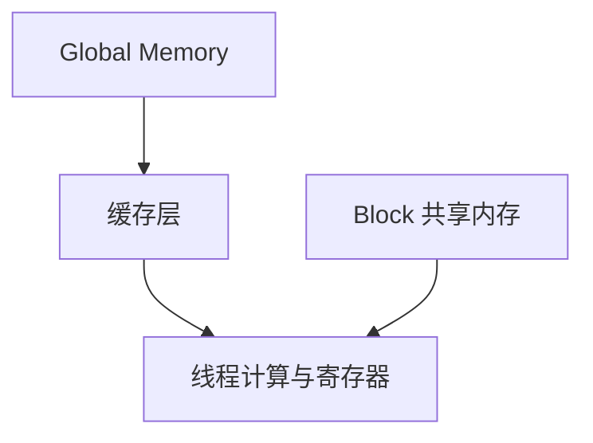

<!-- 由 scripts/sync-obsidian.mjs 从 Obsidian Vault 生成，请勿直接编辑。 -->

> 学习导航：[01 GPU硬件与内存](/posts/obsidian/01-gpu%E7%A1%AC%E4%BB%B6%E4%B8%8E%E5%86%85%E5%AD%98/) · [02 GPU性能理论](/posts/obsidian/02-gpu%E6%80%A7%E8%83%BD%E7%90%86%E8%AE%BA/) · [03 Reduction逐版代码与解析](/posts/obsidian/03-reduction%E9%80%90%E7%89%88%E4%BB%A3%E7%A0%81%E4%B8%8E%E8%A7%A3%E6%9E%90/)

# CUDA 核心概念复习笔记（一）：体系结构、线程分层与内存模型

> [!NOTE] 知识来源说明
> 本文内容基于现代 GPU 体系结构与通用并行计算通用原理梳理，不针对特定具体硬件型号的定制参数，旨在帮助具备 C++ 背景的开发者建立清晰、严谨的软硬件映射直觉。

---

## 1. 硬件视角：GPU 与 SM (Streaming Multiprocessor)

对于传统 C++ 开发者而言，CPU 通常由少数几个高主频、配备庞大缓存（L1/L2/L3）以及高度复杂分支预测与乱序执行引擎的核心构成，目标是**最小化单线程延迟（Latency）**。

与此相反，GPU 的设计哲学是**最大化吞吐量（Throughput）**：将大量的硅片面积让位给算术逻辑单元（ALU），通过成千上万个线程的并发执行，利用硬件级的快速上下文切换来实现**延迟隐藏（Latency Hiding）**。

### 1.1 GPU 芯片与 SM
- **GPU (Device)**：完整的片上系统，内部集成了数十至上百个独立计算单元——**SM（流式多处理器，Streaming Multiprocessor）**，以及跨 SM 共享的片上 L2 缓存、内存控制器和高带宽板载显存（DRAM / Global Memory）。
- **SM (Streaming Multiprocessor)**：GPU 的核心计算集群（相当于 CPU 的一个独立多核集群）。每个 SM 都是一个独立的硬件执行环境，拥有独立的控制单元、寄存器堆、共享内存与缓存。

### 1.2 SM 内部执行单元构成
每个 SM 内部主要包含以下硬件组件：
- **Warp Scheduler（线程束调度器）**：负责在每个周期检查就绪的 Warp，并决定将指令发射到哪个执行流水线。
- **Dispatch Units（指令分发单元）**：负责将调度器选中的指令分派给具体的硬件执行单元。
- **CUDA Cores (ALU / FP32 / INT32)**：最基础的标量运算单元，负责单精度浮点与整型基础运算。
- **DP Units (FP64)**：双精度浮点运算单元。
- **SFU (Special Function Units)**：特殊函数单元，硬件加速实现 `sin`、`cos`、`sqrt`、`log` 等超越函数。
- **LD/ST Units (Load/Store)**：专职负责从各级存储器加载和写回数据的访存通道。
- **Register File（寄存器堆）**：SM 内极其高速的片上存储，由该 SM 上驻留的所有活跃线程动态切分共享。
- **Shared Memory / L1 Cache**：超低延迟的片上高速 SRAM 存储器。

---

## 2. 软件编程模型 vs 硬件执行模型

CUDA 编程的核心难点之一在于理清**软件编写概念**与**硬件执行实体**之间的映射关系。

### 2.1 概念层次对比表

| 维度 / 粒度 | 软件抽象模型 (Software Model) | 硬件执行实体 (Hardware Architecture) | 映射关系与生命周期 |
| :--- | :--- | :--- | :--- |
| **应用级** | **Grid（网格）** | **GPU Device（完整芯片）** | 一个核函数调用（Kernel Launch）对应一个 Grid，由 GPU 调度执行；使用多少 SM 取决于任务规模和资源限制。 |
| **协同级** | **Block（线程块）** | **SM（流式多处理器）** | 一个 Block **仅能分配到某一个 SM** 上执行；一个 SM 可同时驻留多个 Block。 |
| **调度级** | *(无显式语法，系统隐式切分)* | **Warp（线程束，32 线程）** | **硬件调度的最小原子单位**；SM 调度器每次挑选 1 个就绪 Warp 发射指令。 |
| **基本单元** | **Thread（线程）** | **CUDA Core / ALU 通道** | 软件逻辑上的最小执行单元，不永久独占某个 CUDA Core。 |
| **束内标识** | **`threadIdx.x % 32`** | **Lane（通道 ID: 0 ~ 31）** | Warp 内部 32 个物理并行槽位之一。 |

### 2.2 软硬件关系



一个 SM 可同时驻留多个 Block，数量受资源和硬件上限约束。线程不永久绑定某个 CUDA Core。

---

## 3. 硬件执行核心：Warp、Lane 与 256 线程实例剖析

### 3.1 SIMT (Single Instruction, Multiple Threads) 机制
与 CPU 的 SIMD（如 AVX2/AVX-512 中显式操作向量寄存器 `__m256`）不同，CUDA 采用 **SIMT** 模式：
- 开发者写代码时仅关注**单标量线程**（Scalar Thread）的控制流。
- Block 的线程按线性编号每 32 个分为一个 Warp，最后一个 Warp 可以不足 32 个线程。
- Warp 是指令调度的重要单位。现代 GPU 支持线程独立调度状态，不能假定线程始终共用一个 PC，也不能假定内存访问自动同步。
- Lane 是线程在 Warp 中的位置，编号 0 到 31；它不是线程永久独占的 CUDA Core。

### 3.2 深入拆解：以 256 线程的 Block 为例

假定在 Host 端配置一维 Block 启动核函数：`dim3 block(256);`

> [!IMPORTANT] 256 线程划分细节
> - **线程总数**：$256$（`threadIdx.x` 取值范围 `0 ~ 255`）
> - **Warp 大小**：通用固定常数 $32$
> - **Warp 数量**：$256 \div 32 = 8$ 个 Warp（编号 `Warp 0` ~ `Warp 7`）

#### 划分对应明细表

| Warp 编号 | 线程索引范围 (`threadIdx.x`) | 硬件 Lane 对应 (`Lane 0 ~ 31`) |
| :---: | :---: | :---: |
| **Warp 0** | $0 \sim 31$ | `threadIdx.x = 0` $\to$ Lane 0, ..., `threadIdx.x = 31` $\to$ Lane 31 |
| **Warp 1** | $32 \sim 63$ | `threadIdx.x = 32` $\to$ Lane 0, ..., `threadIdx.x = 63` $\to$ Lane 31 |
| **Warp 2** | $64 \sim 95$ | `threadIdx.x = 64` $\to$ Lane 0, ..., `threadIdx.x = 95` $\to$ Lane 31 |
| **Warp 3** | $96 \sim 127$ | `threadIdx.x = 96` $\to$ Lane 0, ..., `threadIdx.x = 127` $\to$ Lane 31 |
| **Warp 4** | $128 \sim 159$ | `threadIdx.x = 128` $\to$ Lane 0, ..., `threadIdx.x = 159` $\to$ Lane 31 |
| **Warp 5** | $160 \sim 191$ | `threadIdx.x = 160` $\to$ Lane 0, ..., `threadIdx.x = 191` $\to$ Lane 31 |
| **Warp 6** | $192 \sim 223$ | `threadIdx.x = 192` $\to$ Lane 0, ..., `threadIdx.x = 223` $\to$ Lane 31 |
| **Warp 7** | $224 \sim 255$ | `threadIdx.x = 224` $\to$ Lane 0, ..., `threadIdx.x = 255` $\to$ Lane 31 |

#### 计算公式
对于任一线程 `threadIdx.x`：
- 所属 Warp 索引：`warp_id = threadIdx.x / 32;`
- 所处 Lane 槽位：`lane_id = threadIdx.x % 32;`

#### 关键推论：分支分化（Warp Divergence）
若在代码中出现条件分支：
```cpp
// 示例：假设在 256 线程的 Block 中
if (threadIdx.x % 2 == 0) {
    do_path_A();
} else {
    do_path_B();
}
```
当一个 Warp 内的线程走不同分支时：
1. 在每个 Warp（如 `Warp 0`）中，偶数 Lane 执行 `do_path_A()` 时，奇数 Lane 必须硬件挂起（屏蔽执行）。
2. 随后切换执行 `do_path_B()`，奇数 Lane 激活，偶数 Lane 挂起。
3. 两条路径可能由不同活动线程分别执行，导致额外开销；实际耗时受编译器和硬件影响。
4. **反例**：若改为 `if (threadIdx.x < 128)`，则 `Warp 0~3` 整束执行 Path A，`Warp 4~7` 整束执行 Path B，**Warp 内部无分化**，该条件不会造成 Warp 内部分化，但不代表整个 Kernel 没有其他性能损失。

---

## 4. 线程全局索引计算 (tid)

编写核函数的第一步是将多维线程坐标展平为一维物理数据偏移量（类似于 C++ 二维数组行优先索引 `i * cols + j`）。

### 4.1 内置坐标变量
- `gridDim`：Grid 的维度大小（有多少个 Block）。
- `blockDim`：Block 的维度大小（每个 Block 包含多少个 Thread）。
- `blockIdx`：当前 Block 在 Grid 内的三维坐标。
- `threadIdx`：当前 Thread 在其所在 Block 内的三维坐标。

### 4.2 一维索引公式与推导
当 Grid 与 Block 均为一维时：

```cpp
// 线性绝对索引计算
int tid = blockIdx.x * blockDim.x + threadIdx.x;
```

#### 推导逻辑
- `blockIdx.x`：当前 Block 前面排了几个 Block。
- `blockIdx.x * blockDim.x`：跳过前面所有 Block 所包含的线程总数。
- `+ threadIdx.x`：加上当前线程在当前 Block 内部的局部偏移。

#### 边界防护（Guard）
如果按向上取整计算 Block 数，且 $N$ 不是 `blockDim.x` 的倍数，启动的线程数会大于 $N$。必须加入边界检查：
```cpp
__global__ void vectorAdd(const float* A, const float* B, float* C, int N) {
    int tid = blockIdx.x * blockDim.x + threadIdx.x;

    // 越界保护，防止段错误与显存破坏
    if (tid < N) {
        C[tid] = A[tid] + B[tid];
    }
}
```

### 4.3 二维图像/矩阵映射公式
对于二维数据矩阵（宽度 `width`，高度 `height`）：
```cpp
int col = blockIdx.x * blockDim.x + threadIdx.x; // X 对应水平列号
int row = blockIdx.y * blockDim.y + threadIdx.y; // Y 对应垂直行号

if (col < width && row < height) {
    int tid = row * width + col; // 行优先展平为一维内存地址
    data[tid] = ...;
}
```

---

## 5. CUDA 内存层级与存储结构

GPU 的存储体系结构设计高度分化，理解每一层存储的生命周期、可见范围与访问延迟是性能优化的核心基石。

### 5.1 各级存储与可见范围

| 类型 | 通常的位置 | 作用范围 |
| --- | --- | --- |
| 寄存器 | SM 片上 | 线程私有，保存局部值和中间结果 |
| Shared Memory | SM 片上 | 同一个 Block 的线程显式共享，读写协作需要同步 |
| Local Memory | 设备内存地址空间，可经缓存访问 | 逻辑上线程私有，可能保存溢出数据或局部数组 |
| L1 / L2 缓存 | 芯片内 | 缓存部分访存；L1 通常按 SM，L2 通常跨 SM 共享 |
| Global Memory | 全局地址空间，数据通常位于设备显存 | 设备线程可访问，Host 通常通过 CUDA API 拷贝 |

Local Memory 的“局部”指作用范围，不保证在片上。实际延迟受架构、缓存命中和访问模式影响。

### 5.2 数据关系示意



图仅说明作用，不表示所有数据都必须经过完全相同的路径。

### 5.3 关键存储概念深究

#### 1. 寄存器 (Registers) 与溢出 (Spill)
- 每个线程独占属于它自己的寄存器。
- SM 内的寄存器总量是物理固定的。每线程寄存器需求降低有时能增加驻留 Block 数；还受分配粒度、共享内存和硬件上限影响。
- 若核函数内部定义过多大型本地局部数组或复杂逻辑导致寄存器不够，编译器可能将部分数据放到 **Local Memory（局部内存）**。它逻辑上线程私有，可经缓存访问；额外访存可能影响性能。

#### 2. 共享内存 (Shared Memory)
- 是程序员显式管理的块内共享存储；部分架构和 L1 共用片上资源，但并不等同于自动管理的 L1 缓存。
- 用于解决全局内存带宽瓶颈：先将需要重复访问的数据从全局内存协作加载到共享内存，计算完成后再统一写回。
- 物理上划分为 32 个交错的存储体（**Banks**）。若 Warp 内部多个 Lane 同时访问同一个 Bank 且地址不同，会引发 **Bank Conflict（存储体冲突）** 导致串行化执行。

#### 3. 全局内存 (Global Memory) 与合并访存 (Coalesced Access)
- 容量最大，可由 CPU（Host）通过 `cudaMemcpy` 写入读出。
- **合并访存机制**：Warp 内 32 个线程在同一条加载指令中访问连续对齐的显存空间时，硬件会合并请求，所需扇区和事务取决于地址、对齐、访问宽度及架构。例如一个完整 Warp 各线程读取相邻 float 且地址按 32 字节对齐时，通常覆盖 4 个 32 字节扇区。若跨步稀疏访问（如跳跃遍历步长较大的矩阵列），会造成极大的显存带宽浪费。

---

## 6. 线程同步与执行协同

并行体系中，必须提供机制让互相独立的执行单元在关键计算节点处实现步调一致。

### 6.1 `__syncthreads()` 同步栅障
CUDA 最基础的核心原语是块内同步栅障 `__syncthreads()`。

#### 核心作用
1. **执行栅障（Execution Barrier）**：同一个 Block 内部的**所有线程**必须全部运行到该行代码，在未全部到达前，任何一个线程都不得跨越栅障继续向下执行。
2. **内存栅障（Memory Fence）**：确保该栅障之前所有线程对 `__shared__` 内存的写入操作对当前 Block 内的所有其他线程完全可见。

#### 经典用法模式（分批协作加载共享内存）
```cpp
__global__ void sharedMemoryDemo(const float* input, float* output) {
    __shared__ float s_data[256];
    int tid = threadIdx.x;

    // 阶段 1：256 个线程协作从慢速 Global Memory 并发读取数据到片上 Shared Memory
    s_data[tid] = input[blockIdx.x * blockDim.x + tid];

    // 关键：等待 256 个线程全部搬运完成，否则后续读数据可能读到未初始化的脏数据
    __syncthreads();

    // 阶段 2：安全消费共享内存中的相邻数据
    float temp = 0.0f;
    if (tid > 0) {
        temp = s_data[tid - 1] + s_data[tid]; // 安全访问相邻线程写入的数据
    }

    // 阶段 3：再次同步（如果后续还涉及对 s_data 的二次写入）
    __syncthreads();

    output[blockIdx.x * blockDim.x + tid] = temp;
}
```

### 6.2 致命隐患：分支死锁 (Deadlock)
> [!CAUTION] 栅障条件分支死锁规则
> `__syncthreads()` **绝不能**置于包含条件散布的分支内部，除非该条件的计算结果对整块 Block 内的所有线程**严格恒等**。

#### 错误范例
```cpp
if (threadIdx.x < 128) {
    // 严重错误！
    // 只有 Warp 0~3 的 128 个线程能运行至此，Warp 4~7 的后 128 个线程永远不会执行这行。
    // 硬件将无限期挂起并导致整个系统或核函数挂起（死锁/超时崩溃）。
    __syncthreads();
} else {
    // ...
}
```

---

## 7. 核心要点速查清单

- **SM** 是物理核集群，**Block** 是软件并行块，Block 不能跨 SM 运行。
- **Warp** 是最核心的执行调度单位（固定包含 32 个逻辑线程），也是硬件资源利用率和分支分化考察的基准。
- 一维索引推导牢记：`int tid = blockIdx.x * blockDim.x + threadIdx.x;`，数组访问需要边界保护，grid-stride 循环也可使用循环条件保护。
- 速度梯度：`寄存器 > 共享内存/L1 >> L2 >> 全局内存 (DRAM)`。
- `__syncthreads()` 仅保证**同一个 Block 内部**同步，不同 Block 之间在 CUDA 编程模型中**默认不可假定任何执行先后顺序**。

---

---

## 资料与核对范围

- 项目代码：`/home/sanzenin/test/cuda_learn/kernels/reduce_float.cu`。
- NotebookLM `ai infra`：[parallel101 atomic 示例](https://github.com/parallel101/course/tree/aa7715d26b55bda8ad7a9444a923c916eda30b7f/08/07_atomic)、[Block 规约示例](https://github.com/parallel101/course/tree/aa7715d26b55bda8ad7a9444a923c916eda30b7f/08/08_block)。
- [NVIDIA CUDA 12.4 Best Practices Guide](https://docs.nvidia.com/cuda/archive/12.4.0/cuda-c-best-practices-guide/index.html)；[Warp Shuffle 官方说明](https://docs.nvidia.com/cuda/cuda-programming-guide/05-appendices/cpp-language-extensions.html)。
