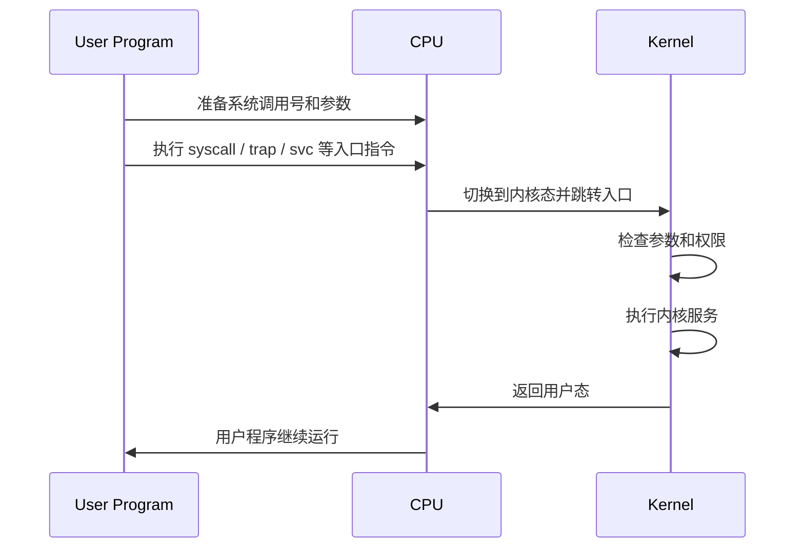

<!-- 由 scripts/sync-obsidian.mjs 从 Obsidian Vault 生成，请勿直接编辑。 -->

# 系统完整性：用户态、内核态与系统调用

系统完整性要解决的问题是：普通程序可以运行，但不能随意破坏操作系统、硬件和其他进程。

核心手段有三类：

- CPU 运行模式；
- 特权指令；
- 内存管理和中断机制。

先把这一节的边界说清楚：这里的“中断”在视频里有时被泛化使用，实际教材里通常会区分 interrupt、trap、fault、system call。它们都会让 CPU 转入内核控制流，但触发原因和返回语义并不完全一样。

## 指令集和特权指令

CPU 指令集中有些指令太危险，不能让普通程序随便执行。例如：

- 修改页表；
- 关闭中断；
- 设置定时器；
- 直接访问 I/O 设备；
- 切换运行模式；
- 修改内核关键寄存器。

这些指令叫 privileged instructions。为了限制它们，硬件必须支持不同运行模式。


普通应用运行在用户态，只能执行安全的普通指令，例如移动数据、复制数据、算术运算、浮点运算、位运算、条件跳转和循环。

## 用户态和内核态

CPU 内部会有某种模式位或特权级字段，用来表示当前处于用户态还是内核态。不同架构叫法不同，但思想一致。

| 模式 | 能做什么 |
|---|---|
| User Mode | 运行普通程序，不能直接控制硬件和关键系统结构 |
| Kernel Mode | 运行操作系统内核，可以执行特权指令 |


这种隔离不是操作系统单方面约定出来的，而是硬件执行指令时就会检查权限。用户态程序如果执行特权指令，CPU 会触发异常，把控制权交给内核。

## 中断、异常和陷入

CPU 执行程序时，程序计数器指向下一条要执行的指令。某些事件发生后，CPU 会暂停当前执行流，跳转到预先设置好的内核入口。

这些事件常见地分为：

| 类型 | 来源 | 例子 | 特点 |
|---|---|---|---|
| Interrupt | 外部硬件 | 定时器、键盘、磁盘、网卡 | 和当前指令流不一定有关，通常是异步的 |
| Trap | 程序主动进入内核 | 系统调用、断点 | 当前程序有意触发，通常是同步的 |
| Fault | 当前指令执行出问题 | 缺页、除零、非法访问 | 内核处理后可能重试这条指令，也可能杀死进程 |

定时器中断让操作系统能够周期性重新获得 CPU 控制权。没有定时器中断，用户程序如果进入死循环，抢占式调度就很难成立。

## MMU 和内存保护


MMU 是 Memory Management Unit，负责把虚拟地址转换成物理地址，并检查访问权限。

内核通过特权指令配置 MMU：

- 哪些虚拟地址映射到哪些物理页；
- 哪些页可读、可写、可执行；
- 哪些页只允许内核访问；
- 用户态是否允许访问某段内存。

这就是为什么普通进程不能覆盖中断处理程序。中断处理代码所在页面属于内核地址空间，用户态访问会被 MMU 拦下。

如果用户进程能直接改中断处理程序，它就可以在下一次中断时劫持内核控制流，整个系统安全性会崩掉。

## 系统调用

普通程序不能直接操作硬件，但它确实需要读文件、分配内存、创建进程、访问网络。解决方法是系统调用。

还要区分两个层次：

- API：程序员调用的库函数，例如 C 标准库或 POSIX 函数；
- system call：真正进入内核的二进制接口。

很多 API 会包装系统调用，但不是每个库函数都会进入内核。例如 `printf` 可能先写用户态缓冲区，缓冲区刷新时才调用 `write`。


系统调用的基本流程：



系统调用是受控入口。用户程序不是直接进入任意内核代码，而是只能进入操作系统暴露的固定入口，由内核检查参数、权限和资源状态。

## 驱动程序


驱动程序是控制特定硬件的软件。因为控制硬件通常需要特权指令、DMA、I/O 端口或 MMIO 权限，传统驱动一般运行在内核态。

现代系统也存在用户态驱动或微内核式驱动模型，但它们仍然需要内核授予受控权限，不能绕过硬件保护机制。

用户程序需要硬件时，不直接操作设备，而是调用操作系统接口。内核再通过对应驱动完成实际操作。

例如读磁盘文件：

```text
user program
  -> read() system call
  -> kernel VFS
  -> filesystem
  -> block device driver
  -> disk controller
```

这样做的意义是把硬件细节和危险权限收在内核里。普通程序只拿到受限制的接口，不能随意改设备寄存器或破坏其他进程的数据。
