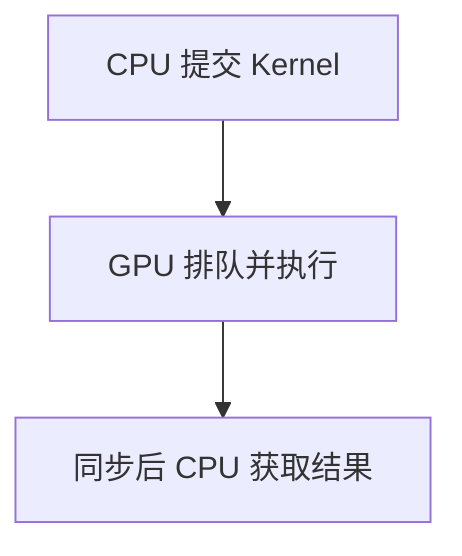

<!-- 由 scripts/sync-obsidian.mjs 从 Obsidian Vault 生成，请勿直接编辑。 -->

> 学习导航：[01 GPU硬件与内存](/posts/obsidian/01-gpu%E7%A1%AC%E4%BB%B6%E4%B8%8E%E5%86%85%E5%AD%98/) · [02 GPU性能理论](/posts/obsidian/02-gpu%E6%80%A7%E8%83%BD%E7%90%86%E8%AE%BA/) · [03 Reduction逐版代码与解析](/posts/obsidian/03-reduction%E9%80%90%E7%89%88%E4%BB%A3%E7%A0%81%E4%B8%8E%E8%A7%A3%E6%9E%90/)

# CUDA 核心复习笔记（二）：延迟、吞吐与性能模型

> [!abstract] 核心目标
> 本篇系统梳理 GPU 体系结构中的关键性能度量：厘清**延迟**与**吞吐**的物理本质，推导**理论带宽**与**有效带宽**公式，深入理解**合并访存**与 **Occupancy** 的真实代价，建立**算术强度**与**简化 Roofline 模型**的分析直觉，并掌握基于 **CUDA Event** 进行无偏基准测试的标准范式。

---

## 1. 延迟（Latency）与吞吐（Throughput）

### 1.1 核心概念拆解

*   **延迟（Latency）**：完成**单次**操作从发起到获得结果所经历的时间。
    *   单位：纳秒（$\text{ns}$）或时钟周期（Clock Cycles）。
    *   典型场景：一条算术指令在管线中的流水延迟（如 4~16 个周期）；一次未命中缓存的全局显存访问延迟（通常为 200~800 个周期）。
*   **吞吐（Throughput）**：系统在**单位时间**内完成的操作总量或传输的数据总量。
    *   单位：$\text{TFLOPS}$（每秒万亿次浮点运算）、$\text{GB/s}$（每秒十亿字节传输）。
*   **吞吐量 vs 吞吐效率（Throughput vs. Efficiency）**：
    *   **吞吐量**是绝对产出（如内核跑出了 $400\text{ GB/s}$）。
    *   **吞吐效率**是实际吞吐量与硬件理论上限的比值（如 $\frac{400\text{ GB/s}}{500\text{ GB/s}} = 80\%$）。高效率意味着逼近物理极限，但若算法本身包含了冗余访存或无效计算，即便硬件效率达到 $95\%$，整体算法实现依然可能是低效的。

### 1.2 直观数值对比：货车运货模型

考虑从仓库（DRAM）向车间（SM）运送零件：
*   **单辆卡车**：容量 100 件零件，单程行驶时间 1 小时。
    *   延迟 = $1\text{ 小时}$。
    *   若仅有 1 辆车循环运作，吞吐量 = $\frac{100\text{ 件}}{1\text{ 小时}} = 100\text{ 件/小时}$。
*   **物流车队（GPU 并发模型）**：公路非常宽，可以容纳 20 辆卡车同时在路上行驶（并发流水线）。
    *   延迟依然是 $1\text{ 小时}$（单辆车不可能跑得更快）。
    *   但路上时刻维持 20 辆车，平均每 3 分钟就有一辆车抵达终点。
    *   此时系统吞吐量 = $\frac{20 \times 100\text{ 件}}{1\text{ 小时}} = 2000\text{ 件/小时}$。
*   **GPU 的设计哲学**：不惜牺牲单线程延迟（CPU 擅长用大缓存与分支预测压低单任务延迟），通过成千上万个并发线程来最大化整体吞吐量。

---

## 2. 存储带宽与计量单位：理论带宽 vs 有效带宽

### 2.1 字节计量陷阱：GB 与 GiB

计算显存带宽与容量时，必须严格区分十进制与二进制前缀：

| 单位名称 | 符号 | 字节数定义 | 常用场景 |
| :--- | :--- | :--- | :--- |
| **Gigabyte** | $\text{GB}$ | $10^9 = 1,000,000,000\text{ B}$ | 硬件厂商规格、显存物理带宽、网络传输 |
| **Gibibyte** | $\text{GiB}$ | $2^{30} = 1,073,741,824\text{ B}$ | 操作系统显存占用、`cudaMalloc` 分配空间 |

> [!warning] 误差提示
> $1\text{ GiB} \approx 1.074\text{ GB}$。用 $1024^3$ 得到的是 GiB/s；用 $10^9$ 得到 GB/s。比较实测与理论值时必须统一单位。

### 2.2 显存理论峰值带宽

若给出每个引脚的**有效数据速率**和总线位宽：

$$\text{理论带宽（GB/s）}=\frac{\text{有效速率（Gb/s/引脚）}\times\text{位宽（bit）}}{8}$$

例如速率为 20 Gb/s、位宽为 384 bit，理论带宽为 $20\times384/8=960$ GB/s。这是假设示例，不是你的 GPU 的实测值。若使用真实时钟而非有效速率，需要按显存类型换算，不要重复乘倍数。

### 2.3 有效带宽（Effective Bandwidth）

有效带宽指内核在单位时间内完成**算法逻辑上必需**的数据搬运速率：

$$\text{Effective Bandwidth (GB/s)} = \frac{B_r + B_w}{t \times 10^9}$$

*   $B_r$：算法逻辑上从全局显存读取的总字节数。
*   $B_w$：算法逻辑上写回全局显存的总字节数。
*   $t$：内核纯执行耗时（秒，$\text{s}$）。

*   **数值示例**：
    *   对长度 $N = 67,108,864$（即 $64\times 2^{20}$ 个元素）的 `float` 单精度数组进行向量复制（$Y[i] = X[i]$）。
    *   每个 `float` 占 $4\text{ 字节}$。
    *   $B_r = 67,108,864 \times 4\text{ B} = 268,435,456\text{ B}$。
    *   $B_w = 67,108,864 \times 4\text{ B} = 268,435,456\text{ B}$。
    *   数据总量 $B_{\text{total}} = B_r + B_w = 536,870,912\text{ B}$（约 $0.537\text{ GB}$）。
    *   假设使用 CUDA Event 测得内核执行耗时 $t = 0.8\text{ ms} = 0.0008\text{ s}$。
    *   **计算**：
        $$\text{Effective Bandwidth} = \frac{536,870,912}{0.0008 \times 10^9} \approx 671.09\text{ GB/s}$$

> [!note] 核心边界：L2 缓存导致的“超额带宽”现象
> *   **现象**：有时计算出的有效带宽会**明显超过**硬件 DRAM 的物理理论带宽（例如在理论峰值 $960\text{ GB/s}$ 的卡上算出了 $1500\text{ GB/s}$）。
> *   **原因**：有效带宽公式中的 $B_r$ 和 $B_w$ 是基于**算法代码逻辑**计算的。若数据在片上 L2 缓存（甚至 L1/Shared Memory）中具有极高的复用率，实际发往片外 DRAM 的物理请求极少，大部分访存直接命中 L2（缓存与显存的吞吐取决于架构和访问模式）。
> *   **适用边界**：
>     1. **有效带宽**反映的是“算法层面的数据消费速率”。
>     2. 若要评估“显存物理总线饱和度”，必须使用 Nsight Compute 采集底层 DRAM 物理吞吐指标（如 `dram__bytes.sum`），不能仅凭算法逻辑大小与物理峰值直接相除。

---

## 3. 合并访存（Coalesced Memory Access）

### 3.1 硬件物理机制

GPU 全局显存的物理访问不是按字节为单位发起的，而是按**固定大小、自然对齐的内存段（Memory Transactions，通常为 32 字节 Sector）**进行传输。
一个 Warp（32 个线程）在执行单条全局访存指令时，硬件访存单元会计算这 32 个线程所请求地址的覆盖范围，并将其折叠为尽可能少的 32 字节物理事务。

*   **合并访存（Coalesced）**：Warp 内 32 个线程访问的地址紧密相邻且对齐在 32 字节边界内，硬件只需最少次数的显存事务即可满足全组需求。
*   **非合并访存（Uncoalesced）**：访问地址分散、跨步较大或未对齐，迫使硬件发起大量事务，每次事务中仅有极小部分是有效数据。

### 3.2 逐步数值对比：连续访问 vs 跨步访问

假设一个 Warp（32 线程）中，每个线程需要读取一个 4 字节的 `float` 数据（全 Warp 共需 $32 \times 4\text{ B} = 128\text{ 字节}$ 有效数据）：

```
线程编号:  T0   T1   T2  ...  T31
需求大小:  4B   4B   4B  ...  4B  (总计 128B)
```

#### 情况 A：对齐连续合并（Stride = 1）
*   **地址分布**：线程 $k$ 访问基准地址 $\text{Base} + 4k$（假设 $\text{Base}$ 已经 128 字节对齐）。
*   **地址范围**：$[0, 127]\text{ 字节}$。
*   **事务产生**：该区间恰好跨越 4 个连续的 32 字节 Sector（$4 \times 32\text{ B} = 128\text{ B}$）。
*   **物理传输**：硬件发出 4 次 32 字节事务，共传输 $128\text{ 字节}$。
*   **总线利用率（Bus Efficiency）**：
    $$\text{Efficiency} = \frac{\text{有效载荷}}{\text{物理传输}} = \frac{128\text{ B}}{128\text{ B}} = 100\%$$

#### 情况 B：跨步非合并（Stride = 32）
*   **地址分布**：线程 $k$ 访问地址 $\text{Base} + 4k \times 32 = \text{Base} + 128k$。
*   **地址特征**：每个线程所请求的 4 字节数据，落在了完全不同的 32 字节 Sector 中。
*   **事务产生**：32 个线程的地址互不属于任何同一个 Sector，硬件必须发出 **32 次独立的 32 字节事务**。
*   **物理传输**：总共搬运 $32 \times 32\text{ B} = 1024\text{ 字节}$。
*   **总线利用率**：
    $$\text{Efficiency} = \frac{128\text{ B}}{1024\text{ B}} = 12.5\%$$
*   **结论**：同样的计算代码，仅因访存步长不同，此示例中请求覆盖的扇区字节数增加 8 倍；实际 DRAM 流量与运行时间还受缓存及其他瓶颈影响。

---

## 4. Occupancy 的精确定义与延迟隐藏

### 4.1 Occupancy 精确定义

**Occupancy（占用率）** 是衡量 SM 计算资源预定程度的度量：

$$\text{Occupancy} = \frac{\text{SM 上的当前活跃 Warp 数（Active Warps）}}{\text{SM 支持的理论最大活跃 Warp 数（Maximum Active Warps）}}$$

*   **活跃 Warp（Active Warp）**：已经分配好寄存器和共享内存资源，常驻在 SM 上等待或正在被执行的 Warp。
*   限制活跃 Warp 数量的硬性资源（木桶效应，取决于瓶颈项）：
    1. **寄存器堆大小（Register File Size）**：每个 SM 总寄存器有限，每线程使用的寄存器越多，能容纳的线程越少。
    2. **共享内存容量（Shared Memory Size）**：每个 Block 申请的动态/静态共享内存。
    3. **SM 调度上限**：最大 Block 数限制（例如每 SM 最多 16 或 32 个 Block）及最大线程总数限制（例如每 SM 最多 1024 或 2048 线程）。

### 4.2 资源瓶颈推算实例

假设某 GPU 架构的单个 SM 规格如下：
*   最大支持 Warp 数：$64$（即最多 2048 线程）。
*   最大支持 Block 数：$32$。
*   SM 寄存器总数：$65536$（64K 个 32-bit 寄存器）。
*   SM 共享内存容量：$64\text{ KB}$。

现在启动一个内核，配置如下：
*   每个 Block 拥有 $256$ 个线程（即 $256 / 32 = 8$ 个 Warp）。
*   编译期分析显示：每个线程使用 $40$ 个寄存器。
*   每个 Block 申请静态共享内存 $16\text{ KB}$。

**步骤计算**：
1.  **线程数限制**：
    $\text{Max Blocks}_{\text{thread}} = \lfloor 2048 / 256 \rfloor = 8\text{ 个 Block}$。
2.  **寄存器限制**：
    每个 Block 需消耗：$256 \times 40 = 10240$ 个寄存器（注：硬件通常按 allocation granule 分配，此处取简化整数）。
    $\text{Max Blocks}_{\text{reg}} = \lfloor 65536 / 10240 \rfloor = 6\text{ 个 Block}$。
3.  **共享内存限制**：
    $\text{Max Blocks}_{\text{smem}} = \lfloor 64\text{ KB} / 16\text{ KB} \rfloor = 4\text{ 个 Block}$。
4.  **最终驻留 Block 数**：
    $$\text{Active Blocks} = \min(8, 6, 4) = 4\text{ 个 Block}$$
5.  **计算 Occupancy**：
    *   当前活跃 Warp 数 $= 4\text{ Blocks} \times 8\text{ Warps/Block} = 32\text{ Warps}$。
    *   $$\text{Occupancy} = \frac{32}{64} = 50\%$$

### 4.3 隐藏延迟

Warp 0 等待显存读取时，如果同一 SM 上有其他**已就绪**的 Warp，调度器可以先发射它们的指令，减少计算单元的空等。

驻留的 Warp 不一定随时就绪；如果都在等待依赖或同一瓶颈，增加数量也不保证能继续发射指令。独立操作可以增加在途工作量，是否足够需结合架构和实测。

### 4.4 避坑指南：为什么 Occupancy 并不是越高越好？

> [!warning] 辟谣：不要盲目追求 100% Occupancy
> 高 Occupancy 仅表示驻留 Warp 相对较多，并不表示这些 Warp 已经就绪，它并不等于**高性能**。过度追求 Occupancy 往往会适得其反：

1.  **寄存器溢出（Register Spilling）**：
    为了拉高 Occupancy，开发者常使用编译指令（如 `__launch_bounds__`）强行限制每个线程使用的寄存器数量。如果线程计算原本需要更多临时变量，受限的变量会被溢出到**局部显存（Local Memory）**中，本质上落入全局显存/L1 Cache，导致大量额外的显存访问，整体执行时间暴增。
2.  **指令级并行（ILP）替代线程级并行（TLP）**：
    隐藏延迟并非只能靠“堆线程”。单个线程如果具备独立的计算流（例如展开循环以发起多个互不依赖的读取），单个 Warp 就能在流水线中维持多笔 in-flight 操作。
    *   高性能 Kernel 的 Occupancy 不一定达到 100%；具体性能需要在目标硬件上测量。
3.  **缓存冲突（Cache Thrashing）**：
    过多活跃线程同时竞争有限的片上 L1/L2 缓存，导致缓存驻留时间缩短，命中率骤降。

---

## 5. 指令瓶颈、带宽瓶颈与简化 Roofline 模型

### 5.1 算术强度（Arithmetic Intensity, AI）

算术强度衡量算法在内存搬运成本下的计算纯度：

$$\text{Arithmetic Intensity (AI)} = \frac{\text{算法总浮点运算量（FLOP）}}{\text{算法总数据移动量（Bytes）}} \quad (\text{单位：FLOP/Byte})$$

*   注意分母通常指与 DRAM 交换的物理字节量（或算法最低内存流量）。

### 5.2 简化 Roofline 模型原理

Roofline 模型将硬件性能极限直观描绘为一张折线图：

带宽上限随算术强度增长；当该上限达到计算峰值后，计算峰值构成另一条上限。

1.  **算力天花板（Compute Roof）**：硬件所能提供的最高理论运算能力 $P_{\text{peak}}$（TFLOPS）。
2.  **带宽天花板（Bandwidth Roof）**：受限于显存传输速度，最大性能为 $\text{Attainable Performance} = \text{AI} \times B_{\text{peak}}$。
3.  **系统机器平衡点 / 拐点（Machine Balance, $\text{AI}^*$）**：
    $$\text{AI}^* = \frac{P_{\text{peak}} \text{ (TFLOPS)}}{B_{\text{peak}} \text{ (TB/s)}} = \frac{P_{\text{peak}} \text{ (GFLOPS)}}{B_{\text{peak}} \text{ (GB/s)}}$$

*   **若算法 $\text{AI} < \text{AI}^*$**：位于简化模型的**带宽上限区**；是否真正受带宽限制仍需实测。优化重心：合并访存、降低访存次数、Shared Memory 数据复用、算子融合（Kernel Fusion）。
*   **若算法 $\text{AI} > \text{AI}^*$**：位于简化模型的**计算上限区**；实际还可能受指令发射、延迟等因素限制。优化重心：利用 Tensor Core、提升 ILP、避免分支分歧、使用快速近似数学函数（仅在精度要求允许且确认适用时）。

### 5.3 逐步数值对比：向量加法 vs 矩阵乘法

假设某 GPU 的理论参数如下：
*   理论单精度算力 $P_{\text{peak}} = 10\text{ TFLOPS} = 10,000\text{ GFLOPS}$。
*   理论显存带宽 $B_{\text{peak}} = 500\text{ GB/s}$。
*   **硬件拐点**：
    $$\text{AI}^* = \frac{10000}{500} = 20\text{ FLOP/Byte}$$

#### 内核 1：向量相加（$C[i] = A[i] + B[i]$）
*   **计算量**：每个元素 1 次加法 = $1\text{ FLOP}$。
*   **访存量**：读取 $A[i], B[i]$（各 4 字节），写入 $C[i]$（4 字节），共 $12\text{ 字节}$。
*   **算术强度**：
    $$\text{AI} = \frac{1\text{ FLOP}}{12\text{ Byte}} \approx 0.0833\text{ FLOP/Byte}$$
*   **分析**：$0.0833 \ll 20$，处于极度**带宽受限区**。
*   **理论最高可达性能**：
    $$P_{\text{attainable}} = 0.0833\text{ FLOP/Byte} \times 500\text{ GB/s} \approx 41.65\text{ GFLOPS}$$
*   假设所有逻辑数据均来自 DRAM 且没有其他开销，该简化模型的上限约为计算峰值的 $0.42\%$。实际还应考虑缓存、访存效率与启动开销。

#### 进一步理解

数据复用可以减少从某层内存搬运的字节，从而提高相对于该层内存的算术强度。真实 GEMM 的访存量还取决于尺寸、分块、缓存和输出读写，不能仅凭简化公式断定实际一定计算受限。

---

## 6. GPU Event 性能基准测试与误差分析

### 6.1 为什么直接使用 CPU 计时器会有问题？



*   `cudaLaunchKernel` 是**异步非阻塞**的，CPU 将命令压入驱动队列后瞬间返回（耗时通常仅几微秒）。
*   若直接使用 C++ `std::chrono` 环绕 kernel 调用，测出的仅仅是“CPU 提交任务的时间”，而非“GPU 真正执行的时间”。
*   若在前后插入 `cudaDeviceSynchronize()` 配合 CPU 计时，测量结果不仅包含 Kernel 执行本身，还会混入：
    1. CPU 线程阻塞与唤醒的 OS 上下文切换开销。
    2. PCIe 总线驱动中断往返延迟。
    3. 破坏了 GPU 原本的多 Stream 流水线并发重叠。

### 6.2 CUDA Event 标准测试范式

CUDA Event 直接由 GPU 硬件时间戳引擎在指定的 CUDA 流执行到该点时记录，具有微秒级硬件精度。

```cpp
#include <cuda_runtime.h>
#include <iostream>

void benchmarkKernel() {
    cudaStream_t stream;
    cudaStreamCreate(&stream);

    cudaEvent_t start, stop;
    cudaEventCreate(&start);
    cudaEventCreate(&stop);

    const int WARMUP_ITERS = 10;
    const int BENCHMARK_ITERS = 100;

    // -------------------------------------------------------------
    // 1. 预热阶段 (Warm-up)：淘汰冷启动干扰
    // -------------------------------------------------------------
    for (int i = 0; i < WARMUP_ITERS; ++i) {
        myKernel<<<grid, block, 0, stream>>>(...);
    }
    // 等待预热结束，便于划分测试阶段
    cudaStreamSynchronize(stream);

    // -------------------------------------------------------------
    // 2. 正式测量阶段 (Measurement)
    // -------------------------------------------------------------
    // 向流中插入起始标记
    cudaEventRecord(start, stream);

    // 连续发射多次，摊薄启动与抖动误差
    for (int i = 0; i < BENCHMARK_ITERS; ++i) {
        myKernel<<<grid, block, 0, stream>>>(...);
    }

    // 向流中插入终止标记
    cudaEventRecord(stop, stream);

    // 仅等待 stop 事件被硬件记录，无需全设备激进同步
    cudaEventSynchronize(stop);

    // -------------------------------------------------------------
    // 3. 提取毫秒耗时并推算
    // -------------------------------------------------------------
    float total_ms = 0.0f;
    cudaEventElapsedTime(&total_ms, start, stop);

    float avg_ms = total_ms / BENCHMARK_ITERS;
    std::cout << "Kernel 平均执行时间: " << avg_ms << " ms" << std::endl;

    // 释放资源
    cudaEventDestroy(start);
    cudaEventDestroy(stop);
    cudaStreamDestroy(stream);
}
```

### 6.3 预热（Warm-up）的核心必要性

若跳过预热直接测试，首次执行会包含巨大的系统偏差：
1.  **时钟频率爬坡延迟（Clock Gating / P-State）**：现代 GPU 待机时处于极低功耗档位，收到计算负载到频率升至额定加速频率（Boost Clock）通常需要数毫秒，首个 Kernel 执行往往处于低频降速状态。
2.  **驱动上下文与内存页建立**：Unified Memory 首次缺页中断映射、首次加载模块的 JIT 编译与符号绑定。
3.  **缓存冷启动**：首轮执行完全面对冷的 L2 缓存，与稳态运行表现不符。

### 6.4 误差来源与测试控制

*   **计时分辨率精度**：`cudaEventElapsedTime` 的硬件精度约为 $0.5\,\mu\text{s}$。如果待测内核执行时间极短（如 $< 5\,\mu\text{s}$），单次测量的量化误差可高达 $10\%$ 以上。**对策**：在 `start` 与 `stop` 之间循环执行 $K$ 次（如 100~1000 次），测得总耗时再除以 $K$。
*   **温度墙与动态调频（Thermal Throttling）**：连续重负载测试可能导致 GPU 撞上功耗墙（Power Limit）或温度墙（Temp Limit），触发降频。**对策**：基准测试应监控 `nvidia-smi` 输出的当前时钟频率，确保测试期间 Core Clock 保持恒定。
*   **系统环境排他性**：尽量减少其他后台 GPU 任务，防止其他流抢占 SM 调度资源导致尾部延迟增大。

---

## 7. 概念复习脑图与自测链接

*   延迟与吞吐: 时钟周期 vs 数据吞吐率，区分系统总吞吐与总线利用效率。
*   理论带宽公式: 注意十进制 $10^9$ 转换与总线位宽乘法。
*   合并访存原则: 32 字节对齐、连续、少事务；杜绝大步长跨步。
*   Occupancy 评估: 由寄存器、Shared Memory、最大 Warp 决定；不高估高 Occupancy 的收益，防范 Register Spill。
*   Roofline 分析: 寻找平衡拐点 $\text{AI}^*$；决定是攻坚访存合并还是算子计算流水。
*   GPU 基准测试: 坚持“先预热、批处理、Event 计时、求均值”的原则。

---

---

## 资料与核对范围

- 项目代码：`/home/sanzenin/test/cuda_learn/kernels/reduce_float.cu`。
- NotebookLM `ai infra`：[parallel101 atomic 示例](https://github.com/parallel101/course/tree/aa7715d26b55bda8ad7a9444a923c916eda30b7f/08/07_atomic)、[Block 规约示例](https://github.com/parallel101/course/tree/aa7715d26b55bda8ad7a9444a923c916eda30b7f/08/08_block)。
- [NVIDIA CUDA 12.4 Best Practices Guide](https://docs.nvidia.com/cuda/archive/12.4.0/cuda-c-best-practices-guide/index.html)；[Warp Shuffle 官方说明](https://docs.nvidia.com/cuda/cuda-programming-guide/05-appendices/cpp-language-extensions.html)。
