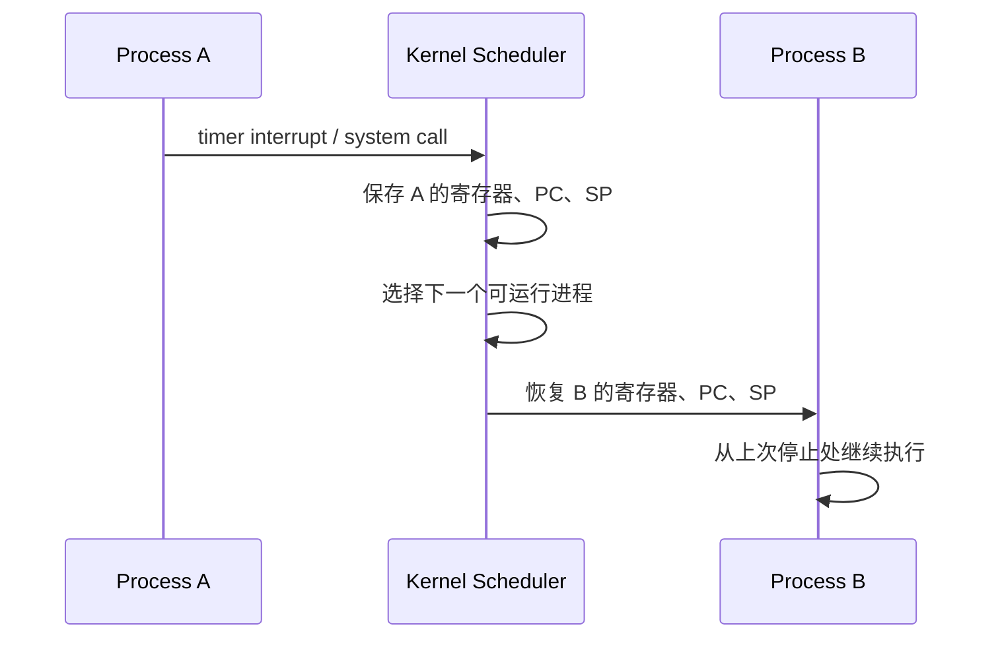

<!-- 由 scripts/sync-obsidian.mjs 从 Obsidian Vault 生成，请勿直接编辑。 -->

# 进程：地址空间、PCB 与上下文


## 程序和进程

程序是一个静态对象：一组已经写好的指令、数据和可执行文件格式。它本身不会“运行”，只是存放在磁盘或内存里的内容。

进程是程序的一次运行实例。程序被操作系统加载后，拥有了自己的执行位置、寄存器状态、地址空间、打开文件、I/O 资源和调度状态，这时它才变成一个活的执行实体。

可以这样区分：

| 概念 | 含义 |
|---|---|
| Program | 静态代码和数据 |
| Process | 正在运行的程序实例 |
| Address Space | 该进程能看到的虚拟内存范围 |
| CPU State | 程序计数器、寄存器、栈指针、标志位等执行现场 |

## 地址空间

操作系统通常会给每个进程分配一个独立的虚拟地址空间。进程内部看到的是一套从低地址到高地址组织起来的虚拟地址；这些虚拟地址最终由 MMU 和页表映射到真实物理内存。

这里的“独立”不是说进程之间永远没有共享。共享库、共享内存、`mmap` 文件、父子进程的 copy-on-write 页面，都可能让多个地址空间映射到同一批物理页。隔离的意思是：进程不能越过页表权限随便访问没有映射给自己的内存。

地址空间通常包含：

- text：程序机器码，通常只读；
- data/bss：全局变量和静态变量；
- heap：动态分配内存，例如 `malloc`；
- mmap 区：共享库、文件映射、匿名映射；
- stack：线程调用栈、局部变量、返回地址。一个进程有多个线程时，每个线程都有自己的用户栈。

隔离地址空间的好处是：一个普通进程不能随便读写另一个进程的内存，也不能直接覆盖内核代码或中断处理程序。

## CPU 如何在多个进程之间切换

单核 CPU 在同一时刻只能真正执行一个进程。多任务的效果来自操作系统调度：把就绪进程放入队列，让它们轮流获得 CPU。


当一个进程被中断或主动让出 CPU 时，操作系统要保存它当前的 CPU 状态，再恢复另一个进程之前保存的 CPU 状态。这个过程就是上下文切换。



注意：上下文切换不是只换一条指令地址，而是换掉“CPU 正在以什么身份运行”的整套上下文。

## PCB：操作系统眼中的进程

进程控制块 PCB 是操作系统维护进程的核心数据结构。视频里给出的简化结构如下：


真实操作系统里的 PCB 会更复杂，但核心思想一样：操作系统必须能从 PCB 中知道这个进程是谁、在哪里运行到一半、占用了哪些资源、下一次如何恢复。

一个简化版 PCB 可以包括：

```rust
ProcessControlBlock {
    pid,
    state,
    program_counter,
    registers,
    stack_pointer,
    memory_limits / address_space,
    open_files,
    io_devices,
}
```

进程切换时，旧任务的寄存器、程序计数器、栈指针等执行现场会保存到内核管理的数据结构中；新任务的对应现场再被加载回 CPU。教材里把这类结构统称 PCB，Linux 中则分散在 `task_struct`、内核栈、架构相关的 `thread_struct` 等位置。

## 创建新进程时操作系统要知道什么


新进程不是简单复制一个文件。以 Unix/Linux 为例，`fork()` 和 `exec()` 做的事情还不一样：

- `fork()` 更像复制当前进程的执行环境，现代系统通常用 copy-on-write 推迟真实内存复制；
- `exec()` 把当前进程的地址空间替换成新程序。

操作系统至少要做这些事：

- 分配 PID；
- 创建内核中的进程描述结构；
- 准备新的地址空间，或者根据创建参数共享父进程的部分资源；
- 建立页表；
- 初始化用户栈和内核栈；
- 设置程序计数器，让它从入口点开始执行；
- 将进程放入调度队列。

如果系统不知道已有进程的地址空间和资源占用情况，就无法安全地给新进程分配内存、文件描述符、信号处理信息等资源。

## Linux 源码中的对应关系

Linux 没有一个直接叫 `PCB` 的结构，最接近的是 `task_struct`。它定义在：

```text
include/linux/sched.h
```

`task_struct` 代表一个可调度实体。Linux 的“进程”和“线程”在内核里都用 `task_struct` 表示，区别主要看它们共享了哪些资源。

几个关键字段可以这样理解：

| Linux 字段 | 含义 |
|---|---|
| `pid` | 这个 task 自己的 ID |
| `tgid` | 线程组 ID；同一进程内线程通常共享同一个 `tgid` |
| `__state` | 睡眠、停止等任务状态；是否正在 CPU 上运行还要结合调度器运行队列判断 |
| `mm` | 用户态地址空间，指向 `mm_struct` |
| `active_mm` | 当前 CPU 切换地址空间时使用的 `mm_struct`；内核线程没有自己的 `mm` 时会借用 |
| `files` | 打开的文件描述符表 |
| `fs` | 当前工作目录、根目录等文件系统上下文 |
| `signal` / `sighand` | 信号相关信息 |
| `thread` | 架构相关的 CPU 上下文，例如寄存器保存位置 |

地址空间对应 `mm_struct`，定义在：

```text
include/linux/mm_types.h
```

里面有 `pgd`、`mmap`、`start_code`、`start_brk`、`brk`、`start_stack` 等字段，分别描述页表、内存映射、代码段、堆和栈的位置。

进程创建主要走：

```text
kernel/fork.c
```

其中 `copy_process()` 会创建新的 `task_struct`，再根据 `clone_flags` 决定哪些资源复制、哪些资源共享。例如：

- 普通 `fork()`：多数资源逻辑上复制，地址空间采用写时复制；
- 线程创建：带 `CLONE_VM`、`CLONE_THREAD` 等标志，共享地址空间和线程组；
- 内核线程：没有普通用户态地址空间。

所以从 Linux 的角度看，进程不是一个单独字段能描述完的东西，而是一组相互连接的内核结构：`task_struct` 管身份和调度，`mm_struct` 管地址空间，`files_struct` 管打开文件，调度器再根据这些结构决定什么时候运行它。

一个容易混淆的点是：Linux 调度的是 task，不是传统意义上的“进程对象”。同一线程组里的多个 task 共享地址空间时，用户态把它们看作一个多线程进程；内核调度器仍然逐个调度这些 task。
