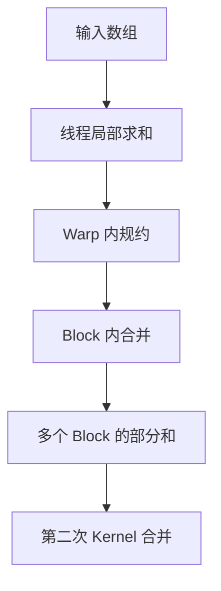
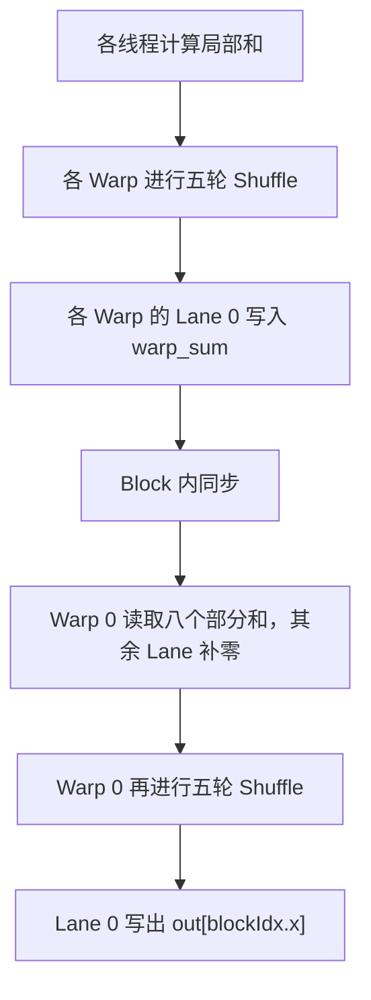

<!-- 由 scripts/sync-obsidian.mjs 从 Obsidian Vault 生成，请勿直接编辑。 -->

> 学习导航：[01 GPU硬件与内存](/posts/obsidian/01-gpu%E7%A1%AC%E4%BB%B6%E4%B8%8E%E5%86%85%E5%AD%98/) · [02 GPU性能理论](/posts/obsidian/02-gpu%E6%80%A7%E8%83%BD%E7%90%86%E8%AE%BA/) · [03 Reduction逐版代码与解析](/posts/obsidian/03-reduction%E9%80%90%E7%89%88%E4%BB%A3%E7%A0%81%E4%B8%8E%E8%A7%A3%E6%9E%90/)

# CUDA 学习笔记（三）：从原子操作到向量化规约（Reduction）的渐进式演进

本篇笔记聚焦于并行计算中最为经典的基础原语——**并行规约（Reduction）**。内容结合 parallel101 课程源码（`07_atomic`、`08_block`）的设计思路，深度解析 `/home/sanzenin/test/cuda_learn/kernels/reduce_float.cu` 中包含的四个核心 Kernel：
- `reduce_atomic`
- `reduce_atomic_tree`
- `reduce_multi_warp`
- `reduce_multi_warpf4`

---

## 一、 规约演进路线与小例推演（从 07_atomic 到 08_block）

规约的目标是将数组 $A$ 中的 $N$ 个元素累加为一个标量。设待规约数组为 8 个元素：
$$A = [1, 2, 3, 4, 5, 6, 7, 8]$$



### 1. 阶段一：每元素直接全局原子加（07_atomic 基线）

* **动机**：最直观的实现，每个线程负责一个元素，直接向全局累加单元写入。
* **数据流与小例**：
  * 启动 8 个线程，线程 $i$ 读取 $A[i]$，执行 `atomicAdd(d_out, A[i])`。
  * 8 个线程并发尝试写入同一个全局内存地址 `d_out`。
* **收益**：代码极简，无须处理块内同步或边界填充。
* **代价**：**硬件争用（Serialization）**。同一地址的大量原子更新可能形成竞争并限制吞吐，具体情况取决于硬件和负载。

### 2. 阶段二：线程先局部累加再原子加 / Grid-Stride Loop（07_atomic 进阶）

* **动机**：与其让 $N$ 个线程发起 $N$ 次全局原子操作，不如让每个线程先在本地寄存器中累加多个元素，最后每个线程仅发射 1 次原子加。
* **数据流与小例**：
  * 设仅启动 2 个线程（线程 0 和线程 1）。采用 **Grid-Stride Loop（网格跨步循环）**：
    * 线程 0 依次累加索引：$0, 2, 4, 6 \rightarrow 1 + 3 + 5 + 7 = 16$（保存在寄存器 `local_sum`）
    * 线程 1 依次累加索引：$1, 3, 5, 7 \rightarrow 2 + 4 + 6 + 8 = 20$（保存在寄存器 `local_sum`）
  * 循环结束后发射原子操作：
    * 线程 0：`atomicAdd(d_out, 16)`
    * 线程 1：`atomicAdd(d_out, 20)`
* **收益**：全局原子加的次数从 $N$ 锐减至 `total_threads`（本例中从 8 次减少至 2 次）。一般情况下同一 Warp 中相邻 Lane 同步访问相邻元素，因此有利于合并；两线程例子仅用于展示索引。
* **代价**：每个线程的计算指令数增加；如果网格大小与数据规模不匹配，延迟隐藏效果可能减弱。

### 3. 阶段三：Block 级别 Shared Memory 树形规约（08_block）

* **动机**：在 Block 内部使用高带宽、低延迟的片上共享内存（Shared Memory）协作完成局部求和，由 Block 的 0 号线程向独立的 `out[blockIdx.x]` 写出部分和，后续再合并。
* **数据流与小例**：
  * 线程先将全局内存加载到 `__shared__ float s_data[8]` 中。
  * **树形折叠（以跨步折半为例）**：
    * 步长 stride = 4：线程 $0 \sim 3$ 执行 `s_data[t] += s_data[t + 4]`。
      $s\_data = [1+5, 2+6, 3+7, 4+8, ...] = [6, 8, 10, 12, ...]$
    * 同步：`__syncthreads()`
    * 步长 stride = 2：线程 $0 \sim 1$ 执行 `s_data[t] += s_data[t + 2]`。
      $s\_data = [6+10, 8+12, ...] = [16, 20, ...]$
    * 同步：`__syncthreads()`
    * 步长 stride = 1：线程 0 执行 `s_data[0] += s_data[1] \rightarrow 16 + 20 = 36$。
  * 最后线程 0 写出 `out[blockIdx.x] = s_data[0]`。
* **收益**：各 Block 写入不同位置，避免逐线程竞争同一全局地址；后续仍需合并。
* **代价**：
  * 每层折叠都需要 `__syncthreads()`，带来块内屏障同步开销。
  * 随着步长缩减，活跃线程对半减少，部分线程逐渐闲置；是否发生 bank conflict 要看具体访问地址。

---

## 二、 `reduce_float.cu` 架构拆解：多 Warp Shuffle 与向量化

用户代码在 `/home/sanzenin/test/cuda_learn/kernels/reduce_float.cu` 中实现了从原子操作到 Warp 原语与向量化的进阶，尤其包含了固定结构设计的 `reduce_multi_warp` 与 `reduce_multi_warpf4`。

### 1. `reduce_multi_warp`：多 Warp 协作与寄存器洗牌

该 Kernel 固定采用 **256 线程/Block** 的配置，Block 内划分情况如下：
$$\text{Block 规模} = 256 \text{ 线程} \quad \Longrightarrow \quad \frac{256}{32} = 8 \text{ 个 Warp}$$
因此，代码内部分配了固定大小的共享内存缓冲：
```cuda
__shared__ float warp_sum[8];
```

#### 数据流执行过程



1. 256 个线程各自计算 `local_sum`，8 个 Warp 分别执行偏移 `16, 8, 4, 2, 1` 的规约。
2. 各 Warp 的 Lane 0 写入 `warp_sum[warp_id]`，随后 `__syncthreads()` 等待写入并确保块内可见。
3. Warp 0 的 Lane 0～7 读取 8 个部分和，其余 Lane 补零。源码再次执行五轮偏移 `16, 8, 4, 2, 1`，由 Lane 0 普通写入 `out[blockIdx.x]`；这里不是 atomicAdd。
4. `0xffffffff` 要求完整 Warp 正确参与；不能不经处理就把固定 256 线程的实现改为不完整 Warp。

### 2. 向量化访存：`reduce_multi_warpf4`

* **优化动机**：每个线程一次加载四个 float，编译器可能生成较宽的加载指令，减少指令数。标量访问也可以合并；这不保证带宽吃满或性能提高。
* **数据划分与对齐（$n/4$）**：
  * 全局元素被视作包含 $n/4$ 个 `float4` 向量的序列。
  * 网格步长变为以 `float4` 为单位迭代（`stride * 4` 元素）。
* **尾部处理（Tail / Remainder Handling）与 Zero-Fill**：
  * 若 $N$ 不能被 4 整除，末尾剩余 $N \pmod 4$ 个元素无法构成完整的 `float4`。
  * 此外，若输入内存地址未按 16 字节对齐，强制转成 `float4*` 可能会引发未定义行为或非对齐异常。
  * **尾部处理原则**：前部整块走 `float4` 循环，末尾剩余元素通过标量循环（逐个 `float`）累加，或者提前实际分配到 4 的倍数并将新增元素初始化为 0，再读取完整向量。不能先进行越界或未对齐加载，再依靠补零使其安全。
* **独立编译历史验收事实**：
  * 在离线 SASS 汇编比对中，`reduce_multi_warpf4` 确实成功被编译器展开为 **`LDG.E.128`** 宽访存指令。
  * > [!IMPORTANT]
    > **事实边界声明**：历史验收仅验证了生成 128-bit 指令的正确性，**未对其进行独立性能 Benchmark 实测**。不可凭空断言其相较于标量版本的实际加速比。

### 3. Two-Pass 规约模式 vs 块间原子累加

| 模式 | 实现机制 | 优势 | 代价 / 限制 |
| :--- | :--- | :--- | :--- |
| **单 Pass + 原子累加**（可选方案） | 每个 Block 内部规约出一个标量，最后通过 `atomicAdd` 累加至全局输出。 | 实现简单，仅启动一次 Kernel，适合中小规模数据。 | 当 Block 数量巨大（例如上万个 Block）时，跨 Block 的原子写入仍然会产生 L2 排队。 |
| **Two-Pass 规约** | **Pass 1**：每个 Block 规约结果写入中间数组 `d_intermediate[gridDim.x]`。<br>**Pass 2**：启动第二个 Kernel 对中间数组进行二次规约。 | 该两阶段实现无需对同一结果做全局 atomicAdd；耗时仍需测量。 | 需额外分配显存空间暂存中间结果，引入多一次 Kernel Launch 开销。 |

---

## 三、 同步语义、洗牌安全性与硬件屏障

### 1. 同一 Stream 内的执行顺序

在 CUDA 运行时中，同一 Stream（包括默认的 Stream 0）内的操作具有严格的**保序性（In-order execution）**：
- 前一个 Kernel 未执行完毕时，后一个 Kernel 绝不会开始执行。
- 因此，如果在同流中连续 launch 两次规约 Kernel，它们在 GPU 硬件上是严格串行排队的。

> [!NOTE]
> 在 `reduce_float.cu` 的 `main` 函数实现中，**实际进行了两次 `reduce_multi_warp` 的调用**（第一次计算 Block 部分和，第二次将部分和规约为最终结果），**而并未调用 `reduce_multi_warpf4`**。

### 2. `__shfl_down_sync` 不提供内存屏障

初学者最容易产生的一个致命误解是：*“Shuffle 函数既然带 `_sync`，它是不是就同步了所有内存？”*

* **答案是否定的**。
* `__shfl_down_sync` 是**寄存器到寄存器（Register-to-Register）**的数据交换，仅在参与该指令的 Warp 内部 Lane 之间完成同步和值传递。
* **它不具备任何内存屏障语义**：它不会刷新 L1/Shared Memory，也不会建立全局内存的 Release-Acquire 一致性。
* **这正是 `reduce_multi_warp` 阶段 2 必须显式调用 `__syncthreads()` 的原因**：Warp 内 Lane 0 将寄存器写入 `warp_sum[8]` 是对 Shared Memory 的操作，必须通过 `__syncthreads()` 确保这些写入对 Warp 0 的读取线程全部可见。

### 3. Full Mask（`0xffffffff`）与分支分歧风险

* `__shfl_down_sync(0xffffffff, val, offset)` 中的第一个参数是线程掩码（Mask）。
* `0xffffffff` 表示开发者承诺：**当前 Warp 的这份示例中的 32 个线程都要正确参与这条 Shuffle 指令**。
* **分歧陷阱**：
  ```cuda
  if (threadIdx.x < 10) {
      // 致命错误：只有前 10 个线程进入，但传入了 0xffffffff
      val = __shfl_down_sync(0xffffffff, val, 2);
  }
  ```
  在 Volta 及更新架构（Independent Thread Scheduling）下，硬件要求 Mask 中指定的线程必须在程序计数器（PC）上聚合。若被掩码指定的线程因为分支分歧未到达该指令，将直接引发**未定义行为（Undefined Behavior）甚至 GPU 挂起（Hang）**。
* **安全法则**：规约中非活跃的 Lane，必须先让它们统一参与 Shuffle（传入单位元 0），如果只让部分线程参与，必须正确构造掩码并确保每次读取的源 Lane 有效参与；仅使用 `__activemask()` 不能自动保证任意规约正确。

---

## 四、 浮点误差与双精度混合陷阱

### 1. 浮点加法的非结合律（Non-Associativity）

根据 IEEE 754 标准，单精度通常具有 24 位有效精度（包括隐含前导位）。浮点加法并不满足结合律：
$$(A + B) + C \neq A + (B + C)$$

* **CPU 串行相加**：从索引 0 到 $N-1$ 顺序累加，随着和越来越大，较小的元素加进来时会发生严重的大数吃小数（Swamping / Truncation）。
* **GPU 树形规约**：成对两两合并，加法层级呈对数分布 $\log_2(N)$，误差积累形态与串行相加完全不同。
* 两种求和顺序可能得到不同结果，不一定意味着 Kernel 错误；仍需结合参考值与容差验证。

### 2. 主机端验证中的双精度隐式转换

在分析主程序核对逻辑时，存在一处经典的隐蔽陷阱：

```cpp
float expected = std::accumulate(vec.begin(), vec.end(), 0.0);
```

> [!WARNING]
> 注意 `0.0` 的字面量类型！
> 1. `0.0` 是 `double` 类型字面量，而 `0.0f` 才是 `float`。
> 2. `std::accumulate` 是模板函数，累加器的类型完全由第三个参数推导：
>    $$\text{推导类型 } T = \text{double}$$
> 3. **导致的行为**：在 CPU 端循环累加期间，所有的中间结果均以 **64 位双精度浮点数（IEEE Double）** 进行高精度保持，通常比 float 保留更多有效数字，但 double 也会产生舍入误差。
> 4. **最终舍入**：累加完成后，将双精度累加结果隐式转换赋值给 `float expected`，发生舍入，可能丢失精度。
> 5. **结果对比**：这样得出的 `expected` 并不是纯 32 位浮点串行累加的结果，而是“双精度高精度和的单精度投影”，它与 GPU 上全程使用 32 位单精度的树形规约值相比，可能不同，具体取决于输入和计算顺序。


### 3. 容差与结果检查

推荐用 double 保存 CPU 参考值：

```cpp
double expected = std::accumulate(a.begin(), a.end(), 0.0);
double abs_err = std::abs(static_cast<double>(gpu_sum) - expected);
double tolerance = 1e-3 + 1e-5 * std::abs(expected);
bool pass = abs_err <= tolerance;
```

判断条件为 $|GPU-CPU| \leq atol+rtol\times|CPU|$。这里的 $atol=10^{-3}$、$rtol=10^{-5}$ 只是示例，需要根据输入规模、数据分布和算子确定；正负抵消使参考值接近 0 时尤其要关注绝对误差。double 参考值不是数学精确真值。分别覆盖全 0、全 1、正负混合、大数与小数、边界长度，再检查 NaN 和 Inf 的行为。

原子版本需要在每次运行前将输出初始化为零，否则会在旧值上继续累加。当前两次 `reduce_multi_warp` 是同一 Stream 的两阶段计算；第一次写入 `partial`，第二次以 `partial` 为输入。只用其中一次得到的是部分和。

### 4. float4 的分组例子

若 `n = 11`，`vec_n = n / 4 = 2`：`a4[0]` 读取 `a[0..3]`，`a4[1]` 读取 `a[4..7]`，最后由 Grid 中一个线程用标量加载 `a[8..10]`。若把分组数向上取整，最后一次 16 字节加载会包含 `a[11]`，除非底层实际分配并初始化了该填充元素，否则存在越界风险。`a4[i]` 的单位已经是 4 个 float，因此 Grid-stride 中的向量索引步长不再额外乘 4。

---

## 五、 规约演进综合对比表

| 维度 | `reduce_atomic` (07_atomic) | `reduce_atomic_tree` (08_block) | `reduce_multi_warp` | `reduce_multi_warpf4` |
| :--- | :--- | :--- | :--- | :--- |
| **加载方式** | 32-bit 全局标量访存 | 32-bit 全局访存 + Shared Mem 缓存 | 32-bit 全局访存 + 寄存器规约 | **float4；历史构建中观察到 `LDG.E.128`** |
| **同步粒度** | 依赖硬件原子单元排队 | 块内多次 `__syncthreads()` | 一次 `__syncthreads()` + Warp Shuffle | 仅一次 `__syncthreads()` + 宽访存流水线 |
| **可能的瓶颈** | 同一地址原子竞争 | 块内同步及线程闲置 | 访存、指令或同步开销 | 指令、访存及寄存器压力；具体需实测 |
| **块规模固定性** | 任意有效 Block 大小 | 需适配树形步长（通常为 2 的幂） | **固定 256 线程**（对应 `warp_sum[8]`） | **固定 256 线程**（对应 `warp_sum[8]`） |
| **主程序调用现状** | 可独立测试 | 可独立测试 | **`main` 函数中调用 2 次** | **`main` 中未调用；历史验收另行测试过该 Kernel** |

---

---

# 各优化版本：完整 Kernel 与逐步解析

下面代码可以逐段对照学习；在 `.cu` 文件中使用时需要包含 `<cuda_runtime.h>`。每个 Kernel 假设输入和输出内存不重叠，长度和索引在 int 范围内。


## 版本 0：每读一个数，就做一次 atomicAdd

**目的：先得到一个容易理解的并行求和基线。** 每个线程按 Grid-stride 访问数组，读取一个数后立刻把它原子加到 `out[0]`。所有线程都更新同一个地址；atomicAdd 保证单次更新的原子性，防止普通 `out[0] += a[i]` 的并发读写丢失结果。

以 8 个数 `[1,2,3,4,5,6,7,8]` 和 2 个线程为例：线程 0 访问下标 `0,2,4,6`，线程 1 访问 `1,3,5,7`。两个线程一共执行 8 次 atomicAdd，执行顺序不能假定。运行前必须把 `out[0]` 初始化为 0；直接把多个 Block 的普通加法写到同一地址会发生数据竞争。

**代价与定位：** 同一地址竞争多时可能限制性能；这是解释用基线，实际快慢要测试。代码中的 `gid` 是线程在整个 Grid 中的编号，`stride` 是整个 Grid 的线程数。

```cpp
__global__ void reduce_element_atomic(const float* a, float* out, int n) {
    int gid = blockIdx.x * blockDim.x + threadIdx.x;
    int stride = blockDim.x * gridDim.x;
    // 同一线程循环处理 gid, gid + stride, ...，每次都更新全局结果。
    for (int i = gid; i < n; i += stride) {
        atomicAdd(out, a[i]);
    }
}
```


## 版本 1：线程先求局部和，再做 atomicAdd

**优化动机：减少共享结果地址上的原子操作次数。** 每个线程先把自己负责的所有数加到私有变量 `sum`，循环结束后才对 `out[0]` 做一次 atomicAdd。`sum` 通常放在寄存器，具体由编译器决定。

同样是 8 个数、2 个线程：线程 0 算 `1+3+5+7=16`，线程 1 算 `2+4+6+8=20`，然后各原子加一次。全局原子调用由示例的 8 次变为 2 次。实际代码每个启动的线程都会在循环后调用一次，即便某些线程没有处理元素也会原子加 0。

**代价与限制：** 若所有线程只分到一个数，原子次数并不会减少；一个线程处理的数过多可能降低可利用的并行度。需要预先清零输出，且浮点加法的先后顺序会影响结果。

```cpp
__global__ void reduce_thread_atomic(const float* a, float* out, int n) {
    int gid = blockIdx.x * blockDim.x + threadIdx.x;
    int stride = blockDim.x * gridDim.x;
    float sum = 0.0f;
    for (int i = gid; i < n; i += stride) sum += a[i];
    // 多个线程仍会竞争 out[0]；调用前必须清零。
    atomicAdd(out, sum);
}
```


## 版本 2：Shared Memory 树形规约

**优化动机：先让同一个 Block 的线程合作，合出一个部分和。** 每个线程先做 Grid-stride 局部累加，再写 `s[tid]`；256 个线程在共享内存中两两合并，最后只有线程 0 写 `out[blockIdx.x]`。各 Block 输出不同的地址，这里没有对全局结果做 atomicAdd。

用 8 个线程和输入 `[1,2,3,4,5,6,7,8]` 类比：步长 4 后前四个位置是 `[6,8,10,12]`；步长 2 后前两个位置是 `[16,20]`；步长 1 后位置 0 是 `36`。实际代码固定 256 线程，步长依次是 `128,64,32,16,8,4,2,1`，共 8 轮；初始写入后同步 1 次，每轮之后同步 1 次。

**为什么同步写在 if 外面？** 因为 `if (tid < step)` 只有一部分线程执行加法，但同一个 Block 的线程都要到达同步点，下一轮才可以安全读取上一轮写出的数据。最终输出是每个 Block 一个数，需要再合并；小数组或启动开销占主导时未必更快。

```cpp
__global__ void reduce_shared(const float* a, float* out, int n) {
    __shared__ float s[256];
    int tid = threadIdx.x;
    int gid = blockIdx.x * blockDim.x + tid;
    int stride = blockDim.x * gridDim.x;
    float sum = 0.0f;
    for (int i = gid; i < n; i += stride) sum += a[i];

    s[tid] = sum;                // 所有线程先写自己的槽位。
    __syncthreads();             // 等待全部线程写完。

    // 256 -> 128 -> ... -> 1；每次相加后都要块内同步。
    for (int step = 128; step > 0; step >>= 1) {
        if (tid < step) s[tid] += s[tid + step];
        __syncthreads();         // 所有线程都执行，不放入 if。
    }
    if (tid == 0) out[blockIdx.x] = s[0];
}
```


## 版本 3：Warp Shuffle + 跨 Warp 规约

**优化动机：在 Warp 内直接交换线程寄存器中的值，减少多轮 Shared Memory 读写和 Block 同步。** 这是对版本 2 的协作方式优化，不能据此推断一定更快。

256 线程对应 8 个 Warp。线程 `tid=37` 属于 `warp=37/32=1`、`lane=37%32=5`。第一轮规约中每个 Warp 的全部 32 个 Lane 都参加 `__shfl_down_sync`，偏移为 `16,8,4,2,1`，每个 Warp 的和落在 Lane 0。八个 Lane 0 写出 `warp_sum[0..7]`，然后所有线程在 `__syncthreads()` 会合；Shuffle 本身不能充当 Shared Memory 的内存屏障。

Warp 0 的 Lane 0～7 分别读 8 个 Warp 部分和，Lane 8～31 放 0。源码中所有 32 个 Lane 仍执行 `16,8,4,2,1` 五轮，Lane 0 普通写 `out[blockIdx.x]`。代码中的 full mask、`warp_sum[8]` 和每个 Warp 的 32 Lane 都依赖此处恰好启动 256 线程；不能不改代码就换任意 Block 大小。

```cpp
__global__ void reduce_warp(const float* a, float* out, int n) {
    __shared__ float warp_sum[8];
    int tid = threadIdx.x;
    int lane = tid % 32;
    int warp = tid / 32;
    int gid = blockIdx.x * blockDim.x + tid;
    int stride = blockDim.x * gridDim.x;
    float sum = 0.0f;
    for (int i = gid; i < n; i += stride) sum += a[i];

    // 32 个 lane 全部参与；每个 Warp 的和最终保存在 lane 0。
    for (int offset = 16; offset > 0; offset >>= 1)
        sum += __shfl_down_sync(0xffffffffu, sum, offset);
    if (lane == 0) warp_sum[warp] = sum;
    __syncthreads();             // 等待 8 个 Warp 的结果均可见。

    if (warp == 0) {
        // Warp 0 中前 8 个 lane 读取部分和，其余 lane 补加法单位元。
        float value = (lane < 8) ? warp_sum[lane] : 0.0f;
        for (int offset = 16; offset > 0; offset >>= 1)
            value += __shfl_down_sync(0xffffffffu, value, offset);
        if (lane == 0) out[blockIdx.x] = value;
    }
}
```


## 版本 4：float4 向量化加载 + Warp Shuffle

**优化动机：尝试减少加载指令数量。** `float4` 让一个线程以一组 4 个 float 读取数据；编译器可能生成较宽的加载指令，但不保证一定，也不意味着显存流量减少 4 倍。相邻线程的标量访问本来也可以合并，性能需在同一条件下比较。

`a4[i]` 对应 `a[4*i]` 至 `a[4*i+3]`。例如 `n=11`，`vec_n=11/4=2`，两次完整向量加载处理 `a[0..7]`，整个 Grid 的线程 0 再标量处理 `a[8..10]`。向量循环中的 i 已是 float4 下标，所以循环步长仍为 `stride`，不是 `stride * 4`。

**对齐与尾部：** `a` 必须按 16 字节对齐；`a+1` 往往不满足。不能把 `vec_n` 向上取整后加载最后不完整组，否则可能越界；只有底层额外分配且初始化好填充元素时才能安全读完整组。该示例固定 256 线程；后续归约与版本 3 一致。

```cpp
__global__ void reduce_float4(const float* a, float* out, int n) {
    __shared__ float warp_sum[8];
    int tid = threadIdx.x;
    int lane = tid % 32;
    int warp = tid / 32;
    int gid = blockIdx.x * blockDim.x + tid;
    int stride = blockDim.x * gridDim.x;
    int vec_n = n / 4; // 只统计完整的四元素组，不向上取整。
    const float4* a4 = reinterpret_cast<const float4*>(a);
    float sum = 0.0f;

    // i 的单位是 float4；不再把循环步长额外乘 4。
    for (int i = gid; i < vec_n; i += stride) {
        float4 v = a4[i];
        sum += v.x; sum += v.y; sum += v.z; sum += v.w;
    }
    // 整个 Grid 仅让一个线程处理最多 3 个尾部元素。
    if (gid == 0) {
        for (int i = vec_n * 4; i < n; ++i) sum += a[i];
    }
    for (int offset = 16; offset > 0; offset >>= 1)
        sum += __shfl_down_sync(0xffffffffu, sum, offset);
    if (lane == 0) warp_sum[warp] = sum;
    __syncthreads();

    if (warp == 0) {
        float value = (lane < 8) ? warp_sum[lane] : 0.0f;
        for (int offset = 16; offset > 0; offset >>= 1)
            value += __shfl_down_sync(0xffffffffu, value, offset);
        if (lane == 0) out[blockIdx.x] = value;
    }
}
```

## 如何启动和验证

下面的主机端代码展示版本 3 的完整两阶段组织：第一次输入是 `n` 个数，输出 `blocks` 个部分和；第二次输入长度必须是 `blocks`。`d_partial` 和 `d_result` 使用不同的内存，第一阶段的输入也不要与输出重叠。float4 版本可用同样的两阶段结构，但两次输入均须满足对齐要求。

```cpp
#include <cuda_runtime.h>
#include <algorithm>
#include <stdexcept>

void check(cudaError_t e) {
    if (e != cudaSuccess) throw std::runtime_error(cudaGetErrorString(e));
}

// 前提：d_a 至少有 n 个 float；d_result 指向 1 个已分配 float；n >= 0。
// reduce_warp 的完整 Kernel 见上方版本 3。此示例尺寸处于 int 安全范围。
void launch_reduce(const float* d_a, float* d_result, int n) {
    constexpr int threads = 256;
    int blocks = std::max(1, std::min(256, (n + threads - 1) / threads));
    float* d_partial = nullptr;
    check(cudaMalloc(&d_partial, blocks * sizeof(float)));

    // 第一次：每个 Block 写一个部分和。
    reduce_warp<<<blocks, threads>>>(d_a, d_partial, n);
    check(cudaGetLastError());

    // 第二次：只有一个 Block，把 blocks 个部分和合并。
    // 默认同一 Stream 保序，所以两个 Kernel 之间无需 DeviceSynchronize。
    reduce_warp<<<1, threads>>>(d_partial, d_result, blocks);
    check(cudaGetLastError());

    check(cudaDeviceSynchronize()); // 在检查结果和释放缓冲前等待并捕获异步错误。
    check(cudaFree(d_partial));
}
```

版本 0、1 不使用两阶段：先 `cudaMemset(d_result, 0, sizeof(float))`，分别启动 `reduce_element_atomic<<<blocks,256>>>(d_a,d_result,n)` 或 `reduce_thread_atomic<<<blocks,256>>>(d_a,d_result,n)`，检查启动与执行错误。版本 2 同样可以两次调用 `reduce_shared`，两次都必须启动 256 线程。

**正确性验证：** 使用 `double expected = std::accumulate(a.begin(), a.end(), 0.0)` 保存参考结果，再按 `abs_err <= atol + rtol * abs(expected)` 比较。容差需结合输入与精度确定；不要把不同求和顺序得到的微小浮点差异直接视为错误。

**本次示例验证：** 在 RTX 4060 Laptop、CUDA 12.4、`nvcc -O3 -arch=sm_89` 下，五个示例对 18 个长度做了正确性测试，包括 0、1、2、3、4、31、32、33、255、256、257、100003 和 1048579，使用正负混合且可被 FP32 精确表示的输入；并非性能 Benchmark，不能得出哪个版本更快的结论。

**对应你的项目：** 版本 1 对应 `reduce_atomic`，版本 2 对应 `reduce_atomic_tree`，版本 3 对应 `reduce_multi_warp`，版本 4 对应 `reduce_multi_warpf4`；版本 0 参考 NotebookLM 中 parallel101 的逐元素 atomic 基线。示例添加了教学注释并使用更清晰的名字，不代表修改了你的源码。


---

## 资料与核对范围

- 项目代码：`/home/sanzenin/test/cuda_learn/kernels/reduce_float.cu`。
- NotebookLM `ai infra`：[parallel101 atomic 示例](https://github.com/parallel101/course/tree/aa7715d26b55bda8ad7a9444a923c916eda30b7f/08/07_atomic)、[Block 规约示例](https://github.com/parallel101/course/tree/aa7715d26b55bda8ad7a9444a923c916eda30b7f/08/08_block)。
- [NVIDIA CUDA 12.4 Best Practices Guide](https://docs.nvidia.com/cuda/archive/12.4.0/cuda-c-best-practices-guide/index.html)；[Warp Shuffle 官方说明](https://docs.nvidia.com/cuda/cuda-programming-guide/05-appendices/cpp-language-extensions.html)。
