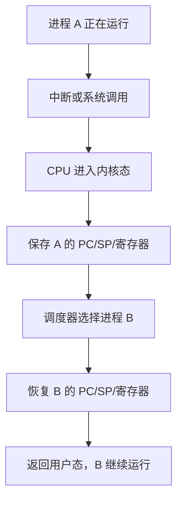

<!-- 由 scripts/sync-obsidian.mjs 从 Obsidian Vault 生成，请勿直接编辑。 -->

# 硬件与多任务：中断、寄存器和上下文切换

这一节回答一个很关键的问题：进程被中断时，CPU 寄存器里还放着这个进程的运行现场。操作系统想切换到另一个进程，就必须先保存现场；但保存现场本身又需要执行指令，而执行指令会修改寄存器。这个循环怎么打破？

答案是：进入内核的第一步必须有硬件支持。纯软件无法在毫无硬件约束的情况下可靠保存被打断的现场。

但也要区分两个概念：

- trap/interrupt entry：CPU 因中断、异常或系统调用进入内核；
- context switch：调度器决定从当前任务切到另一个任务。

一次进入内核不一定会发生上下文切换。例如普通 `getpid()` 系统调用通常进入内核后很快返回原线程。

## 进程为什么依赖寄存器上下文

CPU 只是不断取指、译码、执行。指令本身不包含全部状态，同一条指令在不同寄存器值下会产生不同结果。

进程的运行现场至少包括：

- program counter：下一条指令地址；
- general purpose registers：通用寄存器；
- stack pointer：当前栈顶；
- flags：条件码、中断位等标志；
- 地址空间相关寄存器或页表根；
- 部分架构相关状态。

因此，进程让出 CPU 时，不能只记住“它是哪个程序”。还要保存它执行到哪一行、寄存器里是什么、栈在哪里。

## 上下文切换

上下文切换就是：

1. 保存当前进程的 CPU 状态；
2. 把这些状态写入该进程的 PCB / 内核任务结构；
3. 选择下一个要运行的进程或线程；
4. 加载新任务之前保存的 CPU 状态；
5. 回到用户态，从新任务上次停止的位置继续执行。



这里的难点在第 3 步之前：操作系统必须先获得一小段可靠的执行环境，才能保存旧进程。

## 进程中断的两种来源

软件触发的陷入：进程主动执行特殊指令，请求操作系统服务。例如系统调用、断点、主动 yield。

异常：当前指令执行时触发，例如缺页、除零、非法指令。异常不是“自愿中断”，它是当前指令导致的同步事件。

硬件中断或被动中断：进程没有主动请求，但外部设备或定时器触发了中断。例如时钟中断、I/O 完成、键盘输入。

不管来源是什么，中断发生时 CPU 通常会：

1. 等当前指令执行完；
2. 根据事件类型和当前特权级，保存架构规定的最小返回现场；
3. 切换到内核态或提高特权级，并跳转到入口；
4. 让操作系统接管。

“执行完当前指令再中断”很重要，因为否则一条指令执行一半，寄存器和内存可能处于不可恢复的中间状态。

## 纯软件为什么不够


看起来，操作系统进入中断处理程序后只要执行几条保存指令就行：

```asm
STR SP, [2200]
LOAD SP, 2100
PUSH R0
PUSH R1
PUSH R2
PUSH R3
PUSH flags
PUSH [2200]
```

问题是这些指令一开始仍然在使用“被中断进程”的寄存器和栈。

如果直接 `PUSH R0`，压入的是用户进程自己的栈。这样会修改被中断进程的内存，破坏它原本的栈布局。

如果想先切到内核栈，就要修改 `SP`。但修改 `SP` 之前，又必须先保存旧 `SP`，否则用户栈位置就丢了。现实 CPU 会通过特权级切换规则、专用寄存器或入口代码约定来解决这个问题，而不是让普通软件在用户栈上硬保存。

如果把旧 `SP` 存到某个固定内存地址，也会遇到问题：

- 固定地址本身需要硬件保证可用；
- 多核或嵌套中断时会互相覆盖；
- 存储指令可能也需要临时寄存器；
- 最关键的是，program counter 在跳到中断处理程序时已经被覆盖，纯软件没有机会在覆盖前保存它。


所以真正的问题不是“操作系统不会写保存寄存器的代码”，而是：进入保存代码之前，CPU 已经改变了一些必须保存的状态。

结论：进入内核入口的第一步必须由硬件定义好。硬件至少要提供“从哪里进入、以什么权限执行、怎样能返回原位置”的机制；具体保存多少寄存器则因架构而异。

## 硬件辅助方案一：多套寄存器组


这种设计给 CPU 准备多套寄存器。例如：

- common register set：用户程序平时使用；
- privilege register set：内核或中断处理程序使用。

中断发生时，CPU 不覆盖用户寄存器组，而是切换到特权寄存器组。这样中断处理程序可以用另一套寄存器运行，用户进程的 program counter、stack pointer 和通用寄存器还留在原来的寄存器组里。

流程大致是：

1. 用户程序使用 common register set；
2. 中断发生；
3. CPU 切到内核态，并启用 privilege register set；
4. 用户寄存器组保持不变；
5. OS 用特权指令读取被停用的用户寄存器组；
6. OS 把这些值写入该进程 PCB；
7. OS 从另一个进程 PCB 取出状态，写回用户寄存器组；
8. 执行类似 `cisr` 的特权指令，切回用户态和用户寄存器组。


这里的 `cisr` 可以理解为“从中断返回”的特殊指令。它不是普通跳转，而是同时完成：

- 切回用户模式；
- 恢复或切换活动寄存器组；
- 让 CPU 从目标进程的 program counter 继续执行。

这种方案的好处是概念清楚：中断处理程序不会踩到用户现场。缺点也明显：硬件成本高。现代 CPU 寄存器越来越多，还包括浮点、SIMD、向量寄存器等，为每种模式复制完整寄存器组代价很大。

因此多寄存器组在一些架构或场景里存在，但不是现代通用 CPU 最常依赖的完整方案。

## 硬件辅助方案二：硬件自动切内核栈并保存关键寄存器

更常见的做法是：CPU 在中断、异常或系统调用入口提供一套最小进入机制，然后让内核入口代码继续保存其余寄存器。


CPU 必须至少知道内核栈在哪里。这个位置可以来自：

- 特权寄存器；
- 当前 CPU 的 per-CPU 内存；
- 架构规定的任务状态结构；
- 中断描述符或类似机制。

以传统中断/异常入口为例，硬件可能先做一小段不可分割的工作：

1. 找到当前 CPU 的内核栈；
2. 把用户态的 PC、SP、flags 等关键状态压入内核栈；
3. 切换到内核态；
4. 跳到中断处理入口。

但不能把这条流程当成所有架构的统一规则。例如 x86-64 的 `syscall` 指令不会像普通中断门那样自动把完整返回现场压到内核栈；Linux 入口代码需要用 `swapgs`、per-CPU 数据和汇编保存约定来切换到合适的内核栈并保存寄存器。

之后操作系统的汇编入口代码再保存通用寄存器：

```text
硬件或入口约定保存：返回地址 / flags / privilege info / 必要的栈信息
软件保存：general registers / SIMD state / scheduler state
```

这解决了两个最致命的问题：

- 返回位置有明确定义，不会因为跳到内核入口而丢失；
- 用户栈和内核栈之间的切换有架构支持或内核入口约定。

现代系统大多采用这种“硬件定义最小入口语义 + 软件保存剩余现场”的思路。它在硬件复杂度和操作系统灵活性之间比较平衡。

## 硬件辅助方案三：TSS 或全硬件任务切换

TSS 是 Task State Segment，任务状态段。它是一种由操作系统准备、CPU 理解的数据结构。

在更激进的设计中，CPU 可以在任务切换时自动把完整寄存器状态保存到一个任务结构中，再从另一个任务结构恢复状态。对软件来说，好像上下文切换几乎由硬件完成。

这种方案听起来很省事，但主流操作系统通常不愿意完全依赖硬件任务切换，原因包括：

- 硬件机制复杂，不方便做调度器优化；
- 保存哪些状态、何时保存，软件更想自己控制；
- 不同架构行为不一致，影响可移植性；
- 现代上下文状态很多，全交给硬件未必更快。

在 x86 上，TSS 现在仍有用途，但主流内核通常不会用它来做完整任务切换。更常见的用途是保存特权级切换时需要的栈信息，例如 ring 0 栈指针；x86-64 还用 IST 为某些异常提供专用栈。

## 和 Linux 的关系

Linux 的相关路径可以分成两层看：

1. 中断/异常入口：架构相关汇编保存硬件现场；
2. 调度切换：内核在 `task_struct` 和架构相关 thread context 中切换任务。

概念上对应：

| 笔记概念    | Linux 中的影子                          |
| ------- | ----------------------------------- |
| PCB     | `task_struct`                       |
| 地址空间    | `mm_struct`                         |
| CPU 上下文 | `thread_struct` 和内核栈上的 pt_regs      |
| 调度器选择   | `schedule()` 相关代码                   |
| 线程/进程创建 | `kernel/fork.c` 中的 `copy_process()` |

不同 CPU 架构的保存细节不一样，所以 Linux 把大量入口代码放在 `arch/<架构>/` 下面。通用调度逻辑在内核调度器里，具体寄存器怎么保存和恢复则由架构相关代码处理。

## 这节最重要的结论

上下文切换不是“操作系统随便暂停一个进程再启动另一个进程”这么简单。CPU 必须提供受控进入内核的机制，让内核有办法知道返回位置、当前权限、用户栈和必要状态。否则操作系统还没来得及执行保存代码，最关键的运行位置和栈位置就可能已经不可恢复。

所以多任务操作系统依赖硬件提供：

- 用户态 / 内核态；
- 中断入口；
- 内核栈切换或等价的入口约定；
- 返回现场的硬件定义；
- 从中断返回的特权指令。

操作系统负责策略：什么时候切、切给谁、保存到哪个任务结构。硬件负责保证：切入内核的那一瞬间，旧进程的现场还有办法被可靠保存。
