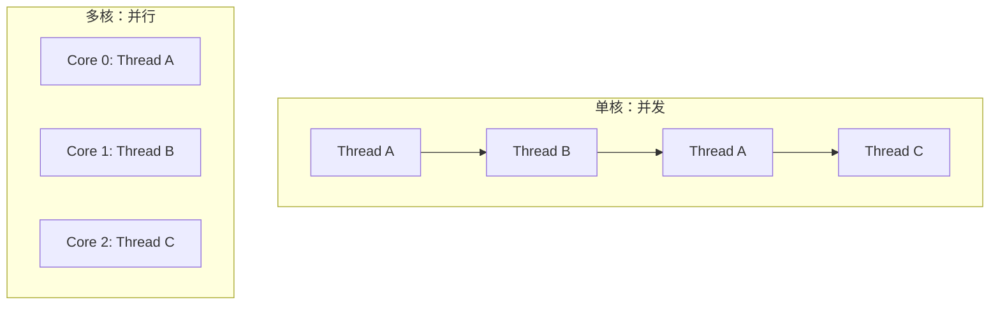

<!-- 由 scripts/sync-obsidian.mjs 从 Obsidian Vault 生成，请勿直接编辑。 -->

# 线程：共享地址空间与并发执行

这一节里有四个基础概念经常一起出现：stack、heap、concurrency、process。线程就是为了让同一进程内部可以有多个执行流。

## 为什么需要线程

CPU 调度最直接的目的，是让多个任务轮流使用处理器；另一个更实际的目的，是尽量不要让 CPU 闲着。

例如服务器处理客户端请求。传统做法是：

1. 主进程监听请求；
2. 每来一个客户端，就创建一个新进程；
3. 新进程专门服务这个客户端。

这个模型能工作，但代价很高。因为进程是一个完整上下文：它有自己的地址空间、文件表、寄存器状态、内核管理结构等。客户端数量上来后，为每个连接创建完整进程会浪费大量内存和创建时间。

线程的思路是：不要把程序计数器直接绑定在“进程”这个整体上，而是在同一个进程内部创建多个可调度的执行流。进程更像资源容器，线程才是实际被调度执行的控制流。

一个进程可以有多个线程。每个线程都有自己的程序计数器和运行现场，但它们共享同一个进程的大部分资源。

## 线程共享什么，独占什么

线程共享：

- 同一个地址空间；
- text 段代码；
- heap；
- 全局变量；
- 打开的文件描述符表，具体取决于操作系统和创建参数；
- 进程级权限和资源。

线程独占：

- 程序计数器；
- 寄存器现场；
- 用户栈和内核栈；
- 调度状态；
- 线程局部存储。

线程本身不“包含代码”。代码在进程的 text section 中，线程只是通过自己的 program counter 指向下一条要执行的指令。

## 每个线程为什么要有自己的栈

函数调用需要栈保存返回地址、局部变量、临时值和调用链。如果多个线程共用同一个栈，线程 A 调用函数时压入的返回地址可能被线程 B 覆盖，程序会很快失控。

所以每个线程必须有自己的栈。

但要注意：这些用户栈仍然位于同一个进程地址空间里。从硬件权限上说，一个线程可以读写另一个线程的用户栈，只是正常程序不应该这么做。很多运行时会在线程栈边界放 guard page，用来尽早发现栈溢出，但这不是线程之间的安全隔离。

线程间共享数据时，heap 通常比栈更合适：

- 栈适合线程自己的临时状态；
- heap 适合多个线程共同访问的对象；
- 共享 heap 数据必须配合同步机制。

如果一个线程正在读某块 heap 内存，另一个线程同时写同一块内存，结果可能是不确定的。这和 [05 进程间通信：共享内存、消息传递与 Socket](/posts/obsidian/05-%E8%BF%9B%E7%A8%8B%E9%97%B4%E9%80%9A%E4%BF%A1-%E5%85%B1%E4%BA%AB%E5%86%85%E5%AD%98-%E6%B6%88%E6%81%AF%E4%BC%A0%E9%80%92%E4%B8%8E-socket/#race-condition) 是同一个本质问题。

## 多线程下的内核结构

从“一个进程一个执行流”变成“一个进程多个执行流”后，原来的 PCB 也要拆分理解。

进程级信息包括地址空间、打开文件、权限等；线程级信息包括程序计数器、寄存器、栈和调度状态。

Linux 中没有单独把“进程 PCB”和“线程 TCB”完全分成两套结构。Linux 用 `task_struct` 表示一个可调度实体，进程和线程都对应一个 `task_struct`。

差异体现在创建时的共享标志上：

| 标志 | 含义 |
|---|---|
| `CLONE_VM` | 共享地址空间 |
| `CLONE_FILES` | 共享文件描述符表 |
| `CLONE_FS` | 共享文件系统上下文 |
| `CLONE_SIGHAND` | 共享信号处理表 |
| `CLONE_THREAD` | 放入同一线程组 |

普通 `fork()` 创建的是新进程；`pthread_create()` 底层通常通过 `clone()` 创建共享资源更多的新 `task_struct`。所以在 Linux 内核里，线程更像是“和其他 task 共享大量资源并属于同一线程组的 task”。

## Main Thread

对普通用户态进程来说，进程启动后会先有一个初始线程。程序入口点开始执行的那条执行流通常称为 main thread。

后续创建线程时，操作系统会把新线程加入调度体系。调度器不关心它是不是“主线程”，它只关心这个线程是否可运行、优先级如何、应该放在哪个 CPU 核心上执行。

## 线程、代码和运行时数据

线程执行的代码位于进程的 text section。线程特有的运行时信息主要在：

- CPU 寄存器中；
- 线程自己的栈上；
- 内核保存的线程上下文中；
- 线程局部存储中。

这也是为什么同一进程内的线程切换通常比跨进程切换轻：地址空间不变，很多情况下不需要切换页表，也不需要让地址转换缓存付出同样的代价。不过调度器、寄存器保存、内核栈切换等成本仍然存在。

## 并发和并行

并发 concurrency：多个任务交替推进，看起来像同时发生。单核心系统也能并发，因为操作系统可以快速切换线程。

并行 parallelism：多个任务在同一时刻真正同时执行。必须有多个 CPU 核心或多个硬件执行单元。

单核系统上，线程只是轮流运行；多核系统上，多个线程可以被调度到不同核心上同时运行。

## 多核处理器上的多线程

处理器相关术语：

| 术语 | 含义 |
|---|---|
| CPU | 物理芯片或处理器封装 |
| Core | CPU 内部独立执行指令的核心 |
| Hardware Thread | 同一核心暴露出的硬件执行上下文，例如 SMT/超线程 |

操作系统通常把可调度的硬件执行位置识别为 logical CPU。线程能否真正同时运行，取决于系统有多少 logical CPU 可用，以及调度器如何分配。

多核下线程的优势是：

- I/O 阻塞时，其他线程可以继续占用 CPU；
- 多个独立任务可以同时运行；
- 程序不需要为不同核心数重新编译，调度器会根据机器情况安排线程；
- 核心不足时仍可退化为分时并发。

并行上限受硬件限制。一个有 N 个可用 logical CPU 的系统，在同一瞬间最多运行 N 个可执行线程；更多线程只能排队、抢占、阻塞或等待。这里的 logical CPU 包括物理核心暴露出的 SMT/超线程上下文，它们能并行发射工作，但性能不等同于 N 个完整物理核心。

## 数据并行和任务并行

数据并行是把同一种运算拆到多份数据上。例如把一个大数组分成 4 段，4 个线程分别检查每段里的质数。

任务并行是让不同线程做不同工作。例如同一份数组上，一个线程求最大值，一个线程求平均值，一个线程搜索某个元素。

| 类型 | 拆分对象 | 例子 |
|---|---|---|
| Data Parallelism | 数据 | 大数组分片计算 |
| Task Parallelism | 工作 | UI、网络、文件写入分别由不同线程负责 |

多线程并不保证线性加速。线程创建、同步、缓存一致性、任务拆分和结果合并都会产生开销。真正能加速的，是那些独立性强、共享写入少、计算量足够大的任务。
