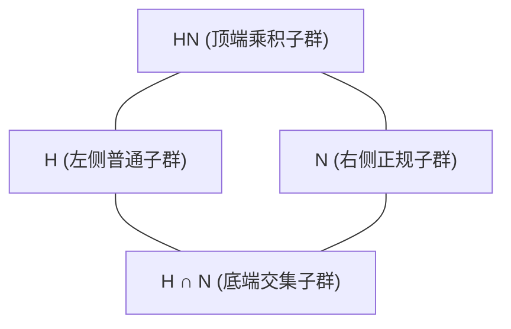

<!-- 由 scripts/sync-obsidian.mjs 从 Obsidian Vault 生成，请勿直接编辑。 -->

# 05-三大同构定理

## 1. 群同态基本定理（第一同构定理）

### 1.1 严格表述与定理
设 $f: G \to G'$ 是群同态。则：
1. $\operatorname{Ker}f$ 是群 $G$ 的正规子群（$\operatorname{Ker}f \triangleleft G$）；
2. 商群 $G/\operatorname{Ker}f$ 与同态像 $\operatorname{Im}f$ 同构：
   $$G/\operatorname{Ker}f \cong \operatorname{Im}f$$

特别地，如果 $f$ 是满同态（即 $\operatorname{Im}f = G'$），则有：
$$G/\operatorname{Ker}f \cong G'$$

### 1.2 数学直觉
同态映射会在目标群中产生重叠与压缩。代数证明表明，原群中映射到同一个像点的所有元素，恰好构成核的正规陪集 $a\operatorname{Ker}f$。商群 $G/\operatorname{Ker}f$ 将这些具有相同像点的陪集视为单个元素，从而消除了原同态中的重叠现象，诱导出与同态像之间的双射同构。

### 1.3 严格形式化证明

**证明：**
第 1 部分 $\operatorname{Ker}f \triangleleft G$ 已在定理 4.6 中证明，此处证明第 2 部分。
记 $K = \operatorname{Ker}f$。
定义从商群 $G/K$ 到像集 $\operatorname{Im}f$ 的映射：
$$\bar{f}: G/K \to \operatorname{Im}f, \quad \bar{f}(aK) = f(a) \quad (\forall a \in G)$$

逐步验证以下四项：

#### 步骤 1：验证映射良定性（Well-defined）
设 $aK = bK \in G/K$。
由定理 3.2，$a^{-1}b \in K = \operatorname{Ker}f$。
由同态核定义：
$$f(a^{-1}b) = e'$$
利用同态保持运算与逆元性质：
$$(f(a))^{-1} f(b) = e' \implies f(a) = f(b)$$
因此：
$$\bar{f}(aK) = f(a) = f(b) = \bar{f}(bK)$$
映射结果与代表元的选择无关，$\bar{f}$ 是良定的。

#### 步骤 2：验证映射是单射（Injective）
设 $aK, bK \in G/K$，且满足：
$$\bar{f}(aK) = \bar{f}(bK) \implies f(a) = f(b)$$
在群 $G'$ 中两边左乘 $(f(a))^{-1}$：
$$(f(a))^{-1} f(b) = e' \implies f(a^{-1}b) = e'$$
由同态核定义：
$$a^{-1}b \in \operatorname{Ker}f = K$$
由定理 3.2，推得：
$$aK = bK$$
故 $\bar{f}$ 是单射。

#### 步骤 3：验证映射是满射（Surjective）
任取 $y \in \operatorname{Im}f$。
由像集定义，存在 $a \in G$ 使得 $f(a) = y$。
选取陪集元素 $aK \in G/K$，代入映射规则：
$$\bar{f}(aK) = f(a) = y$$
因此像集中的每一个元素都存在原像，$\bar{f}$ 是满射。

#### 步骤 4：验证映射保持群运算（Homomorphism）
任取 $aK, bK \in G/K$。
利用商群的乘法定义 $(aK)(bK) = (ab)K$，以及 $f$ 本身的同态性质：
$$\bar{f}((aK)(bK)) = \bar{f}((ab)K) = f(ab) = f(a)f(b) = \bar{f}(aK)\bar{f}(bK)$$
故 $\bar{f}$ 保持乘法运算。

综合以上四步，$\bar{f}$ 是 $G/K$ 到 $\operatorname{Im}f$ 的双射同态（群同构）。
因此：
$$G/\operatorname{Ker}f \cong \operatorname{Im}f \quad \blacksquare$$

---

### 1.4 五大经典应用实例

利用同态基本定理证明 $G/N \cong H$ 的标准方法是：构造从 $G$ 到 $H$ 的满同态 $f$，并验证 $\operatorname{Ker}f = N$。

| 序号 | 经典实例 | 满同态构造 $f$ | 同态核 $\operatorname{Ker}f$ | 同构结论 |
| :---: | :--- | :--- | :--- | :--- |
| **1** | 整数模运算 | $f: \mathbb{Z} \to \mathbb{Z}_m, \ f(n) = [n]$ | $m\mathbb{Z}$ | $\mathbb{Z}/m\mathbb{Z} \cong \mathbb{Z}_m$ |
| **2** | 实数乘法正负符号 | $f: \mathbb{R}^* \to (\{1, -1\}, \cdot), \ f(x) = \frac{x}{\|x\|}$ | $\mathbb{R}^+$（正实数乘法群） | $\mathbb{R}^*/\mathbb{R}^+ \cong (\{1, -1\}, \cdot) \cong \mathbb{Z}_2$ |
| **3** | 复平面单位圆缠绕 | $f: \mathbb{R} \to S^1, \ f(x) = \mathrm{e}^{2\pi \mathrm{i} x}$ | $\mathbb{Z}$（所有周期整点） | $\mathbb{R}/\mathbb{Z} \cong S^1$ |
| **4** | 矩阵行列式群 | $f: \mathrm{GL}_n(\mathbb{R}) \to \mathbb{R}^*, \ f(A) = \det(A)$ | $\mathrm{SL}_n(\mathbb{R})$（行列式为 1 的矩阵群） | $\mathrm{GL}_n(\mathbb{R})/\mathrm{SL}_n(\mathbb{R}) \cong \mathbb{R}^*$ |
| **5** | 置换符号映射（$n\ge2$） | $f: S_n \to (\{1, -1\}, \cdot), \ f(\sigma) = \operatorname{sgn}(\sigma)$ | $A_n$（全体偶置换构成的交代群） | $S_n/A_n \cong \mathbb{Z}_2$ |

---

## 2. 第二同构定理（菱形同构定理 / Diamond Isomorphism Theorem）

### 2.1 严格表述与定理
设 $G$ 是群，$H \le G$ 是 $G$ 的子群，$N \triangleleft G$ 是 $G$ 的正规子群。则：
1. 乘积集 $HN$ 是 $G$ 的子群（$HN \le G$），且 $N \triangleleft HN$；
2. 交集 $H \cap N$ 是 $H$ 的正规子群（$H \cap N \triangleleft H$）；
3. 存在自然同构：
   $$HN/N \cong H/(H \cap N)$$

### 2.2 形式化证明

**证明步骤 1：证明 $HN \le G$ 且 $N \triangleleft HN$**
- $e = ee \in HN \implies HN \ne \emptyset$。
- 任取 $x_1, x_2 \in HN$，设 $x_1 = h_1 n_1, x_2 = h_2 n_2$（$h_i \in H, n_i \in N$）。
  $$x_1 x_2^{-1} = (h_1 n_1)(n_2^{-1} h_2^{-1}) = h_1 (n_1 n_2^{-1}) h_2^{-1}$$
  记 $n_3 = n_1 n_2^{-1} \in N$。因为 $N \triangleleft G$，对全群共轭封闭，故：
  $$n_3 h_2^{-1} = h_2^{-1} (h_2 n_3 h_2^{-1}) = h_2^{-1} n_4, \quad \text{其中 } n_4 \in N$$
  代入得：
  $$x_1 x_2^{-1} = h_1 (h_2^{-1} n_4) = (h_1 h_2^{-1}) n_4$$
  因为 $h_1 h_2^{-1} \in H, n_4 \in N$，所以 $x_1 x_2^{-1} \in HN$。由定理 1.8（一步判定法），$HN \le G$。
- 对任意 $n \in N$，有 $n = e n \in HN$，故包含关系 $N \subseteq HN$ 成立。对任意 $x = hn \in HN$ 及 $n_0 \in N$：
  $$x n_0 x^{-1} = (hn) n_0 (hn)^{-1} = h (n n_0 n^{-1}) h^{-1}$$
  因为 $N \triangleleft G$，所以 $n n_0 n^{-1} \in N$ 且 $h (n n_0 n^{-1}) h^{-1} \in N$。故 $x n_0 x^{-1} \in N$。因此 $N \triangleleft HN$。

**证明步骤 2：利用第一同构定理证明同构**
定义映射：
$$\phi: H \to HN/N, \quad \phi(h) = hN \quad (\forall h \in H)$$
1. **同态性**：任取 $h_1, h_2 \in H$。
   $$\phi(h_1 h_2) = (h_1 h_2)N = (h_1 N)(h_2 N) = \phi(h_1)\phi(h_2)$$
   故 $\phi$ 是群同态。
2. **满射性**：任取商群 $HN/N$ 中的元素 $y$。
   根据乘积集定义，$y = (hn)N$（其中 $h \in H, n \in N$）。
   因为 $n \in N \implies nN = N$，由陪集性质：
   $$(hn)N = h(nN) = hN = \phi(h)$$
   这说明商群中的每一个陪集都能在 $H$ 中找到原像，故 $\phi$ 是满射。
3. **求解同态核 $\operatorname{Ker}\phi$**：
   商群 $HN/N$ 的单位元是陪集 $N$。
   $$\operatorname{Ker}\phi = \{h \in H \mid \phi(h) = N\} = \{h \in H \mid hN = N\}$$
   由定理 3.1，$hN = N \iff h \in N$。
   因此：
   $$\operatorname{Ker}\phi = \{h \in H \mid h \in N\} = H \cap N$$
4. **得出结论**：
   因为 $\phi: H \to HN/N$ 是满同态，且 $\operatorname{Ker}\phi = H \cap N$。
   由群同态基本定理（定理 5.1），直接得出：
   $$H \cap N \triangleleft H \quad \text{且} \quad H/(H \cap N) \cong HN/N \quad \blacksquare$$

### 2.3 最小例子
在克莱因四元群 $K_4 = \{e, a, b, c\}$ 中，所有子群均为正规子群。
取 $H = \{e, a\}, N = \{e, b\}$。
- 乘积群 $HN = \{e, a, b, ab\} = \{e, a, b, c\} = K_4$；
- 交集 $H \cap N = \{e\}$；
- 代入第二同构定理：
  $$HN/N = K_4 / \{e, b\} \cong \mathbb{Z}_2$$
  $$H / (H \cap N) = \{e, a\} / \{e\} \cong \{e, a\} \cong \mathbb{Z}_2$$
  两边阶数均为 2，结构相同。

---

## 3. 第三同构定理（商群约分定理）

### 3.1 严格表述与定理
设 $H, K$ 都是群 $G$ 的正规子群，且满足包含关系 $K \subseteq H \subseteq G$。则：
1. $H/K$ 是商群 $G/K$ 的正规子群（$H/K \triangleleft G/K$）；
2. 存在自然同构：
   $$(G/K) / (H/K) \cong G/H$$

### 3.2 形式化证明

**证明：**
构造从商群 $G/K$ 到商群 $G/H$ 的映射：
$$f: G/K \to G/H, \quad f(aK) = aH \quad (\forall a \in G)$$

1. **良定性**：
   设 $aK = bK$。由定理 3.2，$a^{-1}b \in K$。
   因为已知 $K \subseteq H$，所以 $a^{-1}b \in H$。
   由定理 3.2，推得 $aH = bH$，即 $f(aK) = f(bK)$。
   故映射 $f$ 良定。
2. **同态性**：
   任取 $aK, bK \in G/K$：
   $$f((aK)(bK)) = f(abK) = abH = (aH)(bH) = f(aK)f(bK)$$
   故 $f$ 是同态。
3. **满射性**：
   对任意 $aH \in G/H$，取 $aK \in G/K$ 即可得到 $f(aK) = aH$。故 $f$ 是满射。
4. **求解同态核 $\operatorname{Ker}f$**：
   商群 $G/H$ 的单位元是陪集 $H$。
   $$\operatorname{Ker}f = \{aK \in G/K \mid f(aK) = H\} = \{aK \in G/K \mid aH = H\}$$
   在群中，$aH = H \iff a \in H$。因此：
   $$\operatorname{Ker}f = \{aK \in G/K \mid a \in H\} = H/K$$
5. **套用第一同构定理**：
   因为 $f: G/K \to G/H$ 是满同态，且 $\operatorname{Ker}f = H/K$。
   由群同态基本定理直接得出：
   $$H/K \triangleleft G/K \quad \text{且} \quad (G/K)/(H/K) \cong G/H \quad \blacksquare$$

### 3.3 最小例子与计算实例
- **整数加群的连续商群**：
  取 $G = \mathbb{Z}$，$H = 2\mathbb{Z}$（偶数群），$K = 6\mathbb{Z}$（6 的倍数群）。
  包含关系 $6\mathbb{Z} \subseteq 2\mathbb{Z} \subseteq \mathbb{Z}$ 成立。
  - $G/K = \mathbb{Z}/6\mathbb{Z} = \mathbb{Z}_6 = \{[0], [1], [2], [3], [4], [5]\}$；
  - $H/K = 2\mathbb{Z}/6\mathbb{Z} = \{[0], [2], [4]\} \le \mathbb{Z}_6$；
  - 商群 $\mathbb{Z}_6 / \{[0], [2], [4]\}$ 的阶为 $6/3 = 2$；
  - 代入第三同构定理：
    $$\frac{\mathbb{Z}/6\mathbb{Z}}{2\mathbb{Z}/6\mathbb{Z}} \cong \frac{\mathbb{Z}}{2\mathbb{Z}} \cong \mathbb{Z}_2$$

---

## 4. 满同态下的正规性保持定理

### 4.1 严格表述与定理

#### 定理 5.2
设 $f: G \to G'$ 是群的**满同态**。若 $N \triangleleft G$，则其同态像也是目标群的正规子群：
$$f(N) \triangleleft G'$$

### 4.2 形式化证明

**证明：**
由定理 4.6(1)，子群的同态像仍为子群，故 $f(N) \le G'$。
验证正规性：任取 $y \in G'$，以及任意 $x \in f(N)$。
需证明：
$$y x y^{-1} \in f(N)$$
- 因为 $f$ 是满射，对任意 $y \in G'$，存在 $g \in G$ 使得 $f(g) = y$；
- 因为 $x \in f(N)$，由像集定义，存在 $n \in N$ 使得 $f(n) = x$。
代入共轭式中，利用群同态保持运算与求逆的性质：
$$y x y^{-1} = f(g) f(n) (f(g))^{-1} = f(g) f(n) f(g^{-1}) = f(g n g^{-1})$$
因为已知 $N \triangleleft G$，对任意 $g \in G, n \in N$，必有：
$$g n g^{-1} \in N$$
因此，其像点 $f(g n g^{-1})$ 属于集合 $f(N)$：
$$y x y^{-1} = f(g n g^{-1}) \in f(N)$$
由正规子群定义，$f(N) \triangleleft G'$。 $\blacksquare$

> [!WARNING] 条件反例：非满同态不成立
> 若 $f$ 不是满射，结论不成立。
> 反例：取包含映射 $i: H \to G$（其中 $H \le G$ 且 $H$ 不是 $G$ 的正规子群）。$H \triangleleft H$ 在自身中是正规的，但 $i(H) = H$ 在群 $G$ 中不是正规子群。

---

## 5. 核心易错点

1. **同态基本定理证明的良定性前提**：定义 $\bar{f}(aK) = f(a)$ 时，必须优先证明代表元选取无关性，否则映射不成立。
2. **第二同构定理的正规子群位置**：第二同构定理要求至少有一个子群是正规子群（$N \triangleleft G$）；若两个均仅为普通子群，乘积 $HN$ 甚至不是子群。
3. **第三同构定理的包含链**：必须满足 $K \subseteq H \subseteq G$ 且两者均正规，才能构成商群之间的同构。
4. **定理 5.2 对满射的依赖**：正规性取决于全群环境，只有满同态才能保证任意共轭元素 $y$ 存在原像 $g$ 来调动母群正规性。

---

## 6. 前后知识连接

- **前置依赖**：商集与映射分解（[00-集合论与映射](/posts/obsidian/00-%E9%9B%86%E5%90%88%E8%AE%BA%E4%B8%8E%E6%98%A0%E5%B0%84/)）、商群乘法良定性、同态核正规性、单同态核判据（[04-商群与同态.md](/posts/obsidian/04-%E5%95%86%E7%BE%A4%E4%B8%8E%E5%90%8C%E6%80%81/)）。
- **向后驱动**：
  - 第一同构定理是证明内自同构群定理 $G/Z(G) \cong \operatorname{Inn}(G)$（[06-置换群-内自同构-Cayley.md](/posts/obsidian/06-%E7%BD%AE%E6%8D%A2%E7%BE%A4-%E5%86%85%E8%87%AA%E5%90%8C%E6%9E%84-cayley/)）的核心工具。
  - 第一同构定理是近世代数中判定商代数系统同构结构的普适方法。
- **易错与证明套路**：参见 [90-易错点与证明套路.md](/posts/obsidian/90-%E6%98%93%E9%94%99%E7%82%B9%E4%B8%8E%E8%AF%81%E6%98%8E%E5%A5%97%E8%B7%AF/)（模板 2 第一同构定理构建商群同构四步法）。
