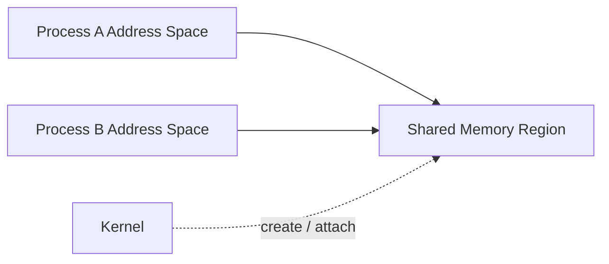
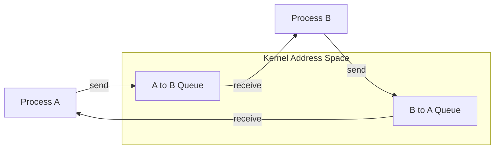

<!-- 由 scripts/sync-obsidian.mjs 从 Obsidian Vault 生成，请勿直接编辑。 -->

# 进程间通信：共享内存、消息传递与 Socket

IPC 是 Inter-Process Communication，也就是进程间通信。进程默认被地址空间隔离，一个进程不能随便读写另一个进程的内存；如果两个进程需要交换数据，就必须通过操作系统提供的机制或由操作系统授权的共享映射。

常见 IPC 可以粗略分成两类：

- shared memory：让多个进程映射同一块内存；
- message passing：由内核或通信端点转发消息。

## Shared Memory


共享内存通常通过系统调用创建。更准确地说，内核维护一个可共享的内存对象，多个进程再把它映射到各自的虚拟地址空间里。System V shared memory 里常说 `attach`，POSIX shared memory 和 `mmap` 则更常说 `map`。

关键点是：这块内存在物理上可以是同一份，但每个进程看到的是自己地址空间中的一段虚拟地址。两个进程中的虚拟地址不必相同，真正共享的是背后的物理页或内核对象。




共享内存只解决“两个进程能看到同一块数据”的问题，不解决“谁先读、谁先写、写到哪里”的问题。具体的内存布局、读写位置、数据格式都由进程自己约定。

因此共享内存通常还要搭配同步机制：

- mutex；
- semaphore；
- condition variable；
- futex；
- 文件锁或其他内核同步对象。

## Race Condition

竞争条件指的是：程序结果依赖多个执行流的相对时序，而这个时序又不受程序控制。它既会发生在线程之间，也会发生在多个进程通过共享内存通信时。

最简单的例子是两个进程同时修改共享变量 `x`：

```text
Process A: read x = 10
Process B: read x = 10
Process A: write x = 11
Process B: write x = 11
```

两个进程都做了一次 `x++`，但最终结果不是 12，而是 11。问题不在共享内存本身，而在“读-改-写”不是一个原子操作。

共享内存速度快，但它把同步责任交给了程序员。如果没有锁或原子操作，数据结构很容易被写坏。


## Message Passing

消息传递的思路是：进程不直接共享可写数据结构，而是通过内核维护的通道或受控端点交换消息。

常见形式包括：

- pipes；
- message queues；
- sockets；
- remote procedure calls；
- Mach ports。


视频里的 mailbox 可以理解成内核管理的消息队列。A 发送消息给 B，不是直接写 B 的内存，而是调用内核的 `send`；B 再通过 `receive` 从 mailbox 里取出消息。具体实现未必真的把所有数据长期放在“内核地址空间的一段队列”里，但权限、排队、阻塞唤醒由内核掌控。

一个双向 mailbox 可以由两个队列实现：



### 为什么进程不能直接访问 mailbox？

因为 mailbox 位于内核地址空间。普通进程运行在用户态，页表和权限位会阻止它直接访问内核内存。

这样做有几个原因：

- 防止进程伪造、篡改或删除别人的消息；
- 防止一个 bug 写坏内核维护的队列结构；
- 让内核可以统一处理阻塞、唤醒、权限检查、消息复制或零拷贝转交；
- 保持进程隔离，避免 IPC 通道变成任意内存写入口。

所以 message passing 至少需要两个系统调用：

- `send`：把消息交给内核；
- `receive`：从内核维护的队列中取消息，必要时阻塞等待。


## Mach：task 和 port

Mach 系统里，`task` 更接近资源容器，`thread` 才是执行流，通信端点是 `port`。需要注意的是：消息不是“发给进程”，而是发给 port。

一个 task 可以持有多个 port：

- listening port：接收连接请求；
- private port：建立后的私有通信通道；
- service port：暴露某种系统服务。

这种设计的好处是通信能力可以被当成一种权限对象来传递。谁持有某个 port 的 send right，谁就能向它发送消息；谁持有 receive right，谁才有资格接收该 port 上的消息。

## Socket


Socket 是更通用的通信接口，既能用于同一台机器上的进程通信，也能用于网络通信。

在 client-server 架构里，服务端通常这样工作：

```text
socket()
bind()
listen()
accept()
read()/write()
close()
```

客户端通常是：

```text
socket()
connect()
read()/write()
close()
```

本机进程通信可以使用 Unix domain socket，包括 `socketpair()` 这种直接创建一对已连接端点的方式；跨机器通信通常使用 TCP/UDP socket。

Socket 的核心抽象是“端点”。进程通过文件描述符操作 socket，内核负责缓冲、路由、阻塞唤醒、网络协议栈处理等细节。

## Shared Memory 和 Message Passing 的性能差异

| 方式 | 优点 | 缺点 |
|---|---|---|
| Shared Memory | 数据不用来回复制，吞吐量高，适合大块数据 | 同步复杂，容易出现 race condition |
| Message Passing | 接口清晰，隔离性好，内核可管理权限和阻塞 | 通常需要系统调用和数据复制，小消息更合适；部分系统可通过共享页、文件描述符传递等方式减少复制 |

大块数据传输常用共享内存，小控制消息常用消息传递。实际系统里两者经常组合使用：先用 socket 或 port 协商，再把大数据放进共享内存。
