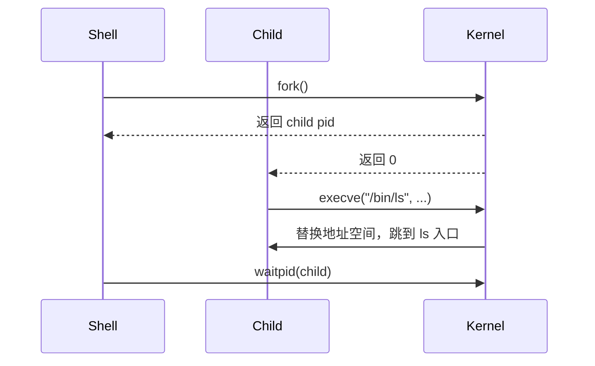

<!-- 由 scripts/sync-obsidian.mjs 从 Obsidian Vault 生成，请勿直接编辑。 -->

# 跨系统运行：CPU 架构、ABI 与可执行文件格式

直觉上很容易把问题归结为 CPU 架构不同：Windows 电脑长期以 x86-64 为主，Mac 现在以 ARM64 为主。但这只解释了一部分。

更关键的是：程序依赖的不只是 CPU 指令集，还依赖操作系统提供的二进制接口。

2019 年之前有大量 Intel Mac，CPU 架构和很多 Windows 电脑一样，但 Windows `.exe` 依然不能直接当作 macOS 程序运行。同样，Linux 和 Windows 即使都在 x86-64 上，普通二进制也不能互相直接运行。

## CPU 架构只是第一层

CPU 架构决定机器码长什么样。例如：

- x86-64 程序不能直接在 ARM CPU 上执行；
- ARM64 程序不能直接在 x86-64 CPU 上执行。

但即使 CPU 指令集一样，程序仍然需要操作系统配合。因为程序运行时会不断请求系统服务：创建进程、读写文件、分配内存、访问网络、加载动态库、处理异常等。

这些服务的入口和规则由 OS 定义。

## 用户态、内核态和系统调用

普通程序运行在用户态，不能直接控制硬件、页表、磁盘、网卡和定时器。需要这些能力时，它必须通过系统调用进入内核。

这里讲的是“系统调用 ABI”，不是程序员平时直接写的高级 API。Windows 程序常调用 Win32 API，例如 `CreateProcess`；这些 API 再进入 Windows 内核提供的更低层服务。Linux 程序常通过 libc 包装 `syscall`，而不是手写系统调用指令。

系统调用的一般流程是：

1. 用户程序把系统调用号放入约定寄存器；
2. 把参数放入约定寄存器或栈中；
3. 执行特殊入口指令，例如 x86-64 上常见的 `syscall`，ARM64 上常见的 `svc`；
4. CPU 切换到内核态；
5. 操作系统读取系统调用号和参数，查表执行对应服务；
6. 内核返回用户态。

问题在于：不同操作系统的系统调用集合、编号、参数规则都不同。

## ABI：真正卡住二进制兼容的地方

ABI 是 Application Binary Interface，应用二进制接口。它规定的是“已经编译好的机器码如何和系统以及其他二进制模块打交道”。

ABI 包括：

- 系统调用编号；
- 系统调用参数放在哪些寄存器里；
- 函数调用约定；
- 栈如何对齐；
- 返回值放在哪里；
- 动态链接规则；
- 结构体布局；
- 异常处理和线程局部存储规则；
- 可执行文件格式。

所以跨系统不兼容并不是“CPU 不认识这条加法指令”，而是“程序请求系统服务的方式和当前 OS 不匹配”。

## Windows 和 Unix 创建进程的差异

Windows 提供 `CreateProcess` 这类 Win32 API：一个主要 API 就能指定新程序路径、参数、环境、句柄继承等信息，然后创建新进程。它不是简单的一条 CPU 指令，也不是本文重点讨论的“系统调用编号”，而是 Windows 用户态 API 和内核服务共同形成的进程创建模型。

Unix/Linux 传统上常见的是 `fork + exec` 两步：

- `fork()`：复制当前进程，得到一个子进程；
- `exec()`：在子进程中把当前程序映像替换成另一个程序。

这不是语法差异，而是进程模型差异。现代 Unix-like 系统也常提供 `posix_spawn()`，它在语义上更接近“一步创建并执行新程序”，但底层仍要遵守该系统自己的 ABI 和加载规则。

## fork 详解

`fork()` 调用后，会出现两个几乎一样的进程：

- 父进程继续从 `fork()` 返回处往下执行；
- 子进程也从同一个位置往下执行；
- 父进程中 `fork()` 返回子进程 PID；
- 子进程中 `fork()` 返回 0。

示意：

```c
pid_t pid = fork();

if (pid == 0) {
    // child
} else {
    // parent
}
```

现代 Linux 不会在 `fork()` 时立刻把父进程所有内存完整复制一份。它通常使用 copy-on-write：

1. 父子进程先共享同一批物理页；
2. 页表标记为只读；
3. 谁要写某页，触发缺页异常；
4. 内核这时才复制该页，让写入方拥有自己的副本。

这样 `fork()` 可以很快，尤其适合马上接 `exec()` 的场景。

## exec 详解

`exec()` 不是创建新进程，而是替换当前进程的程序映像。

执行 `exec()` 后：

- PID 通常不变；
- 当前地址空间被新程序替换；
- text/data/heap/stack 重新建立；
- 程序从新可执行文件入口点开始；
- 打开的文件描述符默认可以保留，除非设置了 close-on-exec；
- 原来的代码不会继续往下执行，除非 `exec()` 失败。

典型 shell 执行命令的流程：



为什么要拆成两步？因为子进程在 `fork()` 和 `exec()` 之间可以做准备工作，例如重定向标准输入输出、设置环境变量、关闭文件描述符、改变工作目录等。

## 可执行文件格式不同

即使系统调用问题解决了，OS 也要能加载这个文件。

常见格式：

| 系统 | 可执行文件格式 |
|---|---|
| Windows | PE / Portable Executable |
| Linux | ELF / Executable and Linkable Format |
| macOS | Mach-O |

可执行文件不只是机器码，还包含：

- 入口点；
- 代码段和数据段布局；
- 动态库依赖；
- 重定位信息；
- 符号表；
- 调试信息；
- 权限和加载元数据。

操作系统的加载器只认识自己支持的格式。Windows loader 不会按 ELF 规则加载普通 Linux 程序，Linux loader 也不会按 PE 规则运行普通 `.exe`。Linux 可以通过 `binfmt_misc` 把某些外来格式转交给解释器或兼容层，但那已经不是“内核原生直接运行这个二进制”。

## 运行时和跨平台语言

Python、JavaScript、Java 这类语言看起来更容易跨平台，是因为中间多了一层运行时：

- Python 代码由对应平台的 Python 解释器执行；
- Java 字节码由 JVM 执行；
- JavaScript 由浏览器或 Node.js 执行。

真正和操作系统 ABI 打交道的是解释器或虚拟机，而不是源码本身。

但这不等于完全没有兼容问题。如果程序依赖平台专属模块、原生扩展、系统路径、动态库或外部命令，仍然可能只能在特定系统上运行。

## Wine、虚拟机和容器分别解决什么

| 方案 | 解决方式 |
|---|---|
| Wine | 在 Unix-like 系统上实现一层 Windows API/ABI 兼容层 |
| 虚拟机 | 模拟一整套硬件环境，在里面运行另一个 OS |
| 容器 | 共享宿主机内核，只隔离用户态环境；通常要求同一内核 ABI |
| Rosetta / QEMU | 做 CPU 指令集翻译 |

它们解决的问题不同。Wine 主要处理 Windows API 和 PE 加载；虚拟机直接带上完整 Windows；容器共享宿主机内核，所以 Linux 容器本质上仍运行 Linux 用户态程序；指令翻译只能解决 CPU 架构差异，不能自动解决 OS ABI 差异。

一句话：二进制程序能不能跨系统运行，取决于 CPU 指令集、可执行文件格式、系统调用 ABI、动态链接和运行时环境是否全部匹配。
