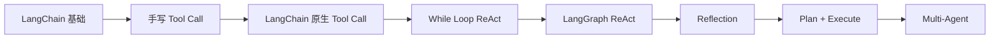
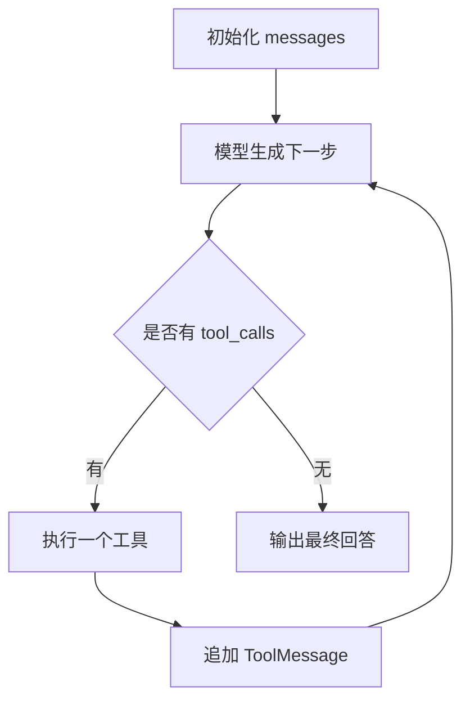
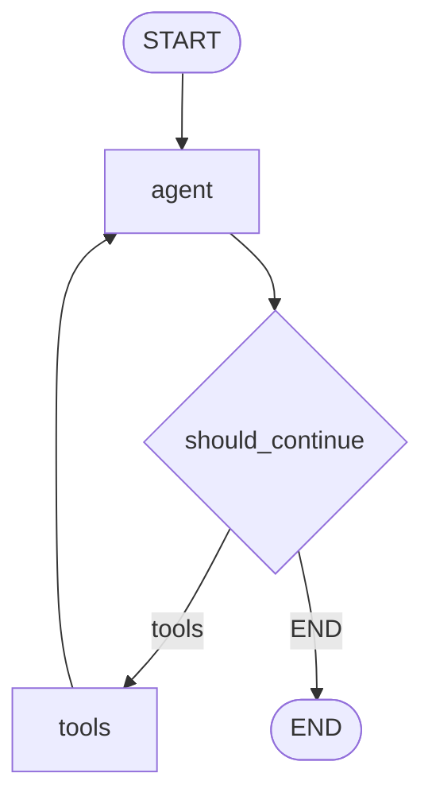
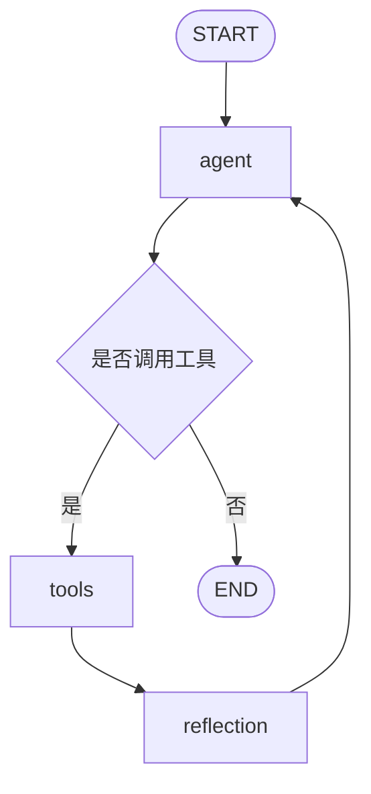
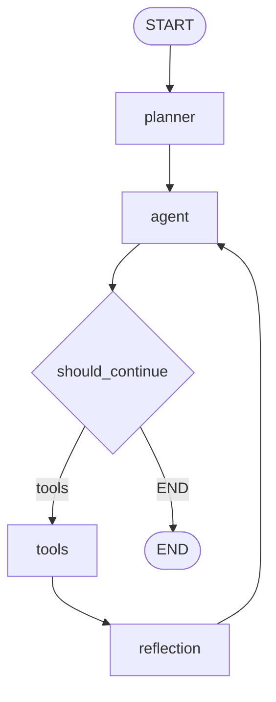
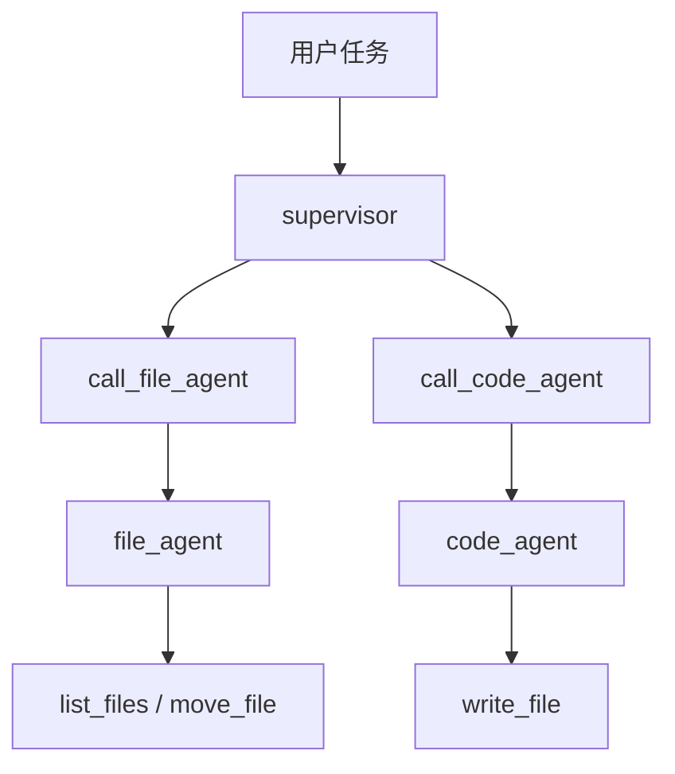
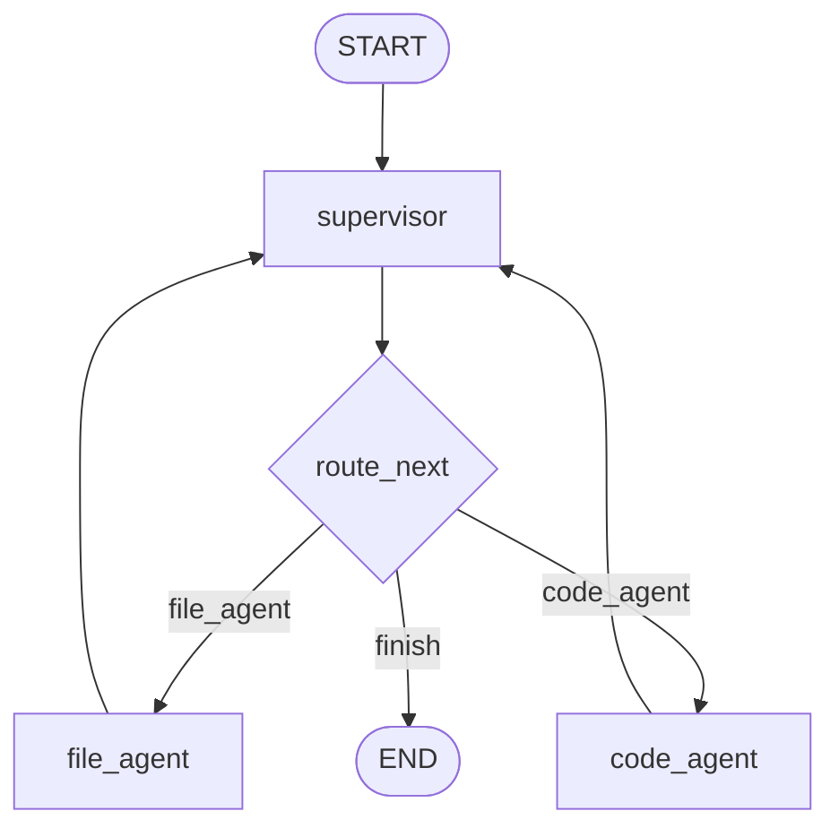

<!-- 由 scripts/sync-obsidian.mjs 从 Obsidian Vault 生成，请勿直接编辑。 -->

# Agent 学习：从 Tool Call 到 ReAct 与 Multi-Agent

写 Agent 之前，先把一件事想清楚：模型本身只会生成内容。它能“查天气”“移动文件”“写代码文件”，靠的是程序把这些能力包装成工具，再让模型在合适的时候选择工具。

本篇文章的完整学习路线为：先学 LangChain 的基本代码，再手写 Tool Call 协议，然后切到 LangChain 原生工具调用，再把一次工具调用扩展成 ReAct 循环，最后用 LangGraph 管理状态图和 Multi-Agent。

整体路线是：



## 1. 先会用 LangChain 调模型

LangChain 里最基础的模型调用，就是创建一个 chat model，然后传入一组 messages。

```python
import os
from pathlib import Path

from dotenv import load_dotenv
from langchain_core.messages import HumanMessage, SystemMessage
from langchain_openai import ChatOpenAI
from pydantic import SecretStr


def load_llm() -> ChatOpenAI:
    load_dotenv(Path(".venv") / ".env")
    return ChatOpenAI(
        model=os.getenv("MODEL", "deepseek-chat"),
        base_url=os.getenv("BASE_URL", "https://api.deepseek.com"),
        api_key=SecretStr(os.getenv("API_KEY", "")),
        temperature=0,
    )


messages = [
    SystemMessage(content="你是一个助手。"),
    HumanMessage(content="你好，介绍一下 LangChain。"),
]

response = load_llm().invoke(messages)
print(response.content)
```

这里先记三个点。

第一，`ChatOpenAI` 不只可以调 OpenAI，也可以调兼容 OpenAI API 协议的模型服务。关键参数是 `model`、`base_url`、`api_key`。

第二，LangChain 把上下文拆成消息对象。`SystemMessage` 放规则，`HumanMessage` 放用户输入，模型返回的是一条 AI 消息。

第三，`messages` 后面会变成 Agent 的记忆。工具调用、工具结果、反思建议，都会不断追加到这条消息链里。

## 2. 再会用 LangChain 定义工具

工具就是普通 Python 函数，只是加上了 LangChain 的 `@tool` 装饰器。

```python
from langchain_core.tools import tool


@tool
def get_weather(city: str) -> str:
    """Get the weather for a city."""
    weather = {
        "Beijing": "晴天，25 度",
        "Shanghai": "多云，28 度",
        "Hangzhou": "小雨，22 度",
    }
    return f"{city} 的天气是：{weather.get(city, '未知天气')}"
```

函数名会变成工具名。参数类型会变成工具参数 schema。docstring 会变成工具描述。

绑定工具的代码是：

```python
llm = load_llm().bind_tools([get_weather])
```

这一步的意思是：把工具列表告诉模型。模型下一次生成时，就可以返回结构化的工具调用。

工具执行完以后，要用 `ToolMessage` 把结果放回上下文。

```python
from langchain_core.messages import ToolMessage


messages.append(response)
messages.append(
    ToolMessage(
        content=result,
        name=tool_call["name"],
        tool_call_id=tool_call["id"],
    )
)
```

这段是 LangChain Agent 的基础。模型决定调用工具，Python 执行工具，工具结果通过 `ToolMessage` 回到模型上下文。

## 3. 简单手写 Tool Call

第一段学习代码先绕开 LangChain 原生 tool calling，手写了一个工具协议。

模型被要求输出固定格式：

```xml
<Tool>get_weather</Tool>
<Args>{"city":"Beijing"}</Args>
```

程序用正则把工具名和参数解析出来：

```python
import json
import re


def parse_tool_call(text: str) -> dict[str, object] | None:
    tool_match = re.search(r"<Tool>(.*?)</Tool>", text, re.DOTALL)
    args_match = re.search(r"<Args>(.*?)</Args>", text, re.DOTALL)

    if not tool_match:
        return None

    args = json.loads(args_match.group(1)) if args_match else {}
    return {
        "tool": tool_match.group(1).strip(),
        "args": args,
    }
```

然后根据工具名调用真实函数：

```python
call = parse_tool_call(model_text)

if call["tool"] == "get_weather":
    result = get_weather(**call["args"])
else:
    result = f"未知工具：{call['tool']}"
```


模型没有真的执行工具。模型只输出了一个动作描述。Python 程序读取这个描述，再决定调用哪个函数。

这也是后面所有 Agent 框架的底层逻辑。不过框架做得更标准，但本质上仍然是“模型给动作，程序执行动作”。

## 4. LangChain 原生 Tool Call：把协议交给框架

手写 XML 协议可以帮助理解原理，但格式太容易漂。第二段学习代码换成了 LangChain 原生工具调用。

先定义两个工具：

```python
@tool
def get_weather(city: str) -> str:
    """Get the weather for a city."""
    return f"{city} 的天气是：晴天，25 度"


@tool
def get_time(city: str) -> str:
    """Get the current time for a city."""
    return f"{city} 的当前时间是：14:00"
```

再把工具绑定到模型：

```python
llm = load_llm().bind_tools([get_weather, get_time])
```

现在模型返回的结果里会有 `tool_calls`：

```python
response = llm.invoke(messages)

print(response.content)
print(response.tool_calls)
```

每个 `tool_call` 大概包含这些信息：

```python
tool_call["name"]  # 工具名
tool_call["args"]  # 工具参数
tool_call["id"]    # 本次工具调用的 ID
```

执行工具时，一般会先做一个工具映射表：

```python
tools = {
    "get_weather": get_weather,
    "get_time": get_time,
}

for tool_call in response.tool_calls:
    selected_tool = tools[tool_call["name"]]
    result = selected_tool.invoke(tool_call["args"])
```

然后把工具结果写回消息链：

```python
messages.append(response)
messages.append(
    ToolMessage(
        content=result,
        name=tool_call["name"],
        tool_call_id=tool_call["id"],
    )
)
```

最后再调用一次模型，让模型根据工具结果组织最终回答：

```python
final_response = llm.invoke(messages)
print(final_response.content)
```

总结就是 LangChain 负责工具 schema 和结构化 tool call，开发者仍然要负责执行工具和回填 Tool Message。

## 5. While Loop ReAct：把一次工具调用扩展成多轮执行

一次 Tool Call 只能处理一步。真实任务通常要多步执行，比如先查看目录，再移动文件，再检查结果。

ReAct 的写法就是加一个循环：



核心代码可以写成这样：

```python
messages = [
    SystemMessage(content=SYSTEM_PROMPT),
    HumanMessage(content=TASK_PROMPT),
]

tools = [move_file, list_files]
tool_map = {tool.name: tool for tool in tools}
model = load_llm().bind_tools(tools)

for _ in range(7):
    response = model.invoke(messages)
    messages.append(response)

    if not response.tool_calls:
        print(response.content)
        break

    tool_call = response.tool_calls[0]
    selected_tool = tool_map[tool_call["name"]]
    result = selected_tool.invoke(tool_call["args"])

    messages.append(
        ToolMessage(
            content=str(result),
            name=tool_call["name"],
            tool_call_id=tool_call["id"],
        )
    )
```

这里有两个重点。

第一，`messages` 是整个 Agent 的运行记录。模型每次都能看到前面发生了什么。

第二，循环一定要有限制。示例里最多跑 7 轮，每轮最多执行一个工具。这样即使模型判断不稳定，也不会无限调用工具。

LangChain 在这里负责模型调用、工具声明和 Tool Message。控制流还在普通 Python 循环里。

## 6. LangGraph ReAct：把循环改成状态图

while loop 跑通以后，下一步就是把 ReAct 改写成 LangGraph。

LangGraph 的三个基本概念是：

- state：保存当前任务状态。
- node：读取 state，返回更新后的 state。
- edge：决定下一个节点。

先定义状态：

```python
from typing import TypedDict
from langchain_core.messages import BaseMessage


class AgentState(TypedDict):
    messages: list[BaseMessage]
```

再定义 Agent 节点：

```python
def agent_node(state: AgentState) -> AgentState:
    response = model.invoke([
        SystemMessage(content=SYSTEM_PROMPT),
        *state["messages"],
    ])

    return {
        **state,
        "messages": [*state["messages"], response],
    }
```

Tools 节点负责执行模型返回的工具调用：

```python
from langchain_core.messages import AIMessage, ToolMessage


def tools_node(state: AgentState) -> AgentState:
    response = state["messages"][-1]
    new_messages = list(state["messages"])

    if not isinstance(response, AIMessage):
        return state

    for tool_call in response.tool_calls:
        result = tool_map[tool_call["name"]].invoke(tool_call["args"])
        new_messages.append(
            ToolMessage(
                content=str(result),
                name=tool_call["name"],
                tool_call_id=tool_call["id"],
            )
        )

    return {**state, "messages": new_messages}
```

条件函数决定是否继续：

```python
from langgraph.graph import END


def should_continue(state: AgentState) -> str:
    response = state["messages"][-1]
    return "tools" if getattr(response, "tool_calls", None) else END
```

最后把节点连成图：

```python
from langgraph.graph import START, StateGraph


graph = StateGraph(AgentState)
graph.add_node("agent", agent_node)
graph.add_node("tools", tools_node)

graph.add_edge(START, "agent")
graph.add_conditional_edges(
    "agent",
    should_continue,
    {"tools": "tools", END: END},
)
graph.add_edge("tools", "agent")

app = graph.compile()
final_state = app.invoke({"messages": messages})
```

这时 ReAct 的结构就从“隐藏在循环里”变成了“画在图上”。

LangChain 仍然负责工具和模型。LangGraph 负责流程：先到 Agent，判断是否去 Tools，Tools 执行完再回 Agent。



## 7. Reflection：在图里插入 reviewer 节点

ReAct 有时会出现一个问题：任务已经完成了，模型还想继续调用工具。

解决办法是加一个 Reflection 节点，让 reviewer 根据最近的工具结果给 executor 一句建议。

状态里多一个字段：

```python
class AgentState(TypedDict):
    messages: list[BaseMessage]
    reflection: str
```

Agent 节点调用模型时，把 reflection note 拼进 prompt：

```python
def agent_node(state: AgentState) -> AgentState:
    prompt = SYSTEM_PROMPT

    if state["reflection"]:
        prompt += f"\n\nReflection note: {state['reflection']}"

    response = model.invoke([
        SystemMessage(content=prompt),
        *state["messages"],
    ])

    return {
        **state,
        "messages": [*state["messages"], response],
    }
```

Reflection 节点只看最近几条消息：

```python
def reflection_node(state: AgentState) -> AgentState:
    recent_messages = state["messages"][-4:]
    transcript = "\n".join(str(message.content) for message in recent_messages)

    note = base_llm.invoke([
        SystemMessage(content=REFLECTION_PROMPT),
        HumanMessage(content=transcript),
    ])

    return {**state, "reflection": str(note.content)}
```

图结构也只多了一段：

```python
graph.add_edge("tools", "reflection")
graph.add_edge("reflection", "agent")
```

对应的图是：



这一步开始体现 LangGraph 的优势了。加 reviewer 不需要重写主循环，只是在图里加一个节点，再改两条边。

## 8. Plan + Execute：先生成计划，再按计划执行

再往后，可以在执行前加一个 Planner 节点。

Planner 负责把用户任务拆成步骤：

```python
PLANNER_PROMPT = """
你是一个任务规划助手。请根据用户任务制定一个清晰的执行计划。
请按顺序输出具体步骤，每步一行，使用 "1. " 编号。
只输出计划步骤，不要输出额外解释。
""".strip()
```

状态继续扩展：

```python
class AgentState(TypedDict):
    task: str
    plan: list[str]
    messages: list[BaseMessage]
    reflection: str
```

Planner 节点生成计划，并把计划写入 state：

```python
def planner_node(state: AgentState) -> AgentState:
    response = base_llm.invoke([
        SystemMessage(content=PLANNER_PROMPT),
        HumanMessage(content=state["task"]),
    ])

    plan = parse_plan(str(response.content))
    plan_text = "\n".join(
        f"{index}. {step}"
        for index, step in enumerate(plan, start=1)
    )

    plan_message = HumanMessage(
        content=f"用户任务：{state['task']}\n\n计划：\n{plan_text}"
    )

    return {
        **state,
        "plan": plan,
        "messages": [*state["messages"], plan_message],
    }
```

Executor 节点把计划放进 prompt：

```python
def agent_node(state: AgentState) -> AgentState:
    plan_text = "\n".join(
        f"{index}. {step}"
        for index, step in enumerate(state["plan"], start=1)
    )

    prompt = f"{SYSTEM_PROMPT}\n\n计划：\n{plan_text}"

    if state["reflection"]:
        prompt += f"\n\nReflection note: {state['reflection']}"

    response = tool_llm.invoke([
        SystemMessage(content=prompt),
        *state["messages"],
    ])

    return {
        **state,
        "messages": [*state["messages"], response],
    }
```

完整图如下：



这版里 LangChain 有两个角色：普通 LLM 用来规划和反思，绑定工具的 LLM 用来执行。LangGraph 把这些角色拆成不同节点。

这个结构比纯 ReAct 更稳。模型先有一个路线图，再根据工具结果一步步调整。

## 9. Multi-Agent 第一版：把 specialist agent 包成工具

Multi-Agent 的第一种写法，是先创建几个 specialist agent，再把它们包装成 supervisor 可以调用的工具。

先创建两个职责窄的 agent：

```python
from langchain.agents import create_agent


file_agent = create_agent(
    model=llm,
    tools=[list_files, move_file],
    system_prompt=FILE_AGENT_PROMPT,
    name="file_agent",
)

code_agent = create_agent(
    model=llm,
    tools=[write_file],
    system_prompt=CODE_AGENT_PROMPT,
    name="code_agent",
)
```

再把 agent 包装成工具：

```python
@tool
def call_file_agent(instruction: str) -> str:
    """Delegate a file-management task to file_agent."""
    response = file_agent.invoke({
        "messages": [{"role": "user", "content": instruction}]
    })
    return str(response["messages"][-1].content)


@tool
def call_code_agent(instruction: str) -> str:
    """Delegate a code-generation task to code_agent."""
    response = code_agent.invoke({
        "messages": [{"role": "user", "content": instruction}]
    })
    return str(response["messages"][-1].content)
```

最后创建 supervisor：

```python
supervisor = create_agent(
    model=llm,
    tools=[call_file_agent, call_code_agent],
    system_prompt=SUPERVISOR_PROMPT,
    name="supervisor",
)

response = supervisor.invoke({
    "messages": [{"role": "user", "content": task}]
})
```

这一版主要是 LangChain 的教学点：agent 也可以被包装成工具。supervisor 看起来只是在调用两个工具，工具背后其实各自跑了一个完整 agent。

结构如下：



这种写法很适合快速实现 multi-agent。缺点也很明显：调用顺序主要靠 supervisor prompt 约束，状态结构没有显式展开。

## 10. Multi-Agent 第二版：把每个 agent 放进 LangGraph 节点

第二种写法更接近工程化 Multi-Agent：每个 agent 都是 LangGraph 里的一个节点。

先定义状态：

```python
class MultiAgentState(TypedDict):
    task: str
    next_agent: str
    file_report: str
    code_report: str
    final_answer: str
```

supervisor 节点负责决定下一步：

```python
def supervisor_node(state: MultiAgentState) -> MultiAgentState:
    if not state["file_report"]:
        next_agent = "file_agent"
    elif not state["code_report"]:
        next_agent = "code_agent"
    else:
        next_agent = "finish"

    decision = llm.invoke([
        SystemMessage(content=SUPERVISOR_PROMPT),
        HumanMessage(content=f"建议答案：{next_agent}"),
    ]).content

    decision = str(decision).strip()
    if decision not in {"file_agent", "code_agent", "finish"}:
        decision = next_agent

    return {**state, "next_agent": decision}
```

这里有个很实用的兜底：先用代码推一个建议答案，再让 LLM 判断。如果 LLM 输出非法值，就回退到代码建议。

specialist 节点只做自己的事，并把报告写回 state：

```python
def file_agent_node(state: MultiAgentState) -> MultiAgentState:
    result = file_agent.invoke({
        "messages": [{
            "role": "user",
            "content": f"只处理文件整理任务：{state['task']}",
        }]
    })

    return {
        **state,
        "file_report": str(result["messages"][-1].content),
    }
```

路由函数根据 `next_agent` 决定下一步：

```python
def route_next(state: MultiAgentState) -> str:
    if state["next_agent"] == "file_agent":
        return "file_agent"
    if state["next_agent"] == "code_agent":
        return "code_agent"
    return END
```

最后组图：

```python
graph = StateGraph(MultiAgentState)
graph.add_node("supervisor", supervisor_node)
graph.add_node("file_agent", file_agent_node)
graph.add_node("code_agent", code_agent_node)

graph.add_edge(START, "supervisor")
graph.add_conditional_edges("supervisor", route_next)
graph.add_edge("file_agent", "supervisor")
graph.add_edge("code_agent", "supervisor")

app = graph.compile()
```

图结构如下：



在这里,supervisor 不再只是 prompt 里的概念，它变成了图里的路由节点。每个 specialist agent 也有自己的节点和状态字段。

这种写法更适合继续扩展。比如后面要加 research agent、review agent、human approval，只需要继续加节点和条件边。

## 11. 小结

以上大致内容可以压缩成一句话：先让模型会表达工具调用，再让程序执行工具，最后用图把多轮执行和多 agent 协作管起来。

LangChain 解决的是“模型、消息、工具”这层问题。你用它定义工具、绑定工具、读取 `tool_calls`、回填 `ToolMessage`。

LangGraph 解决的是“流程、状态、路由”这层问题。先定义 state、node、edge，把 ReAct、Reflection、Plan、Multi-Agent 都放进同一套状态图里。
