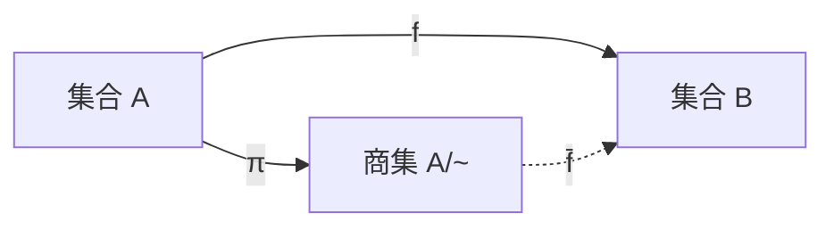
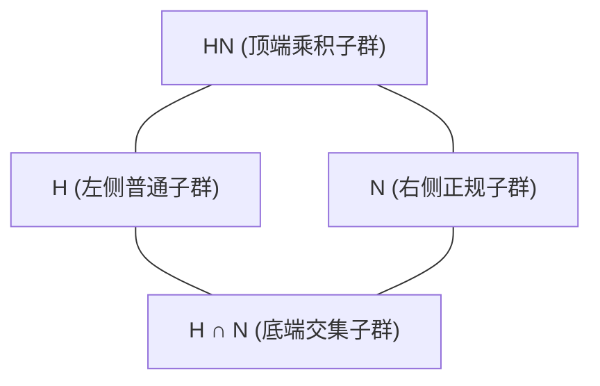

<!-- 由 scripts/sync-obsidian.mjs 从 Obsidian Vault 生成，请勿直接编辑。 -->

# 算法竞赛个人模板库 (Competitive Programming Template Library)

> **作者**: Sanzenin
> **整理时间**: 2026-10-25
> **使用入口**: 第九章查 Trick，第十章查自包含模板，第十一章查数学套路，第十二章查抽象代数；个人易错点见文末附录。

---

## 目录 (Table of Contents)

- **[第一章 竞赛框架与基础设施](#chapter-1)**
  - [1.1 C++ 快速 I/O 与竞赛宏模板](#section-1-1)
  - [1.2 solve() 闭包骨架](#section-1-2)
  - [1.3 离散化 (Discretization)](#section-1-3)
  - [1.4 整数二分查找 (Binary Search)](#section-1-4)
  - [1.5 整数三分查找 (Ternary Search)](#section-1-5)
  - [1.6 双向分层搜索（梦魇专用实例）](#section-1-6)
  - [1.7 八数码 A*（曼哈顿启发式）](#section-1-7)
  - [1.8 编译器预处理、LOCAL 调试与 GCC pragma](#section-1-8)
- **[第二章 基础与进阶数据结构](#chapter-2)**
  - [2.1 树状数组 (Fenwick Tree / 点修区间和)](#section-2-1)
  - [2.2 树状数组 + 倍增求第 K 小 (约瑟夫环 II 实战)](#section-2-2)
  - [2.3 线段树：单点修改与区间和查询](#section-2-3)
  - [2.4 线段树：区间修改与区间求和 (Lazy Tag)](#section-2-4)
  - [2.5 线段树全功能完整实现 (Point & Range Updates)](#section-2-5)
  - [2.6 线段树上二分 (Segment Tree Walk)](#section-2-6)
  - [2.7 动态开点线段树 (Dynamic Segment Tree)](#section-2-7)
  - [2.8 动态开点线段树 (完整题解版)](#section-2-8)
  - [2.9 权值线段树 (Weight Segment Tree)](#section-2-9)
  - [2.10 李超线段树（项目收益实例）](#section-2-10)
  - [2.11 矩形面积并（0-based离散化，128位面积）](#section-2-11)
  - [2.12 可持久化数组（历史版本单点修改/查询）](#section-2-12)
  - [2.13 主席树：权值持久化实现](#section-2-13)
  - [2.14 ST 表：静态区间最值 (RMQ / Sparse Table)](#section-2-14)
  - [2.15 单调队列：滑动窗口最值 (Monotone Queue)](#section-2-15)
  - [2.16 单调栈 (Monotone Stack)](#section-2-16)
  - [2.17 二叉堆（C++动态数组）](#section-2-17)
  - [2.18 可并堆：左偏树 (Leftist Tree / Mergable Heap)](#section-2-18)
  - [2.19 可持久化左偏树 (Persistent Leftist Tree)](#section-2-19)
  - [2.20 笛卡尔树构造与特定 XOR 子树检查实例](#section-2-20)
  - [2.21 Treap 平衡树（FHQ 分裂合并版本）](#section-2-21)
  - [2.22 Splay 伸展树 (Standard Splay)](#section-2-22)
  - [2.23 Splay 伸展树 (第二实现版本)](#section-2-23)
  - [2.24 隐式 FHQ Treap（区间翻转）](#section-2-24)
  - [2.25 FHQ Treap 无旋平衡树 (按值分裂与合并 / 来自知乎专栏)](#section-2-25)
  - [2.26 动态开点线段树合并 (Segment Tree Merge / 来自知乎专栏)](#section-2-26)
  - [2.27 虚树 (Virtual Tree / CF613D & P2495 方案)](#section-2-27)
  - [2.28 树状数组维护区间和（区间加、区间求和）](#section-2-28)
- **[第三章 PBDS (Policy-Based Data Structures)](#chapter-3)**
  - [3.1 PBDS 红黑平衡树全家桶 (rb_tree_tag 全功能封装)](#section-3-1)
  - [3.2 PBDS 有序集合 (Ordered Set)](#section-3-2)
  - [3.3 PBDS 有序多重集合 (Ordered Multiset)](#section-3-3)
  - [3.4 PBDS 哈希表 (gp_hash_table)](#section-3-4)
  - [3.5 PBDS 可修改配对堆 (pairing_heap_tag priority_queue)](#section-3-5)
  - [3.6 PBDS 字典树 (pat_trie_tag trie)](#section-3-6)
- **[第四章 字符串算法](#chapter-4)**
  - [4.1 KMP 字符串模式匹配算法](#section-4-1)
  - [4.2 字符串单哈希与前缀幂预处理](#section-4-2)
  - [4.3 单模哈希应用：对称分块](#section-4-3)
  - [4.4 Manacher 最长回文子串算法](#section-4-4)
  - [4.5 字典树 Trie（小写字母，动态节点）](#section-4-5)
  - [4.6 01-Trie 最大异或对（uint32_t）](#section-4-6)
- **[第五章 图论与树论算法](#chapter-5)**
  - [5.1 单源最短路 Dijkstra](#section-5-1)
  - [5.2 并查集 (Disjoint Set Union)](#section-5-2)
  - [5.3 带权并查集 (Weighted DSU / 势能维护)](#section-5-3)
  - [5.4 带权并查集 (完整题解版)](#section-5-4)
  - [5.5 最小生成树 Kruskal](#section-5-5)
  - [5.6 Kruskal 重构树 (Kruskal Reconstruction Tree)](#section-5-6)
  - [5.7 严格次小生成树 (Strict Second Minimum Spanning Tree)](#section-5-7)
  - [5.8 最近公共祖先 LCA (倍增实现)](#section-5-8)
  - [5.9 LCA 独立实现 (数组版)](#section-5-9)
  - [5.10 两次 DFS 求树的直径](#section-5-10)
  - [5.11 树的直径完整实现 (带权与距离维护)](#section-5-11)
  - [5.12 树上 DFS 与子树规模统计](#section-5-12)
  - [5.13 拓扑排序 (Kahn 算法)](#section-5-13)
  - [5.14 Tarjan 算法：有向图强连通分量 (SCC 缩点)](#section-5-14)
  - [5.15 Tarjan 有向图 SCC (独立实现版)](#section-5-15)
  - [5.16 Tarjan 算法：无向图割点判定](#section-5-16)
  - [5.17 Tarjan 算法：无向图割边判定 (桥)](#section-5-17)
  - [5.18 无向图割点与桥（重边/非连通）](#section-5-18)
  - [5.19 2-SAT 问题求解 (Tarjan SCC)](#section-5-19)
  - [5.20 二分图最大匹配 (匈牙利算法 / Kuhn 算法)](#section-5-20)
  - [5.21 Hall 婚姻定理 (Hall's Marriage Theorem)](#section-5-21)
  - [5.22 网络流：Dinic 最大流算法](#section-5-22)
  - [5.23 网络流：Dinic 独立实现版](#section-5-23)
  - [5.24 网络流：Edmonds-Karp (EK 增广路算法)](#section-5-24)
  - [5.25 第 K 短路 A*（允许重复点边的 walk）](#section-5-25)
  - [5.26 欧拉回路 (Eulerian Circuit / Path)](#section-5-26)
  - [5.27 0-1 BFS（边权仅0或1）](#section-5-27)
  - [5.28 树上启发式合并 (DSU on Tree / 来自知乎专栏)](#section-5-28)
  - [5.29 基环树森林与倍增跳环 (CSES Planets Queries II)](#section-5-29)
- **[第六章 数论与数学算法](#chapter-6)**
  - [6.1 快速幂与模乘 (Binary Exponentiation)](#section-6-1)
  - [6.2 质数判定与试除法分解](#section-6-2)
  - [6.3 埃氏筛与欧拉线性筛 (Euler Sieve)](#section-6-3)
  - [6.4 扩展欧几里得算法 (EXGCD)](#section-6-4)
  - [6.5 扩展欧几里得与一次同余方程 (独立例程)](#section-6-5)
  - [6.6 裴蜀定理应用 (Bezout's Identity)](#section-6-6)
  - [6.7 费马小定理与逆元 (Fermat's Little Theorem)](#section-6-7)
  - [6.8 扩展欧拉降幂（十进制大指数）](#section-6-8)
  - [6.9 组合数：阶乘与逆元预处理](#section-6-9)
  - [6.10 范德蒙德卷积公式与组合恒等式](#section-6-10)
  - [6.11 高斯普通消元法 (Gauss-Jordan Elimination)](#section-6-11)
  - [6.12 高斯异或消元法 (XOR Gauss Elimination)](#section-6-12)
  - [6.13 Miller-Rabin 素性测试 (大素数判定)](#section-6-13)
  - [6.14 BSGS 离散对数算法 (Baby-step Giant-step)](#section-6-14)
  - [6.15 中国剩余定理 CRT (Chinese Remainder Theorem)](#section-6-15)
  - [6.16 扩展中国剩余定理 EXCRT (Extended CRT)](#section-6-16)
  - [6.17 莫比乌斯反演与数论分块 (P3455 ZAP-Queries)](#section-6-17)
  - [6.18 Dirichlet 卷积与莫比乌斯反演理论](#section-6-18)
  - [6.19 异或线性基 (Linear Basis)](#section-6-19)
  - [6.20 K 个数的异或最大/特定统计](#section-6-20)
  - [6.21 逆序对统计 (树状数组 / 归并排序求法)](#section-6-21)
  - [6.22 高精度乘法（幂的数位统计实例）](#section-6-22)
  - [6.23 有界生成函数计数（滑动窗口DP）](#section-6-23)
  - [6.24 卡特兰与括号前缀补全](#section-6-24)
  - [6.25 康托展开与逆康托展开 (Cantor Expansion / Obsidian / 知乎)](#section-6-25)
  - [6.26 斯特林数 (Stirling Numbers / 递推与组合意义)](#section-6-26)
  - [6.27 错排问题 (Derangement)](#section-6-27)
- **[第七章 计算几何](#chapter-7)**
  - [7.1 二维向量与点类基础结构 (Point & Vector)](#section-7-1)
  - [7.2 整数点极角排序（128位叉积）](#section-7-2)
  - [7.3 Andrew 二维凸包算法 (Convex Hull)](#section-7-3)
  - [7.4 Andrew 凸包独立实现 (带周长与多边形面积计算)](#section-7-4)
  - [7.5 二维凸包 (CSES g_andrew.cpp 实战版)](#section-7-5)
  - [7.6 半平面交（有界多边形裁剪）](#section-7-6)
  - [7.7 线段相交判定 (CSES Line Segment Intersection)](#section-7-7)
  - [7.8 多边形面积计算 (CSES Polygon Area)](#section-7-8)
  - [7.9 点在多边形内部判定 (CSES Point in Polygon)](#section-7-9)
  - [7.10 二维最小圆覆盖（随机增量）](#section-7-10)
  - [7.11 三维最小包围球概念](#section-7-11)
  - [7.12 两直线交点计算 (Line Intersection)](#section-7-12)
  - [7.13 直线与圆的交点计算 (Line-Circle Intersection)](#section-7-13)
  - [7.14 平面最近点对 (Closest Pair of Points / 分治法)](#section-7-14)
  - [7.15 Pick 定理与多边形格点 (Pick's Theorem & Polygon Area)](#section-7-15)
  - [7.16 光线投射算法 (Point in Polygon / 射线法判定点在多边形内部)](#section-7-16)
- **[第八章 动态规划与博弈论](#chapter-8)**
  - [8.1 矩阵快速幂 (Matrix Exponentiation)](#section-8-1)
  - [8.2 广义矩阵乘法与恰好 K 步最短路 (CSES 1724)](#section-8-2)
  - [8.3 区间博弈 DP (CSES Removal Game)](#section-8-3)
  - [8.4 树状数组统计所有严格递增子序列](#section-8-4)
  - [8.5 状压 DP 求解哈密顿路径 (CSES Hamiltonian Flights)](#section-8-5)
  - [8.6 二次代价 DP（离散李超树优化）](#section-8-6)
  - [8.7 树形背包（恰选q条与根连通的边）](#section-8-7)
  - [8.8 树形背包 DP (DFS 序展开优化版)](#section-8-8)
  - [8.9 Nim 博弈 (经典异或和定理)](#section-8-9)
  - [8.10 集合 Nim 博弈与 SG 函数 (Sprague-Grundy)](#section-8-10)
  - [8.11 有向图棋子移动博弈 (Graph Chess Game)](#section-8-11)
  - [8.12 剪纸博弈 (Cutting Game)](#section-8-12)
  - [8.13 模拟退火：赛场可读模板与使用场景](#section-8-13)
- **[第九章 竞赛经典 Trick 与思维模型](#chapter-9)**
  - [9.1 经典 Trick 全文（A–Z）](#section-9-1)
  - [9.2 贡献法应用](#section-9-2)
- **[第十章 常用可复用模板](#chapter-10)**
  - [10.1 自包含模板、前提与完整示例](#section-10-1)
- **[第十一章 数学套路与赛时转化](#chapter-11)**
  - [11.1 数学套路](#section-11-1)
- **[第十二章 抽象代数](#chapter-12)**
  - [12.1 抽象代数的竞赛用法](#section-12-1)
  - [12.2 集合论与映射](#section-12-2)
  - [12.3 群与子群](#section-12-3)
  - [12.4 循环群与生成元](#section-12-4)
  - [12.5 陪集-Lagrange-正规子群](#section-12-5)
  - [12.6 商群与同态](#section-12-6)
  - [12.7 三大同构定理](#section-12-7)
  - [12.8 置换群-内自同构-Cayley](#section-12-8)
  - [12.9 易错点与证明套路](#section-12-9)
- **[附录 个人易错点](#chapter-13)**
  - [13.1 个人易错点与三个月复盘](#section-13-1)

---

<a id="chapter-1"></a>

# 第一章 竞赛框架与基础设施

<a id="section-1-1"></a>

## 1.1 C++ 快速 I/O 与竞赛宏模板

**说明与应用场景**：包含 `bits/stdc++.h` 与 pbds 头文件、基础宏定义 (`ll`, `pr`, `inf`, `lc`, `rc`)、解绑标准流 `ios::sync_with_stdio(0)`，以及标准的 lambda `solve()` 结构。

```cpp
#include <bits/stdc++.h>
#include <bits/extc++.h>
#define ll long long
#define pr pair<ll, ll>
#define tii tuple<int, int, int>
#define tll tuple<ll, ll, ll>
#define sp << ' ' <<
#define inf 0x3f3f3f3f3f3f3f3f
#define N 100005
#define M 1000005
#define lc p << 1
#define rc p << 1 | 1
using namespace std;
using namespace __gnu_pbds;

int main()
{
    ios::sync_with_stdio(0);
    cin.tie(nullptr);
    cout.tie(nullptr);

    auto solve = [&]()
    {
        // TODO: 读入题目数据、补充题目本身的逻辑
    };

    solve();
    return 0;
}
```

---

<a id="section-1-2"></a>

## 1.2 solve() 闭包骨架

**说明与应用场景**：多测或局部作用域闭包定义骨架。

```cpp
auto solve = [&]()
{
    // TODO: 题目逻辑
};

solve();
```

---

<a id="section-1-3"></a>

## 1.3 离散化 (Discretization)

**说明与应用场景**：基于 `std::sort` 与 `std::unique` 的 1-indexed 离散化映射，返回 `lower_bound` 后的离散编号。

```cpp
vector<ll> nums;
// TODO: 先把所有会参与比较/查询的原值放入 nums。
sort(nums.begin(), nums.end());
nums.erase(unique(nums.begin(), nums.end()), nums.end());

auto get_id = [&](ll x) -> int
{
    return lower_bound(nums.begin(), nums.end(), x) - nums.begin() + 1;
};

// TODO: get_id(x) 是 1-indexed 离散编号；输出原值用 nums[id - 1]。
```

---

<a id="section-1-4"></a>

## 1.4 整数二分查找 (Binary Search)

**说明与应用场景**：开区间单调性二分模板 (`l + 1 < r`)，稳定防死循环，返回满足单调谓词的第一边界。

```cpp
auto check = [&](ll mid) -> bool
{
    // TODO: 判断 mid 是否可行，保持可行性单调。
    return true;
};

ll l = -1, r = 1e18;
while (l + 1 < r)
{
    ll mid = (l + r) >> 1;
    if (check(mid))
        r = mid;
    else
        l = mid;
}
// TODO: r 是第一个满足 check 的整数；边界按题目修改。
```

---

<a id="section-1-5"></a>

## 1.5 整数三分查找 (Ternary Search)

**说明与应用场景**：单峰 / 单谷函数的三分法极值搜索，三等分点迭代并在小区间内暴力比较极值。

```cpp
auto cal = [&](ll x) -> ll
{
    // TODO: 单峰函数；按题意返回函数值。
    return x;
};

ll l = 0, r = 1e18;
while (r - l > 3)
{
    ll lm = (2 * l + r) / 3;
    ll rm = (l + 2 * r) / 3;
    if (cal(lm) < cal(rm))
        l = lm;
    else
        r = rm;
}
ll ans = cal(l);
for (ll i = l; i <= r; i++)
    ans = max(ans, cal(i));
// TODO: 求最小值时反转比较符号。
```

---

<a id="section-1-6"></a>

## 1.6 双向分层搜索（梦魇专用实例）

**说明与应用场景**：男生每轮3步、女生1步，鬼每轮扩散2格；不能当一般等代价双向BFS原封套用。

```cpp
#include<bits/stdc++.h>
#define ll long long
#define N 805
#define pr pair<ll,ll>
using namespace std;

ll n,m,t,tim;
pr b,g;
vector<pr>gho;
char map1[N][N];
bool vis1[N][N];
bool vis2[N][N];
bool check(int x,int y)
{
    if(x<1 || y<1 ||x>n||y>m || map1[x][y]=='X') return 0;
    for(auto gg:gho)
    {
        if(abs(x-gg.first)+abs(y-gg.second)<=tim*2) return false;
    }
    return 1;
}
pr mv[4]={{1,0},{-1,0},{0,1},{0,-1}};
void bfs()
{
    queue<pr>q1;
    queue<pr>q2;
    q1.push(b);
    q2.push(g);
    vis1[b.first][b.second]=1;
    vis2[g.first][g.second]=1;
    while(q1.size()|| q2.size())
    {
        tim++;
        for(int i=1;i<=3;i++)
        {
            ll siz=q1.size();
            for(int j=0;j<siz;j++)
            {
                auto now=q1.front();
                q1.pop();
                if(!check(now.first,now.second)) continue;
                for(int k=0;k<4;k++)
                {
                    ll x=now.first+mv[k].first;
                    ll y=now.second+mv[k].second;
                    if(!check(x,y)) continue;
                    if(vis2[x][y])
                    {
                        cout<<tim<<'\n'; //在当前步遇到
                        return;
                    }
                    if(vis1[x][y]) continue;
                    vis1[x][y]=1;
                    q1.push({x,y});
                }
            }
        }
        for(int i=1;i<=1;i++)
        {
            ll siz=q2.size();
            for(int j=0;j<siz;j++)
            {
                auto now=q2.front();
                q2.pop();
                if(!check(now.first,now.second)) continue;
                for(int k=0;k<4;k++)
                {
                    ll x=now.first+mv[k].first;
                    ll y=now.second+mv[k].second;
                    if(!check(x,y)) continue;
                    if(vis1[x][y])
                    {
                        cout<<tim<<'\n';
                        return;
                    }
                    if(vis2[x][y]) continue;
                    vis2[x][y]=1;
                    q2.push({x,y});
                }
            }
        }

    }
    cout<<-1<<'\n';
}

int main()
{
    ios::sync_with_stdio(0);
    cin.tie(NULL);
    cout.tie(NULL);
    cin>>t;
    while(t--)
    {
        tim=0;
        memset(vis1,0,sizeof vis1);
        memset(vis2,0,sizeof vis2);
        gho.clear();
        cin>>n>>m;
        for(int i=1;i<=n;i++)
        {
            for(int j=1;j<=m;j++)
            {
                cin>>map1[i][j];
                if(map1[i][j]=='M') b={i,j};
                else if(map1[i][j]=='G') g={i,j};
                else if(map1[i][j]=='Z') gho.push_back({i,j});
            }
        }
        bfs();
    }

    return 0;
}
```

---

<a id="section-1-7"></a>

## 1.7 八数码 A*（曼哈顿启发式）

**说明与应用场景**：自定义目标，默认123804765；输入0..8排列，无解-1，最优步数。

```cpp
#include <bits/stdc++.h>
using namespace std;
// A*+曼哈顿距离，忽略0空格；目标可自定义。输入须为0..8的排列。
int eight_puzzle(string start,string goal="123804765"){
    auto valid=[](string s){sort(s.begin(),s.end());return s=="012345678";};
    if(!valid(start)||!valid(goal))return -1;
    auto parity=[](const string&s){int c=0;for(int i=0;i<9;++i)if(s[i]!='0')for(int j=0;j<i;++j)if(s[j]!='0'&&s[j]>s[i])++c;return c%2;};
    if(parity(start)!=parity(goal))return -1;
    array<int,9>pos{};for(int i=0;i<9;++i)pos[goal[i]-'0']=i;
    auto h=[&](const string&s){int sum=0;for(int i=0;i<9;++i)if(s[i]!='0'){int p=pos[s[i]-'0'];sum+=abs(i/3-p/3)+abs(i%3-p%3);}return sum;};
    using State=tuple<int,int,string>;priority_queue<State,vector<State>,greater<State>>q;
    unordered_map<string,int>d;d[start]=0;q.push({h(start),0,start});
    const int dx[]={1,-1,0,0},dy[]={0,0,1,-1};
    while(!q.empty()){
        auto[f,g,s]=q.top();q.pop();if(d[s]!=g)continue;if(s==goal)return g;
        int zero=s.find('0'),x=zero/3,y=zero%3;
        for(int k=0;k<4;++k){int X=x+dx[k],Y=y+dy[k];if(X<0||X>=3||Y<0||Y>=3)continue;string t=s;swap(t[zero],t[X*3+Y]);auto it=d.find(t);if(it==d.end()||g+1<it->second){d[t]=g+1;q.push({g+1+h(t),g+1,t});}}
    }
    return -1;
}
int main(){string s;if(cin>>s)cout<<eight_puzzle(s)<<'\n';}
```

---

<a id="section-1-8"></a>

## 1.8 编译器预处理、LOCAL 调试与 GCC pragma

**说明与应用场景**：C++17 宏、条件编译、头文件保护、日志、断言与可选编译优化；包含完整单文件板子和编译命令。

### 算法竞赛编译器预处理

这里整理 C++17 的预处理指令和常见 GCC 编译选项。预处理解决“哪些源代码交给编译器、宏怎样替换”；优化选项控制编译器生成什么代码；筛法、阶乘等算法预计算属于算法章节。

#### 1. 按用途选板子

| 需要解决的问题 | 使用什么 | 应用边界 |
| --- | --- | --- |
| 本地打印中间状态，提交时删除 | `LOCAL` 条件编译与 `CP_DBG` | 关闭时参数完全不求值，必要操作不能写在日志参数里 |
| 常量、类型别名、更新最优值 | `constexpr`、`using`、函数模板 | 交给类型系统，避免文字替换改变含义 |
| 同一头文件被重复包含 | include guard 或 `#pragma once` | 防同一翻译单元重复定义，不自动解决跨文件链接冲突 |
| 针对某个语言标准或编译器选代码 | `#if`、`defined`、特性检测 | `constexpr` 变量不能直接参与预处理表达式 |
| 给日志打印表达式、生成标识符 | `#`、`##` 的二层宏 | 宏专长是处理 token；别用它代替普通数值函数 |
| 编译后仍慢，想试优化 | 先用命令行 `-O2`，再实测局部 `O3` | 不改变算法复杂度，性能不保证单调提升 |
| 想启用 AVX2 等指令 | 架构限定的函数版本及运行时分派 | 目标 CPU 必须支持，基线入口不能先使用该指令集 |

#### 2. 默认竞赛框架：LOCAL 日志、类型与常量

下面是完整单文件板子，输入 `n` 和 `n` 个整数，输出总和。数值前提为 `n>=0` 且所有前缀和能放进 `int64_t`。日志只写 `stderr`，正式答案只写 `stdout`。`CP_DBG` 支持已经定义 `operator<<` 的类型；打印容器时自行提供输出函数，不假定 `vector` 可以直接流输出。

文件同源：`ready/preprocessor_example.cpp`。

```cpp
#include <cassert>
#include <cstdint>
#include <iostream>
#include <type_traits>

#if __cplusplus < 201703L
#error This template requires C++17 or later.
#endif

using i64 = std::int64_t;
[[maybe_unused]] constexpr i64 MOD = 1000000007;

#define CP_STRING_IMPL(x) #x
#define CP_STRING(x) CP_STRING_IMPL(x)
#define CP_JOIN_IMPL(a, b) a##b
#define CP_JOIN(a, b) CP_JOIN_IMPL(a, b)

#ifdef LOCAL
namespace cp_debug {
struct Line {
    const char* file;
    int line;
    const char* expressions;
    template<class... Ts>
    void operator()(const Ts&... values) const {
        std::cerr << '[' << file << ':' << line << "] " << expressions << " =";
        ((std::cerr << ' ' << values), ...);
        std::cerr << '\n';
    }
};
} // namespace cp_debug
#define CP_DBG(...) ::cp_debug::Line{__FILE__, __LINE__, #__VA_ARGS__}(__VA_ARGS__)
#else
#define CP_DBG(...) ((void)0)
#endif

template<class T>
bool chmin(T& current, const T& candidate) {
    if (candidate < current) {
        current = candidate;
        return true;
    }
    return false;
}

void solve() {
    int n;
    if (!(std::cin >> n)) return;
    assert(n >= 0);
    i64 sum = 0;
    for (int i = 0; i < n; ++i) {
        i64 x;
        std::cin >> x;
        sum += x;
    }
    CP_DBG(n, sum);
    std::cout << sum << '\n';
}

int main() {
    std::ios::sync_with_stdio(false);
    std::cin.tie(nullptr);
    solve();
    return 0;
}
```

例如输入 `4 -3 2 7 9`（空白分隔），标准输出为 `15`。

启用本地模式时 `CP_DBG(n, sum)` 打印文件、行号、表达式文字和对应值；关闭后展开成 `((void)0)`，没有参数求值。虽然这种隔离对日志方便，**不要写 `CP_DBG(++cnt)` 并依赖它推进算法**：本地和提交的行为会不同。多个参数的求值先后也不要依赖，例如不要在一条日志里同时修改并读取同一个变量。`__FILE__`、`__LINE__` 的语义见 [GCC 标准预定义宏](https://gcc.gnu.org/onlinedocs/cpp/Standard-Predefined-Macros.html)。

`chmin` 用模板函数表达“比较并赋值”；类型别名使用 `using i64=...`，常量使用 `constexpr`。不把 `#define int long long` 当默认配置，它会改写第三方声明、函数签名和本来需要 `int` 的位置。

#### 3. 宏是 token 替换，不是函数

下面这种宏即使加足括号，也会把参数复制两遍：

```cpp
#define CP_BAD_SQUARE(x) ((x) * (x))
// CP_BAD_SQUARE(++i) 会展开为 ((++i) * (++i))，不能这样调用。
```

若只写成 `#define CP_BAD_SQUARE(x) x*x`，`CP_BAD_SQUARE(a+b)` 还会产生运算优先级问题。算术函数用模板或 `inline`；`inline` 不是承诺“必须机器码内联”，是否内联由编译器决定。

多个语句的宏若确有必要，用 `do { ... } while (0)` 包成一个语句，调用者在最后写分号，才能正常接 `if (...) MACRO(...); else ...`。括号解决结合方式，`do/while` 解决语句边界；两者都不能自动消除重复求值。[GCC 宏优先级说明](https://gcc.gnu.org/onlinedocs/cpp/Operator-Precedence-Problems.html)、[重复副作用](https://gcc.gnu.org/onlinedocs/cpp/Duplication-of-Side-Effects.html)、[宏与分号](https://gcc.gnu.org/onlinedocs/cpp/Swallowing-the-Semicolon.html)分别解释这三种问题。

#### 4. 条件编译：存在性与数值判断分开

- `#ifdef LOCAL`：只检查宏是否存在，`-DLOCAL=0` 也会进入。
- `#if defined(CP_DEBUG_LEVEL) && CP_DEBUG_LEVEL >= 2`：检查存在性和整数值。
- `#if __cplusplus >= 201703L`：选择 C++17 或以上分支。
- `#error ...`：不满足必要编译条件时直接给出诊断。

`LOCAL`、`DEBUG`、`ONLINE_JUDGE` 都是约定名称，不是 C++ 标准保证的环境开关。不要假定某个 OJ 一定定义 `ONLINE_JUDGE`；自己掌控的本地开关用 `-DLOCAL` 最直观。`-Dname` 等价于预定义为 1，`-Uname` 撤销定义。[GCC 命令行预处理选项](https://gcc.gnu.org/onlinedocs/gcc/Preprocessor-Options.html)

预处理器不理解 C++ 的类型、`sizeof`、`constexpr` 变量。`#if LIMIT > 10` 中，若 LIMIT 只是 C++ 变量而不是宏，预处理时它通常被当成 0；`-Wundef` 能帮助发现未定义标识符。分支类型检查应使用 C++17 的 `if constexpr`，但它不能无条件屏蔽任意非法代码：模板中不依赖模板参数的错误仍可能提前诊断，模板外的丢弃分支也不是随意放未声明名字的地方。[GCC #if 规则](https://gcc.gnu.org/onlinedocs/cpp/If.html)、[C++17 if constexpr 草案](https://timsong-cpp.github.io/cppwp/n4659/stmt.if)

```cpp
#ifndef CP_DEBUG_LEVEL
#define CP_DEBUG_LEVEL 0
#endif
#if CP_DEBUG_LEVEL >= 2
// 只有该配置会进入后续编译阶段。
#endif
constexpr int LIMIT = 20;
static_assert(LIMIT > 10, "LIMIT must exceed 10");
```

预处理条件是编译时选择，不随输入变化；题目分支仍用普通 `if`。

#### 5. assert 与 NDEBUG：检查不能承担算法工作

`assert(condition)` 用于检查程序内部不变量；`-DNDEBUG` 可以关闭它。不要写 `assert(read_input())`、`assert(++ptr<n)` 并指望其中的读取或自增仍会发生。先执行必要工作，再断言结果。`NDEBUG` 必须在定义 `assert` 的头文件被处理时生效，最简单是编译命令传 `-DNDEBUG`。[C++17 断言章节](https://timsong-cpp.github.io/cppwp/n4659/assertions)

含模板逗号的表达式可用额外括号包住，例如 `assert((std::is_same_v<int, int>));`，因为预处理器不会把尖括号当作宏参数的括号。静态条件使用 `static_assert`；它不受 `NDEBUG` 关闭。需要在正式程序处理的“无解”“输入允许的越界状态”等分支，写正常判断并返回错误结果，不仅依赖断言。

#### 6. 字符串化、token 拼接与可变参数

默认框架里保留四个小宏：

```cpp
#define CP_STRING_IMPL(x) #x
#define CP_STRING(x) CP_STRING_IMPL(x)
#define CP_JOIN_IMPL(a, b) a##b
#define CP_JOIN(a, b) CP_JOIN_IMPL(a, b)
```

例如先 `#define CP_LIMIT 24`：

| 写法 | 展开结果 |
| --- | --- |
| `CP_STRING_IMPL(CP_LIMIT)` | 字符串 `"CP_LIMIT"` |
| `CP_STRING(CP_LIMIT)` | 字符串 `"24"` |
| `CP_JOIN_IMPL(value_, CP_LIMIT)` | 标识符 `value_CP_LIMIT` |
| `CP_JOIN(value_, CP_LIMIT)` | 标识符 `value_24` |

直接遇到 `#` 或 `##` 的宏参数不会先按普通规则展开，所以外层用于先展开、内层用于字符串化或拼接。拼接后必须是合法 token，不能用它拼出任意语法。[GCC 字符串化](https://gcc.gnu.org/onlinedocs/cpp/Stringizing.html)、[GCC token 拼接](https://gcc.gnu.org/onlinedocs/cpp/Concatenation.html)

`__VA_ARGS__` 用于可变参数宏。C++17 不以 `__VA_OPT__` 为标准特性；GNU 的 `, ##__VA_ARGS__` 是扩展，别把它当跨编译器的标准 C++17 逗号处理方案。默认框架采用“构造日志对象后再调用”的写法，`CP_DBG()` 也会形成合法的空参数函数调用，不会遗留逗号。[GCC 可变参数宏说明](https://gcc.gnu.org/onlinedocs/cpp/Variadic-Macros.html)

#### 7. 头文件与特性检测

自写头文件可以使用唯一的 include guard：

```cpp
#ifndef SANZENIN_CP_EXTRA_HPP_INCLUDED
#define SANZENIN_CP_EXTRA_HPP_INCLUDED
// 在这里放声明、inline 函数或模板。
#endif
```

也可以在文件开头写 `#pragma once`；它受 GCC、Clang 等支持，但不是 ISO C++ 的标准指令。二选一通常足够。宏名包含项目与文件信息，避免两个头文件误用同一个 guard。[GCC 头文件保护](https://gcc.gnu.org/onlinedocs/cpp/Once-Only-Headers.html)、[pragma once](https://gcc.gnu.org/onlinedocs/cpp/Alternatives-to-Wrapper-_0023ifndef.html)

检测头文件时先判是否支持检测操作：

```cpp
#if defined(__has_include)
#  if __has_include(<bits/stdc++.h>)
#    include <bits/stdc++.h>
#  else
#    include <algorithm>
#    include <iostream>
#    include <vector>
#  endif
#else
#  include <algorithm>
#  include <iostream>
#  include <vector>
#endif
```

这个示例的回退只包含列出的三个标准头；真实代码用了什么就补什么。`__has_include` 在 C++17 中已有标准依据，但头文件存在不等于其全部接口可在当前模式使用。`bits/stdc++.h` 是实现提供的汇总头，不是标准头。[C++17 条件包含草案](https://timsong-cpp.github.io/cppwp/n4659/cpp.cond)、[Clang 头文件检测](https://clang.llvm.org/docs/LanguageExtensions.html#include-file-checking-macros)

区分编译器时，先检查 Clang，再检查 GCC 兼容宏：

```cpp
#if defined(__clang__)
// Clang 路径
#elif defined(__GNUC__)
// GCC 或其他声明兼容 GNU 的编译器路径
#else
// 其他编译器路径
#endif
```

仅有 `__GNUC__` 不能证明“这就是 GCC”。要探测某个内建函数，可先判 `defined(__has_builtin)` 再调用 `__has_builtin(函数名)`；不要因为版本号看起来够大就假定扩展存在。[GCC 兼容宏定义](https://gcc.gnu.org/onlinedocs/cpp/Common-Predefined-Macros.html)、[Clang 特性检测](https://clang.llvm.org/docs/LanguageExtensions.html#feature-checking-macros)

#### 8. GCC 优化与 target：按需求启用

| 写法 | 实际控制什么 | 何时使用 |
| --- | --- | --- |
| 命令行 `-O2` | 常见优化等级 | 竞赛提交的常用起点，最终以 OJ 命令为准 |
| 命令行 `-O3` | 更多优化尝试 | 对热点实测，代码膨胀等因素可能让它更慢 |
| `#pragma GCC optimize("O3")` | 后续定义函数的优化选项 | 需要局部试验时，使用 push/pop 限定范围 |
| `#pragma GCC target("avx2")` | 后续函数可使用的指令集 | 限定架构，并确保运行 CPU 支持 |
| `-Ofast` / `fast-math` | 放宽浮点及其他语义限制 | 只有明确允许这些变化的计算才考虑 |

`Ofast` 包含 `fast-math`，后者允许重关联等变换，并可假定没有 NaN/无穷。几何精度判定、模拟退火能量的 `isfinite` 检查、依赖浮点特殊值的代码不应套一个全局“极限优化”开头；优化不能修复越界、有符号溢出或错误算法。[GCC 优化选项](https://gcc.gnu.org/onlinedocs/gcc/Optimize-Options.html)

`target("avx2")` 不是“检测并开启 AVX2”，而是允许生成对应指令。`-march=native` 也是针对当前编译机器，不保证换到评测机器还能运行。需要通用可执行文件时保留基线版本，用函数级 target 加运行时检测分派；包含检测逻辑的入口也要按基线指令集编译。[GCC x86 选项](https://gcc.gnu.org/onlinedocs/gcc/x86-Options.html)、[CPU 检测内建函数](https://gcc.gnu.org/onlinedocs/gcc/x86-Built-in-Functions.html)

下面完整程序演示局部 O3、可选 AVX2 版本和回退。默认不编译 AVX2 特化；使用 GCC 且传 `-DCP_ENABLE_AVX2` 时才产生该版本，运行时仍检查是否支持。Clang 路径保留普通函数。数据本身只有四个元素，不用于宣称 AVX2 更快；实际热点应另行测量。`push_options/pop_options` 保存与恢复当前函数选项，避免设置影响后续函数及头文件。[GCC 函数选项 pragma](https://gcc.gnu.org/onlinedocs/gcc/Function-Specific-Option-Pragmas.html)

文件同源：`ready/preprocessor_pragmas.cpp`。

```cpp
#include <cstddef>
#include <cstdint>
#include <iostream>
#include <vector>

// GCC-only function options; Clang uses the baseline implementation below.
#if defined(__GNUC__) && !defined(__clang__)
#pragma GCC push_options
#pragma GCC optimize("O3")
#endif
std::uint64_t sum_words(const std::vector<std::uint32_t>& a) {
    std::uint64_t answer = 0;
    for (std::uint32_t x : a) answer += x;
    return answer;
}
#if defined(__GNUC__) && !defined(__clang__)
#pragma GCC pop_options
#endif

// Optional x86 specialization: opt in at compile time, then dispatch at runtime.
#if defined(CP_ENABLE_AVX2) && defined(__GNUC__) && !defined(__clang__) && \
    (defined(__x86_64__) || defined(__i386__))
#define CP_HAS_AVX2_VARIANT 1
#pragma GCC push_options
#pragma GCC optimize("O3")
#pragma GCC target("avx2")
std::uint64_t sum_words_avx2(const std::vector<std::uint32_t>& a) {
    std::uint64_t answer = 0;
    for (std::uint32_t x : a) answer += x;
    return answer;
}
#pragma GCC pop_options
#else
#define CP_HAS_AVX2_VARIANT 0
#endif

int main() {
    const std::vector<std::uint32_t> a{1, 2, 3, 4};
    std::uint64_t answer;
#if CP_HAS_AVX2_VARIANT
    // main and the fallback must themselves be compiled for the baseline CPU.
    if (__builtin_cpu_supports("avx2")) answer = sum_words_avx2(a);
    else answer = sum_words(a);
#else
    answer = sum_words(a);
#endif
    std::cout << answer << '\n';
    return 0;
}
```

程序输出 `10`。启用参数：`g++ -std=c++17 -O2 -DCP_ENABLE_AVX2 ready/preprocessor_pragmas.cpp -o /tmp/cp-pragmas`。不要同时全局加 `-march=native` 再把运行时检测当成跨 CPU 兼容保证。

#### 9. 本地调试与提交命令

在模板目录运行，源文件换成你的提交文件即可：

```bash
# 本地定位越界、悬空访问和一部分未定义行为；LOCAL 日志写 stderr。
g++ -std=c++17 -O1 -g -Wall -Wextra -Wshadow -Wundef \
  -DLOCAL -fsanitize=address,undefined -fno-omit-frame-pointer \
  ready/preprocessor_example.cpp -o /tmp/cp-debug
/tmp/cp-debug < input.txt > output.txt 2> debug.txt

# 贴近通常的优化提交环境；断言默认保留，不额外定义 LOCAL。
g++ -std=c++17 -O2 -Wall -Wextra \
  ready/preprocessor_example.cpp -o /tmp/cp-submit
/tmp/cp-submit < input.txt > output.txt
```

`-O2` 本身不会自动定义 `NDEBUG`。只有明确决定关闭断言时再加 `-DNDEBUG`。Sanitizer 用于查错，会改变时间和内存开销，不能拿它测比赛极限性能；相关检测范围见 [GCC 插桩选项](https://gcc.gnu.org/onlinedocs/gcc/Instrumentation-Options.html)。

要查 STL 迭代器和部分容器前提，可另外用 `-D_GLIBCXX_DEBUG` 编译本地单文件。它属于 libstdc++ 模式，不是标准 C++，会改变部分容器类型的大小与行为；跨编译单元传容器时需保持配置一致。[libstdc++ Debug Mode](https://gcc.gnu.org/onlinedocs/libstdc++/manual/debug_mode_using.html)

#### 10. 看预处理结果：宏出问题时直接展开

```bash
# 展开 include 和宏，查看实际交给编译器的 C++。
g++ -std=c++17 -E -P ready/preprocessor_example.cpp -o /tmp/cp-expanded.cpp

# 查看当前编译器/标准模式预定义了哪些宏。
g++ -std=c++17 -dM -E -x c++ /dev/null > /tmp/cp-macros.txt
rg '__cplusplus|__GNUC__|__clang__|ONLINE_JUDGE|LOCAL' /tmp/cp-macros.txt

# 查看包含了哪些头文件，缩进反映包含深度。
g++ -std=c++17 -H -fsyntax-only ready/preprocessor_example.cpp 2> /tmp/cp-includes.txt
```

`-E` 只做预处理，`-P` 去掉输出中的行标记；`-dM -E` 列出宏定义，`-H` 输出包含层次。它们帮助判断 LOCAL 分支是否出现、某个名字是否被宏污染、头文件搜索是否符合预期。[GCC 预处理命令文档](https://gcc.gnu.org/onlinedocs/gcc/Preprocessor-Options.html)

相关：[模拟退火的适用情形与分类模板](/posts/obsidian/%E6%A8%A1%E6%8B%9F%E9%80%80%E7%81%AB%E7%9A%84%E9%80%82%E7%94%A8%E6%83%85%E5%BD%A2%E4%B8%8E%E5%88%86%E7%B1%BB%E6%A8%A1%E6%9D%BF/)、[算法竞赛模板增补](/posts/obsidian/%E7%AE%97%E6%B3%95%E7%AB%9E%E8%B5%9B%E6%A8%A1%E6%9D%BF%E5%A2%9E%E8%A1%A5/)、[算法竞赛个人易错点](/posts/obsidian/%E7%AE%97%E6%B3%95%E7%AB%9E%E8%B5%9B%E4%B8%AA%E4%BA%BA%E6%98%93%E9%94%99%E7%82%B9/)。

---

<a id="chapter-2"></a>

# 第二章 基础与进阶数据结构

<a id="section-2-1"></a>

## 2.1 树状数组 (Fenwick Tree / 点修区间和)

**说明与应用场景**：单点修改、前缀求和与区间求和，采用 `lowbit` 运算；区间加、区间求和的双树状数组见2.28。

```cpp
vector<ll> tree(n + 5);
auto add = [&](int x, ll v)
{
    for (; x <= n; x += x & -x)
        tree[x] += v;
};
auto sum = [&](int x) -> ll
{
    ll res = 0;
    for (; x; x -= x & -x)
        res += tree[x];
    return res;
};
auto query = [&](int l, int r) -> ll
{
    return sum(r) - sum(l - 1);
};

// TODO: 点修用 add(pos, delta)，区间和用 query(l, r)。
```

---

<a id="section-2-2"></a>

## 2.2 树状数组 + 倍增求第 K 小 (约瑟夫环 II 实战)

**说明与应用场景**：基于树状数组前缀权值和，通过二进制倍增 (`find_k`) 在 $O(\log N)$ 内完成单次第 $K$ 小元素查询与动态删除。

```cpp
#include <bits/stdc++.h>
#include <bits/extc++.h>
#define N 200005
#define ll long long
#define pr pair<ll,ll>
#define inf 100000000000
using namespace std;
ll n,m,k;
ll mod=1e9+7;
int main()
{
    ios::sync_with_stdio(0);
    cin.tie(nullptr);
    cout.tie(nullptr);
    cin>>n>>k;
    #define lowbit(x) (x&-x)
    vector<int>s(n+5,0);
    auto add=[&](int x,int add)
    {
        for(int i=x;i<=n;i+=lowbit(i))
        {
            s[i]+=add;
        }
    };
    for(int i=1;i<=n;i++)
    {
        add(i,1);
    }
    auto find_k=[&](ll tol)
    {
        ll step=1LL<<(63-__builtin_clzll(n));
        ll id=0;
        for(;step>=1;step>>=1)
        {
            ll next=id+step;
            if(next<=n&&s[next]<tol)
            {
                tol-=s[next];
                id=next;
            }
        }
        return id+1;
    };
    int id=0;
    for(ll cur_size=n;cur_size>=1;cur_size--)
    {
        id=(id+k)%cur_size;
        auto res=find_k(id+1);
        cout<<res<<'\n';
        add(res,-1);
    }
    return 0;

}
```

---

<a id="section-2-3"></a>

## 2.3 线段树：单点修改与区间和查询

**说明与应用场景**：四倍空间标准递归线段树，支持快速建树、单点增加与区间求和。

```cpp
vector<ll> s(n + 5), tree(4 * n + 5);
auto up = [&](int p)
{
    tree[p] = tree[lc] + tree[rc];
};
auto build = [&](auto &&self, int p, int l, int r) -> void
{
    if (l == r)
    {
        tree[p] = s[l];
        return;
    }
    int mid = (l + r) >> 1;
    self(self, lc, l, mid);
    self(self, rc, mid + 1, r);
    up(p);
};
auto change = [&](auto &&self, int p, int l, int r, int x, ll v) -> void
{
    if (l == r)
    {
        tree[p] += v;
        return;
    }
    int mid = (l + r) >> 1;
    if (x <= mid)
        self(self, lc, l, mid, x, v);
    else
        self(self, rc, mid + 1, r, x, v);
    up(p);
};
auto query = [&](auto &&self, int p, int l, int r, int x, int y) -> ll
{
    if (x <= l && r <= y)
        return tree[p];
    int mid = (l + r) >> 1;
    ll ans = 0;
    if (x <= mid)
        ans += self(self, lc, l, mid, x, y);
    if (mid < y)
        ans += self(self, rc, mid + 1, r, x, y);
    return ans;
};

// TODO: build(build, 1, 1, n); 点修改用 change，区间查询用 query。
```

---

<a id="section-2-4"></a>

## 2.4 线段树：区间修改与区间求和 (Lazy Tag)

**说明与应用场景**：带延迟下传标记 (`down/lazy`) 的区间修改线段树，维护区间和。

```cpp
struct SegNode
{
    ll sum = 0, add = 0;
};
vector<SegNode> tree(4 * n + 5);
auto up = [&](int p)
{
    tree[p].sum = tree[lc].sum + tree[rc].sum;
};
auto down = [&](int p, int l, int r)
{
    if (!tree[p].add || l == r)
        return;
    int mid = (l + r) >> 1;
    ll v = tree[p].add;
    tree[lc].sum += (mid - l + 1) * v;
    tree[rc].sum += (r - mid) * v;
    tree[lc].add += v;
    tree[rc].add += v;
    tree[p].add = 0;
};
auto change = [&](auto &&self, int p, int l, int r, int x, int y, ll v) -> void
{
    if (x <= l && r <= y)
    {
        tree[p].sum += (r - l + 1) * v;
        tree[p].add += v;
        return;
    }
    down(p, l, r);
    int mid = (l + r) >> 1;
    if (x <= mid)
        self(self, lc, l, mid, x, y, v);
    if (mid < y)
        self(self, rc, mid + 1, r, x, y, v);
    up(p);
};
auto query = [&](auto &&self, int p, int l, int r, int x, int y) -> ll
{
    if (x <= l && r <= y)
        return tree[p].sum;
    down(p, l, r);
    int mid = (l + r) >> 1;
    ll ans = 0;
    if (x <= mid)
        ans += self(self, lc, l, mid, x, y);
    if (mid < y)
        ans += self(self, rc, mid + 1, r, x, y);
    return ans;
};

// TODO: 如果需要区间赋值，另加 set 标记；按题目补 build。
```

---

<a id="section-2-5"></a>

## 2.5 线段树全功能完整实现 (Point & Range Updates)

**说明与应用场景**：完整工程版线段树实现，包含完整 build、change_point、change_range、pushdown 逻辑。

```cpp
#include<bits/stdc++.h>
#define N 1000050
#define lc p<<1
#define rc p<<1|1
#define ll long long
#pragma GCC optimize(2)
using namespace std;
struct s_tree{
    int l,r;
    ll sum,add; //lazy标记是针对子节点而言的
}tree[4*N];
int s[N];
void up(int p)
{
    tree[p].sum=tree[lc].sum+tree[rc].sum;


    return;
}
void down(int p)
{
    if(tree[p].add)
    {
        tree[lc].sum+=(tree[lc].r-tree[lc].l+1)*tree[p].add;
        tree[rc].sum+=(tree[rc].r-tree[rc].l+1)*tree[p].add;
        tree[lc].add+=tree[p].add;
        tree[rc].add+=tree[p].add;
        tree[p].add=0;

    }
    up(p);
    return;
}
void build(int p,int l,int r)
{
    tree[p]={l,r,0,0};
    if(l==r)
    {
        tree[p].sum=s[l];
        return;
    }


    int mid=(l+r)>>1;
    build(lc,l,mid);
    build(rc,mid+1,r);
    up(p);
    return;

}
ll ask(int p,int l,int r)
{

    if(tree[p].l>=l&&tree[p].r<=r)
        return  tree[p].sum;
    down(p);
    ll sum=0;
    int mid=(tree[p].l+tree[p].r)>>1;
    if(mid>=l) sum+=ask(lc,l,r);
    if(mid<r) sum+=ask(rc,l,r);

    return sum;
}
void change(int p,int l,int r,ll k)
{


    if(tree[p].l>=l&&tree[p].r<=r)
    {
        tree[p].sum+=(tree[p].r-tree[p].l+1)*k;
        tree[p].add+=k;
        return;
    }
    down(p);
    int mid=(tree[p].l+tree[p].r)>>1;
    if(mid>=l) change(lc,l,r,k);
    if(mid<r)  change(rc,l,r,k);
    up(p);
    return;

}
int main(){
    int n,q;
    char flag;
    ios::sync_with_stdio(false);
    cin.tie(NULL);
    cin>>n>>q;;
    for(int i=1;i<=n;i++)
    {
        cin>>s[i];
    }
    build(1,1,n);
    int a,b;
    ll c;
    for(int i=1;i<=q;i++)
    {

        cin>>flag;
        if(flag=='C')
        {
            cin>>a>>b>>c;
            change(1,a,b,c);
        }
        else
        {
            cin>>a>>b;
            printf("%lld\n",ask(1,a,b));
        }
        // getchar();
    }

    return 0;
}
```

---

<a id="section-2-6"></a>

## 2.6 线段树上二分 (Segment Tree Walk)

**说明与应用场景**：在权值线段树或计数线段树上直接二分跳转，单次 $O(\log N)$ 确定第 $k$ 大/小位置。

```cpp
// 依赖：点修线段树的 tree、lc、rc。
auto kth = [&](auto &&self, int p, int l, int r, ll k) -> int
{
    if (l == r)
        return l;
    int mid = (l + r) >> 1;
    if (tree[lc] >= k)
        return self(self, lc, l, mid, k);
    return self(self, rc, mid + 1, r, k - tree[lc]);
};

// TODO: tree 维护计数时，kth(kth, 1, 1, n, k) 返回第 k 个存在的位置。
// 区间内二分需要额外传入查询范围并判断左右子树贡献。
```

---

<a id="section-2-7"></a>

## 2.7 动态开点线段树 (Dynamic Segment Tree)

**说明与应用场景**：动态开点区间加与区间和。long long闭区间；范围长度和区间和必须可表示。

```cpp
#include <bits/stdc++.h>
using namespace std;

// 0-based闭区间；值域端点必须可相减，所有区间和可放long long。
// 返回节点编号，不能跨vector扩容保留对子节点的引用。
struct DynamicRangeAddSum {
    using ll = long long;
    struct Node { int left = 0, right = 0; ll sum = 0, lazy = 0; };
    vector<Node> tr{Node{}};
    int root = 0;
    ll lo, hi;
    DynamicRangeAddSum(ll l, ll r) : lo(l), hi(r) { assert(l <= r); }
    int add(int p, ll l, ll r, ll L, ll R, ll value) {
        if (R < l || r < L) return p;
        if (!p) { p = int(tr.size()); tr.push_back({}); }
        if (L <= l && r <= R) {
            tr[p].sum += (r - l + 1) * value;
            tr[p].lazy += value;
            return p;
        }
        ll mid = l + (r - l) / 2;
        int left = add(tr[p].left, l, mid, L, R, value);
        tr[p].left = left;
        int right = add(tr[p].right, mid + 1, r, L, R, value);
        tr[p].right = right;
        tr[p].sum = tr[left].sum + tr[right].sum + tr[p].lazy * (r - l + 1);
        return p;
    }
    ll sum(int p, ll l, ll r, ll L, ll R, ll carry = 0) const {
        ll overlap = max(0LL, min(r, R) - max(l, L) + 1);
        if (!overlap) return 0;
        if (!p) return carry * overlap;
        if (L <= l && r <= R) return tr[p].sum + carry * (r - l + 1);
        ll mid = l + (r - l) / 2;
        carry += tr[p].lazy;
        return sum(tr[p].left, l, mid, L, R, carry)
             + sum(tr[p].right, mid + 1, r, L, R, carry);
    }
    void add(ll l, ll r, ll value) { assert(lo <= l && l <= r && r <= hi); root = add(root, lo, hi, l, r, value); }
    ll sum(ll l, ll r) const { assert(lo <= l && l <= r && r <= hi); return sum(root, lo, hi, l, r); }
};
```

---

<a id="section-2-8"></a>

## 2.8 动态开点线段树 (完整题解版)

**说明与应用场景**：带完整动态分配与值域覆盖的独立实现。

```cpp
#include<bits/stdc++.h>
#include <algorithm>
#define ll long long
#define N 300003*49
#define pr pair<ll,ll>
using namespace std;
int n,q;

class dynamic_t
{
    public:
    int root;
    int n,cnt;
    int lc[N]={};
    int rc[N]={};
    int lazy[N];
    dynamic_t()
    {
        memset(lazy,-1,sizeof lazy);
    }
    struct node
    {
        int sum;
    }tree[N];
    void up(int x)
    {
        tree[x].sum=tree[lc[x]].sum+tree[rc[x]].sum;
    }
    void down(int x,int l,int r)
    {
        if(lazy[x]==-1) return;
        if(!lc[x]) lc[x]=++cnt;
        if(!rc[x]) rc[x]=++cnt;
        lazy[lc[x]]=lazy[x];
        lazy[rc[x]]=lazy[x];
        int mid=(l+r)>>1;
        tree[lc[x]].sum=(mid-l+1)*lazy[x];
        tree[rc[x]].sum=(r-mid)*lazy[x];
        lazy[x]=-1;
    }
    void change(int &u,int l,int r,int x,int y,int k)
    {
        if(!u) u=++cnt;
        if(l>=x && r<=y)
        {
            tree[u].sum=k*(r-l+1);
            lazy[u]=k;
            return;
        }
        down(u,l,r);
        int mid=l+r>>1;
        if(x<=mid) change(lc[u],l,mid,x,y,k);
        if(y>mid) change(rc[u],mid+1,r,x,y,k);
        up(u);
    }
    int query(int &u,int l,int r,int x,int y)
    {
        if(l>=x && r<=y)
        {
            return tree[u].sum;
        }
        down(u,l,r);
        int mid=l+r>>1;
        int ans=0;
        if(x<=mid) ans+=query(lc[u],l,mid,x,y);
        if(y>mid) ans+=query(rc[u],mid+1,r,x,y);
        return ans;
    }
}t;

int m;
int main()
{
    ios::sync_with_stdio(0);
    cin.tie(nullptr);
    cout.tie(nullptr);

    cin>>n>>q;
    int l,r,k;
    for(int i=1;i<=q;i++)
    {
        cin>>l>>r>>k;
        k--;
        k=!k;
        t.change(t.root,1,n,l,r,k);
        // cout<<t.query(t.root,1,n,1,n)<<'\n';
        cout<<n-t.tree[1].sum<<'\n';
    }
    return 0;
}
```

---

<a id="section-2-9"></a>

## 2.9 权值线段树 (Weight Segment Tree)

**说明与应用场景**：维护元素出现频次、支持前驱/后继与第 $k$ 大查询的权值线段树。

```cpp
#include<bits/stdc++.h>
#include <algorithm>
#define ll long long
#define N 100005
#define pr pair<ll,ll>
using namespace std;
int n;

class wei_segment_t
{
    #define lc x<<1
    #define rc x<<1|1
    public:
    struct weisegment_t
    {
        int l,r,sum;
    }tree[N*4];
    void up(int x)
    {
        tree[x].sum=tree[lc].sum+tree[rc].sum;
    }
    void build(int x,int l,int r)
    {
        tree[x]={l,r,0};
        if(l==r) return ;
        int mid=(l+r)>>1;
        build(lc,l,mid);
        build(rc,mid+1,r);
    }
    void change(int x,int u,int k)
    {
        if(tree[x].l==tree[x].r)
        {
            tree[x].sum+=k;
            return;
        }
        int mid=(tree[x].l+tree[x].r)>>1;
        if(u<=mid) change(lc,u,k);
        if(u>mid) change(rc,u,k);
        up(x);
    }
    int get_rank(int x,int l,int r)
    {
        if(l>r || r<tree[x].l || tree[x].r<l) return 0;
        if(tree[x].l>=l &&tree[x].r<=r) //注意这里不要把大小顺序搞反了
        {
            return tree[x].sum;
        }
        int ans=0;
        int mid=(tree[x].l+tree[x].r)>>1;
        if(l<=mid) ans+=get_rank(lc,l,r);
        if(r>mid) ans+=get_rank(rc,l,r);
        return ans;
    }
    int get_val(int x,int v)
    {
        if(tree[x].l==tree[x].r)
        {
            return tree[x].l;
        }
        if(v<=tree[lc].sum) return get_val(lc,v);
        else return get_val(rc,v-tree[lc].sum);
    }
}t;
int op[N],v[N];
int b[N];
int m;
int main()
{
    ios::sync_with_stdio(0);
    cin.tie(nullptr);
    cout.tie(nullptr);

    scanf("%d",&n);
    for(int i=1;i<=n;i++)
    {
        scanf("%d%d",&op[i],&v[i]);
        if(!(op[i]==4)) b[++m]=v[i];
    }
    t.build(1, 1, m);
    sort(b+1,b+m+1);
    int x,ans,id;
    for(int i=1;i<=n;i++)
    {
        id=lower_bound(b+1, b+m+1, v[i])-b;
        if(op[i]==1)
        {
            t.change(1,id,1);
        }
        else if(op[i]==2)
        {
            t.change(1,id,-1);
        }
        else if(op[i]==3)
        {
            ans=t.get_rank(1,1,id-1)+1; //实际上是查询权值的前缀和
            printf("%d\n",ans);
        }
        else if(op[i]==4)
        {
            ans=t.get_val(1,v[i]);
            printf("%d\n",b[ans]);
        }
        else if(op[i]==5)
        {
            ans=t.get_rank(1,1,id-1);
            ans=b[t.get_val(1,ans)];
            printf("%d\n",ans);
        }
        else if(op[i]==6)
        {
            ans=t.get_rank(1,1,id)+1;
            ans=b[t.get_val(1,ans)];
            printf("%d\n",ans);
        }
    }
    return 0;
}
```

---

<a id="section-2-10"></a>

## 2.10 李超线段树（项目收益实例）

**说明与应用场景**：固定x值域1..50000，默认收益0；只插入整条线的Project/Query实例，负线会被0截断。一般负值DP使用8.6的离散Li Chao。

```cpp
#include<iostream>
#include<vector>
#define N 100005
using namespace std;
class lc_t
{
    public:
    struct line
    {
        double k,b;
    }lin[N];
    int tree[N*2];
    int cnt;
    #define lc x<<1
    #define rc x<<1|1
    void add(double a,double bb)
    {
        lin[++cnt]={a,bb};
    }
    double cal(int id,int x)
    {
        return lin[id].k*x+lin[id].b;
    }
    void modify(int x,int l,int r,int ll,int rr,int id)
    {
        int mid=l+r>>1;
        if(l>=ll &&r<=rr)
        {
            if(cal(tree[x],mid)<cal(id,mid)) swap(id,tree[x]);
            if(cal(tree[x],l)<cal(id,l)) modify(lc,l,mid,ll,rr,id);
            if(cal(tree[x],r)<cal(id,r)) modify(rc,mid+1,r,ll,rr,id);
            return ;
        }
        if(ll<=mid) modify(lc,l,mid,ll,rr,id);
        if(mid<rr) modify(rc,mid+1,r,ll,rr,id);

    }
    double query(int x,int l,int r,int pos)
    {
        double ans=cal(tree[x],pos);
        int mid=l+r>>1;
        if(l==r) return ans;
        if(pos<=mid) return max(ans,query(lc,l,mid,pos));
        else return max(ans,query(rc,mid+1,r,pos));
    }
}t;
int main(){
    int q;
    int n=50000;
    cin>>q;
    while(q--)
    {
        string s;
        cin>>s;
        if(s=="Project")
        {
            double a,b;
            cin>>a>>b;
            t.add(b,a-b);
            t.modify(1,1,n,1,n,t.cnt);
        }else {
            int day;
            cin>>day;
            long long ans=t.query(1,1,n,day)/100;
            cout<<ans<<'\n';
        }
    }
	return 0;
}
```

---

<a id="section-2-11"></a>

## 2.11 矩形面积并（0-based离散化，128位面积）

**说明与应用场景**：线段树维护区间被覆盖次数与有效被覆盖总长度，结合离散化计算矩形并集面积。

```cpp
#include <bits/stdc++.h>
using namespace std;
using ll=long long;using i128=__int128_t;
// 整数矩形并面积；忽略零面积矩形，坐标与总面积在128位内。
i128 rectangle_union(vector<array<ll,4>> rect){
    struct Event{ll x,y1,y2;int d;bool operator<(const Event&o)const{return x<o.x;}};
    vector<Event>ev;vector<ll>ys;
    for(auto [x1,y1,x2,y2]:rect){
        if(x1>x2)swap(x1,x2);if(y1>y2)swap(y1,y2);
        if(x1==x2||y1==y2)continue;
        ev.push_back({x1,y1,y2,1});ev.push_back({x2,y1,y2,-1});ys.push_back(y1);ys.push_back(y2);
    }
    if(ev.empty())return 0;
    sort(ev.begin(),ev.end());sort(ys.begin(),ys.end());ys.erase(unique(ys.begin(),ys.end()),ys.end());
    int n=int(ys.size())-1;vector<int>cover(4*n+4);vector<i128>len(4*n+4);
    auto add=[&](auto&&self,int p,int l,int r,int L,int R,int d)->void{
        if(R<l||r<L)return;
        if(L<=l&&r<=R)cover[p]+=d;
        else{int mid=(l+r)/2;self(self,p*2,l,mid,L,R,d);self(self,p*2+1,mid+1,r,L,R,d);}
        if(cover[p]>0)len[p]=i128(ys[r+1])-ys[l];
        else len[p]=l==r?0:len[p*2]+len[p*2+1];
    };
    i128 area=0;ll last=ev[0].x;
    for(size_t i=0;i<ev.size();){
        ll x=ev[i].x;area+=len[1]*(i128(x)-last);
        while(i<ev.size()&&ev[i].x==x){auto e=ev[i++];int l=lower_bound(ys.begin(),ys.end(),e.y1)-ys.begin(),r=lower_bound(ys.begin(),ys.end(),e.y2)-ys.begin()-1;add(add,1,0,n-1,l,r,e.d);}
        last=x;
    }
    return area;
}
int main(){
    int n;if(!(cin>>n))return 0;vector<array<ll,4>>r(n);for(auto&a:r)for(auto&x:a)cin>>x;
    i128 ans=rectangle_union(r);string s;do{s+=char('0'+ans%10);ans/=10;}while(ans);reverse(s.begin(),s.end());cout<<s<<'\n';
}
```

---

<a id="section-2-12"></a>

## 2.12 可持久化数组（历史版本单点修改/查询）

**说明与应用场景**：可持久化数组，支持历史版本单点查询和单点修改；区间第K小见2.13。

```cpp
#include<bits/stdc++.h>
#define ll long long
#define N 1000003
#define pr pair<ll,ll>
using namespace std;
int n,m;
class his_tree
{
    public:
    int n=0,cnt=0;
    int tr[N*25];
    int lc[N*25];
    int rc[N*25];
    int root[N];
    his_tree(int l){n=l;};

    void build(int &u,int l,int r,int s[])
    {
        u=++cnt;
        if(l==r)
        {
            tr[u]=s[l];
            return;
        }
        int m=l+r>>1;
        build(lc[u],l,m,s);
        build(rc[u],m+1,r,s);
    }
    void change(int &u,int v,int l,int r,int x,int num)
    {
        u=++cnt;
        tr[u]=tr[v];
        lc[u]=lc[v],rc[u]=rc[v];
        if(l==r)
        {
            tr[u]=num;
            return;
        }
        int m=l+r>>1;
        if(x<=m) change(lc[u],lc[v],l,m,x,num);
        else change(rc[u],rc[v],m+1,r,x,num);
    }
    int query(int &u,int l,int r,int x)
    {
        if(l==r) return tr[u];
        int m=l+r>>1;
        if(x<=m)  return query(lc[u],l,m,x);
        else return query(rc[u],m+1,r,x);
    }

}t(n);
int s[N],op,v,p,c;
int main()
{
    ios::sync_with_stdio(0);
    cin.tie(nullptr);
    cout.tie(nullptr);
    cin>>n>>m;

    for(int i=1;i<=n;i++)
    {

        cin>>s[i];
    }
    t.build(t.root[0],1,n,s);

    for(int i=1;i<=m;i++)
    {
        cin>>v>>op;

        if(--op)
        {

            t.root[i]=t.root[v];
            cin>>p;
            cout<<t.query(t.root[v], 1,n,p)<<'\n';
        }
        else
        {
            cin>>p>>c;
            t.change(t.root[i],t.root[v],1,n,p,c);
        }
    }
    return 0;
}
```

---

<a id="section-2-13"></a>

## 2.13 主席树：权值持久化实现

**说明与应用场景**：主席树维护权值与历史版本更新的变体实现。

```cpp
#include<bits/stdc++.h>
#define ll long long
#define N 1000003
#define pr pair<ll,ll>
using namespace std;
int n,m;
int s[N];
vector <int>nums;
int op,v,p,c;
class trr
{
    public:
        int s[N*20];
        int cnt=0;
        int lc[N*20],rc[N*20],root[N*20];
    void insert(int &u,int v,int l,int r,int k)
    {
        u=++cnt;
        s[u]=s[v]+1;
        lc[u]=lc[v];
        rc[u]=rc[v];
        if(l==r) return;
        int m=l+r>>1;
        if(k<=m) insert(lc[u],lc[v],l,m,k);
        else insert(rc[u],rc[v],m+1,r,k);
    }
    int query(int u,int v,int l,int r,int k)
    {
        if(l==r) return l;
        int num=s[lc[v]]-s[lc[u]];
        int m=l+r>>1;
        if(k<=num) return query(lc[u],lc[v],l,m,k);
        else return query(rc[u],rc[v],m+1,r,k-num);
    }
}t;
int main()
{
    ios::sync_with_stdio(0);
    cin.tie(nullptr);
    cout.tie(nullptr);
    cin>>n>>m;
    for(int i=1;i<=n;i++)
    {
        cin>>s[i];
        nums.push_back(s[i]);
    }
    // auto cmp=[](auto a,auto b){return a.num<=b.num;};
    // sort(s+1,s+n+1,cmp);
    sort(nums.begin(),nums.end());
    nums.erase(unique(nums.begin(),nums.end()),nums.end());
    int len=nums.size();
    for(int i=1;i<=n;i++)
    {
        int id=lower_bound(nums.begin(),nums.end(),s[i])-nums.begin()+1;
        t.insert(t.root[i],t.root[i-1], 1,len,id);
    }
    int l,r,k,id;
    while(m--)
    {
        cin>>l>>r>>k;
        id=t.query(t.root[l-1],t.root[r],1,len,k);
        cout<<nums[id-1]<<'\n';
    }
    return 0;
}
```

---

<a id="section-2-14"></a>

## 2.14 ST 表：静态区间最值 (RMQ / Sparse Table)

**说明与应用场景**：$O(N \log N)$ 预处理、$O(1)$ 在线回答静态区间最大/最小值的倍增数据结构。

```cpp
int LOG = __lg(n) + 1;
vector<vector<ll>> st(LOG, vector<ll>(n + 1));
for (int i = 1; i <= n; i++)
    st[0][i] = a[i];
for (int j = 1; j < LOG; j++)
    for (int i = 1; i + (1 << j) - 1 <= n; i++)
        st[j][i] = max(st[j - 1][i], st[j - 1][i + (1 << (j - 1))]);

auto query = [&](int l, int r) -> ll
{
    int k = __lg(r - l + 1);
    return max(st[k][l], st[k][r - (1 << k) + 1]);
};

// TODO: 求区间最小值时把 max 改为 min；ST 表只适合静态数据。
```

---

<a id="section-2-15"></a>

## 2.15 单调队列：滑动窗口最值 (Monotone Queue)

**说明与应用场景**：双端队列维护区间单调性，在线性 $O(N)$ 时间内滑动处理定长窗口最值。

```cpp
deque<int> que;
for (int i = 1; i <= n; i++)
{
    while (que.size() && que.front() <= i - k)
        que.pop_front();
    while (que.size() && a[que.back()] >= a[i])
        que.pop_back();
    que.push_back(i);
    if (i >= k)
        cout << a[que.front()] << ' ';
}
// TODO: 求最大值时将 >= 改为 <=；窗口边界按题意调整。
```

---

<a id="section-2-16"></a>

## 2.16 单调栈 (Monotone Stack)

**说明与应用场景**：$O(N)$ 时间求解序列中每个元素左侧/右侧第一个更大或更小的元素位置。

```cpp
vector<int> sta;
for (int i = 1; i <= n; i++)
{
    while (sta.size() && a[sta.back()] >= a[i])
    {
        int x = sta.back();
        sta.pop_back();
        // TODO: i 是 x 右侧第一个不大于它的位置，利用 x 补答案。
    }
    if (sta.size())
    {
        // TODO: sta.back() 是 i 左侧最近的更小位置。
    }
    sta.push_back(i);
}
// TODO: 求更大/允许相等时调整比较符号。
```

---

<a id="section-2-17"></a>

## 2.17 二叉堆（C++动态数组）

**说明与应用场景**：自包含C++二叉堆，Compare控制大小根，push/pop为O(log n)，空堆先检查。

```cpp
#include <bits/stdc++.h>
using namespace std;
// Compare=less<T>是最大堆，greater<T>是最小堆；top/pop前检查empty。
template<class T,class Compare=less<T>>struct BinaryHeap{
    vector<T>a;Compare less_priority;
    bool empty()const{return a.empty();}
    size_t size()const{return a.size();}
    const T&top()const{assert(!empty());return a[0];}
    void push(T x){
        a.push_back(x);size_t i=a.size()-1;
        while(i){size_t p=(i-1)/2;if(!less_priority(a[p],a[i]))break;swap(a[p],a[i]);i=p;}
    }
    void pop(){
        assert(!empty());a[0]=a.back();a.pop_back();if(empty())return;
        size_t i=0;
        while(i*2+1<a.size()){
            size_t child=i*2+1;if(child+1<a.size()&&less_priority(a[child],a[child+1]))++child;
            if(!less_priority(a[i],a[child]))break;swap(a[i],a[child]);i=child;
        }
    }
};
```

---

<a id="section-2-18"></a>

## 2.18 可并堆：左偏树 (Leftist Tree / Mergable Heap)

**说明与应用场景**：支持 $O(\log N)$ 距离调整与两堆无损合并的可并优先队列，结合并查集维护连通分支。

```cpp
#include<bits/stdc++.h>
#include <cstdlib>
#include <utility>
#define ll long long
#define N 100005
#define pr pair<ll,ll>
using namespace std;
ll k,n,m;
class dsu
{
    public:
    int fa[N];
    void init()
    {
        for(int i=1;i<N;i++) fa[i]=i;
    }
    int find(int x){return fa[x]=(fa[x]==x?x:find(fa[x]));}
    bool merge(int x,int y)
    {
        int rx,ry;
        rx=find(x);
        ry=find(y);
        if(rx==ry) return 0;
        fa[rx]=ry;
        return 1;
    }
}ds;
class mergeable_heap
{
    public:

    int val[N],rc[N],lc[N],dis[N],id=0;

    int new_(int x)
    {
        val[++id]=x;
        dis[id]=1;
        return id;
    }
    int merge(int x,int y)
    {
        if(!x||!y) return x+y;
        if(make_pair(val[x],x)>make_pair(val[y], y)) swap(x,y);
        rc[x]=merge(rc[x],y);
        if(dis[rc[x]]>dis[lc[x]]) swap(lc[x],rc[x]);
        dis[x]=dis[rc[x]]+1;
        return x;
    }
}mh;
int main()
{
    ios::sync_with_stdio(0);
    cin.tie(nullptr);
    cout.tie(nullptr);
    cin>>n>>m;
    ds.init();
    for(int i=1;i<=n;i++)
    {
        ll x;
        cin>>x;
        mh.new_(x);
    }
    mh.val[0]=-1;
    while(m--)
    {
        ll opt,x,y;
        cin>>opt;
        if(opt==1)
        {
            cin>>x>>y;
            if(mh.val[x]==-1 || mh.val[y]==-1 ) continue;
            x=ds.find(x),y=ds.find(y);
            if(x!=y) ds.fa[x]=ds.fa[y]=mh.merge(ds.find(x),ds.find(y));
        }else {
            cin>>x;
            if(mh.val[x]==-1) cout<<-1<<'\n';
            else
            {
                x=ds.find(x);
                cout<<mh.val[x]<<'\n';
                mh.val[x]=-1;
                ds.fa[x]=ds.fa[mh.lc[x]]=ds.fa[mh.rc[x]]=mh.merge(mh.lc[x],mh.rc[x]);
            }
        }
    }
    return 0;
}
```

---

<a id="section-2-19"></a>

## 2.19 可持久化左偏树 (Persistent Leftist Tree)

**说明与应用场景**：仅收可持久化堆接口，0为空，push/pop/merge返回新版本根；不再混入资金购买路径的整题代码。

```cpp
#include <bits/stdc++.h>
using namespace std;

// 函数式左偏最小堆；所有版本只读共享，操作返回新根。0为空堆。
// 每次merge复制右路径，O(log(n+m))新节点；禁止同一版本与自身合并。
struct PersistentLeftistHeap {
    using ll = long long;
    struct Node { ll value = 0; int left = 0, right = 0, dist = 0; };
    vector<Node> tr{Node{}};
    int singleton(ll value) {
        tr.push_back({value, 0, 0, 1});
        return int(tr.size()) - 1;
    }
    int merge(int x, int y) {
        if (!x || !y) return x ? x : y;
        if (tr[x].value > tr[y].value) swap(x, y);
        Node node = tr[x]; // 不保留vector元素引用
        node.right = merge(node.right, y);
        if (tr[node.left].dist < tr[node.right].dist) swap(node.left, node.right);
        node.dist = tr[node.right].dist + 1;
        tr.push_back(node);
        return int(tr.size()) - 1;
    }
    int push(int root, ll value) { return merge(root, singleton(value)); }
    ll top(int root) const { assert(root); return tr[root].value; }
    int pop(int root) { assert(root); return merge(tr[root].left, tr[root].right); }
};
```

---

<a id="section-2-20"></a>

## 2.20 笛卡尔树构造与特定 XOR 子树检查实例

**说明与应用场景**：包含笛卡尔树和题目特定DSU on Tree判定；不是只需输入数组即返回通用笛卡尔树接口。

```cpp
#include <bits/extc++.h>
#include <bits/stdc++.h>
#define ll long long
#define pr pair<ll, ll>
#define tii tuple<int, int, int>
#define tll tuple<ll, ll, ll>
#define sp << ' ' <<
#define inf 0x3f3f3f3f3f3f3f3f
#define N 100005
using namespace std;
using namespace __gnu_pbds;
int main() {
    ios::sync_with_stdio(0);
    cin.tie(nullptr);
    cout.tie(nullptr);

    vector<ll> cnt(1 << 21, 0);
    auto solve = [&]() {
        ll n, root;
        cin >> n;
        vector<array<int, 2>> tr(n + 5, {0, 0});
        stack<int> sta;
        vector<int> s(n + 5, 0);
        vector<int> pre(n + 5, 0);
        for (int i = 1; i <= n; i++) {
            cin >> s[i];
            int pre = -1;
            while (sta.size() && s[sta.top()] < s[i])
                pre = sta.top(), sta.pop();
            if (sta.size())
                tr[sta.top()][1] = i;
            else
                root = i;
            if (pre != -1)
                tr[i][0] = pre;
            sta.push(i);
        }
        ll ans = 0;
        auto check = [&](int M) -> bool {
            for (int i = 1; i <= n; i++) {
                pre[i] = pre[i - 1] ^ (s[i] & M);
            }
            bool found = false;
            auto dfs = [&](auto &&self, int x, int l, int r, bool keep) -> void {
                if (l == r) {
                    if (keep)
                        cnt[pre[l]]++;
                    return;
                }
                int lc = tr[x][0], rc = tr[x][1];
                bool leftSmall = x - 1 - l <= r - x;
                int sl = leftSmall ? l : x, sr = leftSmall ? x - 1 : r;
                if (leftSmall)
                    self(self, lc, l, x - 1, false), self(self, rc, x, r, true);
                else
                    self(self, rc, x, r, false), self(self, lc, l, x - 1, true);
                if ((s[x] & M) == M) {
                    bool bad = (pre[x - 1] ^ pre[x]) == M;
                    int badid = leftSmall ? x - 1 : x;
                    for (int i = sl; i <= sr; i++) {
                        if (cnt[pre[i] ^ M] - (bad && badid == i) > 0)
                            found = true;
                    }
                }
                for (int i = sl; i <= sr; i++)
                    cnt[pre[i]]++;
                if (!keep)
                    for (int i = l; i <= r; i++)
                        cnt[pre[i]]--;
            };
            dfs(dfs, root, 0, n, false);
            return found;
        };
        for (int i = 20; i >= 0; i--) {
            if (check(ans | (1 << i)))
                ans |= (1 << i);
        }
        cout << ans << '\n';
    };
    ll t;
    cin >> t;
    while (t--)
        solve();
    return 0;
}
```

---

<a id="section-2-21"></a>

## 2.21 Treap 平衡树（FHQ 分裂合并版本）

**说明与应用场景**：本节实际为FHQ Treap，不是旋转Treap；与2.25同型。值域不含INT_MIN，前驱/后继保证存在时调用。

```cpp
#include<bits/stdc++.h>
#include <cstdlib>
#define ll long long
#define N 100005
#define pr pair<ll,ll>
using namespace std;
int n;
class treap
{
    #define lc tr[p].l
    #define rc tr[p].r
    public:
    int n=0,root=0,idx=0;
    struct node
    {
        int l,r;
        int v;
        int key;
        int size;
    }tr[N];
    int newnode(int v)
    {
        tr[++idx].v=v;
        tr[idx].key=rand();
        tr[idx].size=1;
        return idx;
    }
    void push_up(int p)
    {
        tr[p].size=tr[lc].size+tr[rc].size+1;
    }
    void split(int p,int v,int &x,int &y) //x 和 y分别是分裂出来的根及子树需要填补的右左节点
    {
        if(!p) {x=0,y=0;return;}
        if(tr[p].v<=v)
        {
            x=p; //是上一个需要填补的子树根的右孩子
            split(rc,v,rc,y);//因为x以及整个左子树均符合要求,就去右子树上找去填补x的右孩子
        }else {
            y=p;
            split(lc,v,x,lc);
        }
        push_up(p);
    }
    int merge(int x,int y)//根据堆的性质合并左右子树
    {
        if(!x || !y) return x+y;
        //这里采用小根堆
        if(tr[x].key<tr[y].key)//x是根
        {
            tr[x].r=merge(tr[x].r,y); //1.递归过程中x始终是小于v的子树,y及其子树值都大于x上值,为满足搜索树性质应填补右子树 2.根据堆的性质,应挑选自己的右孩子和y中key最大的节点作为右子节点
            push_up(x);
            return x;
        }else {
            tr[y].l=merge(x,tr[y].l);
            push_up(y);
            return y;
        }
    }
    void insert(int v)
    {
        int x,y,z;
        split(root,v,x,y);
        z=newnode(v);
        root=merge(merge(x,z),y); //这里就很好理解了 把小于等于v的树和v合并再和大于v的合并
    }
    void del(int v)
    {
         int x,y,z;
        split(root,v,x,y);
        split(x,v-1,x,z); //此时x y z 分别为 小于v的子树 大于v的子树 和只有v的子树
        z=merge(tr[z].l,tr[z].r);//把z的根丢掉 即删除了一个v
        root=merge(merge(x,z),y);//复原树
    }
    int get_k(int p,int k)//返回第k个节点
    {
        if(!p) return 0;
        if(k<=tr[lc].size) return get_k(lc, k);//左子树节点数量多于排名 说明要找的节点就在左链上
        else if(k==tr[lc].size+1) return p;
        else return get_k(rc, k-1-tr[lc].size); //单独去右子树找,则需要将整个左子树中以及小于排名的数量减去(排除了)
    }
    int get_pre(int v)
    {
        int x,y,ans;
        split(root,v-1,x,y);
        ans=get_k(x,tr[x].size);//x中最大的节点
        root=merge(x,y);
        return tr[ans].v;
    }
    int get_suc(int v)
    {
        int x,y,ans;
        split(root,v,x,y);
        ans=get_k(y,1);
        root=merge(x,y);
        return tr[ans].v;
    }
    int get_val(int k)
    {
        return tr[get_k(root,k)].v;
    }
    int get_rank(int v)
    {
        int x,y,ans;
        split(root,v-1,x,y);
        ans=tr[x].size+1;
        root=merge(x,y);
        return ans;
    }

}t;

int main()
{
    ios::sync_with_stdio(0);
    cin.tie(nullptr);
    cout.tie(nullptr);

    scanf("%d",&n);
    int op,x,ans;
    for(int i=1;i<=n;i++)
    {
        scanf("%d%d",&op,&x);
        if(op==1)
        {
            t.insert(x);
        }
        else if(op==2)
        {
            t.del(x);
        }
        else if(op==3)
        {
            ans=t.get_rank(x);
            printf("%d\n",ans);
            // cout<<ans<<'\n';
        }
        else if(op==4)
        {
            ans=t.get_val(x);
            printf("%d\n",ans);

        }
        else if(op==5)
        {
            ans=t.get_pre(x);
            printf("%d\n",ans);

        }
        else if(op==6)
        {
            ans=t.get_suc(x);
            printf("%d\n",ans);

        }

    }
    return 0;
}
```

---

<a id="section-2-22"></a>

## 2.22 Splay 伸展树 (Standard Splay)

**说明与应用场景**：单旋/双旋双向更新的通用自平衡二叉树，具备极强的区间拆分与合并能力。

```cpp
#include<bits/stdc++.h>
#define ll long long
#define N 100005
#define pr pair<ll,ll>
using namespace std;
int n;
//能不看模板手写这种东西的也是神人了
class splay_
{
    #define lx tree[x].s[0]
    #define rx tree[x].s[1]
    public:
    int root=0;
    int idx=0;
    struct node
    {
        int s[2];
        int fa;
        int v;
        int cnt;
        int size;
        void init(int fa1,int v1)
        {
            fa=fa1,v=v1;
            cnt=size=1;
        }
    }tree[N];
    void pushup(int x)
    {
        tree[x].size=tree[tree[x].s[0]].size+tree[tree[x].s[1]].size+tree[x].cnt;
    }
    void rotate(int x)
    {
        int y=tree[x].fa,z=tree[y].fa,k=tree[y].s[1]==x;//爹 爷爷 是不是右儿子
        tree[y].s[k]=tree[x].s[k^1]; //吧自己的儿子给爹
        tree[tree[x].s[k^1]].fa=y;//儿子变孙子了
        tree[x].s[k^1]=y;
        tree[y].fa=x;
        tree[z].s[tree[z].s[1]==y]=x;
        tree[x].fa=z;
        pushup(y);//有先后顺序
        pushup(x);
    }
    void splay(int x,int k)
    {
        while(tree[x].fa!=k)
        {
            int y=tree[x].fa,z=tree[y].fa;
            if(z!=k) (tree[y].s[0]==x)^(tree[z].s[0]==y)?rotate(x):rotate(y);
            rotate(x);//最后已经把x转到根节点儿子了,再转就是根了
        }
        if(!k) root=x;
    }
    void find(int v)
    {
        int x=root;
        while(tree[x].s[v>tree[x].v] &&tree[x].v!=v) //子节点不空且没走到
        {
            x=tree[x].s[v>tree[x].v];
        }
        splay(x,0);//节点不存在可以最后会走到比他更大的点或是更小的点
    }
    void insert(int v)
    {
        int x=root,fa=0;
        while(x && tree[x].v!=v) fa=x,x=tree[x].s[v>tree[x].v];
        if(x && tree[x].v==v) tree[x].cnt++;
        else
        {
            x=++idx;
            tree[x].init(fa, v);
            tree[fa].s[v>tree[fa].v]=x;
        }
        pushup(x);
        splay(x,0);
    }
    int get_pre(int v)
    {
        find(v);
        int x=root;
        if(tree[x].v<v) return x;
        x=lx;
        while(rx) x=rx;//根左节点的右子树的末端是最接近的前驱
        splay(x,0);
        return x;
    }
    int gp(int v)
    {
        return tree[get_pre(v)].v;
    }
    int get_suc(int v)
    {
        find(v);
        int x=root;
        if(tree[x].v>v) return x;
        x=rx;
        while(lx) x=lx;
        splay(x,0);
        return x;
    }
    int gs(int v)
    {
        return tree[get_suc(v)].v;
    }
    void del(int v)
    {
        int pre=get_pre(v);
        int suc=get_suc(v);
        splay(pre,0);
        splay(suc,pre);//让suc变成pre的右子节点 保证要删除节点一定是suc的左节点
        int del=tree[suc].s[0];
        if(tree[del].cnt>1)
        {
            tree[del].cnt--;
            splay(del,0);//间接更新数据
        }else {
            tree[suc].s[0]=0;//为什么可以直接删除?此时比pre小的数都在pre左子树,比suc大的都在suc的右子树,那del一定没有孩子
            splay(suc,0);
        }
    }
    int get_rank(int v)
    {
        insert(v);
        int x=root;
        int ans=tree[lx].size;
        del(v);
        return ans;
    }
    int get_val(int k)
    {
        int x=root;
        while(1)
        {
            int y=lx;
            if(k<=tree[lx].size) x=lx;
            else if(k<=tree[lx].size+tree[x].cnt) break; //主要这里的逻辑顺序
            else k-=tree[y].size+tree[x].cnt,x=rx;
        }
        splay(x,0);
        return tree[x].v;
    }
}t;
int main()
{
    ios::sync_with_stdio(0);
    cin.tie(nullptr);
    cout.tie(nullptr);
    t.insert(1e9);
    t.insert(-1e9);
    scanf("%d",&n);
    int op,x,ans;
    for(int i=1;i<=n;i++)
    {
        scanf("%d%d",&op,&x);
        if(op==1)
        {
            t.insert(x);
        }
        else if(op==2)
        {
            t.del(x);
        }
        else if(op==3)
        {
            ans=t.get_rank(x);
            printf("%d\n",ans);
            // cout<<ans<<'\n';
        }
        else if(op==4)
        {
            ans=t.get_val(x+1);
            printf("%d\n",ans);

        }
        else if(op==5)
        {
            ans=t.gp(x);
            printf("%d\n",ans);

        }
        else if(op==6)
        {
            ans=t.gs(x);
            printf("%d\n",ans);

        }

    }
    return 0;
}
```

---

<a id="section-2-23"></a>

## 2.23 Splay 伸展树 (第二实现版本)

**说明与应用场景**：Splay 平衡树的备选编码风格与指针/节点封装。

```cpp
#include<bits/stdc++.h>
#define ll long long
#define N 100005
#define pr pair<ll,ll>
using namespace std;
int n;
//能不看模板手写这种东西的也是神人了

    #define lx tree[x].s[0]
    #define rx tree[x].s[1]

    int root=0;
    int idx=0;
    struct node
    {
        int s[2];
        int fa;
        int v;
        int cnt;
        int size;
        void init(int fa1,int v1)
        {
            fa=fa1,v=v1;
            cnt=size=1;
        }
    }tree[N];
    void pushup(int x)
    {
        tree[x].size=tree[tree[x].s[0]].size+tree[tree[x].s[1]].size+tree[x].cnt;
    }
    void rotate(int x)
    {
        int y=tree[x].fa,z=tree[y].fa,k=tree[y].s[1]==x;//爹 爷爷 是不是右儿子
        tree[y].s[k]=tree[x].s[k^1]; //吧自己的儿子给爹
        tree[tree[x].s[k^1]].fa=y;//儿子变孙子了
        tree[x].s[k^1]=y;
        tree[y].fa=x;
        tree[z].s[tree[z].s[1]==y]=x;
        tree[x].fa=z;
        pushup(y);//有先后顺序
        pushup(x);
    }
    void splay(int x,int k)
    {
        while(tree[x].fa!=k)
        {
            int y=tree[x].fa,z=tree[y].fa;
            if(z!=k) (tree[y].s[0]==x)^(tree[z].s[0]==y)?rotate(x):rotate(y);
            rotate(x);//最后已经把x转到根节点儿子了,再转就是根了
        }
        if(!k) root=x;
    }
    void find(int v)
    {
        int x=root;
        while(tree[x].s[v>tree[x].v] &&tree[x].v!=v) //子节点不空且没走到
        {
            x=tree[x].s[v>tree[x].v];
        }
        splay(x,0);//节点不存在可以最后会走到比他更大的点或是更小的点
    }
    void insert(int v)
    {
        int x=root,fa=0;
        while(x && tree[x].v!=v) fa=x,x=tree[x].s[v>tree[x].v];
        if(x && tree[x].v==v) tree[x].cnt++;
        else
        {
            x=++idx;
            tree[x].init(fa, v);
            tree[fa].s[v>tree[fa].v]=x;
        }
        pushup(x);
        splay(x,0);
    }
    int get_pre(int v)
    {
        find(v);
        int x=root;
        if(tree[x].v<v) return x;
        x=lx;
        while(rx) x=rx;//根左节点的右子树的末端是最接近的前驱
        splay(x,0);
        return x;
    }
    int gp(int v)
    {
        return tree[get_pre(v)].v;
    }
    int get_suc(int v)
    {
        find(v);
        int x=root;
        if(tree[x].v>v) return x;
        x=rx;
        while(lx) x=lx;
        splay(x,0);
        return x;
    }
    int gs(int v)
    {
        return tree[get_suc(v)].v;
    }
    void del(int v)
    {
        int pre=get_pre(v);
        int suc=get_suc(v);
        splay(pre,0);
        splay(suc,pre);//让suc变成pre的右子节点 保证要删除节点一定是suc的左节点
        int del=tree[suc].s[0];
        if(tree[del].cnt>1)
        {
            tree[del].cnt--;
            splay(del,0);//间接更新数据
        }else {
            tree[suc].s[0]=0;//为什么可以直接删除?此时比pre小的数都在pre左子树,比suc大的都在suc的右子树,那del一定没有孩子
            splay(suc,0);
        }
    }
    int get_rank(int v)
    {
        insert(v);
        int x=root;
        int ans=tree[lx].size;
        del(v);
        return ans;
    }
    int get_val(int k)
    {
        int x=root;
        while(1)
        {
            int y=lx;
            if(tree[x].cnt+tree[y].size<k)
            {
                k-=tree[y].size+tree[x].cnt;//因为要在右子树上进行查找
                x=rx;
            }else {
                if(tree[y].size>=k) x=lx;
                else break;
            }

        }
        splay(x,0);
        return tree[x].v;
    }

int main()
{
    ios::sync_with_stdio(0);
    cin.tie(nullptr);
    cout.tie(nullptr);
    insert(1e9);
    insert(-1e9);
    scanf("%d",&n);
    int op,x,ans;
    for(int i=1;i<=n;i++)
    {
        scanf("%d%d",&op,&x);
        if(op==1)
        {
            insert(x);
        }
        else if(op==2)
        {
            del(x);
        }
        else if(op==3)
        {
            ans=get_rank(x);
            printf("%d\n",ans);
            // cout<<ans<<'\n';
        }
        else if(op==4)
        {
            ans=get_val(x+1);
            printf("%d\n",ans);

        }
        else if(op==5)
        {
            ans=gp(x);
            printf("%d\n",ans);

        }
        else if(op==6)
        {
            ans=gs(x);
            printf("%d\n",ans);

        }

    }
    return 0;
}
```

---

<a id="section-2-24"></a>

## 2.24 隐式 FHQ Treap（区间翻转）

**说明与应用场景**：原题名误写Splay；代码按位置split，随机优先级merge，维护翻转懒标记。

```cpp
#include<bits/stdc++.h>
#include <cstdlib>
#define ll long long
#define N 100005
#define pr pair<ll,ll>
using namespace std;
int n,m;
class wy_t
{
    #define lc tr[p].l
    #define rc tr[p].r
    public:
    int cnt=0,root=0;
    struct node
    {
        int key;
        int num;
        int l,r;
        bool lazy;//这里的lazy_tag和线段树中的一样,都是标记子节点需要操作
        int size;
    }tr[N];
    int newnoede(int p)
    {
        tr[++cnt].key=rand();
        tr[cnt].num=p;
        tr[cnt].size=1;
        return cnt;
    }
    void up(int p)
    {
        tr[p].size=tr[lc].size+tr[rc].size+1;
    }
    void down(int p)
    {
        if(!tr[p].lazy) return;
        swap(lc,rc);
        tr[lc].lazy^=1;//如果本身子节点需要交换 再交换一次就抵消为0
        tr[rc].lazy^=1;
        tr[p].lazy^=1;
    }
    void split(int p,int k,int &x,int &y)
    {
        if(!p)
        {
            x=y=0;
            return;
        }
        down(p);
        if(tr[lc].size<k)
        {
            x=p;
            k-=tr[lc].size+1;
            split(tr[p].r,k,tr[p].r,y);
        }
        else {
            y=p;
            split(tr[p].l,k,x,tr[p].l);
        }
        up(p);
    }
    int merge(int x,int y)
    {
        if(!x||!y) return x+y;
        if(tr[x].key<tr[y].key)
        {
            down(x);
            tr[x].r=merge(tr[x].r,y);
            up(x);
            return x;
        }
        else {
            down(y);
            tr[y].l=merge(x,tr[y].l);
            up(y);
            return y;
        }
    }
    void out(int p)
    {
        if(!p) return;
        down(p);
        out(lc);
        cout<<tr[p].num<<' ';
        out(rc);
    }
}t;

int main()
{
    ios::sync_with_stdio(0);
    cin.tie(nullptr);
    cout.tie(nullptr);
    cin>>n>>m;
    for(int i=1;i<=n;i++) t.root=t.merge(t.root,t.newnoede(i));
    while(m--)
    {
        int l,r;
        cin>>l>>r;
        int x,y,z;
        t.split(t.root,r,y,z);
        t.split(y,l-1,x,y);
        t.tr[y].lazy^=1;
        t.root=t.merge(t.merge(x,y),z);
    }
    t.out(t.root);
    return 0;
}
```

---

<a id="section-2-25"></a>

## 2.25 FHQ Treap 无旋平衡树 (按值分裂与合并 / 来自知乎专栏)

**说明与应用场景**：基于 split 和 merge 操作的非旋转 Treap，代码短且支持可持久化，覆盖 rank、kth、前驱、后继。

```cpp
#include<bits/stdc++.h>
#include <cstdlib>
#define ll long long
#define N 100005
#define pr pair<ll,ll>
using namespace std;
int n;
class treap
{
    #define lc tr[p].l
    #define rc tr[p].r
    public:
    int n=0,root=0,idx=0;
    struct node
    {
        int l,r;
        int v;
        int key;
        int size;
    }tr[N];
    int newnode(int v)
    {
        tr[++idx].v=v;
        tr[idx].key=rand();
        tr[idx].size=1;
        return idx;
    }
    void push_up(int p)
    {
        tr[p].size=tr[lc].size+tr[rc].size+1;
    }
    void split(int p,int v,int &x,int &y) //x 和 y分别是分裂出来的根及子树需要填补的右左节点
    {
        if(!p) {x=0,y=0;return;}
        if(tr[p].v<=v)
        {
            x=p; //是上一个需要填补的子树根的右孩子
            split(rc,v,rc,y);//因为x以及整个左子树均符合要求,就去右子树上找去填补x的右孩子
        }else {
            y=p;
            split(lc,v,x,lc);
        }
        push_up(p);
    }
    int merge(int x,int y)//根据堆的性质合并左右子树
    {
        if(!x || !y) return x+y;
        //这里采用小根堆
        if(tr[x].key<tr[y].key)//x是根
        {
            tr[x].r=merge(tr[x].r,y); //1.递归过程中x始终是小于v的子树,y及其子树值都大于x上值,为满足搜索树性质应填补右子树 2.根据堆的性质,应挑选自己的右孩子和y中key最大的节点作为右子节点
            push_up(x);
            return x;
        }else {
            tr[y].l=merge(x,tr[y].l);
            push_up(y);
            return y;
        }
    }
    void insert(int v)
    {
        int x,y,z;
        split(root,v,x,y);
        z=newnode(v);
        root=merge(merge(x,z),y); //这里就很好理解了 把小于等于v的树和v合并再和大于v的合并
    }
    void del(int v)
    {
         int x,y,z;
        split(root,v,x,y);
        split(x,v-1,x,z); //此时x y z 分别为 小于v的子树 大于v的子树 和只有v的子树
        z=merge(tr[z].l,tr[z].r);//把z的根丢掉 即删除了一个v
        root=merge(merge(x,z),y);//复原树
    }
    int get_k(int p,int k)//返回第k个节点
    {
        if(!p) return 0;
        if(k<=tr[lc].size) return get_k(lc, k);//左子树节点数量多于排名 说明要找的节点就在左链上
        else if(k==tr[lc].size+1) return p;
        else return get_k(rc, k-1-tr[lc].size); //单独去右子树找,则需要将整个左子树中以及小于排名的数量减去(排除了)
    }
    int get_pre(int v)
    {
        int x,y,ans;
        split(root,v-1,x,y);
        ans=get_k(x,tr[x].size);//x中最大的节点
        root=merge(x,y);
        return tr[ans].v;
    }
    int get_suc(int v)
    {
        int x,y,ans;
        split(root,v,x,y);
        ans=get_k(y,1);
        root=merge(x,y);
        return tr[ans].v;
    }
    int get_val(int k)
    {
        return tr[get_k(root,k)].v;
    }
    int get_rank(int v)
    {
        int x,y,ans;
        split(root,v-1,x,y);
        ans=tr[x].size+1;
        root=merge(x,y);
        return ans;
    }

}t;

int main()
{
    ios::sync_with_stdio(0);
    cin.tie(nullptr);
    cout.tie(nullptr);

    scanf("%d",&n);
    int op,x,ans;
    for(int i=1;i<=n;i++)
    {
        scanf("%d%d",&op,&x);
        if(op==1)
        {
            t.insert(x);
        }
        else if(op==2)
        {
            t.del(x);
        }
        else if(op==3)
        {
            ans=t.get_rank(x);
            printf("%d\n",ans);
            // cout<<ans<<'\n';
        }
        else if(op==4)
        {
            ans=t.get_val(x);
            printf("%d\n",ans);

        }
        else if(op==5)
        {
            ans=t.get_pre(x);
            printf("%d\n",ans);

        }
        else if(op==6)
        {
            ans=t.get_suc(x);
            printf("%d\n",ans);

        }

    }
    return 0;
}
```

---

<a id="section-2-26"></a>

## 2.26 动态开点线段树合并 (Segment Tree Merge / 来自知乎专栏)

**说明与应用场景**：解决树上统计与子树权值合并的经典工具，单次合并耗时正比于重叠节点数，均摊复杂度 $O(N \log N)$。

```cpp
#include<bits/stdc++.h>
#include <cstdlib>
#define ll long long
#define N 100005
#define pr pair<ll,ll>
using namespace std;
ll n,m,cnt,vv;
int root[N];
ll ans[N];
class segment
{
    public:
    int cnt;
    int mx_sum[N*50],lc[N*50],rc[N*50],typ[N*50];
    #define mid ((l+r)>>1)
    void up(int x)
    {
        if(mx_sum[lc[x]]>=mx_sum[rc[x]]) typ[x]=typ[lc[x]];
        else typ[x]=typ[rc[x]];
        mx_sum[x]=max(mx_sum[lc[x]],mx_sum[rc[x]]);
    }
    void update(int &x,int l,int r,int pos,int add)
    {
        if(!x) x=++cnt;
        if(l==r)
        {
            mx_sum[x]+=add,typ[x]=pos;
            return;
        }
        if(pos<=mid) update(lc[x],l,mid,pos,add);
        else update(rc[x],mid+1,r,pos,add);
        up(x);
    }
    int merge(int x,int y,int l,int r)
    {
        if(!x || ! y) return x+y;
        if(l==r)
        {
            mx_sum[x]+=mx_sum[y];
            return x;
        }
        lc[x]=merge(lc[x],lc[y],l,mid);
        rc[x]=merge(rc[x],rc[y],mid+1,r);
        up(x);
        return x;
    }
}t;
vector<vector<int>>map1;
int fa[N][25];
int dep[N];
void dfs(int x,int f)
{
    for(int i=1;i<=22;i++)
    {
        fa[x][i]=fa[fa[x][i-1]][i-1];
    }
    dep[x]=dep[f]+1;
    for(auto v:map1[x])
    {
        if(v==f ) continue;
        fa[v][0]=x;
        dfs(v,x);
    }
}
int lca(int x,int y)
{
    if(dep[x]<dep[y]) swap(x,y);
    for(int i=22;i>=0;i--)
    {
        if(dep[fa[x][i]]>=dep[y]) x=fa[x][i];
    }
    if(x==y) return x;
    for(int i=22;i>=0;i--)
    {
        if(fa[x][i]!=fa[y][i]) x=fa[x][i],y=fa[y][i];
    }
    return fa[x][0];
}
void cal(int x,int f)
{
    for(auto v:map1[x])
    {
        if(v==f) continue;
        cal(v,x);
        root[x]=t.merge(root[x],root[v],1,N-1);//注意这里要记录合并后的点
    }
    ans[x]=t.mx_sum[root[x]]?t.typ[root[x]]:0;//如果这个点没有东西就需要输出0
}
int main()
{
    ios::sync_with_stdio(0);
    cin.tie(nullptr);
    cout.tie(nullptr);
    cin>>n>>m;
    map1.resize(n+5,{});
    for(int i=1;i<n;i++)
    {
        int a,b;
        cin>>a>>b;
        map1[a].push_back(b);
        map1[b].push_back(a);
    }
    dfs(1,0);
    for(int i=1;i<=m;i++)
    {
        int x,y,z;
        cin>>x>>y>>z;
        int lc=lca(x,y);
        t.update(root[x],1,N-1,z,1);
        t.update(root[y],1,N-1,z,1);
        t.update(root[lc],1,N-1,z,-1);
        t.update(root[fa[lc][0]],1,N-1,z,-1);
    }
    cal(1,0);
    for(int i=1;i<=n;i++) cout<<ans[i]<<'\n';
    return 0;
}
```

---

<a id="section-2-27"></a>

## 2.27 虚树 (Virtual Tree / CF613D & P2495 方案)

**说明与应用场景**：针对树上关键点集合的多组询问，单调栈构建 $O(K)$ 关键分叉子树，大幅压缩树形 DP 规模。

```cpp
#include <bits/stdc++.h>
#include <cstdlib>
#define ll long long
#define N 100005
#define pr pair<ll, ll>
using namespace std;
ll n, ans, m, cnt, tol, q;
int main() {
    ios::sync_with_stdio(0);
    cin.tie(nullptr);
    cout.tie(nullptr);
    cin >> n;
    vector<vector<int>> adj(n + 5);
    for (int i = 1; i < n; i++) {
        ll a, b;
        cin >> a >> b;
        adj[a].push_back(b);
        adj[b].push_back(a);
    }
    vector<int> dep(n + 5, 0);
    vector<int> dfn(n + 5, 0);
    vector<vector<int>> fa(n + 5, vector<int>(25, 0));
    auto dfs = [&](auto &&self, int x, int f, auto &&tim) -> void {
        dfn[x] = ++tim;
        fa[x][0] = f;
        dep[x] = dep[f] + 1;
        for (int i = 1; i <= 20; i++) {
            fa[x][i] = fa[fa[x][i - 1]][i - 1];
        }
        for (auto v : adj[x]) {
            if (v == f)
                continue;
            self(self, v, x, tim);
        }
    };
    dfs(dfs, 1, 0, 0);
    auto lca = [&](ll x, ll y) -> ll {
        if (dep[x] < dep[y])
            swap(x, y);
        for (int i = 20; i >= 0; i--) {
            if (dep[fa[x][i]] >= dep[y])
                x = fa[x][i];
        }
        if (x == y)
            return x;
        for (int i = 20; i >= 0; i--) {
            if (fa[x][i] != fa[y][i])
                x = fa[x][i], y = fa[y][i];
        }
        return fa[x][0];
    };
    vector<ll> h(n + 5, -1);
    vector<ll> cnt(n + 5, 0);
    vector<bool> iscri(n + 5, 0);
    vector<pr> edges;
#define next first
#define to second
    cin >> q;
    while (q--) {
        ll k;
        cin >> k;
        vector<int> cri(k + 5, 0);
        for (int i = 1; i <= k; i++) {
            cin >> cri[i];
            iscri[cri[i]] = 1;
            cnt[cri[i]] = 1;
        }
        sort(cri.begin() + 1, cri.begin() + k + 1, [&](ll a, ll b) { return dfn[a] < dfn[b]; });
        auto build = [&]() {
            auto add = [&](ll a, ll b) {
                auto tmp = h[a];
                h[a] = edges.size();
                edges.push_back({tmp, b});
            };
            edges.clear();
            vector<int> sta;
            sta.push_back(1);
            if (cri[1] != 1)
                sta.push_back(cri[1]);
            for (int i = 2; i <= k; i++) {
                auto l = lca(sta.back(), cri[i]);
                // 递归处理lca下方的链
                while (sta.size() > 1 && dep[sta[sta.size() - 2]] >= dep[l]) {
                    add(sta[sta.size() - 2], sta.back());
                    sta.pop_back();
                }
                // 如果lca不在栈中
                if (l != sta.back()) {
                    add(l, sta.back());
                    sta.pop_back();
                    sta.push_back(l);
                }
                sta.push_back(cri[i]);
            }
            while (sta.size() > 1) {
                add(sta[sta.size() - 2], sta.back());
                sta.pop_back();
            }
        };
        build();
        int flag = 0;
        for (int i = 1; i <= k; i++) {
            if (iscri[fa[cri[i]][0]]) {
                flag = 1;
                break;
            }
        }
        ll ans = 0;
        auto done = [&](auto &&self, int x) -> void {
            for (int i = h[x]; ~i; i = edges[i].next) {
                auto v = edges[i].to;
                self(self, v);
            }
            iscri[x] = 0;
            h[x] = -1;
            cnt[x] = 0;
        };
        if (flag) {
            cout << -1 << '\n';
            done(done, 1);
            continue;
        }
        auto dp = [&](auto &&self, int x) -> void {
            if (iscri[x]) {
                for (int i = h[x]; ~i; i = edges[i].next) {
                    auto v = edges[i].to;
                    self(self, v);
                    if (cnt[v]) {
                        ans++;
                        cnt[v] = 0;
                    }
                }
            } else {
                for (int i = h[x]; ~i; i = edges[i].next) {
                    auto v = edges[i].to;
                    self(self, v);
                    cnt[x] += cnt[v];
                    cnt[v] = 0;
                }
                if (cnt[x] > 1)
                    ans++, cnt[x] = 0;
            }
        };
        dp(dp, 1);
        done(done, 1);
        cout << ans << '\n';
    }
    return 0;
}
```

---

<a id="section-2-28"></a>

## 2.28 树状数组维护区间和（区间加、区间求和）

**说明与应用场景**：两棵树状数组维护差分与加权差分，支持区间加、区间求和；保留原笔记配图、公式推导和按行离线矩形计数的完整代码。


### AtCoder Beginner Contest 477 F：Count Cells in a Window

#### 题目重述

给定一个 $N$ 行 $M$ 列的网格。第 $i$ 行中，第 $L_i$ 列到第 $R_i$ 列的格子为黑色，其余格子为白色。

每次查询给出 $A,B,C,D$，求矩形区域

$$
[A,B]\times[C,D]
$$

内黑色格子的数量。

约束为 $1\le N,M,Q\le 2\times 10^5$，且 $1\le L_i\le R_i\le M$。

#### 关键观察

固定扫描到前 $i$ 行，令 `cover[x]` 表示第 $x$ 列在这些行中出现的黑格数量，则查询前缀行区间 $[1,i]$ 对列区间 $[C,D]$ 的答案就是

$$
\sum_{x=C}^{D}\text{cover}[x].
$$

加入第 $i$ 行时，需要对整个区间 $[L_i,R_i]$ 加 $1$；查询时需要求列区间和。因此问题转化为：

- 区间加：对 $[L_i,R_i]$ 中每个位置加 $1$；
- 区间求和：求 $[C,D]$ 的元素和。

单棵树状数组适合“单点修改、前缀和查询”，不能直接同时完成区间加和区间求和。使用两棵树状数组维护差分数组即可支持这两种操作。

#### 解析

##### 两棵树状数组维护区间加、区间和

设对差分数组在位置 $l$ 加上 $k$、在位置 $r+1$ 加上 $-k$。令第一棵树状数组维护这些差分值，第二棵树状数组维护差分值乘以位置偏移后的结果：

$$
\begin{aligned}
\text{tr}_1[l]&\mathrel{+}=k, &\text{tr}_1[r+1]&\mathrel{-}=k,\\
\text{tr}_2[l]&\mathrel{+}=k(l-1), &\text{tr}_2[r+1]&\mathrel{-}=kr.
\end{aligned}
$$

记两棵树状数组在位置 $x$ 的前缀和分别为 $S_1(x)$、$S_2(x)$，则原数组的前缀和为

$$
\operatorname{prefix}(x)=xS_1(x)-S_2(x).
$$

所以区间和可以写成

$$
\operatorname{sum}(l,r)=\operatorname{prefix}(r)-\operatorname{prefix}(l-1).
$$

代码中的 `modify(l, r, k)` 实现区间加，`query_interval(l, r)` 实现区间求和。

##### 按行编号离线处理查询

设一个查询为 $(A,B,C,D)$。扫描行编号 $i$ 时：

- 在处理第 $A$ 行之前，树状数组维护的是第 $1$ 到第 $A-1$ 行，因此记录一次负贡献；
- 加入第 $A$ 行到第 $B$ 行后，树状数组维护的是第 $1$ 到第 $B$ 行，因此记录一次正贡献。

两次前缀状态之差恰好只保留第 $A$ 到第 $B$ 行的贡献。代码使用 `enter[A]` 保存负贡献事件，使用 `settle[B]` 保存正贡献事件：

$$
\text{answer}(A,B,C,D)
=F(B,C,D)-F(A-1,C,D),
$$

其中 $F(i,C,D)$ 表示前 $i$ 行在列区间 $[C,D]$ 中的黑格数。

##### 正确性说明

在扫描到第 $i$ 行后，树状数组中每一列的值等于前 $i$ 行该列黑格的数量，因为每行只在自己的黑色区间 $[L_i,R_i]$ 上加 $1$。因此 `query_interval(C, D)` 等于前 $i$ 行在列区间 $[C,D]$ 内的黑格总数。

对于查询 $(A,B,C,D)$，负事件发生在加入第 $A$ 行前，得到 $F(A-1,C,D)$；正事件发生在加入第 $B$ 行后，得到 $F(B,C,D)$。两者相减后，编号不在 $[A,B]$ 内的行贡献完全抵消，剩余值正是目标矩形中的黑格数量。

每次区间修改或区间查询需要 $O(\log M)$ 时间，所有行和查询的总复杂度为

$$
O((N+Q)\log M),
$$

空间复杂度为 $O(N+Q+M)$。

#### 代码

```cpp
#include <bits/stdc++.h>
#define ll long long
#define pr pair<ll, ll>
#define tii tuple<int, int, int>
#define tll tuple<ll, ll, ll>
#define sp << ' ' <<
#define inf 0x3f3f3f3f3f3f3f3f
#define N 100005
#define M 1000005
#define lc p << 1
#define rc p << 1 | 1
#define lowbit(x) (x & -x)
using namespace std;

int main() {
    ios::sync_with_stdio(0);
    cin.tie(nullptr);
    cout.tie(nullptr);

    auto solve = [&]() {
        ll n, m, q;
        cin >> n >> m >> q;
        vector<ll> tr1(m + 5, 0);
        vector<ll> tr2(m + 5, 0);
        vector<pr> block(n + 5);
        for (int i = 1; i <= n; i++) {
            cin >> block[i].first >> block[i].second;
        }
        vector<vector<tuple<ll, ll, ll>>> enter(n + 5); //
        vector<vector<tuple<ll, ll, ll>>> settle(n + 5);
        for (int i = 1; i <= q; i++) {
            ll a, b, c, d;
            cin >> a >> b >> c >> d;
            enter[a].push_back({i, c, d});
            settle[b].push_back({i, c, d});
        }
        auto add = [&](vector<ll> &tr, ll x, ll add) {
            for (; x <= m; x += lowbit(x))
                tr[x] += add;
        };
        auto query = [&](vector<ll> &tr, ll x) {
            ll res = 0;
            for (; x; x -= lowbit(x))
                res += tr[x];
            return res;
        };
        auto modify = [&](ll l, ll r, ll k) {
            add(tr1, l, k);
            add(tr1, r + 1, -k);
            add(tr2, l, k * (l - 1));
            add(tr2, r + 1, -k * r);
        };
        auto query_interval = [&](ll l, ll r) {
            return (query(tr1, r) * r - query(tr2, r) - (query(tr1, l - 1) * (l - 1) - query(tr2, l - 1)));
        };
        vector<ll> ans(q + 5, 0);
        for (int i = 1; i <= n; i++) {
            for (auto [id, l, r] : enter[i]) {
                ans[id] -= query_interval(l, r);
            }
            modify(block[i].first, block[i].second, 1);
            for (auto [id, l, r] : settle[i]) {
                ans[id] += query_interval(l, r);
            }
        }
        for (int i = 1; i <= q; i++)
            cout << ans[i] << '\n';
    };

    solve();
    return 0;
}
```

---

<a id="chapter-3"></a>

# 第三章 PBDS (Policy-Based Data Structures)

<a id="section-3-1"></a>

## 3.1 PBDS 红黑平衡树全家桶 (rb_tree_tag 全功能封装)

**说明与应用场景**：通过带 uid 的 `pair<ll, int>` 实现可重平衡树，涵盖 rank (第 $k$ 小)、order_of_key (排名)、前驱后继、split (分裂)、join (合并)。

```cpp
using key = pair<ll, int>;
using pbds_tree = tree<
    key,
    null_type,
    less<key>,
    rb_tree_tag,
    tree_order_statistics_node_update>;

pbds_tree tr;
int uid = 0;

// 插入：第二维 uid 让重复值也能共存。
auto insert = [&](ll x)
{
    tr.insert({x, ++uid});
};

// 查找、边界、精确删除。
auto find = [&](ll x, int id)
{
    return tr.find({x, id});
};
auto lower = [&](ll x)
{
    return tr.lower_bound({x, numeric_limits<int>::min()});
};
auto upper = [&](ll x)
{
    return tr.upper_bound({x, numeric_limits<int>::max()});
};
auto erase_exact = [&](ll x, int id)
{
    tr.erase({x, id});
};

// 按值删除一个、删除所有；删除一个时不需要知道 uid。
auto erase_one = [&](ll x)
{
    auto it = lower(x);
    if (it != tr.end() && it->first == x)
        tr.erase(it);
};
auto erase_all = [&](ll x)
{
    auto l = lower(x), r = upper(x);
    while (l != r)
    {
        auto now = l++;
        tr.erase(now);
    }
};

// 排名与第 k 小：这里统一使用 1-indexed 对外接口。
auto rank = [&](ll x) -> ll
{
    return tr.order_of_key({x, numeric_limits<int>::min()}) + 1;
};
auto kth = [&](ll k) -> key
{
    auto it = tr.find_by_order(k - 1);
    // TODO: k 越界时 it == tr.end()，按题意处理。
    return *it;
};

// 前驱与后继。
auto predecessor = [&](ll x) -> key
{
    auto it = lower(x);
    if (it == tr.begin())
        return {-(ll)4e18, -1};
    --it;
    return *it;
};
auto successor = [&](ll x) -> key
{
    auto it = upper(x);
    if (it == tr.end())
        return {(ll)4e18, -1};
    return *it;
};

// 迭代器遍历、容量和清空。
for (auto [x, id] : tr)
{
    // TODO: 使用 x、id。
}
int sz = tr.size();
bool empty = tr.empty();
// tr.clear(); // 清空整棵树

// split：左树保留 <= key 的元素，右树得到 > key 的元素。
pbds_tree right;
// tr.split({3, numeric_limits<int>::max()}, right);

// join：要求当前 tr 的所有 key 严格小于 right 的所有 key，且类型相同。
// tr.join(right);
// join 成功后 right 为空；不满足顺序条件时不要 join。

// 常用写法：
//   rank(x)                 第一个 >= x 的排名
//   kth(k)                  第 k 小的 {值, uid}
//   lower(x), upper(x)      边界迭代器
//   tr.order_of_key(key)    严格小于 key 的数量
//   tr.find_by_order(k)     0-indexed 第 k 小
//   tr.split(key, other)    按 key 拆树
//   tr.join(other)          合并两棵有序且不相交的树

// TODO: 如果只需要不重复集合，把 key 改成 ll，并删除 uid 相关逻辑。
```

---

<a id="section-3-2"></a>

## 3.2 PBDS 有序集合 (Ordered Set)

**说明与应用场景**：单值 `ordered_set`，支持 $O(\log N)$ 的 `order_of_key` 与 `find_by_order`。

```cpp
using ordered_set = tree<
    ll,
    null_type,
    less<ll>,
    rb_tree_tag,
    tree_order_statistics_node_update>;

ordered_set os;
os.insert(x);
os.erase(x);

ll less_count = os.order_of_key(x); // 严格小于 x 的元素个数
auto it = os.find_by_order(k);       // 0-indexed 第 k 小元素
if (it != os.end())
    cout << *it << '\n';

// TODO: order_of_key 是排名查询；find_by_order 越界时返回 end()。
```

---

<a id="section-3-3"></a>

## 3.3 PBDS 有序多重集合 (Ordered Multiset)

**说明与应用场景**：多重可重有序集合，支持重复元素及其排名范围统计。

```cpp
using ordered_multiset = tree<
    pair<ll, int>,
    null_type,
    less<pair<ll, int>>,
    rb_tree_tag,
    tree_order_statistics_node_update>;

ordered_multiset oms;
int uid = 0;
oms.insert({x, ++uid});

ll less_count = oms.order_of_key({x, -1});
ll less_equal_count = oms.order_of_key({x, INT_MAX});
auto it = oms.find_by_order(k);
if (it != oms.end())
    cout << it->first << '\n';

// TODO: 删除时保存插入用的 uid；用 pair 的第二维区分重复值。
```

---

<a id="section-3-4"></a>

## 3.4 PBDS 哈希表 (gp_hash_table)

**说明与应用场景**：探测法哈希表，相比 STL `unordered_map` 常数更小且防 Codeforces 针对性 Anti-hash。

```cpp
gp_hash_table<ll, ll> h;

h[x]++;
h[x] = value;
if (h.find(x) != h.end())
    cout << h[x] << '\n';
h.erase(x);

// TODO: gp_hash_table 接口接近 unordered_map；需要自定义 hash 时补第三个模板参数。
```

---

<a id="section-3-5"></a>

## 3.5 PBDS 可修改配对堆 (pairing_heap_tag priority_queue)

**说明与应用场景**：支持持迭代器并在 $O(1)$ 均摊复杂度修改已有节点键值 (`modify`) 的配对堆。

```cpp
__gnu_pbds::priority_queue<
    pr,
    greater<pr>,
    pairing_heap_tag> pq;

auto it = pq.push({dis, vertex});
pq.modify(it, {new_dis, vertex});
auto [d, x] = pq.top();
pq.pop();

// TODO: push 返回迭代器，只有 pairing_heap 等支持 modify；普通优先队列不能修改旧元素。
```

---

<a id="section-3-6"></a>

## 3.6 PBDS 字典树 (pat_trie_tag trie)

**说明与应用场景**：内置前缀查询与区间迭代器范围 (`prefix_range`) 的高效 PAT 字典树。

```cpp
using string_trie = trie<
    string,
    null_type,
    trie_string_access_traits<>,
    pat_trie_tag,
    trie_prefix_search_node_update>;

string_trie tr;
tr.insert(s);
tr.erase(s);
auto [first, last] = tr.prefix_range(prefix);
for (auto it = first; it != last; it++)
    cout << *it << '\n';

// TODO: prefix_range(prefix) 返回所有以 prefix 为前缀的字符串。
```

---

<a id="chapter-4"></a>

# 第四章 字符串算法

<a id="section-4-1"></a>

## 4.1 KMP 字符串模式匹配算法

**说明与应用场景**：求解前缀函数 `next / pi` 数组，在 $O(N+M)$ 时间内完成单模式串完全匹配与周期计算。

```cpp
#include<bits/stdc++.h>
#define ll long long
#define N 1000005
#define sp << " "<<
#define mp make_pair
#define pr pair<ll,ll>
#define MOD 998244353
using namespace std;

ll n,m,b,sum,a,c,max_,cnt;

ll ne[N];

int main()
{
    string s,t,ss;

    s='\0';
    cin>>ss;
    s+=ss;
    n=s.size()-1;
    t='\0';
    cin>>ss;
    t+=ss;
    m=t.size()-1;
    for(int i=2,j=0;i<=m;i++)
    {
        while(j&&t[i]!=t[j+1]) j=ne[j];
        if(t[i]==t[j+1]) j++;
        ne[i]=j;
    }
    for(int i=1,j=0;i<=n;i++)
    {
        while(j&&s[i]!=t[j+1]) j=ne[j];
        if(s[i]==t[j+1]) j++;
        if(j==m) cout<<i-m+1<<endl;
    }

    for(int i=1;i<=m;i++) cout<<ne[i]<<' ';
    return 0;
}
```

---

<a id="section-4-2"></a>

## 4.2 字符串单哈希与前缀幂预处理

**说明与应用场景**：1-indexed 基础多项式哈希，单模数预处理子串快速 $O(1)$ 哈希值截取。

```cpp
const ll HASH_BASE = 337;
const ll HASH_MOD = 1000000007;
string s;
cin >> s;
int len = s.size();
s = " " + s;
vector<ll> pre(len + 1), power(len + 1);
power[0] = 1;
for (int i = 1; i <= len; i++)
{
    pre[i] = (pre[i - 1] * HASH_BASE + s[i]) % HASH_MOD;
    power[i] = power[i - 1] * HASH_BASE % HASH_MOD;
}

auto get_hash = [&](int l, int r) -> ll
{
    return (pre[r] - pre[l - 1] * power[r - l + 1] % HASH_MOD + HASH_MOD) % HASH_MOD;
};

// TODO: 需要更低碰撞概率时再加第二模数；区间下标从 1 开始。
```

---

<a id="section-4-3"></a>

## 4.3 单模哈希应用：对称分块

**说明与应用场景**：单模字符串哈希；存在碰撞概率，必要时加第二模数或校验。

```cpp
#include <bits/stdc++.h>
#include <iomanip>
#include <utility>
#define ll long long
#define N 200005
using namespace std;
ll ans;
ll n, m, k;
ll t;
#define pr pair<ll, ll>
const ll B = 337;
const ll M = 1e9 + 7;
int main() {
    ios::sync_with_stdio(0);
    cin.tie(0);
    cout.tie(0);
    cin >> t;
    while (t--) {
        auto solve = [&]() {
            string s;
            cin >> s;
            n = s.length();
            vector<ll> pre(n + 5, 0);
            vector<ll> p(n + 5, 0);
            auto init = [&]() {
                p[0] = 1;
                for (int i = 1; i <= n; i++) {
                    pre[i] = (pre[i - 1] * B + s[i]) % M;
                    p[i] = p[i - 1] * B % M;
                }
            };
            s = '0' + s;
            init();
            int mid = n / 2;
            ll len = 0;
            ll cnt = 0;
            auto cal = [&](int l, int r) {
                return (pre[r] - pre[l - 1] * p[r - l + 1] % M + M) % M;
            };
            for (int l = 1, r = n; l <= mid; l++, r--) {
                len++;
                if (cal(l - len + 1, l) == cal(r, r + len - 1)) {
                    len = 0;
                    cnt += 2;
                }
            }
            if (len || (n % 2))
                cnt++;
            cout << cnt << '\n';
        };
        solve();
    }
    return 0;
}
```

---

<a id="section-4-4"></a>

## 4.4 Manacher 最长回文子串算法

**说明与应用场景**：利用回文中心对称性，线性 $O(N)$ 时间求解所有位置的回文半径与全局最长回文子串。

```cpp
#include <bits/stdc++.h>
using namespace std;

int longest_palindrome(const string& s) {
    int n = s.size(), ans = 0;
    vector<int> odd(n), even(n);
    for (int i = 0, l = 0, r = -1; i < n; ++i) {
        int k = i > r ? 1 : min(odd[l + r - i], r - i + 1);
        while (i - k >= 0 && i + k < n && s[i-k] == s[i+k]) ++k;
        odd[i] = k; ans = max(ans, 2*k-1);
        if (i+k-1 > r) l = i-k+1, r = i+k-1;
    }
    for (int i = 0, l = 0, r = -1; i < n; ++i) {
        int k = i > r ? 0 : min(even[l + r - i + 1], r - i + 1);
        while (i-k-1 >= 0 && i+k < n && s[i-k-1] == s[i+k]) ++k;
        even[i] = k; ans = max(ans, 2*k);
        if (i+k-1 > r) l = i-k, r = i+k-1;
    }
    return ans;
}
int main() { string s; cin >> s; cout << longest_palindrome(s) << '\n'; }
```

---

<a id="section-4-5"></a>

## 4.5 字典树 Trie（小写字母，动态节点）

**说明与应用场景**：经典 26 叉字典树，支持字符串集合插入与前缀计数统计。

```cpp
#include <bits/stdc++.h>
using namespace std;

// 小写英文字母；按实际节点数分配；重复插入累加结束计数。
struct LowercaseTrie {
    vector<array<int,26>> child{array<int,26>{}};
    vector<int> terminal{0};
    void insert(const string& s) {
        int p = 0;
        for (char c : s) {
            int k = c - 'a'; assert(0 <= k && k < 26);
            if (!child[p][k]) {
                int id = child.size();
                child.push_back({}); terminal.push_back(0);
                child[p][k] = id;
            }
            p = child[p][k];
        }
        ++terminal[p];
    }
    int node(const string& s) const {
        int p = 0;
        for (char c : s) {
            int k = c - 'a'; assert(0 <= k && k < 26);
            if (!child[p][k]) return -1;
            p = child[p][k];
        }
        return p;
    }
    int count(const string& s) const { int p = node(s); return p < 0 ? 0 : terminal[p]; }
    bool starts_with(const string& s) const { return node(s) >= 0; }
};
```

---

<a id="section-4-6"></a>

## 4.6 01-Trie 最大异或对（uint32_t）

**说明与应用场景**：按高位到低位建树，支持贪心走反向位快速检索最大异或值。

```cpp
#include <bits/stdc++.h>
using namespace std;
// 完整uint32_t值域，避免1<<31的有符号错误；至少插入一个值后才能查询。
struct XorTrie32{
    vector<array<int,2>>tr{array<int,2>{}};int count=0;
    void insert(uint32_t x){int p=0;for(int b=31;b>=0;--b){int k=x>>b&1U;if(!tr[p][k]){int id=tr.size();tr.push_back({});tr[p][k]=id;}p=tr[p][k];}++count;}
    uint32_t max_xor(uint32_t x)const{assert(count);int p=0;uint32_t ans=0;for(int b=31;b>=0;--b){int k=x>>b&1U;if(tr[p][k^1])ans|=uint32_t(1)<<b,p=tr[p][k^1];else p=tr[p][k];}return ans;}
};
int main(){int n;if(!(cin>>n))return 0;XorTrie32 t;vector<uint32_t>a(n);for(auto&x:a)cin>>x,t.insert(x);uint32_t ans=0;for(auto x:a)ans=max(ans,t.max_xor(x));cout<<ans<<'\n';}
```

---

<a id="chapter-5"></a>

# 第五章 图论与树论算法

<a id="section-5-1"></a>

## 5.1 单源最短路 Dijkstra

**说明与应用场景**：堆优化的非负权最短路算法，时间复杂度 $O((N+M) \log M)$。

```cpp
vector<vector<pr>> adj(n + 5);
for (int i = 1; i <= m; i++)
{
    int u, v;
    ll w;
    cin >> u >> v >> w;
    adj[u].push_back({v, w});
    // TODO: 无向图时补上 adj[v].push_back({u, w});
}

const ll INF = 4e18;
vector<ll> dis(n + 5, INF);
std::priority_queue<pr, vector<pr>, greater<pr>> que;

auto dijkstra = [&](int st)
{
    fill(dis.begin(), dis.end(), INF);
    dis[st] = 0;
    que.push({0, st});
    while (que.size())
    {
        auto [d, x] = que.top();
        que.pop();
        if (d != dis[x])
            continue;
        for (auto [v, w] : adj[x])
        {
            if (dis[v] > dis[x] + w)
            {
                dis[v] = dis[x] + w;
                que.push({dis[v], v});
            }
        }
    }
};

// TODO: dijkstra(st); 根据题意处理 dis。
```

---

<a id="section-5-2"></a>

## 5.2 并查集 (Disjoint Set Union)

**说明与应用场景**：路径压缩并查集，极简 lambda 递归实现。

```cpp
vector<int> fa(n + 5);
iota(fa.begin(), fa.end(), 0);

auto find = [&](auto &&self, int x) -> int
{
    return fa[x] == x ? x : fa[x] = self(self, fa[x]);
};

auto merge = [&](int x, int y)
{
    x = find(find, x);
    y = find(find, y);
    if (x != y)
        fa[x] = y;
};

// TODO: merge(x, y); 用 find(find, x) 判断连通性。
```

---

<a id="section-5-3"></a>

## 5.3 带权并查集 (Weighted DSU / 势能维护)

**说明与应用场景**：维护点到根相对权值（势能差）的并查集，解决差分约束与相对关系判定。

```cpp
vector<int> fa(n + 5);
vector<ll> val(n + 5, 0);
iota(fa.begin(), fa.end(), 0);

// find 后 val[x] 表示 pot[x] - pot[根]。
auto find = [&](auto &&self, int x) -> int
{
    if (fa[x] == x)
        return x;
    int f = fa[x];
    fa[x] = self(self, fa[x]);
    val[x] += val[f];
    return fa[x];
};

// 约定 pot[y] - pot[x] = w。
auto merge = [&](int x, int y, ll w)
{
    int rx = find(find, x);
    int ry = find(find, y);
    if (rx == ry)
        return;
    fa[rx] = ry;
    val[rx] = val[y] - val[x] - w;
};

auto query = [&](int x, int y) -> ll
{
    if (find(find, x) != find(find, y))
        return (ll)4e18;
    return val[y] - val[x];
};

// TODO: 按题意决定权值方向，先统一写清楚 pot 的含义。
```

---

<a id="section-5-4"></a>

## 5.4 带权并查集 (完整题解版)

**说明与应用场景**：银河英雄传说式队列合并实例，M x y把x队接到y队；不是通用差分约束并查集。

```cpp
#include<bits/stdc++.h>
#define ll long long
#define N 30005
using namespace std;

ll n,p,t;
ll fa[N];
ll vec[N];
ll siz[N];
ll find_(int x)
{
    ll tem=fa[x];
    if(fa[x]==x) return x;
    else
    {
        fa[x]=find_(fa[x]);
    }

    vec[x]=vec[x]+vec[tem];

    return fa[x];
}
//接在后面
void union_(int x,int y,int w)
{
    int rtx=find_(x);
    int rty=find_(y);

    if(rtx==rty) return;
    vec[rty]=siz[rtx]+w;
    siz[rtx]+=siz[rty]+w;
    fa[rty]=rtx;
}
ll query(int x,int y)
{
    int rtx=find_(x);
    int rty=find_(y);

    if(rtx!=rty) return -1;
    else return max(0LL,abs(vec[x]-vec[y])-1);

}

int main()
{
    ios::sync_with_stdio(0);
    cin.tie(NULL);
    cout.tie(NULL);
    cin>>t;
    memset(fa,0,sizeof fa);
        memset(vec,0,sizeof vec);
        for(int i=1;i<=30000;i++) fa[i]=i;
    while(t--)
    {
        char flag;
        ll l,r;

        cin>>flag>>l>>r;
        if(flag=='M')
        {
            union_(r,l,1);
        }
        else {
            cout<<query(l,r)<<'\n';
        }
    }

    return 0;
}
```

---

<a id="section-5-5"></a>

## 5.5 最小生成树 Kruskal

**说明与应用场景**：贪心边排序加并查集合并，构建无向图最小生成树。

```cpp
vector<tll> edges;
for (int i = 1; i <= m; i++)
{
    int u, v;
    ll w;
    cin >> u >> v >> w;
    edges.push_back({w, u, v});
}
sort(edges.begin(), edges.end());

vector<int> fa(n + 5);
iota(fa.begin(), fa.end(), 0);
auto find = [&](auto &&self, int x) -> int
{
    return fa[x] == x ? x : fa[x] = self(self, fa[x]);
};

ll ans = 0;
int cnt = 0;
for (auto [w, u, v] : edges)
{
    int ru = find(find, u);
    int rv = find(find, v);
    if (ru == rv)
        continue;
    fa[ru] = rv;
    ans += w;
    cnt++;
    // TODO: 需要重构树、记录边或提前停止时在这里补逻辑。
}
// TODO: cnt < n - 1 时按题意处理不连通情况。
```

---

<a id="section-5-6"></a>

## 5.6 Kruskal 重构树 (Kruskal Reconstruction Tree)

**说明与应用场景**：生成树化为具有堆性质的有根二叉树，把路径最大边权/瓶颈边权转化为两点 LCA 的点权。

```cpp
#include<bits/stdc++.h>
#include <cstdlib>
#include <set>
#define ll long long
#define N 1000005
#define M 1000005
#define pr pair<ll,ll>
using namespace std;
ll n,a,b,cnt,m,q;
void work()
{
    cin>>n>>m;
    vector<tuple<ll,ll,ll>>edges;
    for(int i=1;i<=m;i++)
    {
        ll a,b,c;
        cin>>a>>b>>c;
        edges.push_back({-c,a,b});
    }
    int id=n;
    vector<int>pa(2*n+10,0);
    vector<int>val(2*n+10,0);
    vector<int>dep(2*n+10,0);
    vector<vector<int>>adj(2*n+10);
    vector<vector<int>>fa(2*n+10,vector<int>(30,0));
    for(int i=1;i<=2*n;i++) pa[i]=i;
    auto find=[&](auto &&self,int x)->int
    {
        return pa[x]=(pa[x]==x?x:self(self,pa[x]));
    };
    auto kruscal=[&]()
    {
        sort(edges.begin(),edges.end());
        for(auto [w,a,b]:edges)
        {
            auto ra=find(find,a);
            auto rb=find(find,b);
            if(ra!=rb)
            {
                id++;
                val[id]=-w;
                pa[ra]=id;
                pa[rb]=id;
                adj[id].push_back(ra),adj[id].push_back(rb);
            }
            if(id==2*n-1) break;
        }
    };
    kruscal();
    auto dfs=[&](auto &&self,int x,int f)->void
    {
        dep[x]=dep[f]+1;
        fa[x][0]=f;
        for(int i=1;i<=20;i++) fa[x][i]=fa[fa[x][i-1]][i-1];
        for(auto v:adj[x])
        {
            self(self,v,x);
        }
    };
    for(int i=1;i<=id;i++)
        if(pa[i]==i)
            dfs(dfs,i,0);
    auto lca=[&](int x,int y)
    {
        if(dep[x]<dep[y]) swap(x,y);
        for(int i=20;i>=0;i--)
        {
            if(dep[fa[x][i]]>=dep[y]) x=fa[x][i];
        }
        if(x==y) return x;
        for(int i=20;i>=0;i--)
        {
            if(fa[x][i]!=fa[y][i]) x=fa[x][i],y=fa[y][i];
        }
        return fa[x][0];
    };
    cin>>q;
    while(q--)
    {
        ll a,b;
        cin>>a>>b;
        if(find(find,a)!=find(find,b))
        {
            cout<<-1<<'\n';
            continue;
        }
        cout<<val[lca(a,b)]<<'\n';
    }
}
int main()
{
    ios::sync_with_stdio(0);
    cin.tie(nullptr);
    cout.tie(nullptr);
    work();
    return 0;
}
```

---

<a id="section-5-7"></a>

## 5.7 严格次小生成树 (Strict Second Minimum Spanning Tree)

**说明与应用场景**：倍增维护树链上最大值与严格次大值，尝试替换非树边求解严格次小边权和。

```cpp
#include <bits/stdc++.h>
using namespace std;
using ll=long long;
// 返回严格次小生成树权值；不连通或不存在严格更大的生成树时nullopt。
// 顶点0-based；允许重边、自环、负边；|边权|<2^60，总权值可放long long。
optional<ll> strict_second_mst(int n,vector<tuple<int,int,ll>> edges) {
    assert(n>=1);
    vector<int> ids(edges.size()); iota(ids.begin(),ids.end(),0);
    sort(ids.begin(),ids.end(),[&](int a,int b){return get<2>(edges[a])<get<2>(edges[b]);});
    vector<int> parent(n),sz(n,1); iota(parent.begin(),parent.end(),0);
    auto find=[&](int x){while(parent[x]!=x)x=parent[x]=parent[parent[x]];return x;};
    vector<vector<pair<int,ll>>> adj(n);
    vector<bool> used(edges.size()); ll total=0; int chosen=0;
    for(int id:ids){
        auto [u,v,w]=edges[id]; int a=find(u),b=find(v);
        if(a==b)continue;
        if(sz[a]<sz[b])swap(a,b);parent[b]=a;sz[a]+=sz[b];
        used[id]=true;total+=w;++chosen;adj[u].push_back({v,w});adj[v].push_back({u,w});
    }
    if(chosen!=n-1)return nullopt;
    const ll NEG=-(1LL<<61);
    using Pair=pair<ll,ll>;
    auto combine=[&](Pair a,Pair b){
        Pair out{NEG,NEG};
        for(ll x:{a.first,a.second,b.first,b.second})
            if(x>out.first)out={x,out.first};else if(x<out.first && x>out.second)out.second=x;
        return out;
    };
    int LOG=1;while((1LL<<LOG)<=n)++LOG;
    vector<vector<int>> up(LOG,vector<int>(n));
    vector<vector<Pair>> mx(LOG,vector<Pair>(n,{NEG,NEG}));
    vector<int> depth(n,-1),order{0};depth[0]=0;
    for(size_t i=0;i<order.size();++i){
        int u=order[i];
        for(auto [v,w]:adj[u])if(depth[v]==-1){depth[v]=depth[u]+1;up[0][v]=u;mx[0][v]={w,NEG};order.push_back(v);}
    }
    for(int k=1;k<LOG;++k)for(int v=0;v<n;++v){up[k][v]=up[k-1][up[k-1][v]];mx[k][v]=combine(mx[k-1][v],mx[k-1][up[k-1][v]]);}
    auto path_max=[&](int u,int v){
        Pair out{NEG,NEG};if(depth[u]<depth[v])swap(u,v);
        int delta=depth[u]-depth[v];
        for(int k=LOG-1;k>=0;--k)if(delta>>k&1){out=combine(out,mx[k][u]);u=up[k][u];}
        if(u==v)return out;
        for(int k=LOG-1;k>=0;--k)if(up[k][u]!=up[k][v]){out=combine(out,mx[k][u]);out=combine(out,mx[k][v]);u=up[k][u];v=up[k][v];}
        return combine(out,combine(mx[0][u],mx[0][v]));
    };
    optional<ll> best;
    for(int i=0;i<int(edges.size());++i)if(!used[i]){
        auto [u,v,w]=edges[i];if(u==v)continue;
        auto [first,second]=path_max(u,v);
        ll removed=w>first?first:second;
        if(removed==NEG)continue;
        ll candidate=total+w-removed;
        if(candidate>total && (!best||candidate<*best))best=candidate;
    }
    return best;
}
int main(){
    ios::sync_with_stdio(false);cin.tie(nullptr);
    int n,m;if(!(cin>>n>>m))return 0;
    vector<tuple<int,int,ll>> edges;
    while(m--){int u,v;ll w;cin>>u>>v>>w;edges.push_back({u-1,v-1,w});}
    auto ans=strict_second_mst(n,edges);cout<<(ans?*ans:-1)<<'\n';
}
```

---

<a id="section-5-8"></a>

## 5.8 最近公共祖先 LCA (倍增实现)

**说明与应用场景**：树上二进制倍增跳转，预处理 $O(N \log N)$，单次查询 $O(\log N)$。

```cpp
const int LOG = 22;
vector<vector<int>> adj(n + 5);
vector<int> dep(n + 5);
vector<array<int, LOG>> fa(n + 5);

auto dfs = [&](auto &&self, int x, int f) -> void
{
    dep[x] = dep[f] + 1;
    fa[x][0] = f;
    for (int i = 1; i < LOG; i++)
        fa[x][i] = fa[fa[x][i - 1]][i - 1];
    for (auto v : adj[x])
    {
        if (v == f)
            continue;
        self(self, v, x);
    }
};

auto lca = [&](int x, int y) -> int
{
    if (dep[x] < dep[y])
        swap(x, y);
    for (int i = LOG - 1; i >= 0; i--)
        if (dep[fa[x][i]] >= dep[y])
            x = fa[x][i];
    if (x == y)
        return x;
    for (int i = LOG - 1; i >= 0; i--)
        if (fa[x][i] != fa[y][i])
            x = fa[x][i], y = fa[y][i];
    return fa[x][0];
};

// TODO: 建树后 dfs(dfs, root, 0); LOG 按 n 的范围调整。
```

---

<a id="section-5-9"></a>

## 5.9 LCA 独立实现 (数组版)

**说明与应用场景**：经典的数组形式倍增求 LCA 模板。

```cpp
#include<iostream>
#include<vector>
#define mm 999999
#include<cstdio>
using namespace std;

vector <int>map1[mm];

int ans,n,m,f[mm][19],w[mm],deep[mm],w2[mm];
int lca(int a,int b){
	if(deep[a]<deep[b]) swap(a,b);

	for(int i=18;i>=0;i--){
		if(deep[f[a][i]]>=deep[b]) a=f[a][i];

	}
	if(b==a) return a;
	for(int i=18;i>=0;i--){
		if(f[a][i]!=f[b][i]) a=f[a][i],b=f[b][i];
	}
	return f[a][0];
}

void dfs1(int x,int fa){

	for(int i=0;i<map1[x].size();i++){
		int v=map1[x][i];
		if(v==fa) continue;
		deep[v]=deep[x]+1;
		f[v][0]=x;
		dfs1(v,x);

	}

}

void dfs2(int x,int fa){

	for(int i=0;i<map1[x].size();i++){
		int v=map1[x][i];

		if(v==fa) continue;

		dfs2(v,x);
		w2[x]+=w2[v];

	}

}


int main(){

	cin>>n>>m;
	int a,b;
	for(int i=1;i<=n-1;i++){
		scanf("%d%d",&a,&b);
		map1[a].push_back(b);
		map1[b].push_back(a);

	}
	deep[1]=1;
	dfs1(1,0);

	for(int i=1;i<=18;i++)
	for(int j=1;j<=n;j++){

		f[j][i]=f[f[j][i-1]][i-1];
	}

	for(int i=1;i<=m;i++){
		scanf("%d%d",&a,&b);
		w[a]++;
		w[b]++;
		w[lca(a,b)]-=2;
	}
	for(int i=1;i<=n;i++) w2[i]=w[i];
	dfs2(1,0);
	for(int i=2;i<=n;i++){
		if(w2[i]==0) ans+=m;
		else
		if(w2[i]==1) ans++;
	}
	cout<<ans;
}
```

---

<a id="section-5-10"></a>

## 5.10 两次 DFS 求树的直径

**说明与应用场景**：适用于正权树，任意一点出发找最远点，再从该最远点出发找最远点，得到直径两端点。

```cpp
vector<vector<pr>> adj(n + 5);
vector<ll> dis(n + 5, 0);

auto dfs = [&](auto &&self, int x, int fa) -> void
{
    for (auto [v, w] : adj[x])
    {
        if (v == fa)
            continue;
        dis[v] = dis[x] + w;
        self(self, v, x);
    }
};

auto farthest = [&](int st) -> int
{
    fill(dis.begin(), dis.end(), 0);
    dfs(dfs, st, 0);
    return max_element(dis.begin() + 1, dis.begin() + n + 1) - dis.begin();
};

int s = farthest(1);
int t = farthest(s);
ll diameter = dis[t];
// TODO: diameter 是直径长度；若需要路径，用 fa / pre 在 DFS 中记录。
```

---

<a id="section-5-11"></a>

## 5.11 树的直径完整实现 (带权与距离维护)

**说明与应用场景**：树的直径完整代码，包含最远点与距离跟踪。

```cpp
#include<bits/stdc++.h>
#define ll long long
#define N 200005
#define pr pair<ll,ll>
using namespace std;
bitset<N>vis;
// vector <pr>map1[N];
vector<vector<pr>>map1;
vector<ll>dis;
vector<ll>pre;
ll n,m,mxd,max_;
pr dfs1(int x,int fa)
{
    pr ans={dis[x],x};
    for(auto [v,w]:map1[x])
    {
        if(v==fa) continue;
        dis[v]=dis[x]+w;
        pre[v]=x;
        auto tem=dfs1(v,x);
        if(tem>ans) ans=tem;
    }
    return ans;
}
ll dfs2(int x,int fa,ll dfa)
{
    ll d=dfa;
    for(auto [v,w]:map1[x])
    {
        if(v==fa|| vis[v]) continue;
        d=max(dfs2(v,x,dfa+w),d);
    }
    return d;
}
void solve()
{
    max_=0;
    cin>>n;
    vis.reset();
    map1.assign(n+5,{});
    pre.assign(n+5,0);
    for(int i=1;i<n;i++)
    {
        ll a,b,c;
        cin>>a>>b>>c;
        map1[a].push_back({b,c});
        map1[b].push_back({a,c});
    }
    max_=0;
    dis.assign(n+5,0);
    auto  r=dfs1(1,0).second;
    max_=0;
    dis.assign( n+5,0);
    pre.assign( n+5,0);
    auto  [mxd,l]=dfs1(r,0);
    cout<<mxd<<'\n';
    for(int i=l;i;i=pre[i])
    {
        vis[i]=1;
    }
    ll pri_r=r;
    ll pri_l=l;
    for(int i=l;i;i=pre[i])
    {
        ll tem=dfs2(i,0,0);
        if(dis[i]+tem==mxd) l=i;
        else if(dis[i] == tem) {r=i;break;}
    }
    ll cnt=0;
    if(l==r) cnt=0;
    else for(int i=l;i!=r;i=pre[i]) cnt++;
    cout<<cnt<<'\n';
}

int main()
{
    ios::sync_with_stdio(0);
    cin.tie(0);
    solve();
    return 0;
}
```

---

<a id="section-5-12"></a>

## 5.12 树上 DFS 与子树规模统计

**说明与应用场景**：树上深度与子树大小基础遍历框架。

```cpp
vector<vector<int>> adj(n + 5);
vector<int> dep(n + 5), siz(n + 5);

auto dfs = [&](auto &&self, int x, int fa) -> void
{
    siz[x] = 1;
    for (auto v : adj[x])
    {
        if (v == fa)
            continue;
        dep[v] = dep[x] + 1;
        self(self, v, x);
        siz[x] += siz[v];
    }
};

// TODO: 建树后 dfs(dfs, root, 0); 按题意继续转移。
```

---

<a id="section-5-13"></a>

## 5.13 拓扑排序 (Kahn 算法)

**说明与应用场景**：基于入度统计与队列的 DAG 拓扑排序，检测有向图环结构。

```cpp
vector<vector<int>> adj(n + 5);
vector<int> indeg(n + 5, 0);
// TODO: 建图时 adj[u].push_back(v), indeg[v]++。

queue<int> que;
for (int i = 1; i <= n; i++)
    if (!indeg[i])
        que.push(i);
vector<int> order;
while (que.size())
{
    int x = que.front();
    que.pop();
    order.push_back(x);
    for (auto v : adj[x])
        if (!--indeg[v])
            que.push(v);
}
// TODO: order.size() < n 时存在环；需要字典序时将 queue 换为 priority_queue。
```

---

<a id="section-5-14"></a>

## 5.14 Tarjan 算法：有向图强连通分量 (SCC 缩点)

**说明与应用场景**：基于 `dfn` 与 `low` 栈维护的有向图强连通分量划分，输出缩点映射。

```cpp
vector<vector<int>> adj(n + 5);
vector<int> dfn(n + 5), low(n + 5), scc(n + 5);
vector<int> sta;
vector<bool> in_st(n + 5);
int tim = 0, block = 0;

auto tarjan = [&](auto &&self, int x) -> void
{
    dfn[x] = low[x] = ++tim;
    sta.push_back(x);
    in_st[x] = true;
    for (auto v : adj[x])
    {
        if (!dfn[v])
        {
            self(self, v);
            low[x] = min(low[x], low[v]);
        }
        else if (in_st[v])
            low[x] = min(low[x], dfn[v]);
    }
    if (dfn[x] == low[x])
    {
        block++;
        while (true)
        {
            int v = sta.back();
            sta.pop_back();
            in_st[v] = false;
            scc[v] = block;
            if (v == x)
                break;
        }
    }
};

for (int i = 1; i <= n; i++)
    if (!dfn[i])
        tarjan(tarjan, i);
// TODO: 缩点、判环或按题意使用 scc。
```

---

<a id="section-5-15"></a>

## 5.15 Tarjan 有向图 SCC (独立实现版)

**说明与应用场景**：带图缩点重构与度数统计的完整代码。

```cpp
#include <bits/stdc++.h>
#define N 10005
using namespace std;
class graph
{
    public:
    struct edge
    {
        int next;
        int to;

    }edges[5*N];
    int head[N],cnt=0,n;
    graph()
    {
        memset(head,-1,sizeof head);
    }
    bitset<N>book;
    int stack[N],dfn[N]={},low[N]={},block=0,scc[N],din[N]={},dout[N]={};
    int top=0;
    void add(int from,int to)
    {
        cnt++;
        edges[cnt].next=head[from];
        edges[cnt].to=to;
        head[from]=cnt;
    }
    void tarjan(int x,int &time)
    {
        dfn[x]=low[x]=++time;
        stack[++top]=x;
        book[x]=1;
        for(int i=head[x];~i;i=edges[i].next)
        {
            int v=edges[i].to;
            if(!dfn[v])
            {
                tarjan(v,time);
                low[x]=min(low[x],low[v]);
            }else if(book[v]){ //如果还没出栈
                low[x]=min(low[x],dfn[v]);
            }
        }
        if(dfn[x]==low[x])
        {
            block++;
            while(1)
            {
                int v=stack[top--];
                book[v]=0;
                scc[v]=block;
                if(v==x) break;
            }
        }

    }
    void worK()
    {
        for(int i=1;i<=n;i++)
        {
            for(int j=head[i];~j;j=edges[j].next)
            {
                int v=edges[j].to;
                if(scc[i]!=scc[v])
                {
                    din[scc[v]]++;
                    dout[scc[i]]++;
                }
            }
        }
        int a=0,b=0;
        for(int i=1;i<=block;i++)
        {
            if(!din[i]) a++;
            if(!dout[i]) b++;
        }

        cout<<a<<'\n';
        if(block==1) cout<<0<<'\n';
            else
        cout<<max(a,b);
    }
}g;
int n;

int main()
{
    ios::sync_with_stdio(0);
    cin.tie(nullptr);
    cout.tie(nullptr);
    cin>>n;
    g.n=n;
    for(int i=1;i<=n;i++)
    {
        int a;
        while(cin>>a)
        {
            if(!a) break;
            g.add(i,a);
        }
    }
    int x=0;
    for(int i=1;i<=n;i++)
        if(!g.dfn[i]) g.tarjan(i, x);
    g.worK();
    return 0;
}
```

---

<a id="section-5-16"></a>

## 5.16 Tarjan 算法：无向图割点判定

**说明与应用场景**：根据搜索树孩子节点 `low` 与 `dfn` 关系判定无向图关节点。

```cpp
vector<vector<int>> adj(n + 5);
vector<int> dfn(n + 5), low(n + 5), cut(n + 5);
int tim = 0;

auto tarjan = [&](auto &&self, int x, int fa, int root) -> void
{
    dfn[x] = low[x] = ++tim;
    int child = 0;
    for (auto v : adj[x])
    {
        if (!dfn[v])
        {
            child++;
            self(self, v, x, root);
            low[x] = min(low[x], low[v]);
            if (x != root && low[v] >= dfn[x])
                cut[x] = 1;
        }
        else if (v != fa)
            low[x] = min(low[x], dfn[v]);
    }
    if (x == root && child >= 2)
        cut[x] = 1;
};

for (int i = 1; i <= n; i++)
    if (!dfn[i])
        tarjan(tarjan, i, 0, i);
// TODO: cut[i] 是否为割点。重边图需要改成按边编号跳过父边。
```

---

<a id="section-5-17"></a>

## 5.17 Tarjan 算法：无向图割边判定 (桥)

**说明与应用场景**：无向图判定桥，处理重边时通过边 ID 避免反向走回反边。

```cpp
struct Edge
{
    int to, id;
};
vector<vector<Edge>> adj(n + 5);
vector<int> dfn(n + 5), low(n + 5);
vector<pair<int, int>> bridge;
int tim = 0;

auto tarjan = [&](auto &&self, int x, int in_edge) -> void
{
    dfn[x] = low[x] = ++tim;
    for (auto [v, id] : adj[x])
    {
        if (!dfn[v])
        {
            self(self, v, id);
            low[x] = min(low[x], low[v]);
            if (low[v] > dfn[x])
                bridge.push_back({x, v});
        }
        else if (id != in_edge)
            low[x] = min(low[x], dfn[v]);
    }
};

// 建边时：adj[u].push_back({v, i}); adj[v].push_back({u, i});
for (int i = 1; i <= n; i++)
    if (!dfn[i])
        tarjan(tarjan, i, 0);
// TODO: bridge 保存所有割边；有重边时 id 必须是真实边编号。
```

---

<a id="section-5-18"></a>

## 5.18 无向图割点与桥（重边/非连通）

**说明与应用场景**：按边编号处理父边，返回0-based割点和桥的输入编号；无向、非连通、重边均支持，深链须考虑递归栈。

```cpp
#include <bits/stdc++.h>
using namespace std;
// 无向图，可不连通，可含重边；边编号从0起，同一无向边两端用同一id。
pair<vector<int>,vector<int>> articulation_bridges(int n,const vector<pair<int,int>>& edges){
    vector<vector<pair<int,int>>>adj(n);
    for(int i=0;i<int(edges.size());++i){auto[u,v]=edges[i];adj[u].push_back({v,i});adj[v].push_back({u,i});}
    vector<int>dfn(n),low(n),cut(n),bridges;int time=0;
    auto dfs=[&](auto&& self,int u,int parent_edge)->void{
        dfn[u]=low[u]=++time;int children=0;
        for(auto[v,id]:adj[u]){
            if(id==parent_edge)continue;
            if(!dfn[v]){
                ++children;self(self,v,id);low[u]=min(low[u],low[v]);
                if(parent_edge!=-1&&low[v]>=dfn[u])cut[u]=1;
                if(low[v]>dfn[u])bridges.push_back(id);
            }else low[u]=min(low[u],dfn[v]);
        }
        if(parent_edge==-1&&children>=2)cut[u]=1;
    };
    for(int i=0;i<n;++i)if(!dfn[i])dfs(dfs,i,-1);
    vector<int>points;for(int i=0;i<n;++i)if(cut[i])points.push_back(i);sort(bridges.begin(),bridges.end());
    return {points,bridges};
}
// 输入n,m和1-based边；输出割点数、割点列表、桥数、桥的1-based输入编号。
int main(){int n,m;if(!(cin>>n>>m))return 0;vector<pair<int,int>>e(m);for(auto&[u,v]:e)cin>>u>>v,--u,--v;auto[c,b]=articulation_bridges(n,e);cout<<c.size()<<'\n';for(int x:c)cout<<x+1<<' ';cout<<'\n'<<b.size()<<'\n';for(int x:b)cout<<x+1<<' ';cout<<'\n';}
```

---

<a id="section-5-19"></a>

## 5.19 2-SAT 问题求解 (Tarjan SCC)

**说明与应用场景**：构造布尔变量蕴含关系有向图，强连通缩点后判定无解并按拓扑逆序构造合法赋值。

```cpp
vector<vector<int>> adj(2 * n + 5);
vector<int> dfn(2 * n + 5), low(2 * n + 5), scc(2 * n + 5);
vector<int> sta;
vector<bool> in_st(2 * n + 5);
int tim = 0, block = 0;

auto rev = [&](int x)
{
    return x ^ 1;
};
auto add_imp = [&](int x, int y)
{
    adj[x].push_back(y);
    adj[rev(y)].push_back(rev(x));
};
// TODO: 节点编号自行约定，例如变量 i 的两个状态为 2*i 与 2*i+1。

auto tarjan = [&](auto &&self, int x) -> void
{
    dfn[x] = low[x] = ++tim;
    sta.push_back(x);
    in_st[x] = true;
    for (auto v : adj[x])
    {
        if (!dfn[v])
        {
            self(self, v);
            low[x] = min(low[x], low[v]);
        }
        else if (in_st[v])
            low[x] = min(low[x], dfn[v]);
    }
    if (dfn[x] == low[x])
    {
        block++;
        while (true)
        {
            int v = sta.back();
            sta.pop_back();
            in_st[v] = false;
            scc[v] = block;
            if (v == x)
                break;
        }
    }
};

for (int i = 0; i < 2 * n; i++)
    if (!dfn[i])
        tarjan(tarjan, i);
// TODO: 若 scc[i] == scc[rev(i)] 则无解；赋值顺序按 SCC 编号性质决定。
```

---

<a id="section-5-20"></a>

## 5.20 二分图最大匹配 (匈牙利算法 / Kuhn 算法)

**说明与应用场景**：增广路交替搜索，解决二分图最大匹配问题。

```cpp
vector<vector<int>> adj(n + 5);
vector<int> match(m + 5, 0), vis(m + 5);

auto dfs = [&](auto &&self, int x) -> bool
{
    for (auto y : adj[x])
    {
        if (vis[y])
            continue;
        vis[y] = 1;
        if (!match[y] || self(self, match[y]))
        {
            match[y] = x;
            return true;
        }
    }
    return false;
};

int ans = 0;
for (int i = 1; i <= n; i++)
{
    fill(vis.begin(), vis.end(), 0);
    ans += dfs(dfs, i);
}
// TODO: ans 是匹配数；左右部点数按题目修改 n、m。
```

---

<a id="section-5-21"></a>

## 5.21 Hall 婚姻定理 (Hall's Marriage Theorem)

**说明与应用场景**：二分图完美匹配存在性充要条件 $|N(S)| \ge |S|$，结合线段树进行贪心区间判定。

### Hall 婚姻定理与可用的区间匹配判定

对于二分图G=(L,R,E)，覆盖L的匹配存在，当且仅当每个S⊆L满足|N(S)|≥|S|。最大匹配大小为|L|-max_S(|S|-|N(S)|)，其中包含空集，故最大亏损非负。

#### 区间邻域的正确使用方式

若右部是槽位1..m，每个左部对象i可放在[L_i,R_i]，且每个对象需要一个槽位，可以按R_i从小到大，将它放进当前最小的、不小于L_i的空槽位。如果这个槽位超过R_i，则无法匹配；否则继续。交换论证：把任一可行匹配中当前对象使用的槽位，与贪心选中的更早槽位交换，不会破坏之后截止时间更晚对象的可行性。

对于此模型，Hall也等价于：任意右部区间[a,b]内，允许区间完全包含于[a,b]的对象数量不能超过b-a+1。这里枚举的是**右部槽位区间**，不是任意给左部对象按输入编号切出的连续片段。

反例：m=3，三个左部对象的区间按输入顺序为[1,1]、[2,3]、[1,1]。所有连续左部片段都能满足计数检查，但对象1和3无法同时匹配到唯一槽位1。

只有证明了当前模型的亏损恰可表达为特定序列的区间和，才可用最大子段和线段树优化判定。

#### 可直接使用的区间匹配函数

```cpp
#include <bits/stdc++.h>
using namespace std;
// 右部槽位1..m；返回每个原始对象所配槽位；无解nullopt。
// 用set显式存槽位，时间O(m log m+n log n+n log m)，空间O(m+n)。
optional<vector<int>> interval_matching(vector<pair<int,int>> ranges,int m){
    assert(m>=0);
    int n=ranges.size();vector<int>order(n),answer(n);iota(order.begin(),order.end(),0);
    sort(order.begin(),order.end(),[&](int a,int b){return ranges[a].second<ranges[b].second;});
    set<int>free_slots;for(int i=1;i<=m;++i)free_slots.insert(i);
    for(int id:order){
        auto[l,r]=ranges[id];assert(1<=l&&l<=r&&r<=m);
        auto it=free_slots.lower_bound(l);
        if(it==free_slots.end()||*it>r)return nullopt;
        answer[id]=*it;free_slots.erase(it);
    }
    return answer;
}
```

多个单位需求可以展开为多个对象；较大的m或特殊邻域结构需要另外设计存储。一般二分图用二分匹配/网络流，不能按本节的区间贪心处理任意邻域。

---

<a id="section-5-22"></a>

## 5.22 网络流：Dinic 最大流算法

**说明与应用场景**：分层图 BFS + 多路增广 DFS + 当前弧优化的经典 Dinic 算法。

```cpp
vector<vector<int>> adj(n + 5);
vector<pair<int, ll>> edges;

auto add = [&](int x, int y, ll w)
{
    adj[x].push_back(edges.size());
    edges.push_back({y, w});
    adj[y].push_back(edges.size());
    edges.push_back({x, 0});
};

vector<int> dep(n + 5), cur(n + 5);
auto bfs = [&](int st, int en) -> bool
{
    fill(dep.begin(), dep.end(), 0);
    queue<int> que;
    que.push(st);
    dep[st] = 1;
    while (que.size())
    {
        int x = que.front();
        que.pop();
        for (auto id : adj[x])
        {
            auto [v, w] = edges[id];
            if (w && !dep[v])
                dep[v] = dep[x] + 1, que.push(v);
        }
    }
    return dep[en];
};

auto dinic = [&](int st, int en) -> ll
{
    auto dfs = [&](auto &&self, int x, ll flow) -> ll
    {
        if (x == en)
            return flow;
        ll res = 0;
        for (int &i = cur[x]; i < (int)adj[x].size(); i++)
        {
            int id = adj[x][i];
            auto &[v, w] = edges[id];
            if (w && dep[v] == dep[x] + 1)
            {
                ll tem = self(self, v, min(flow, w));
                w -= tem;
                edges[id ^ 1].second += tem;
                res += tem;
                flow -= tem;
                if (!flow)
                    break;
            }
        }
        if (!res)
            dep[x] = 0;
        return res;
    };

    ll flow = 0;
    while (bfs(st, en))
    {
        fill(cur.begin(), cur.end(), 0);
        flow += dfs(dfs, st, (ll)4e18);
    }
    return flow;
};

// TODO: add(u, v, capacity); cout << dinic(source, sink);
```

---

<a id="section-5-23"></a>

## 5.23 网络流：Dinic 独立实现版

**说明与应用场景**：包含残量网络反向边异或编号的独立 Dinic 实现。

```cpp
#include <bits/stdc++.h>
#define N 100005
#define ll long long
#define pr pair<ll,ll>
using namespace std;
ll n,m,cnt;
struct ed
{
    ll next,to,w;
}edges[N];
vector<ll> head;
vector<ll> cur;
vector<ll> d;

void add(int x,int y,ll w)
{
    edges[cnt]={head[x],y,w};
    head[x]=cnt;
    cnt++;
}
bool bfs(int s,int t)
{
    queue<int>q;
    q.push(s);
    fill(d.begin(),d.end(),0);
    d[s]=1;
    int flag=0;
    while(q.size())
    {
        auto x=q.front();
        q.pop();
        for(int i=head[x];~i;i=edges[i].next)
        {
            int v=edges[i].to;
            ll w=edges[i].w;
            if(w && !d[v])
            {
                d[v]=d[x]+1;
                q.push(v);
                if(v==t) flag=1;
            }
        }
    }
    return flag;
}
ll dfs(int x,int t,ll tol_f)
{
    if(x==t) return tol_f;
    ll sum=0;
    for(int i=cur[x];~i;i=edges[i].next)
    {
        cur[x]=i;
        int v=edges[i].to;
        ll w=edges[i].w;
        if(w && d[v]==d[x]+1)
        {
            ll tem=dfs(v,t,min(tol_f,w));
            sum+=tem;
            tol_f-=tem;
            edges[i].w-=tem;
            edges[i^1].w+=tem;
            if(!tol_f) break;
        }
    }
    if(!sum) d[x]=0;
    return sum;
}
ll dinic(int s,int t)
{
    ll flow=0;
    while(bfs(s,t))
    {
        cur=head;
        flow+=dfs(s,t,1e8);
    }
    return flow;
}

int main()
{
    ios::sync_with_stdio(0);
    cin.tie(0);
    cout.tie(0);
    int s,t;
    cin>>n>>m>>s>>t;
    assert(s!=t);
    head.assign(n+1,-1);cur.resize(n+1);d.resize(n+1);
    for(int i=1;i<=m;i++)
    {
        ll a,b,c;
        cin>>a>>b>>c;
        add(a,b,c);
        add(b,a,0);
    }
    cout<<dinic(s,t);
    return 0;
}
```

---

<a id="section-5-24"></a>

## 5.24 网络流：Edmonds-Karp (EK 增广路算法)

**说明与应用场景**：单路 BFS 增广的最大流算法，适合点数较小或特定费用流变形。

```cpp
#include <bits/stdc++.h>
#define N 700
#define ll long long
#define pr pair<ll,ll>
using namespace std;
ll n,m,cnt;
struct ed
{
    ll next,to,w;
}edges[N];
ll head[N];
ll pre[N];
ll f[N];
void add(int x,int y,ll w)
{
    edges[cnt]={head[x],y,w};
    head[x]=cnt;
    cnt++;
}
bool bfs(int s,int t)
{
    queue<int>q;
    q.push(s);
    memset(f,0,sizeof f);
    memset(pre,-1,sizeof pre);
    f[s]=1e9;
    while(q.size())
    {
        auto x=q.front();
        q.pop();
        for(int i=head[x];~i;i=edges[i].next)
        {
            int v=edges[i].to;
            ll w=edges[i].w;
            if(w && !f[v])
            {
                pre[v]=i;
                f[v]=min(f[x],w);
                q.push(v);
                if(v==t)
                    return 1;
            }
        }
    }
    return 0;
}
ll ek(int s,int t)
{
    ll flow=0;
    while(bfs(s,t))
    {

        for(int i=pre[t];~i;i=pre[edges[i^1].to])
        {
            edges[i].w-=f[t];
            edges[i^1].w+=f[t];
        }
        flow+=f[t];
    }
    return flow;
}
int main()
{
    ios::sync_with_stdio(0);
    cin.tie(0);
    cout.tie(0);
    cin>>m>>n;
    memset(head,-1,sizeof head);
    for(int i=1;i<=m;i++)
    {
        ll a,b,c;
        cin>>a>>b>>c;
        add(a,b,c);
        add(b,a,0);
    }
    cout<<ek(1,n);
    return 0;
}
```

---

<a id="section-5-25"></a>

## 5.25 第 K 短路 A*（允许重复点边的 walk）

**说明与应用场景**：反图Dijkstra作下界，A*枚举第K短walk；排除起终点相同的空路径。非简单路径算法，非负边，K与枚举规模须可承受。

```cpp
#include<bits/stdc++.h>
#define ll long long
#define N 5000005
#define sp << " "<<
#define mp make_pair
#define pr pair<ll,ll>
#define MOD 998244353
#define inf 0x3f3f3f3f3f3f3f3f
using namespace std;
ll n,m,s,e,k;
vector<ll>revd;
vector<ll>times;
vector<vector<pr>>map1;
vector<vector<pr>>map2;
bitset<N>vis;

void dij(int s)
{
    priority_queue<pr>q;
    vis.reset();
    revd.assign(n+1,inf);
    q.push({0,s});
    revd[s]=0;
    while(q.size())
    {
        auto p=q.top().second;
        q.pop();
        if(vis[p]) continue;
        vis[p]=1;
        for(auto tem:map2[p])
        {
            int v=tem.first;
            ll w=tem.second;
            if(revd[v]>revd[p]+w)
            {
                revd[v]=revd[p]+w;
                q.push({-revd[v],v});
            }
        }
    }
}
bool astar(int s,int t,ll tol)
{
    priority_queue<pair<ll,pair<ll,ll>>>q;
    times.assign(n+1,0);
    if(revd[s]>=inf) return false;
    q.push({-revd[s],{0,s}});
    while(q.size())
    {
        auto p=q.top().second.second;
        auto dis=q.top().second.first;
        q.pop();
        if(times[p]>=k) continue;
        times[p]++;
        if(times[p]==k && p==t)
        {
            return dis<=tol;
        }
        for(auto tem:map1[p])
        {
            int v=tem.first;
            ll w=tem.second;
            ll dis_=dis+w;
            if(revd[v]+dis_<=tol &&times[v]<k)
            {
                q.push({-(revd[v]+dis_),{dis_,v}});
            }
        }
    }
    return 0;
}
int main()
{
    ll t;
    ios::sync_with_stdio(0);
    cin.tie(0);
    cout.tie(0);
    while(cin>>n>>m)
    {
        cin>>s>>e>>k>>t;
        map1.assign(n+5,{});
        map2.assign(n+5,{});
        for(int i=1;i<=m;i++)
        {
            ll a,b,c;
            cin>>a>>b>>c;
            map1[a].push_back({b,c});
            map2[b].push_back({a,c});//反向图
        }
        if(s==e) k++;
        dij(e);
        if(astar(s,e,t)) cout<<"yareyaredawa\n";
        else cout<<"Whitesnake!\n";
    }
    return 0;
}
```

---

<a id="section-5-26"></a>

## 5.26 欧拉回路 (Eulerian Circuit / Path)

**说明与应用场景**：Hierholzer 算法当前弧优化，在线性时间内寻找欧拉回路与路径输出。

```cpp
#include <bits/stdc++.h>
#define N 100005
#define inf 0x3f3f3f3f3f3f3f3f
#define ll long long
#define pr pair<ll, ll>
using namespace std;
int n, m, q, ma, k, cnt;
vector<vector<tuple<int, int, int>>> map1;
const ll mod = 1e9 + 7;
int main() {
    ios::sync_with_stdio(0);
    cin.tie(nullptr);
    cout.tie(nullptr);
    cin >> n;
    if (n == 1) {
        cout << "10";
        return 0;
    }
    map1.assign(1 << n, {});
    for (int i = 0; i < (1 << (n - 1)); i++) {
        auto x = i;
        x >>= 1;
        map1[i].push_back({++cnt, 0, x});
        map1[i].push_back({++cnt, 1, x ^ (1 << (n - 2))});
    }
    vector<int> ans;
    vector<bool> vis(cnt + 10, 0);
    vector<int> cur(1 << n, 0);
    auto dfs = [&](auto &&self, int x) -> void {
        for (int &i = cur[x]; i < map1[x].size(); i++) {
            auto [id, num, y] = map1[x][i];
            if (!vis[id]) {
                vis[id] = 1;
                self(self, y);
                ans.push_back(num);
            }
        }
    };
    dfs(dfs, 0);
    reverse(ans.begin(), ans.end());
    for (int i = 1; i < n; i++)
        cout << 0;
    for (auto x : ans)
        cout << x;
    return 0;
}
```

---

<a id="section-5-27"></a>

## 5.27 0-1 BFS（边权仅0或1）

**说明与应用场景**：只支持0/1边权；0权松弛放队首，1权放队尾；一般非负权使用Dijkstra。

```cpp
#include <bits/stdc++.h>
using namespace std;
// 边权严格限于0/1；无向实例输入n,m,target及m条(u,v,w)，起点1。
vector<long long> zero_one_bfs(const vector<vector<pair<int,int>>>& adj,int source){
    const long long INF=1LL<<60;vector<long long>d(adj.size(),INF);deque<pair<long long,int>>q;
    d[source]=0;q.push_back({0,source});
    while(!q.empty()){
        auto[du,u]=q.front();q.pop_front();if(du!=d[u])continue;
        for(auto[v,w]:adj[u]){
            assert(w==0||w==1);
            if(d[v]>du+w){d[v]=du+w;if(w==0)q.push_front({d[v],v});else q.push_back({d[v],v});}
        }
    }
    return d;
}
int main(){int n,m,t;if(!(cin>>n>>m>>t))return 0;vector<vector<pair<int,int>>>a(n);while(m--){int u,v,w;cin>>u>>v>>w;--u;--v;a[u].push_back({v,w});a[v].push_back({u,w});}auto d=zero_one_bfs(a,0);cout<<(d[t-1]==(1LL<<60)?-1:d[t-1])<<'\n';}
```

---

<a id="section-5-28"></a>

## 5.28 树上启发式合并 (DSU on Tree / 来自知乎专栏)

**说明与应用场景**：离线处理无修改子树统计询问，轻重儿子划分保留重儿子状态，时间复杂度 $O(N \log N)$。

```cpp
#include<bits/stdc++.h>
#include <queue>
#define ll long long
#define N 100005
#define sp << " "<<
using namespace std;
vector<vector<int>>map1;
ll n,m,mx,sum;
ll a,b,k;
ll t;
ll col[N];
ll cnt[N];
ll siz[N];
ll ans[N];
ll son[N];
void dfs(int x,int fa)
{
    siz[x]=1;
    for(auto v:map1[x])
    {
        if(v==fa) continue;
        dfs(v,x);
        siz[x]+=siz[v];
        if(siz[v]>siz[son[x]]) son[x]=v;
    }
}
void add(int x,int fa,int hs)
{
    cnt[col[x]]++;
    if(cnt[col[x]]>mx)
    {
        mx=cnt[col[x]];
        sum=col[x];
    }else if(cnt[col[x]]==mx) sum+=col[x];
    for(auto v:map1[x])
    {
        if(v==hs||v==fa) continue;
        add(v,x,hs);
    }
}
void sub(int x,int fa)
{
    cnt[col[x]]--;
    for(auto v:map1[x])
    {
        if(v==fa) continue;
        sub(v,x);
    }
}
void cal(int x,int fa)
{
    for(auto v:map1[x])
    {
        if(v==son[x]||v==fa) continue;
        cal(v,x);
        sub(v,x);
        mx=sum=0;//减去轻子树的贡献不会清除重儿子的贡献
    }
    if(son[x])
        cal(son[x],x);
    add(x,fa,son[x]);
    ans[x]=sum;
}
int main()
{
    ios::sync_with_stdio(0);
    cin.tie(0);
    cout.tie(0);
    cin>>n;
    for(int i=1;i<=n;i++)
    {
        cin>>col[i];
    }
    map1.resize(n+5,{});
    for(int i=1;i<n;i++)
    {
        ll x,y;
        cin>>x>>y;
        map1[x].push_back(y);
        map1[y].push_back(x);
    }
    dfs(1,0);
    cal(1,0);
    for(int i=1;i<=n;i++)
    {
        cout<<ans[i]<<' ';
    }
    return 0;
}
```

---

<a id="section-5-29"></a>

## 5.29 基环树森林与倍增跳环 (CSES Planets Queries II)

**说明与应用场景**：出度为 1 的内向基环树森林，通过 Tarjan 缩环结合二进制倍增跳环快速计算两点最短到达距离。

```cpp
#include <bits/stdc++.h>
#include <iterator>
#include <queue>
#include <set>
#include <unordered_map>
#define N 100005
#define inf 0x3f3f3f3f3f3f3f3f
#define ll long long
#define pr pair<ll,ll>
using namespace std;
int n,m,q;
vector<vector<int>>map1;
vector<vector<int>>fa;
vector<vector<int>>ring;

vector<ll>scc;
vector<ll>siz;
vector<ll>dis;
vector<ll>ancestor;
vector<ll>priority;

const ll mod=1e9+7;
int main()
{
    ios::sync_with_stdio(0);
    cin.tie(nullptr);
    cout.tie(nullptr);
    cin>>n>>q;

    map1.assign(n+5,{});
    ring.assign(n+5,{});
    fa.assign(n+5,vector<int>(30,0));
    scc.assign(n+5,0);
    priority.assign(n+5,0);
    ancestor.assign(n+5,0); //在环上的祖先
    siz.assign(n+5,0);
    dis.assign(n+5,0);

    for(int i=1;i<=n;i++)
    {
        ll x;
        cin>>x;
        fa[i][0]=x;
        map1[i].push_back(x);
    }
    for(int j=1;j<=25;j++)
    {
        for(int i=1;i<=n;i++)
        {
            fa[i][j]=fa[fa[i][j-1]][j-1];
        }
    }
    auto tarjan=[&]()
    {
        int tim=0;
        stack<int>st;
        vector<ll>dfn(n+5,0);vector<ll>low(n+5,0);
        vector<bool>insta(n+5,0);

        auto dfs=[&](auto &&self,int x)->void
        {
            dfn[x]=low[x]=++tim;
            st.push(x);
            insta[x]=1;
            for(auto v:map1[x])
            {
                if(!dfn[v])
                {
                    self(self,v);
                    low[x]=min(low[x],low[v]);
                }else if(insta[v])
                {
                    low[x]=min(low[x],dfn[v]);
                }
            }
            if(low[x]==dfn[x])
            {
                int y=-1;
                while(y!=x)
                {
                    y=st.top(),st.pop();
                    insta[y]=0;
                    scc[y]=x,ring[x].push_back(y);
                    priority[y]=(++siz[scc[y]]);
                }
            }
        };
        auto dfs2=[&](auto &&self,int x)->void
        {
            if(ancestor[x]) return ;
            auto v=map1[x][0];
            self(self,v);
            ancestor[x]=ancestor[v];
            dis[x]=dis[v]+1;
        };
        for(int i=1;i<=n;i++)
        {
            if(!dfn[i]) dfs(dfs,i);
        }
        for(int i=1;i<=n;i++)
        {
            if(map1[i][0]==i) ancestor[i]=i;
            else if(ring[i].size()>1)
            {
                for(auto x:ring[i]) ancestor[x]=x;
            }
        }
        for(int i=1;i<=n;i++) dfs2(dfs2,i);
    };
    auto query=[&](int a,int b)
    {
        auto query=[&](int x,int k)
        {
            if(k<=0) return x;
            for(int i=25;i>=0;i--)
            {
                if((k>>i)&1)
                {
                    x=fa[x][i];
                }
            }
            return x;
        };
        int ans=-1;
        if(scc[ancestor[a]]!=scc[ancestor[b]]) return -1;

        if(ancestor[a]==a && ancestor[b]!=b) return -1; //a在环上 b在树上
        else if(ancestor[a]!=a && ancestor[b]!=b) //都在树上
        {
            ans=dis[a]-dis[b];
            if(query(a, ans)==b) return ans;
            else return -1;
        }
        else
        {
            ans=dis[a]-dis[ancestor[a]];
            a=ancestor[a];
            ll tem=(priority[a]-priority[b]+siz[scc[a]])%siz[scc[a]];
            ans+=tem;
            return ans;
        }

    };
    tarjan();
    while(q--)
    {
        ll a,b;
        cin>>a>>b;
        cout<<query(a, b)<<'\n';
    }


    return 0;
}
```

---

<a id="chapter-6"></a>

# 第六章 数论与数学算法

<a id="section-6-1"></a>

## 6.1 快速幂与模乘 (Binary Exponentiation)

**说明与应用场景**：$O(\log B)$ 整数幂次模运算，内置 `__int128` 防止防溢出。

```cpp
auto qpow = [&](ll a, ll b, ll mod) -> ll
{
    ll res = 1 % mod;
    while (b)
    {
        if (b & 1)
            res = (__int128)res * a % mod;
        a = (__int128)a * a % mod;
        b >>= 1;
    }
    return res;
};

// TODO: qpow(a, b, mod); 模数为 1 时注意边界。
```

---

<a id="section-6-2"></a>

## 6.2 质数判定与试除法分解

**说明与应用场景**：$O(\sqrt{N})$ 试除判定质数与质因数幂次分解。

```cpp
auto is_prime = [&](ll x) -> bool
{
    if (x < 2)
        return false;
    for (ll i = 2; i * i <= x; i++)
        if (x % i == 0)
            return false;
    return true;
};

auto factor = [&](ll x)
{
    vector<pair<ll, int>> res;
    for (ll p = 2; p * p <= x; p++)
    {
        if (x % p)
            continue;
        int cnt = 0;
        while (x % p == 0)
            x /= p, cnt++;
        res.push_back({p, cnt});
    }
    if (x > 1)
        res.push_back({x, 1});
    return res;
};

// TODO: 大数判素使用 Miller-Rabin；分解结果按题意使用。
```

---

<a id="section-6-3"></a>

## 6.3 埃氏筛与欧拉线性筛 (Euler Sieve)

**说明与应用场景**：$O(N)$ 线性时间内筛选出范围内的全部素数，便于扩展积性函数。

```cpp
vector<int> primes;
vector<bool> vis(n + 5, false);

auto euler = [&](int lim)
{
    primes.clear();
    vis.assign(lim + 5, false);
    for (int i = 2; i <= lim; i++)
    {
        if (!vis[i])
            primes.push_back(i);
        for (auto p : primes)
        {
            if (1LL * i * p > lim)
                break;
            vis[i * p] = true;
            if (i % p == 0)
                break;
        }
    }
};

// TODO: euler(limit); 若求 phi、mu 等积性函数，在 i*p 处补转移。
```

---

<a id="section-6-4"></a>

## 6.4 扩展欧几里得算法 (EXGCD)

**说明与应用场景**：求解 $ax + by = \gcd(a, b)$ 的一组整数特解及模逆元。

```cpp
auto exgcd = [&](auto &&self, ll a, ll b, ll &x, ll &y) -> ll
{
    if (!b)
    {
        x = 1;
        y = 0;
        return a;
    }
    ll xx, yy;
    ll g = self(self, b, a % b, xx, yy);
    x = yy;
    y = xx - (a / b) * yy;
    return g;
};

// TODO: exgcd(exgcd, a, b, x, y) 得到 a*x + b*y = gcd(a,b)。
```

---

<a id="section-6-5"></a>

## 6.5 扩展欧几里得与一次同余方程 (独立例程)

**说明与应用场景**：结合裴蜀定理求解一般线性同余方程 $ax \equiv c \pmod b$。

```cpp
#include <bits/stdc++.h>
#define ll long long
#define sp << ' ' <<
using namespace std;

ll t;

// 扩展欧几里得：求解 a*x + b*y = gcd(a, b)
ll exgcd(ll a, ll b, ll &x, ll &y) {
  if (!b) {
    x = 1;
    y = 0;
    return a;
  }
  ll xx, yy;
  ll gc = exgcd(b, a % b, xx, yy);
  x = yy;
  y = xx - (a / b) * yy;
  return gc;
}

int main() {
  ios::sync_with_stdio(0);
  cin.tie(NULL);
  cout.tie(NULL);

  cin >> t;
  ll a, b, c, x, y;
  while (t--) {
    cin >> a >> b >> c;
    ll gc = exgcd(a, b, x, y);
    if (c % gc != 0) {
      cout << -1 << '\n';
      continue;
    }

    // 基础特解满足 a*x0 + b*y0 = c
    ll step_x = b / gc;
    ll step_y = a / gc;
    ll mul = c / gc;
    ll x0 = (__int128)x * mul % step_x;
    if (x0 <= 0)
      x0 += step_x; // 最小正整数 x
    ll y0 = (c - (__int128)a * x0) / b;

    if (y0 > 0) {
      // 存在正整数解
      ll kx = (y0 - 1) / step_y; // 还可以往后增加的解个数
      ll num = kx + 1;           // 正整数解的个数
      ll min_x = x0;
      ll max_x = x0 + kx * step_x;
      ll min_y = y0 - kx * step_y;
      ll max_y = y0;
      cout << num sp min_x sp min_y sp max_x sp max_y << '\n';
    } else {
      // 无正整数解，输出 x 的最小正整数值，以及 y 的最小正整数值
      ll min_x = x0;
      ll y_pos = (__int128)y * mul % step_y;
      if (y_pos <= 0)
        y_pos += step_y;
      ll min_y = y_pos;
      cout << min_x sp min_y << '\n';
    }
  }

  return 0;
}
```

---

<a id="section-6-6"></a>

## 6.6 裴蜀定理应用 (Bezout's Identity)

**说明与应用场景**：多变量裴蜀定理与最大公约数判断。

```cpp
#include<bits/stdc++.h>
#define ll long long
using namespace std;

ll n,p;

ll gcd(ll a,ll b)
{
    return b==0?a:gcd(b,a%b);
}

int main()
{
    ios::sync_with_stdio(0);
    cin.tie(NULL);
    cout.tie(NULL);
    cin>>n;
    ll ans=1;
    for(int i=1;i<=n;i++)
    {
        ll k;
        cin>>k;
        if(i==1) ans=k;
        ans=gcd(ans,abs(k));
    }
    cout<<ans;
    return 0;
}
```

---

<a id="section-6-7"></a>

## 6.7 费马小定理与逆元 (Fermat's Little Theorem)

**说明与应用场景**：质数模数下 $a^{-1} \equiv a^{p-2} \pmod p$ 的求法。

```cpp
#include<bits/stdc++.h>
#define ll long long
using namespace std;

ll n,p;

ll qpow(ll a,ll p,ll pp)
{

    ll res=1;
    while(p)
    {
        if(p&1) res=res*a%pp;
        a=(a*a)%pp;
        p>>=1;
    }
    return res;

}

int main()
{
    ios::sync_with_stdio(0);
    cin.tie(NULL);
    cout.tie(NULL);
    cin>>n>>p;

    for(int i=1;i<=n;i++)
    {
        cout<<qpow(i,p-2,p)<<'\n';
    }

    return 0;
}
```

---

<a id="section-6-8"></a>

## 6.8 扩展欧拉降幂（十进制大指数）

**说明与应用场景**：模数非质数且底数与模数不互质时，降幂公式 $a^b \equiv a^{b \bmod \varphi(m) + \varphi(m)} \pmod m$。

```cpp
#include <bits/stdc++.h>
using namespace std;using ll=long long;using i128=__int128_t;
ll phi(ll n){ll ans=n;for(ll p=2;p<=n/p;++p)if(n%p==0){ans=ans/p*(p-1);while(n%p==0)n/=p;}if(n>1)ans=ans/n*(n-1);return ans;}
// 十进制非负大指数；a是64位整数，模数m>0。试除phi复杂度O(sqrt m)。
ll huge_power(ll a,ll m,const string& exponent){
    assert(m>0&&!exponent.empty());if(m==1)return 0;
    ll ph=phi(m),rem=0;bool large=false;
    for(char c:exponent){assert('0'<=c&&c<='9');i128 now=i128(rem)*10+c-'0';if(now>=ph)large=true;rem=now%ph;}
    i128 e=i128(rem)+(large?ph:0);a%=m;if(a<0)a+=m;ll result=1%m;
    while(e){if(e&1)result=i128(result)*a%m;a=i128(a)*a%m;e>>=1;}
    return result;
}
int main(){ll a,m;string b;if(cin>>a>>m>>b)cout<<huge_power(a,m,b)<<'\n';}
```

---

<a id="section-6-9"></a>

## 6.9 组合数：阶乘与逆元预处理

**说明与应用场景**：$O(N)$ 预处理阶乘与倒序递推阶乘逆元，单次 $O(1)$ 查询 $\binom{n}{m} \bmod p$。

```cpp
const ll MOD = 998244353;
vector<ll> fac(n + 5), ifac(n + 5);

auto qpow = [&](ll a, ll b)
{
    ll res = 1;
    while (b)
    {
        if (b & 1)
            res = res * a % MOD;
        a = a * a % MOD;
        b >>= 1;
    }
    return res;
};

fac[0] = 1;
for (int i = 1; i <= n; i++)
    fac[i] = fac[i - 1] * i % MOD;
ifac[n] = qpow(fac[n], MOD - 2);
for (int i = n; i; i--)
    ifac[i - 1] = ifac[i] * i % MOD;

auto C = [&](int x, int y) -> ll
{
    if (y < 0 || y > x)
        return 0;
    return fac[x] * ifac[y] % MOD * ifac[x - y] % MOD;
};

// TODO: MOD 为质数且 n < MOD；其他模数按题目替换。
```

---

<a id="section-6-10"></a>

## 6.10 范德蒙德卷积公式与组合恒等式

**说明与应用场景**：$\sum_{k=0}^r \binom{m}{k}\binom{n}{r-k} = \binom{m+n}{r}$，二重组合计数化简为单次 $O(1)$ 组合数。

### 范德蒙德卷积 (Vandermonde's Convolution)

#### 1. 核心恒等式
$$
\sum_{k=0}^r \binom{m}{k} \binom{n}{r - k} = \binom{m + n}{r}
$$

#### 2. 组合意义证明
考虑一个大小为 $m + n$ 的集合，其中前 $m$ 个元素标记为红色，后 $n$ 个元素标记为蓝色。
从这 $m + n$ 个元素中任意选取 $r$ 个元素的总方案数为 $\binom{m+n}{r}$。
若按选出的红色元素个数 $k$ 分类（$0 \le k \le r$），则需要从 $m$ 个红色中选 $k$ 个，同时从 $n$ 个蓝色中选 $r-k$ 个，方案数为 $\binom{m}{k}\binom{n}{r-k}$。
对所有可能的 $k$ 求和，二者必然相等。

#### 3. 常用推论与变形
1. **对称平方和**：
   $$
   \sum_{k=0}^n \binom{n}{k}^2 = \sum_{k=0}^n \binom{n}{k} \binom{n}{n - k} = \binom{2n}{n}
   $$
2. **上指标求和 (朱世杰恒等式)**：
   $$
   \sum_{i=0}^n \binom{i}{k} = \binom{n + 1}{k + 1}
   $$
3. **带权范德蒙德卷积**：
   $$
   \sum_{k=0}^r k \binom{m}{k} \binom{n}{r - k} = m \binom{m + n - 1}{r - 1}
   $$

#### 4. 竞赛实战应用：二重计数化简模板
在很多组合计数问题中，面对形如 $\sum_{k} \binom{m}{k} \binom{n}{r-k}$ 的二重求和，直接计算为 $O(N)$；使用范德蒙德卷积可化简为单次 $O(1)$ 的组合数 $\binom{m+n}{r}$ 查询。

```cpp
#include <bits/stdc++.h>
using namespace std;
using ll = long long;
const int MOD = 998244353;
const int N = 200005;
ll fac[N], ifac[N];
ll qpow(ll a, ll b) {
    ll res = 1;
    while (b) {
        if (b & 1)
            res = res * a % MOD;
        a = a * a % MOD;
        b >>= 1;
    }
    return res;
}
void init_comb(int n) {
    fac[0] = 1;
    for (int i = 1; i <= n; i++)
        fac[i] = fac[i - 1] * i % MOD;
    ifac[n] = qpow(fac[n], MOD - 2);
    for (int i = n; i >= 1; i--)
        ifac[i - 1] = ifac[i] * i % MOD;
}
ll C(int n, int m) {
    if (m < 0 || m > n)
        return 0;
    return fac[n] * ifac[m] % MOD * ifac[n - m] % MOD;
}
// 范德蒙德卷积求和：sum_{k=0}^r C(m, k) * C(n, r-k) = C(m+n, r)
ll vandermonde(int m, int n, int r) {
    if (r < 0 || r > m + n)
        return 0;
    return C(m + n, r);
}
```

---

<a id="section-6-11"></a>

## 6.11 高斯普通消元法 (Gauss-Jordan Elimination)

**说明与应用场景**：浮点矩阵主元选取消元，求解线性方程组并判别无解/无穷多解。

```cpp
#include <bits/stdc++.h>
using namespace std;

// n行、m个未知量，增广矩阵每行m+1项。返回0无解、1唯一解、2无穷多解。
// 部分主元浮点高斯；病态方程仍需按题目改精度/EPS。
int gauss(vector<vector<long double>> a, vector<long double>& ans, long double eps = 1e-12L) {
    int n = a.size();
    assert(n > 0 && !a[0].empty());
    int m = int(a[0].size()) - 1, row = 0;
    vector<int> where(m, -1);
    for (auto& r : a) assert(int(r.size()) == m + 1);
    for (int col = 0; col < m && row < n; ++col) {
        int pivot = row;
        for (int i = row + 1; i < n; ++i) if (fabsl(a[i][col]) > fabsl(a[pivot][col])) pivot = i;
        if (fabsl(a[pivot][col]) <= eps) continue;
        swap(a[pivot], a[row]);
        where[col] = row;
        long double d = a[row][col];
        for (int j = col; j <= m; ++j) a[row][j] /= d;
        for (int i = 0; i < n; ++i) if (i != row) {
            long double t = a[i][col];
            for (int j = col; j <= m; ++j) a[i][j] -= t * a[row][j];
        }
        ++row;
    }
    for (int i = row; i < n; ++i) if (fabsl(a[i][m]) > eps) return 0;
    ans.assign(m, 0);
    for (int col = 0; col < m; ++col) if (where[col] != -1) ans[col] = a[where[col]][m];
    return row == m ? 1 : 2;
}
```

---

<a id="section-6-12"></a>

## 6.12 高斯异或消元法 (XOR Gauss Elimination)

**说明与应用场景**：基于 `std::bitset` 的模 2 线性方程组消元，处理异或开关状态问题。

```cpp
vector<bitset<1005>> a(n + 1);
// a[i][1..n] 是系数，a[i][n+1] 是常数项。

int row = 1;
for (int col = 1; col <= n && row <= n; col++)
{
    int pivot = -1;
    for (int i = row; i <= n; i++)
        if (a[i][col])
        {
            pivot = i;
            break;
        }
    if (pivot == -1)
        continue;
    swap(a[row], a[pivot]);
    for (int i = 1; i <= n; i++)
        if (i != row && a[i][col])
            a[i] ^= a[row];
    row++;
}

// TODO: 检查左侧全零而右侧为 1 的行；自由元处理按题意补充。
```

---

<a id="section-6-13"></a>

## 6.13 Miller-Rabin 素性测试 (大素数判定)

**说明与应用场景**：基于费马检验与二次探测定理，在 64 位整型范围内使用固定基数达到 100% 确定性判定。

```cpp
auto mul = [&](ll a, ll b, ll mod) -> ll
{
    return (__int128)a * b % mod;
};
auto qpow = [&](ll a, ll b, ll mod) -> ll
{
    ll res = 1;
    while (b)
    {
        if (b & 1)
            res = mul(res, a, mod);
        a = mul(a, a, mod);
        b >>= 1;
    }
    return res;
};

auto is_prime = [&](ll x) -> bool
{
    if (x < 2)
        return false;
    for (ll p : {2LL, 3LL, 5LL, 7LL, 11LL, 13LL, 17LL, 19LL, 23LL, 29LL, 31LL, 37LL})
    {
        if (x == p)
            return true;
        if (x % p == 0)
            return false;
    }
    ll d = x - 1, r = 0;
    while (!(d & 1))
        d >>= 1, r++;
    for (ll a : {2LL, 325LL, 9375LL, 28178LL, 450775LL, 9780504LL, 1795265022LL})
    {
        if (a % x == 0)
            continue;
        ll y = qpow(a % x, d, x);
        if (y == 1 || y == x - 1)
            continue;
        bool ok = false;
        for (int i = 1; i < r; i++)
        {
            y = mul(y, y, x);
            if (y == x - 1)
            {
                ok = true;
                break;
            }
        }
        if (!ok)
            return false;
    }
    return true;
};

// TODO: 本接口支持0到LLONG_MAX；完整uint64范围需改为uint64_t和无符号128位模乘。
```

---

<a id="section-6-14"></a>

## 6.14 BSGS 离散对数算法 (Baby-step Giant-step)

**说明与应用场景**：块大小 $M = \lceil\sqrt{P}\rceil$ 分块哈希，求解 $a^x \equiv b \pmod p$。

```cpp
#include <bits/stdc++.h>
using namespace std;
using ll = long long;
using i128 = __int128_t;

// 求最小非负x使a^x=b(mod m)。要求m>=1、gcd(a,m)=1；返回-1表示无解。
// O(sqrt(m))时间与空间；这不是非互质exBSGS。
ll bsgs(ll a, ll b, ll m) {
    assert(m >= 1);
    if (m == 1) return 0;
    a %= m; if (a < 0) a += m;
    b %= m; if (b < 0) b += m;
    assert(gcd(a, m) == 1);
    auto power = [&](ll x, ll e) {
        ll r = 1;
        while (e) { if (e & 1) r = i128(r) * x % m; x = i128(x) * x % m; e >>= 1; }
        return r;
    };
    ll step = sqrtl((long double)m);
    while (i128(step) * step < m) ++step;
    unordered_map<ll, ll> baby;
    ll cur = 1;
    for (ll j = 0; j < step; ++j) { baby.emplace(cur, j); cur = i128(cur) * a % m; }
    // 扩展欧几里得求(a^step)^(-1)，不假设m为素数。
    i128 r0 = power(a, step), r1 = m, s0 = 1, s1 = 0;
    while (r1) {
        i128 q = r0 / r1, nr = r0 - q * r1, ns = s0 - q * s1;
        r0 = r1; r1 = nr; s0 = s1; s1 = ns;
    }
    ll factor = (s0 % m + m) % m;
    cur = b;
    for (ll i = 0; i <= step; ++i) {
        auto it = baby.find(cur);
        if (it != baby.end()) return ll(i128(i) * step + it->second);
        cur = i128(cur) * factor % m;
    }
    return -1;
}
```

---

<a id="section-6-15"></a>

## 6.15 中国剩余定理 CRT (Chinese Remainder Theorem)

**说明与应用场景**：一般CRT合并接口，正模数可非互质，返回最小非负解和lcm；lcm必须在signed long long内。

```cpp
#include <bits/stdc++.h>
using namespace std;
using ll = long long;
using i128 = __int128_t;

// 任意正模数，允许非互质。返回{最小非负解,lcm}；无解返回nullopt。
// 约定所有模数的lcm<=LLONG_MAX；超出时抛overflow_error，不静默截断。
optional<pair<ll,ll>> crt(const vector<ll>& residues, const vector<ll>& moduli) {
    assert(residues.size() == moduli.size());
    ll r = 0, m = 1;
    for (size_t i = 0; i < residues.size(); ++i) {
        ll n = moduli[i]; assert(n > 0);
        ll s = residues[i] % n; if (s < 0) s += n;
        i128 a = m, b = n, u = 1, v = 0;
        while (b) {
            i128 q = a / b, nb = a - q * b, nv = u - q * v;
            a = b; b = nb; u = v; v = nv;
        }
        ll g = ll(a), reduced = n / g;
        i128 diff = i128(s) - r;
        if (diff % g) return nullopt;
        i128 step = (diff / g * u) % reduced;
        if (step < 0) step += reduced;
        i128 next_m = i128(m) * reduced;
        if (next_m > LLONG_MAX) throw overflow_error("CRT lcm exceeds signed 64-bit range");
        r = (i128(r) + i128(m) * step) % next_m;
        m = ll(next_m);
    }
    return pair<ll,ll>{r,m};
}

// 输入n及n组(模数,余数)，输出最小非负解；无解输出-1。
int main() {
    ios::sync_with_stdio(false); cin.tie(nullptr);
    int n; if (!(cin >> n)) return 0;
    vector<ll> r(n), m(n);
    for (int i = 0; i < n; ++i) cin >> m[i] >> r[i];
    auto result = crt(r,m);
    cout << (result ? result->first : -1) << '\n';
}
```

---

<a id="section-6-16"></a>

## 6.16 扩展中国剩余定理 EXCRT (Extended CRT)

**说明与应用场景**：与6.15共用经验证的CRT实现，包含无解与lcm溢出处理。

```cpp
#include <bits/stdc++.h>
using namespace std;
using ll = long long;
using i128 = __int128_t;

// 任意正模数，允许非互质。返回{最小非负解,lcm}；无解返回nullopt。
// 约定所有模数的lcm<=LLONG_MAX；超出时抛overflow_error，不静默截断。
optional<pair<ll,ll>> crt(const vector<ll>& residues, const vector<ll>& moduli) {
    assert(residues.size() == moduli.size());
    ll r = 0, m = 1;
    for (size_t i = 0; i < residues.size(); ++i) {
        ll n = moduli[i]; assert(n > 0);
        ll s = residues[i] % n; if (s < 0) s += n;
        i128 a = m, b = n, u = 1, v = 0;
        while (b) {
            i128 q = a / b, nb = a - q * b, nv = u - q * v;
            a = b; b = nb; u = v; v = nv;
        }
        ll g = ll(a), reduced = n / g;
        i128 diff = i128(s) - r;
        if (diff % g) return nullopt;
        i128 step = (diff / g * u) % reduced;
        if (step < 0) step += reduced;
        i128 next_m = i128(m) * reduced;
        if (next_m > LLONG_MAX) throw overflow_error("CRT lcm exceeds signed 64-bit range");
        r = (i128(r) + i128(m) * step) % next_m;
        m = ll(next_m);
    }
    return pair<ll,ll>{r,m};
}

// 输入n及n组(模数,余数)，输出最小非负解；无解输出-1。
int main() {
    ios::sync_with_stdio(false); cin.tie(nullptr);
    int n; if (!(cin >> n)) return 0;
    vector<ll> r(n), m(n);
    for (int i = 0; i < n; ++i) cin >> m[i] >> r[i];
    auto result = crt(r,m);
    cout << (result ? result->first : -1) << '\n';
}
```

---

<a id="section-6-17"></a>

## 6.17 莫比乌斯反演与数论分块 (P3455 ZAP-Queries)

**说明与应用场景**：线性筛预处理 $\mu$ 前缀和，利用整除分块 (数论分块) 在 $O(\sqrt{N})$ 内快速计算 $\sum [\gcd(i, j) = k]$。

```cpp
#include<bits/stdc++.h>
#define ll long long
#define N 50005
#define pr pair<ll,ll>
using namespace std;
ll k,n,q;
int main()
{
    ios::sync_with_stdio(0);
    cin.tie(nullptr);
    cout.tie(nullptr);
    cin>>n;
    vector<ll>primes;
    bitset<N+1>vis;
    vector<ll>mu(N+5,0);
    auto init=[&]()
    {
        mu[1]=1;
        for(int i=2;i<=N;i++)
        {
            if(!vis[i]) primes.push_back(i),mu[i]=-1;
            for(auto p:primes)
            {
                if(i*p>N) break;
                vis[i*p]=1;
                if(i%p==0)
                {
                    mu[i*p]=0;
                    break;
                }else {
                    mu[i*p]=-mu[i];
                }
            }
        }
        for(int i=1;i<=N;i++) mu[i]+=mu[i-1];
    };
    init();
    auto cal=[&](ll a,ll b,ll d)
    {
        if(a>b) swap(a,b);
        a/=d,b/=d;
        ll res=0;
        for(ll l=1,r;l<=a;l=r+1)
        {
            r=min(a/(a/l),b/(b/l));
            res+=(mu[r]-mu[l-1])*(a/l)*(b/l);
        }
        return res;
    };
    while(n--)
    {
        ll a,b,d;
        cin>>a>>b>>d;
        cout<<cal(a,b,d)<<'\n';
    }
    return 0;
}
```

---

<a id="section-6-18"></a>

## 6.18 Dirichlet 卷积与莫比乌斯反演理论

**说明与应用场景**：数论函数卷积运算、单位元 $\epsilon$、莫比乌斯函数与欧拉函数转换恒等式 $\mu * id = \varphi$。

### Dirichlet生成函数
$F(x)=\sum_{i=1}^{\infty}\frac{a_{i}}{i^x}$

其乘法运算运算为
$\sum_{i=1}^{\infty}\frac{a_{i}}{i^x} \sum_{i=1}^{\infty}\frac{b_i}{i^x}=\sum_{i=1}^{\infty}\frac{1}{i^x}\sum_{d|i}^{}a_{d}b_{\frac{i}{d}}$
### 积性函数

**定义**
1.$f(1)=1$

2.当$gcd(a,b)=1$时,有$f(ab)=f(a)f(b)$
### 欧拉函数
$\varphi(n)=\sum_{i=1}^{n}[\gcd(i,n)=1]$
**性质**
$\sum_{d|n}^{}\phi(d)=n$

**不严谨证明**
对于n的所有真分数集合
$\frac{0}{n},\frac{1}{n},\dots,\frac{n-1}{n}$,其数量显然为n
	将其约分,对于分母d,显然有约分后的集合$\frac{a_{1}}{d},\dots \frac{a_{\phi(d)}}{d}$,其中$a_{i}集合为d所有互质的数,$且显然$d|n$
	即$\sum_{d|n}^{}\phi(d)=n$,得证

### 莫比乌斯函数

定义
$$\mu(n)=\begin{cases}
1,&n=1 \\
(-1)^s,&n=p_{1}p_{2}\dots p_{s} \\
0, &n包含相同质因子
\end{cases}$$
**性质**
$\sum_{d|n}^{}\mu(d)=[n=1]$
**证明**
当n=1时,显然成立
n>1时,由算术基本定理,$n=p_1^{s_1}p_2^{s_2}\dots p_r^{s_r}$
令$n'=p_1p_2\dots p_r$
显然,$\sum_{d|n}\mu(d)=\sum_{d|n'}\mu(d)$
其中 $\sum_{d|n'}\mu(d)=1 + (-1)\binom{r}{1}+(-1)^{2}\binom{r}{2}+\dots +(-1)^r\binom{r}{r}=(1+(-1))^r=0$,得证

### 莫比乌斯函数与欧拉函数联系

$$\sum_{d|n}\mu(d) \frac{n}{d}=\phi(n)$$
**证明**
当$n=1$时显然成立
当$n>1$时,由算术基本定理,$n=p_1^{s_1}p_2^{s_2}\dots p_r^{s_r}$
令$n'=p_1p_2\dots p_r$
	则$\sum_{d|n}\mu(d)\frac{n}{d}=n\sum^{}_{d|n'}\frac{\mu(d)}{d}$
展开得 $n(1-(\frac{1}{p_1}+\frac{1}{p_2}+\dots)+(\frac{1}{p_1 p_2} +\frac{1}{p_1 p_3}+\dots)-\dots)$
$=n(1-\frac{1}{p_1})(1-\frac{1}{p_2})\dots(1-\frac{1}{p_n})$
$=\phi(n)$
### Dirichlet卷积
**定义**
$f,g$ 是任意两个算术函数，其 Dirichlet 卷积定义为
$$(f*g)(n)=\sum^{}_{d|n}f(d)g(\frac{n}{d})$$
Dirichlet卷积的意义是取遍n的所有约数对
**规律**
1. 交换律: $f*g=g*f$
2. 结合律 $f*(g*h)=(f*g)*h$
3. 分配律 $(f+g)*h=f*h+g*h$

其单位元为$\epsilon(n)=[n=1]$
其他常用函数为$常数函数1(n)=1,恒等函数id(n)=n$

##### 常用卷积关系

1. $\sum_{d|n} \mu(d) = [n = 1] \iff \mu * 1 = \epsilon$
2. $\sum_{d|n} \varphi(d) = n \iff \varphi * 1 = id$
3. $\sum_{d|n} \mu(d) \frac{n}{d} = \varphi(n) \iff \mu * id = \varphi$
4. $f * \epsilon = f$
5. $f * 1 \neq f$

---

##### 证明

**1. 证明 $\mu * 1 = \epsilon$：**
$$(\mu * 1)(n) = \sum_{d|n} \mu(d) 1\left(\frac{n}{d}\right) = \sum_{d|n} \mu(d) = [n = 1] = \epsilon(n)$$

**2. 证明 $\varphi * 1 = id$：**
$$(\varphi * 1)(n) = \sum_{d|n} \varphi(d) 1\left(\frac{n}{d}\right) = \sum_{d|n} \varphi(d) = n = id(n)$$

**3. 证明 $\mu * id = \varphi$：**
$$(\mu * id)(n) = \sum_{d|n} \mu(d) id\left(\frac{n}{d}\right) = \sum_{d|n} \mu(d) \frac{n}{d} = \varphi(n)$$

**4. 证明 $f * \epsilon = f$：**
$$(f * \epsilon)(n) = \sum_{d|n} f(d) \epsilon\left(\frac{n}{d}\right) = \sum_{d|n} f(d) \left[\frac{n}{d} = 1\right] = f(n)$$

**5. 关于 $f * 1$：**
$$(f * 1)(n) = \sum_{d|n} f(d) 1\left(\frac{n}{d}\right) = \sum_{d|n} f(d)$$

###  莫比乌斯反演 (Möbius Inversion)

###### 核心公式
$$f(n) = \sum_{d|n} g(d) \iff g(n) = \sum_{d|n} \mu(d) f\left(\frac{n}{d}\right)$$

*   $f,g$ 为任意算术函数，不要求积性；若二者积性，其卷积也积性。
*   $f(n)$ 称为 $g(n)$ 的**莫比乌斯变换**。
*   $g(n)$ 称为 $f(n)$ 的**莫比乌斯逆变换**。

---

###### 证明方法（利用迪利克雷卷积）


*   **充分性证明**：
    若 $f = g * 1$，则：
    $$\mu * f = \mu * g * 1 = g * \mu * 1 = g * \epsilon = g$$
*   **必要性证明**：
    若 $g = \mu * f$，则：
    $$g * 1 = \mu * f * 1 = f * \mu * 1 = f * \epsilon = f$$


---

<a id="section-6-19"></a>

## 6.19 异或线性基 (Linear Basis)

**说明与应用场景**：高位贪心插入维护一组异或空间基底，支持最大异或和与子集异或判定。

```cpp
#include<bits/stdc++.h>
#define N 1000050
#define lc p<<1
#define rc p<<1|1
#define ll long long

using namespace std;
vector<ll>bas;
int gassu(int n)
{
    int k=1;
    for(int j=62;j>=0;j--)
    {
        for(int i=k;i<=n;i++)
        {
            if(bas[i]>>j&1)
            {
                swap(bas[i],bas[k]);
                break;
            }
        }
        if(!(bas[k]>>j&1)) continue;
        for(int i=1;i<=n;i++)
        {
            if(i==k) continue;
            if(bas[i]>>j&1) bas[i]^=bas[k];
        }
        k++;
        if(k==n+1) break;
    }
    return k;
}
int main(){
    int n,q;
    char flag;
    ios::sync_with_stdio(false);
    cin.tie(NULL);
    cin>>n;
    bas.resize(n+10,{});
    for(int i=1;i<=n;i++)
    {
        cin>>bas[i];
    }
    ll ans=0;
    int k=gassu(n);
    for(int i=1;i<k;i++)
    {
        ans^=bas[i];
    }
    cout<<ans;
    return 0;
}
```

---

<a id="section-6-20"></a>

## 6.20 K 个数的异或最大/特定统计

**说明与应用场景**：异或线性基在序列查询与特定值统计中的变形拓展。

```cpp
#include<bits/stdc++.h>
#define N 1000050
#define lc p<<1
#define rc p<<1|1
#define ll long long

using namespace std;
vector<ll>bas;
int t,q;
int gassu(int n)
{
    int k=1;
    for(int i=63;i>=0;i--)
    {
        for(int j=k;j<=n;j++)
        {
            if(bas[j]>>i&1)
            {
                swap(bas[j],bas[k]);
                break;
            }
        }
        if(!(bas[k]>>i&1)) continue;
        for(int j=1;j<=n;j++)
        {
            if(j==k) continue;
            if(bas[j]>>i&1)
                bas[j]^=bas[k];
        }
        k++;
        if(k==n+1)
            break;
    }
    return k-1;
}
int main(){
    int n,q;
    char flag;
    ios::sync_with_stdio(false);
    cin.tie(NULL);
    cin>>t;
    for(int tt=1;tt<=t;tt++)
    {
        cout<<"Case #"<<tt<<":\n";
        cin>>n;
        bas.assign(n+10,{});
        for(int i=1;i<=n;i++)
        {
            cin>>bas[i];
        }
        ll k=gassu(n);
        cin>>q;
        for(int i=1;i<=q;i++)
        {
            ll x;
            cin>>x;
            if(k!=n) x--;
            if(x>=(1ULL<<k)) cout<<-1<<'\n';
            else
            {
                ll ans=0;
                for(int j=0;j<k;j++)
                {
                    if(x>>j&1) ans^=bas[k-j];
                }
                cout<<ans<<'\n';
            }
        }
    }

    return 0;
}
```

---

<a id="section-6-21"></a>

## 6.21 逆序对统计 (树状数组 / 归并排序求法)

**说明与应用场景**：使用树状数组离散化统计序列反序对数。

```cpp
#include<bits/stdc++.h>
#include <cstdlib>
#define ll long long
#define N 500005
#define pr pair<ll,ll>
using namespace std;
class fenwick_tree
{
    public:
    int tree[N],n;//tree[i] 代表了i上有没有元素存在
    int lowbit(int x){return x&-x;};

    void change(int x)
    {
        while(x<=n)
        {
            tree[x]++;
            x+=lowbit(x);
        }
    }
    ll sum(int x)
    {
        ll ans=0;
        while(x)
        {
            ans+=tree[x];
            x-=lowbit(x);
        }
        return ans;
    }
}t;
int n;
struct kk
{
    int v,pos;

}s[N];
bool cmp(kk a,kk b)
{
    if(a.v==b.v) return a.pos>b.pos;
    else return a.v>b.v;
}
int main()
{
    ios::sync_with_stdio(0);
    cin.tie(nullptr);
    cout.tie(nullptr);
    cin>>n;
    t.n=n;
    for(int i=1;i<=n;i++)
    {
        s[i].pos=i;
        cin>>s[i].v;
    }
    sort(s+1,s+n+1,cmp);
    ll ans=0;
    for(int i=1;i<=n;i++)
    {
        ans+=t.sum(s[i].pos-1);
        t.change(s[i].pos);
    }
    cout<<ans;
    return 0;
}
```

---

<a id="section-6-22"></a>

## 6.22 高精度乘法（幂的数位统计实例）

**说明与应用场景**：非负十进制大整数乘法类；原实例指数n>=1，主程序输出奇数位数减偶数位数。

```cpp
#include<bits/stdc++.h>
#define ll long long
#define N 9999
#define sp << " "<<
#define mp make_pair
#define pr pair<ll,ll>
#define MOD 998244353
using namespace std;

ll n,m,b,sum,a,c,max_,cnt;
ll ans1,ans2,ans3;
ll k;


class large{
    public:
        vector <int>num;
        int len;

    large(string s)
    {
        reverse(s.begin(),s.end());
        for(auto x:s) num.push_back(x-'0');
        len=s.length();
    }

    large operator *(const large& other) const{
        vector <int>tem(len+other.len+1,0);
        for(int i=0;i<len;i++)
        for(int j=0;j<other.len;j++)
        {
            tem[i+j]+=num[i]*other.num[j];
            tem[i+j+1]+=tem[i+j]/10;
            tem[i+j]%=10;
        }
        while(tem.back()==0&&tem.size()!=1) tem.pop_back();
        // reverse(tem.begin(),tem.end());
        string s;
        for(auto x:tem) s.push_back(x+'0');
        reverse(s.begin(),s.end());
        large tt(s);
        return tt;
    }

};


int main()
{
    string a;
    cin>>a>>n;

    large s(a);
    large t(a);
    for(int i=1;i<n;i++)
    {
        s=s*t;
    }
    for(auto x:s.num)
    {
        if((x)%2) cnt++;
        else sum++;
    }
    cout<<cnt-(sum);
    return 0;
}
```

---

<a id="section-6-23"></a>

## 6.23 有界生成函数计数（滑动窗口DP）

**说明与应用场景**：变量上下界非负，求恰好总量m的精确方案数；滑动窗口DP，自带非负大整数加减，无第三方依赖。

```cpp
#include <bits/stdc++.h>
using namespace std;
// 本题只需要非负大整数的加减，无第三方依赖。
struct BigCount {
    static constexpr int BASE=1000000000;
    vector<int>d;
    BigCount(long long x=0){do{d.push_back(x%BASE);x/=BASE;}while(x);}
    BigCount& operator+=(const BigCount&o){
        long long carry=0;size_t n=max(d.size(),o.d.size());d.resize(n);
        for(size_t i=0;i<n||carry;++i){if(i==d.size())d.push_back(0);long long x=d[i]+carry+(i<o.d.size()?o.d[i]:0LL);d[i]=x%BASE;carry=x/BASE;}return *this;
    }
    BigCount& operator-=(const BigCount&o){
        int borrow=0;
        for(size_t i=0;i<d.size();++i){long long x=(long long)d[i]-borrow-(i<o.d.size()?o.d[i]:0LL);borrow=x<0;if(borrow)x+=BASE;d[i]=x;}
        assert(!borrow);while(d.size()>1&&d.back()==0)d.pop_back();return *this;
    }
    bool operator==(long long x)const{return d==BigCount(x).d;}
    friend ostream&operator<<(ostream&out,const BigCount&x){out<<x.d.back();char old=out.fill('0');for(int i=int(x.d.size())-2;i>=0;--i)out<<setw(9)<<x.d[i];out.fill(old);return out;}
};
// 每种物品数量在[l_i,r_i]，求总数量恰为m的方案数；非负上下界。
// O(n*m)次大整数加减；滑动窗口维护上一层可贡献的总量。
BigCount bounded_composition(const vector<pair<int,int>>& bounds,int m){
    assert(m>=0);vector<BigCount>dp(m+1),next(m+1);dp[0]=1;
    for(auto[l,r]:bounds){
        assert(0<=l&&l<=r);BigCount window=0;
        for(int s=0;s<=m;++s){
            if(s>=l)window+=dp[s-l];
            if(s>r)window-=dp[s-r-1];
            next[s]=window;
        }
        dp.swap(next);
    }
    return dp[m];
}
int main(){int n,m;while(cin>>n>>m){vector<pair<int,int>>b(n);for(auto&[l,r]:b)cin>>l>>r;cout<<bounded_composition(b,m)<<'\n';}}
```

---

<a id="section-6-24"></a>

## 6.24 卡特兰与括号前缀补全

**说明与应用场景**：合法括号串的前缀补全实例，反射原理O(total)预处理；total<1e9+7且能开数组。

```cpp
#include <bits/stdc++.h>
using namespace std;
using ll=long long;const ll MOD=1000000007;
// 长度为total的合法括号串，必须以前缀s开头。要求0<=total<MOD且可开数组。
ll complete_brackets(int total,const string&s){
    if(total<0||int(s.size())>total)return 0;
    int b=0;for(char c:s){assert(c=='('||c==')');b+=c=='('?1:-1;if(b<0)return 0;}
    int rem=total-int(s.size());if(rem<b||(rem-b)%2)return 0;
    assert(total<MOD);
    auto power=[](ll a,ll e){ll r=1;while(e){if(e&1)r=r*a%MOD;a=a*a%MOD;e>>=1;}return r;};
    vector<ll>fac(rem+1,1),inv(rem+1,1);
    for(int i=1;i<=rem;++i)fac[i]=fac[i-1]*i%MOD;
    inv[rem]=power(fac[rem],MOD-2);for(int i=rem;i;--i)inv[i-1]=inv[i]*i%MOD;
    auto C=[&](int k){return k<0||k>rem?0:fac[rem]*inv[k]%MOD*inv[rem-k]%MOD;};
    int up=(rem-b)/2;return (C(up)-C(up-1)+MOD)%MOD;
}
int main(){int n;string s;if(!(cin>>n))return 0;cin>>s;cout<<complete_brackets(n,s)<<'\n';}
```

---

<a id="section-6-25"></a>

## 6.25 康托展开与逆康托展开 (Cantor Expansion / Obsidian / 知乎)

**说明与应用场景**：1..n互异排列的排名/逆排名，1-based rank，n<=20，rank在1..n!内。

```cpp
#include <algorithm>
#include <bit>
#include <bits/stdc++.h>
#include <iterator>
#include <set>
#include <tuple>
#include <unordered_map>
#define N 2000005
#define inf 0x3f3f3f3f3f3f3f3f
#define ll unsigned long long
#define pr pair<int, int>
#define i128 __int128
using namespace std;
ll n, m, q, ans, ma, t, product, k;
const ll mod = 1000000007;
ll f[N];
int main() {
    ios::sync_with_stdio(0);
    cin.tie(nullptr);
    cout.tie(nullptr);
    vector<ll> f(30);
    vector<int> tem;
    f[0] = 1;
    for (ll i = 1; i <= 20; i++)
        f[i] = f[i - 1] * i;
    cin >> t;
    auto reset = [&](int n) {
        tem.clear();
        for (int i = 1; i <= n; i++)
            tem.push_back(i);
        ;
    };
    auto find = [&](int n, ll k) {
        k--;
        reset(n);
        vector<int> res;
        for (int i = n - 1; i >= 0; i--) {
            auto x = k / (f[i]);
            k %= (f[i]);
            res.push_back(tem[x]);
            tem.erase(tem.begin() + x);
        }
        return res;
    };
    auto cal = [&](int n, vector<ll> &p) -> ll {
        reset(n);
        int cnt = n - 1;
        ll res = 0;

        for (auto num : p) {
            auto pos = lower_bound(tem.begin(), tem.end(), num) - tem.begin();
            res += f[cnt--] * pos;
            tem.erase(tem.begin() + pos);
        }
        return res;
    };
    while (t--) {
        int flag;
        cin >> flag;
        if (flag == 1) {
            cin >> n >> k;
            auto res = find(n, k);
            for (auto x : res)
                cout << x << ' ';
            cout << '\n';
        } else {
            cin >> n;
            vector<ll> t;
            for (int i = 1; i <= n; i++) {
                ll x;
                cin >> x, t.push_back(x);
            }
            cout << cal(n, t) + 1 << '\n';
        }
    }
    return 0;
}
```

---

<a id="section-6-26"></a>

## 6.26 斯特林数 (Stirling Numbers / 递推与组合意义)

**说明与应用场景**：第一类与第二类斯特林数的递推公式、圆排列与盒子放球模型。

### 斯特林数 (Stirling Numbers)

##### 第一类斯特林数（斯特林轮换数）
将 $n$ 个不同元素，划分为 $m$ 个非空圆排列的方案数，记作 $\begin{bmatrix} n \\ m \end{bmatrix}$ 或 $s(n, m)$。

**递推式**：
$$
\begin{bmatrix} n \\ m \end{bmatrix} = \begin{bmatrix} n - 1 \\ m - 1 \end{bmatrix} + (n - 1) \begin{bmatrix} n - 1 \\ m \end{bmatrix}
$$

**组合意义**：
$n$ 个人坐 $m$ 张圆桌的方案数。考虑第 $n$ 个人：
1. 若单独坐一桌，前面 $n-1$ 人坐 $m-1$ 张桌子，方案数为 $\begin{bmatrix} n-1 \\ m-1 \end{bmatrix}$；
2. 若坐到已有人的桌子上，先让前 $n-1$ 个人坐 $m$ 张桌子，第 $n$ 个人可以坐到这 $n-1$ 个人中任意一个人的左边，方案数为 $(n-1) \begin{bmatrix} n-1 \\ m \end{bmatrix}$。

---

##### 第二类斯特林数（斯特林子集数）
将 $n$ 个不同元素，划分为 $m$ 个非空子集的方案数，记作 $\begin{Bmatrix} n \\ m \end{Bmatrix}$ 或 $S(n, m)$。

**递推式**：
$$
\begin{Bmatrix} n \\ m \end{Bmatrix} = \begin{Bmatrix} n - 1 \\ m - 1 \end{Bmatrix} + m \begin{Bmatrix} n - 1 \\ m \end{Bmatrix}
$$

**组合意义**：
$n$ 个不同的小球放入 $m$ 个无标号盒子的方案数。考虑第 $n$ 个小球：
1. 若单独放入一个新盒子，前面 $n-1$ 个球放入 $m-1$ 个盒子，方案数为 $\begin{Bmatrix} n-1 \\ m-1 \end{Bmatrix}$；
2. 若放入已有球的盒子中，前面 $n-1$ 个球已放入 $m$ 个盒子，第 $n$ 个球有 $m$ 种选择，方案数为 $m \begin{Bmatrix} n-1 \\ m \end{Bmatrix}$。

**容斥通项公式**：
$$
\begin{Bmatrix} n \\ m \end{Bmatrix} = \frac{1}{m!} \sum_{i=0}^m (-1)^{m-i} \binom{m}{i} i^n
$$

---

#### 经典应用一：P4609 [FJOI2016] 建筑师
高度为 $n$ 的建筑是一个分水岭，在它左边有 $a-1$ 个建筑群（每个建筑群左边一个最高建筑，剩下的建筑自由排列，数量等于圆排列的数量），在它右边有 $b-1$ 个建筑群。每个建筑群构成一个圆排列，共计 $a+b-2$ 个圆排列。即把 $n-1$ 个建筑划分成 $a+b-2$ 个圆排列，即 $\begin{bmatrix} n-1 \\ a+b-2 \end{bmatrix}$。然后从圆排列数中拿出 $a-1$ 个放在 $n$ 的左边，即 $\binom{a+b-2}{a-1}$。

答案：$\begin{bmatrix} n-1 \\ a+b-2 \end{bmatrix} \times \binom{a+b-2}{a-1}$。

```cpp
#include <bits/stdc++.h>
#define ll long long
#define N 50005
#define M 205
using namespace std;
ll t;
ll c[N][M];
ll s[N][M];
const int mod = 1e9 + 7;
void init() {
    for (int i = 0; i < N; i++) {
        c[i][0] = 1;
        s[i][0] = (i == 0 ? 1 : 0);
    }
    for (int i = 1; i < N; i++) {
        for (int j = 1; j < M; j++) {
            c[i][j] = (c[i - 1][j - 1] + c[i - 1][j]) % mod;
        }
    }
    for (int i = 1; i < N; i++) {
        for (int j = 1; j < M; j++) {
            s[i][j] = (s[i - 1][j - 1] + (i - 1) * s[i - 1][j]) % mod;
        }
    }
}
int main() {
    ios::sync_with_stdio(0);
    cin.tie(nullptr);
    cout.tie(nullptr);
    init();
    cin >> t;
    while (t--) {
        ll n, a, b;
        cin >> n >> a >> b;
        if (a + b - 2 >= M || a + b - 2 < 0) {
            cout << 0 << '\n';
            continue;
        }
        cout << (s[n - 1][a + b - 2] * c[a + b - 2][a - 1]) % mod << '\n';
    }
    return 0;
}
```

---

#### 经典应用二：第二类斯特林数递推与高精度 (P3904)
将 $n$ 个互不相同的元素划分为 $m$ 个非空集合的方案数，递推关系 $S(i, j) = S(i-1, j-1) + j \cdot S(i-1, j)$。

```cpp
#include <bits/stdc++.h>
using namespace std;
// 高精度整数辅助类
struct BigInt {
    vector<int> a;
    BigInt(long long v = 0) {
        if (v == 0)
            a.push_back(0);
        while (v > 0) {
            a.push_back(v % 10);
            v /= 10;
        }
    }
    BigInt operator+(const BigInt &o) const {
        BigInt c;
        c.a.clear();
        int carry = 0, n = max(a.size(), o.a.size());
        for (int i = 0; i < n || carry; i++) {
            if (i < a.size())
                carry += a[i];
            if (i < o.a.size())
                carry += o.a[i];
            c.a.push_back(carry % 10);
            carry /= 10;
        }
        return c;
    }
    BigInt operator*(int m) const {
        BigInt c;
        c.a.clear();
        long long carry = 0;
        for (int i = 0; i < a.size() || carry; i++) {
            if (i < a.size())
                carry += 1LL * a[i] * m;
            c.a.push_back(carry % 10);
            carry /= 10;
        }
        while (c.a.size() > 1 && c.a.back() == 0)
            c.a.pop_back();
        return c;
    }
    void print() const {
        for (int i = (int)a.size() - 1; i >= 0; i--)
            cout << a[i];
        cout << '\n';
    }
};
BigInt S[105][105];
int main() {
    ios::sync_with_stdio(0);
    cin.tie(nullptr);
    int n, m;
    if (!(cin >> n >> m))
        return 0;
    S[0][0] = BigInt(1);
    for (int i = 1; i <= n; i++) {
        for (int j = 1; j <= m; j++) {
            S[i][j] = S[i - 1][j - 1] + S[i - 1][j] * j;
        }
    }
    S[n][m].print();
    return 0;
}
```

---

<a id="section-6-27"></a>

## 6.27 错排问题 (Derangement)

**说明与应用场景**：错排递推公式 $D_n = (n-1)(D_{n-1} + D_{n-2})$ 与容斥原理推导。

```cpp
#include <bits/stdc++.h>
using namespace std;
// D(0)=1,D(1)=0；非负n，模数为正。中间乘法使用128位。
long long derangement(int n,long long mod=1000000007){
    assert(n>=0&&mod>0);long long a=1%mod,b=0;if(n==0)return a;
    for(int i=2;i<=n;++i){long long c=(__int128)(i-1)*((__int128)a+b)%mod;a=b;b=c;}return b;
}
```

---

<a id="chapter-7"></a>

# 第七章 计算几何

<a id="section-7-1"></a>

## 7.1 二维向量与点类基础结构 (Point & Vector)

**说明与应用场景**：点与向量运算重载、点积 (`dot`)、叉积 (`cross` / `cross3`)、模长 (`len`)、符号函数 (`sgn`)。

```cpp
struct Point
{
    double x, y;
    Point operator + (const Point &o) const { return {x + o.x, y + o.y}; }
    Point operator - (const Point &o) const { return {x - o.x, y - o.y}; }
    Point operator * (double k) const { return {x * k, y * k}; }
};

auto dot = [&](Point a, Point b) -> double
{
    return a.x * b.x + a.y * b.y;
};
auto cross = [&](Point a, Point b) -> double
{
    return a.x * b.y - a.y * b.x;
};
auto cross3 = [&](Point a, Point b, Point c) -> double
{
    return cross(b - a, c - a);
};
auto len = [&](Point a) -> double
{
    return sqrt(dot(a, a));
};
auto sgn = [&](double x) -> int
{
    const double EPS = 1e-9;
    return (x > EPS) - (x < -EPS);
};

// TODO: 点、向量、线段关系均建立在这些基础运算上。
```

---

<a id="section-7-2"></a>

## 7.2 整数点极角排序（128位叉积）

**说明与应用场景**：原点在前、从正x轴逆时针排序，同向按距离；坐标建议绝对值<=10^12。

```cpp
#include <bits/stdc++.h>
using namespace std;
struct PolarPoint{long long x,y;};
// 整数坐标，建议绝对值<=10^12；原点放最前，同向按距离递增。
void polar_sort(vector<PolarPoint>&p,PolarPoint origin={0,0}){
    using I=__int128_t;
    sort(p.begin(),p.end(),[&](PolarPoint a,PolarPoint b){
        I x=I(a.x)-origin.x,y=I(a.y)-origin.y,u=I(b.x)-origin.x,v=I(b.y)-origin.y;
        bool az=x==0&&y==0,bz=u==0&&v==0;
        if(az||bz)return az&&!bz;
        bool ha=y>0||(y==0&&x>=0),hb=v>0||(v==0&&u>=0);
        if(ha!=hb)return ha>hb;
        I c=x*v-y*u;if(c)return c>0;
        return x*x+y*y<u*u+v*v;
    });
}
```

---

<a id="section-7-3"></a>

## 7.3 Andrew 二维凸包算法 (Convex Hull)

**说明与应用场景**：按 $x$ 坐标排序后分上下凸壳分别单调栈维护，生成二维点集的凸多边形外包。

```cpp
// 依赖：Point、cross3；points 为待处理点集。
sort(points.begin(), points.end(), [&](Point a, Point b)
{
    if (a.x != b.x)
        return a.x < b.x;
    return a.y < b.y;
});
points.erase(unique(points.begin(), points.end(), [&](Point a, Point b)
{
    return fabs(a.x - b.x) < 1e-9 && fabs(a.y - b.y) < 1e-9;
}), points.end());

vector<Point> hull;
for (auto p : points)
{
    while (hull.size() >= 2 && cross3(hull[hull.size() - 2], hull.back(), p) <= 0)
        hull.pop_back();
    hull.push_back(p);
}
int lower_size = hull.size();
for (int i = (int)points.size() - 2; i >= 0; i--)
{
    auto p = points[i];
    while ((int)hull.size() > lower_size && cross3(hull[hull.size() - 2], hull.back(), p) <= 0)
        hull.pop_back();
    hull.push_back(p);
}
if (hull.size() > 1)
    hull.pop_back();
// TODO: <= 保留严格凸包；需要保留边界共线点时调整判断。
```

---

<a id="section-7-4"></a>

## 7.4 Andrew 凸包独立实现 (带周长与多边形面积计算)

**说明与应用场景**：包含凸包完整点集排序、周长求和与面积计算的独立代码。

```cpp
#include<bits/stdc++.h>
#include <cstdlib>
#include <iomanip>
#define ll long long
#define N 100005
#define pr pair<double,double>
using namespace std;
ll n,ans,top;
pr s[N];
pr sta[N];
double cal(pr a,pr b,pr c)
{
    return (b.first-a.first)*(c.second-a.second)-(b.second-a.second)*(c.first-a.first);
}
double len(pr a,pr b)
{
    double tem1=a.first-b.first;
    double tem2=a.second-b.second;
    return sqrt(tem1*tem1+tem2*tem2);
}
double andrew()
{
    top=0;
    sort(s+1,s+n+1);
    for(int i=1;i<=n;i++)
    {
        while(top>1 &&cal(sta[top-1],sta[top],s[i])<=0) top--;
        sta[++top]=s[i];
    }
    int t=top;
    for(int i=n-1;i>=1;i--)
    {
        while(top>t &&cal(sta[top-1],sta[top],s[i])<=0) top--;
        sta[++top]=s[i];
    }
    double ans=0;
    for(int i=1;i<top;i++)
    {
        ans+=len(sta[i],sta[i+1]);

    }
    return ans;
}
int main()
{
    ios::sync_with_stdio(0);
    cin.tie(nullptr);
    cout.tie(nullptr);
    cin>>n;
    for(int i=1;i<=n;i++)
    {
        double a,b;
        cin>>s[i].first>>s[i].second;
    }
    double ans=andrew();
    ans=ans*100;
    ans=round(ans);
    ans=ans/100;
    cout<<fixed<<setprecision(2)<<ans;
    return 0;
}

// 1. 叉积的计算
// 代码中的 cross 函数如下：
// code
// C++
// double cross(Point a, Point b, Point c){
//     return (b.x-a.x)*(c.y-a.y) - (b.y-a.y)*(c.x-a.x);
// }
// 这个公式看起来有点复杂，但如果我们用向量来理解就非常清晰了。
// 首先，我们定义两个向量，都以点 a 为起点：
// 向量 AB = (b.x - a.x, b.y - a.y)
// 向量 AC = (c.x - a.x, c.y - a.y)
// 然后，我们将这两个向量代入公式：
// (b.x - a.x) 就是向量 AB 的 x 分量。
// (c.y - a.y) 就是向量 AC 的 y 分量。
// (b.y - a.y) 就是向量 AB 的 y 分量。
// (c.x - a.x) 就是向量 AC 的 x 分量。
// 所以，这个公式实际上计算的是：
// cross(a, b, c) = (AB.x * AC.y) - (AB.y * AC.x)
// 这就是二维向量 AB 和 AC 的叉积。
// 2. 叉积的几何意义（这部分是关键！）
// 叉积的结果是一个数值（标量），这个值的正负号有非常重要的几何意义。它告诉我们向量 AC 相对于向量 AB 的方向，或者说，点 C 相对于有向线段 AB 的位置。
// 想象你站在点 a，面朝点 b 的方向：
// cross(a, b, c) > 0
// 这意味着向量 AC 在向量 AB 的逆时针方向。
// 换句话说，点 c 在有向直线 ab 的左侧。
// 从 a 到 b 再到 c 形成一个“左转”。
// cross(a, b, c) < 0
// 这意味着向量 AC 在向量 AB 的顺时针方向。
// 换句话- 话说，点 c 在有向直线 ab 的右侧。
// 从 a 到 b 再到 c 形成一个“右转”。
// cross(a, b, c) = 0
// 这意味着向量 AB 和 AC 共线。
// 换句话说，点 a、b、c 在同一条直线上。
// 3. 在 Andrew 算法中的应用
// Andrew 算法通过维护一个栈来构建凸包。在遍历所有点时，我们需要判断新加入的点是否会使已形成的凸包“向内凹陷”。这个判断就是通过叉积来完成的。
// 让我们看一下算法中求下凸包的核心代码：
// code
// C++
// // s[] 是维护凸包的栈, top 是栈顶指针
// // p[i] 是当前要考虑的新点
// while(top > 1 && cross(s[top-1], s[top], p[i]) <= 0) {
//     top--; // 弹出栈顶
// }
// s[++top] = p[i]; // 新点入栈
// 这里的 cross(s[top-1], s[top], p[i]) 是在做什么呢？
// s[top-1] 是栈顶下面的那个点（我们称之为 A）。
// s[top] 是栈顶的点（我们称之为 B）。
// p[i] 是当前要考察的新点（我们称之为 C）。
// 这个 while 循环的条件 cross(A, B, C) <= 0 意味着：
// 从路径 A -> B -> C 形成了一个右转（结果 < 0）或者三点共线（结果 = 0）。
// 为什么出现这种情况就要弹出栈顶？
// 因为凸包的边界在逆时针前进时，每一步都应该是左转。如果新加入的点 C 导致了 A->B->C 是一个右转，说明点 B 在新的凸包的内部，它不再是凸包的顶点了，所以必须把它从栈中弹出 (top--)。
// 算法会一直弹出栈顶，直到 A->B->C 形成一个左转 (cross > 0)，这时才安全地将新点 C 加入栈中，维持了凸包的“凸”性。
// 总结一下：
// 这个 cross 函数通过计算两个向量的叉积，来判断三个点的相对位置关系（左转、右转或共线）。这是在构建凸包时，决定一个点是否应该被保留在凸包边界上的关键依据。
```

---

<a id="section-7-5"></a>

## 7.5 二维凸包 (CSES g_andrew.cpp 实战版)

**说明与应用场景**：128位叉积，保留凸包边界共线点；重复点只输出一次，全共线时输出按字典序排序的全部点。

```cpp
#include <algorithm>
#include <bits/stdc++.h>
#include <iomanip>
#include <type_traits>
#include <unordered_map>
#include <utility>
#define N 1000005
#define pr pair<ll,ll>
#define ll __int128
using namespace std;
long long  n,m,ans,x;
const ll mod=1e9+7;
class Point
{
    public:
    ll x=0,y=0;
    ll operator *(const Point &oth) const
    {
        return x*oth.x+y*oth.y;
    }
    ll operator ^(const Point &oth) const
    {
        return x*oth.y-y*oth.x;
    }
    Point operator +(const Point &oth) const
    {
        return {x+oth.x,y+oth.y};
    }
    Point operator -(const Point &oth)
    {
        return {x-oth.x,y-oth.y};
    }
    ll dis(const Point &oth)
    {
        return (x-oth.x)*(x-oth.x)+(y-oth.y)*(y-oth.y);
    }
    bool operator<(const Point&oth)
    {
        return make_pair(x, y)<make_pair(oth.x, oth.y);
    }
};
ll cross(Point a,Point b,Point c)
{
    return (b-a)^(c-a);
};
int main()
{
    ios::sync_with_stdio(0);
    cin.tie(nullptr);
    cout.tie(nullptr);
    cin>>n;
    vector<Point>s;
    int id=0;
    for(int i=1;i<=n;i++)
    {
        long long x,y;
        cin>>x>>y;
        s.push_back({x,y});
    }
    sort(s.begin(),s.end());
    s.erase(unique(s.begin(),s.end(),[](const Point&a,const Point&b){return a.x==b.x&&a.y==b.y;}),s.end());
    n=s.size();
    bool collinear=true;
    for(int i=2;i<n;i++) if(cross(s[0],s[1],s[i])!=0) collinear=false;
    if(n<=2||collinear){cout<<n<<'\n';for(auto p:s)cout<<(long long)p.x<<' '<<(long long)p.y<<'\n';return 0;}

    vector<Point>sta;
    for(int i=0;i<n;i++)
    {
        auto x=s[i];
        while(sta.size()>1 &&cross(sta[sta.size()-2], sta[sta.size()-1],x)<0) sta.pop_back();
        sta.push_back(x);
    }
    int t=sta.size();
    for(int i=n-2;i>=0;i--)
    {
        auto x=s[i];
        while(sta.size()>t &&cross(sta[sta.size()-2], sta[sta.size()-1],x)<0) sta.pop_back();
        sta.push_back(x);
    }
    sta.pop_back();
    cout<<sta.size()<<'\n';
    for(auto x:sta)
    {
        cout<<(long long)x.x<<' '<<(long long)x.y<<'\n';
    }
    return 0;
}
```

---

<a id="section-7-6"></a>

## 7.6 半平面交（有界多边形裁剪）

**说明与应用场景**：求半平面与[-B,B]^2的交，最坏O(k^2)，不是O(k log k)无界半平面交；B必须按题意选择。

```cpp
#include <bits/stdc++.h>
using namespace std;
using ld = long double;
struct Point {
    ld x = 0, y = 0;
    Point operator+(Point b) const { return {x+b.x,y+b.y}; }
    Point operator-(Point b) const { return {x-b.x,y-b.y}; }
    Point operator*(ld k) const { return {x*k,y*k}; }
};
ld dot(Point a, Point b) { return a.x*b.x+a.y*b.y; }
ld cross(Point a, Point b) { return a.x*b.y-a.y*b.x; }
ld norm2(Point a) { return dot(a,a); }

// 有界半平面交：初始边界[-B,B]^2，逐条保留有向直线ab左侧。
// O(k*h)，最坏O(k^2)；返回与该边界的交，不判定无界性。
vector<Point> halfplane_clip(const vector<pair<Point,Point>>& lines, ld B) {
    assert(B>0);
    vector<Point> poly{{-B,-B},{B,-B},{B,B},{-B,B}};
    for (auto [a,b] : lines) {
        Point v=b-a; assert(norm2(v)>0);
        vector<Point> next;
        for (int i=0;i<int(poly.size());++i) {
            Point p=poly[i],q=poly[(i+1)%poly.size()];
            ld s=cross(v,p-a),t=cross(v,q-a);
            bool in_p=s>=0,in_q=t>=0;
            if (in_p) next.push_back(p);
            if (in_p!=in_q) next.push_back(p+(q-p)*(s/(s-t)));
        }
        poly.swap(next);
        if (poly.empty()) break;
    }
    return poly;
}
```

---

<a id="section-7-7"></a>

## 7.7 线段相交判定 (CSES Line Segment Intersection)

**说明与应用场景**：整数几何，建议|坐标|<=10^12；点在多边形要求简单多边形；面积输出为两倍面积，Pick另输出内部点与边界点数。

```cpp
#include <bits/stdc++.h>
using namespace std;
using ll=long long;
using i128=__int128_t;
struct IntPoint { ll x,y; };
// 推荐|坐标|<=10^12；所有叉积与总和仍须在有符号128位内。
i128 orient(IntPoint a,IntPoint b,IntPoint c) {
    return (i128(b.x)-a.x)*(i128(c.y)-a.y)-(i128(b.y)-a.y)*(i128(c.x)-a.x);
}
int sign128(i128 x) { return (x>0)-(x<0); }
bool on_segment(IntPoint a,IntPoint b,IntPoint p) {
    return orient(a,b,p)==0 && min(a.x,b.x)<=p.x && p.x<=max(a.x,b.x)
        && min(a.y,b.y)<=p.y && p.y<=max(a.y,b.y);
}
bool segments_intersect(IntPoint a,IntPoint b,IntPoint c,IntPoint d) {
    if (max(a.x,b.x)<min(c.x,d.x)||max(c.x,d.x)<min(a.x,b.x)
      ||max(a.y,b.y)<min(c.y,d.y)||max(c.y,d.y)<min(a.y,b.y)) return false;
    return sign128(orient(a,b,c))*sign128(orient(a,b,d))<=0
        && sign128(orient(c,d,a))*sign128(orient(c,d,b))<=0;
}
// -1边界，0外部，1内部；简单多边形，可顺/逆时针。
int point_in_polygon(const vector<IntPoint>& p,IntPoint q) {
    bool inside=false;
    for (int i=0;i<int(p.size());++i) {
        IntPoint a=p[i],b=p[(i+1)%p.size()];
        if (on_segment(a,b,q)) return -1;
        if ((a.y>q.y)!=(b.y>q.y)) {
            i128 c=orient(a,b,q);
            if ((b.y>a.y && c>0)||(b.y<a.y && c<0)) inside=!inside;
        }
    }
    return inside;
}
i128 doubled_area(const vector<IntPoint>& p) {
    i128 s=0;
    for (int i=0;i<int(p.size());++i) {
        auto a=p[i],b=p[(i+1)%p.size()]; s+=i128(a.x)*b.y-i128(a.y)*b.x;
    }
    return s<0?-s:s;
}
string print128(i128 x) {
    if (x==0) return "0";
    bool neg=x<0; if (neg) x=-x;
    string s; while(x){s+=char('0'+x%10);x/=10;}
    if(neg)s+='-'; reverse(s.begin(),s.end()); return s;
}

int main(){int t;if(!(cin>>t))return 0;while(t--){IntPoint a,b,c,d;cin>>a.x>>a.y>>b.x>>b.y>>c.x>>c.y>>d.x>>d.y;cout<<(segments_intersect(a,b,c,d)?"YES":"NO")<<'\n';}}
```

---

<a id="section-7-8"></a>

## 7.8 多边形面积计算 (CSES Polygon Area)

**说明与应用场景**：整数几何，建议|坐标|<=10^12；点在多边形要求简单多边形；面积输出为两倍面积，Pick另输出内部点与边界点数。

```cpp
#include <bits/stdc++.h>
using namespace std;
using ll=long long;
using i128=__int128_t;
struct IntPoint { ll x,y; };
// 推荐|坐标|<=10^12；所有叉积与总和仍须在有符号128位内。
i128 orient(IntPoint a,IntPoint b,IntPoint c) {
    return (i128(b.x)-a.x)*(i128(c.y)-a.y)-(i128(b.y)-a.y)*(i128(c.x)-a.x);
}
int sign128(i128 x) { return (x>0)-(x<0); }
bool on_segment(IntPoint a,IntPoint b,IntPoint p) {
    return orient(a,b,p)==0 && min(a.x,b.x)<=p.x && p.x<=max(a.x,b.x)
        && min(a.y,b.y)<=p.y && p.y<=max(a.y,b.y);
}
bool segments_intersect(IntPoint a,IntPoint b,IntPoint c,IntPoint d) {
    if (max(a.x,b.x)<min(c.x,d.x)||max(c.x,d.x)<min(a.x,b.x)
      ||max(a.y,b.y)<min(c.y,d.y)||max(c.y,d.y)<min(a.y,b.y)) return false;
    return sign128(orient(a,b,c))*sign128(orient(a,b,d))<=0
        && sign128(orient(c,d,a))*sign128(orient(c,d,b))<=0;
}
// -1边界，0外部，1内部；简单多边形，可顺/逆时针。
int point_in_polygon(const vector<IntPoint>& p,IntPoint q) {
    bool inside=false;
    for (int i=0;i<int(p.size());++i) {
        IntPoint a=p[i],b=p[(i+1)%p.size()];
        if (on_segment(a,b,q)) return -1;
        if ((a.y>q.y)!=(b.y>q.y)) {
            i128 c=orient(a,b,q);
            if ((b.y>a.y && c>0)||(b.y<a.y && c<0)) inside=!inside;
        }
    }
    return inside;
}
i128 doubled_area(const vector<IntPoint>& p) {
    i128 s=0;
    for (int i=0;i<int(p.size());++i) {
        auto a=p[i],b=p[(i+1)%p.size()]; s+=i128(a.x)*b.y-i128(a.y)*b.x;
    }
    return s<0?-s:s;
}
string print128(i128 x) {
    if (x==0) return "0";
    bool neg=x<0; if (neg) x=-x;
    string s; while(x){s+=char('0'+x%10);x/=10;}
    if(neg)s+='-'; reverse(s.begin(),s.end()); return s;
}

int main(){int n;if(!(cin>>n))return 0;vector<IntPoint>p(n);for(auto&v:p)cin>>v.x>>v.y;cout<<print128(doubled_area(p))<<'\n';}
```

---

<a id="section-7-9"></a>

## 7.9 点在多边形内部判定 (CSES Point in Polygon)

**说明与应用场景**：整数几何，建议|坐标|<=10^12；点在多边形要求简单多边形；面积输出为两倍面积，Pick另输出内部点与边界点数。

```cpp
#include <bits/stdc++.h>
using namespace std;
using ll=long long;
using i128=__int128_t;
struct IntPoint { ll x,y; };
// 推荐|坐标|<=10^12；所有叉积与总和仍须在有符号128位内。
i128 orient(IntPoint a,IntPoint b,IntPoint c) {
    return (i128(b.x)-a.x)*(i128(c.y)-a.y)-(i128(b.y)-a.y)*(i128(c.x)-a.x);
}
int sign128(i128 x) { return (x>0)-(x<0); }
bool on_segment(IntPoint a,IntPoint b,IntPoint p) {
    return orient(a,b,p)==0 && min(a.x,b.x)<=p.x && p.x<=max(a.x,b.x)
        && min(a.y,b.y)<=p.y && p.y<=max(a.y,b.y);
}
bool segments_intersect(IntPoint a,IntPoint b,IntPoint c,IntPoint d) {
    if (max(a.x,b.x)<min(c.x,d.x)||max(c.x,d.x)<min(a.x,b.x)
      ||max(a.y,b.y)<min(c.y,d.y)||max(c.y,d.y)<min(a.y,b.y)) return false;
    return sign128(orient(a,b,c))*sign128(orient(a,b,d))<=0
        && sign128(orient(c,d,a))*sign128(orient(c,d,b))<=0;
}
// -1边界，0外部，1内部；简单多边形，可顺/逆时针。
int point_in_polygon(const vector<IntPoint>& p,IntPoint q) {
    bool inside=false;
    for (int i=0;i<int(p.size());++i) {
        IntPoint a=p[i],b=p[(i+1)%p.size()];
        if (on_segment(a,b,q)) return -1;
        if ((a.y>q.y)!=(b.y>q.y)) {
            i128 c=orient(a,b,q);
            if ((b.y>a.y && c>0)||(b.y<a.y && c<0)) inside=!inside;
        }
    }
    return inside;
}
i128 doubled_area(const vector<IntPoint>& p) {
    i128 s=0;
    for (int i=0;i<int(p.size());++i) {
        auto a=p[i],b=p[(i+1)%p.size()]; s+=i128(a.x)*b.y-i128(a.y)*b.x;
    }
    return s<0?-s:s;
}
string print128(i128 x) {
    if (x==0) return "0";
    bool neg=x<0; if (neg) x=-x;
    string s; while(x){s+=char('0'+x%10);x/=10;}
    if(neg)s+='-'; reverse(s.begin(),s.end()); return s;
}

int main(){int n,q;if(!(cin>>n>>q))return 0;vector<IntPoint>p(n);for(auto&v:p)cin>>v.x>>v.y;while(q--){IntPoint x;cin>>x.x>>x.y;int t=point_in_polygon(p,x);cout<<(t<0?"BOUNDARY":t?"INSIDE":"OUTSIDE")<<'\n';}}
```

---

<a id="section-7-10"></a>

## 7.10 二维最小圆覆盖（随机增量）

**说明与应用场景**：期望O(n)、最坏O(n^3)；long double，几何误差依赖坐标尺度，空集半径0。

```cpp
#include <bits/stdc++.h>
using namespace std;
using ld = long double;
struct Point {
    ld x = 0, y = 0;
    Point operator+(Point b) const { return {x+b.x,y+b.y}; }
    Point operator-(Point b) const { return {x-b.x,y-b.y}; }
    Point operator*(ld k) const { return {x*k,y*k}; }
};
ld dot(Point a, Point b) { return a.x*b.x+a.y*b.y; }
ld cross(Point a, Point b) { return a.x*b.y-a.y*b.x; }
ld norm2(Point a) { return dot(a,a); }

struct Circle { Point o; ld r=-1; };
bool contains(Circle c, Point p) {
    return c.r>=0 && norm2(p-c.o)<=c.r*c.r+1e-12L*max(1.L,c.r*c.r);
}
Circle diameter_circle(Point a, Point b) {
    Point o=(a+b)*.5L; return {o,sqrtl(norm2(a-o))};
}
Circle circle_through_three(Point a, Point b, Point c) {
    Point u=b-a,v=c-a;
    ld d=2*cross(u,v);
    if (d==0) {
        Circle best=diameter_circle(a,b);
        for (Circle candidate : {diameter_circle(a,c),diameter_circle(b,c)})
            if (candidate.r>best.r) best=candidate;
        return best;
    }
    Point offset{(norm2(u)*v.y-norm2(v)*u.y)/d,
                 (u.x*norm2(v)-v.x*norm2(u))/d};
    return {a+offset,sqrtl(norm2(offset))};
}
// 二维最小圆覆盖；随机增量期望O(n)，最坏O(n^3)。空集半径0。
Circle minimum_enclosing_circle(vector<Point> p) {
    if (p.empty()) return {{0,0},0};
    mt19937_64 rng(20261025);
    shuffle(p.begin(),p.end(),rng);
    Circle ball;
    for (int i=0;i<int(p.size());++i) if (!contains(ball,p[i])) {
        ball={p[i],0};
        for (int j=0;j<i;++j) if (!contains(ball,p[j])) {
            ball=diameter_circle(p[i],p[j]);
            for (int k=0;k<j;++k) if (!contains(ball,p[k]))
                ball=circle_through_three(p[i],p[j],p[k]);
        }
    }
    return ball;
}
```

---

<a id="section-7-11"></a>

## 7.11 三维最小包围球概念

**说明与应用场景**：定义与退化情形；本节为理论说明，不含三维实现。

### 三维最小包围球

给定三维点集，寻找半径最小且覆盖全部点的闭球。球面边界上至多需要四个支撑点确定最小球。

实现时需分别处理单点、两点直径球、三点最小球与四点外接球；共线、共面及重复点可能让直接解外心的方程退化，应退回较小支撑集。浮点包含判定需与坐标尺度匹配。本节不含三维实现；二维最小圆不能仅增加一个坐标维度便直接使用。

---

<a id="section-7-12"></a>

## 7.12 两直线交点计算 (Line Intersection)

**说明与应用场景**：完整Point依赖与直线交点接口，浮点误差阈值按题目调整。

```cpp
#include <bits/stdc++.h>
using namespace std;
using ld = long double;
struct Point {
    ld x = 0, y = 0;
    Point operator+(Point b) const { return {x+b.x,y+b.y}; }
    Point operator-(Point b) const { return {x-b.x,y-b.y}; }
    Point operator*(ld k) const { return {x*k,y*k}; }
};
ld dot(Point a, Point b) { return a.x*b.x+a.y*b.y; }
ld cross(Point a, Point b) { return a.x*b.y-a.y*b.x; }
ld norm2(Point a) { return dot(a,a); }

// 平行/重合/退化直线均返回nullopt；阈值按坐标精度调整。
optional<Point> line_intersection(Point a, Point b, Point c, Point d) {
    Point u=b-a,v=d-c;
    ld den=cross(u,v);
    if (fabsl(den)<=1e-15L*sqrtl(norm2(u)*norm2(v))) return nullopt;
    return a+u*(cross(c-a,v)/den);
}
// 直线ab与圆(o,r)；退化成单点时只判断该点是否在圆上。
vector<Point> line_circle(Point a, Point b, Point o, ld r) {
    assert(r>=0);
    Point v=b-a;
    ld vv=norm2(v), eps=1e-12L*max(1.L,r*r);
    if (vv==0) return fabsl(norm2(a-o)-r*r)<=eps ? vector<Point>{a} : vector<Point>{};
    Point foot=a+v*(dot(o-a,v)/vv);
    ld h2=r*r-norm2(foot-o);
    if (h2 < -eps) return {};
    if (h2<=eps) return {foot};
    Point offset=v*sqrtl(h2/vv); // 交点沿原直线方向，而非其法向
    return {foot+offset,foot-offset};
}
```

---

<a id="section-7-13"></a>

## 7.13 直线与圆的交点计算 (Line-Circle Intersection)

**说明与应用场景**：完整Point依赖；返回直线ab与圆的0/1/2个交点，线段需另筛参数范围。

```cpp
#include <bits/stdc++.h>
using namespace std;
using ld = long double;
struct Point {
    ld x = 0, y = 0;
    Point operator+(Point b) const { return {x+b.x,y+b.y}; }
    Point operator-(Point b) const { return {x-b.x,y-b.y}; }
    Point operator*(ld k) const { return {x*k,y*k}; }
};
ld dot(Point a, Point b) { return a.x*b.x+a.y*b.y; }
ld cross(Point a, Point b) { return a.x*b.y-a.y*b.x; }
ld norm2(Point a) { return dot(a,a); }

// 平行/重合/退化直线均返回nullopt；阈值按坐标精度调整。
optional<Point> line_intersection(Point a, Point b, Point c, Point d) {
    Point u=b-a,v=d-c;
    ld den=cross(u,v);
    if (fabsl(den)<=1e-15L*sqrtl(norm2(u)*norm2(v))) return nullopt;
    return a+u*(cross(c-a,v)/den);
}
// 直线ab与圆(o,r)；退化成单点时只判断该点是否在圆上。
vector<Point> line_circle(Point a, Point b, Point o, ld r) {
    assert(r>=0);
    Point v=b-a;
    ld vv=norm2(v), eps=1e-12L*max(1.L,r*r);
    if (vv==0) return fabsl(norm2(a-o)-r*r)<=eps ? vector<Point>{a} : vector<Point>{};
    Point foot=a+v*(dot(o-a,v)/vv);
    ld h2=r*r-norm2(foot-o);
    if (h2 < -eps) return {};
    if (h2<=eps) return {foot};
    Point offset=v*sqrtl(h2/vv); // 交点沿原直线方向，而非其法向
    return {foot+offset,foot-offset};
}
```

---

<a id="section-7-14"></a>

## 7.14 平面最近点对 (Closest Pair of Points / 分治法)

**说明与应用场景**：整数点最近距离，n>=2，建议坐标绝对值<=10^12；128位平方与long double开方。

```cpp
#include <algorithm>
#include <bits/stdc++.h>
#define N 1000005
#define pr pair<ll, ll>
#define ll __int128
using namespace std;
long long n, m, ans, x;
const ll mod = 1e9 + 7;
class Point {
  public:
    ll x = 0, y = 0;
    ll operator*(const Point &oth) const { return x * oth.x + y * oth.y; }
    ll mul(const Point &oth) const { return x * oth.y - y * oth.x; }
    Point operator+(const Point &oth) const { return {x + oth.x, y + oth.y}; }
    Point operator-(const Point &oth) { return {x - oth.x, y - oth.y}; }
    ll dis(const Point &oth) { return (x - oth.x) * (x - oth.x) + (y - oth.y) * (y - oth.y); }
    bool operator<(const Point &oth) { return make_pair(x, y) < make_pair(oth.x, oth.y); }
};
int main() {
    ios::sync_with_stdio(0);
    cin.tie(nullptr);
    cout.tie(nullptr);
    cin >> n;
    vector<Point> s(n + 5);
    for (int i = 1; i <= n; i++) {
        long long x, y;
        cin >> x >> y;
        s[i] = {x, y};
    }
    auto abs = [](ll x) { return x < 0 ? -x : x; };
    sort(s.begin() + 1, s.begin() + n + 1);
    auto merge_sort = [&](auto &&self, int l, int r) -> ll {
        if (l == r)
            return (__int128(1)<<120);
        int mid = (l + r) >> 1;
        ll M = s[mid].x; // 一定要记录中点 不然排序后就不是原来的中点了
        ll d = min(self(self, l, mid), self(self, mid + 1, r));
        inplace_merge(s.begin() + l, s.begin() + mid + 1, s.begin() + 1 + r,
                      [](const Point &a, const Point &b) { return a.y < b.y; });
        vector<int> tem;
        for (int i = l; i <= r; i++) {
            if (abs(s[i].x - M) * abs(s[i].x - M) < d)
                tem.push_back(i);
        }
        for (int i = 0; i < tem.size(); i++) {
            int a = tem[i];
            for (int j = i + 1;
                 j < tem.size() && abs(s[a].y - s[tem[j]].y) * abs(s[a].y - s[tem[j]].y) < d;
                 j++) // 这一层实际上的复杂度只有常数
            {
                d = min(d, s[a].dis(s[tem[j]]));
            }
        }
        return d;
    };
    cout << fixed << setprecision(4) << sqrtl((long double)(merge_sort(merge_sort, 1, n)));
    return 0;
}
```

---

<a id="section-7-15"></a>

## 7.15 Pick 定理与多边形格点 (Pick's Theorem & Polygon Area)

**说明与应用场景**：整数几何，建议|坐标|<=10^12；点在多边形要求简单多边形；面积输出为两倍面积，Pick另输出内部点与边界点数。

```cpp
#include <bits/stdc++.h>
using namespace std;
using ll=long long;
using i128=__int128_t;
struct IntPoint { ll x,y; };
// 推荐|坐标|<=10^12；所有叉积与总和仍须在有符号128位内。
i128 orient(IntPoint a,IntPoint b,IntPoint c) {
    return (i128(b.x)-a.x)*(i128(c.y)-a.y)-(i128(b.y)-a.y)*(i128(c.x)-a.x);
}
int sign128(i128 x) { return (x>0)-(x<0); }
bool on_segment(IntPoint a,IntPoint b,IntPoint p) {
    return orient(a,b,p)==0 && min(a.x,b.x)<=p.x && p.x<=max(a.x,b.x)
        && min(a.y,b.y)<=p.y && p.y<=max(a.y,b.y);
}
bool segments_intersect(IntPoint a,IntPoint b,IntPoint c,IntPoint d) {
    if (max(a.x,b.x)<min(c.x,d.x)||max(c.x,d.x)<min(a.x,b.x)
      ||max(a.y,b.y)<min(c.y,d.y)||max(c.y,d.y)<min(a.y,b.y)) return false;
    return sign128(orient(a,b,c))*sign128(orient(a,b,d))<=0
        && sign128(orient(c,d,a))*sign128(orient(c,d,b))<=0;
}
// -1边界，0外部，1内部；简单多边形，可顺/逆时针。
int point_in_polygon(const vector<IntPoint>& p,IntPoint q) {
    bool inside=false;
    for (int i=0;i<int(p.size());++i) {
        IntPoint a=p[i],b=p[(i+1)%p.size()];
        if (on_segment(a,b,q)) return -1;
        if ((a.y>q.y)!=(b.y>q.y)) {
            i128 c=orient(a,b,q);
            if ((b.y>a.y && c>0)||(b.y<a.y && c<0)) inside=!inside;
        }
    }
    return inside;
}
i128 doubled_area(const vector<IntPoint>& p) {
    i128 s=0;
    for (int i=0;i<int(p.size());++i) {
        auto a=p[i],b=p[(i+1)%p.size()]; s+=i128(a.x)*b.y-i128(a.y)*b.x;
    }
    return s<0?-s:s;
}
string print128(i128 x) {
    if (x==0) return "0";
    bool neg=x<0; if (neg) x=-x;
    string s; while(x){s+=char('0'+x%10);x/=10;}
    if(neg)s+='-'; reverse(s.begin(),s.end()); return s;
}

int main(){int n;if(!(cin>>n))return 0;vector<IntPoint>p(n);for(auto&v:p)cin>>v.x>>v.y;i128 b=0;for(int i=0;i<n;++i){auto u=p[i],v=p[(i+1)%n];b+=gcd(llabs(u.x-v.x),llabs(u.y-v.y));}cout<<print128((doubled_area(p)-b+2)/2)<<' '<<print128(b)<<'\n';}
```

---

<a id="section-7-16"></a>

## 7.16 光线投射算法 (Point in Polygon / 射线法判定点在多边形内部)

**说明与应用场景**：整数几何，建议|坐标|<=10^12；点在多边形要求简单多边形；面积输出为两倍面积，Pick另输出内部点与边界点数。

```cpp
#include <bits/stdc++.h>
using namespace std;
using ll=long long;
using i128=__int128_t;
struct IntPoint { ll x,y; };
// 推荐|坐标|<=10^12；所有叉积与总和仍须在有符号128位内。
i128 orient(IntPoint a,IntPoint b,IntPoint c) {
    return (i128(b.x)-a.x)*(i128(c.y)-a.y)-(i128(b.y)-a.y)*(i128(c.x)-a.x);
}
int sign128(i128 x) { return (x>0)-(x<0); }
bool on_segment(IntPoint a,IntPoint b,IntPoint p) {
    return orient(a,b,p)==0 && min(a.x,b.x)<=p.x && p.x<=max(a.x,b.x)
        && min(a.y,b.y)<=p.y && p.y<=max(a.y,b.y);
}
bool segments_intersect(IntPoint a,IntPoint b,IntPoint c,IntPoint d) {
    if (max(a.x,b.x)<min(c.x,d.x)||max(c.x,d.x)<min(a.x,b.x)
      ||max(a.y,b.y)<min(c.y,d.y)||max(c.y,d.y)<min(a.y,b.y)) return false;
    return sign128(orient(a,b,c))*sign128(orient(a,b,d))<=0
        && sign128(orient(c,d,a))*sign128(orient(c,d,b))<=0;
}
// -1边界，0外部，1内部；简单多边形，可顺/逆时针。
int point_in_polygon(const vector<IntPoint>& p,IntPoint q) {
    bool inside=false;
    for (int i=0;i<int(p.size());++i) {
        IntPoint a=p[i],b=p[(i+1)%p.size()];
        if (on_segment(a,b,q)) return -1;
        if ((a.y>q.y)!=(b.y>q.y)) {
            i128 c=orient(a,b,q);
            if ((b.y>a.y && c>0)||(b.y<a.y && c<0)) inside=!inside;
        }
    }
    return inside;
}
i128 doubled_area(const vector<IntPoint>& p) {
    i128 s=0;
    for (int i=0;i<int(p.size());++i) {
        auto a=p[i],b=p[(i+1)%p.size()]; s+=i128(a.x)*b.y-i128(a.y)*b.x;
    }
    return s<0?-s:s;
}
string print128(i128 x) {
    if (x==0) return "0";
    bool neg=x<0; if (neg) x=-x;
    string s; while(x){s+=char('0'+x%10);x/=10;}
    if(neg)s+='-'; reverse(s.begin(),s.end()); return s;
}

int main(){int n,q;if(!(cin>>n>>q))return 0;vector<IntPoint>p(n);for(auto&v:p)cin>>v.x>>v.y;while(q--){IntPoint x;cin>>x.x>>x.y;int t=point_in_polygon(p,x);cout<<(t<0?"BOUNDARY":t?"INSIDE":"OUTSIDE")<<'\n';}}
```

---

<a id="chapter-8"></a>

# 第八章 动态规划与博弈论

<a id="section-8-1"></a>

## 8.1 矩阵快速幂 (Matrix Exponentiation)

**说明与应用场景**：方阵相乘与矩阵快速幂，解决线性递推常系数加速。

```cpp
using Matrix = vector<vector<ll>>;
const ll MOD = 998244353;

auto mul = [&](const Matrix &a, const Matrix &b) -> Matrix
{
    int n = a.size(), m = b[0].size(), k = b.size();
    Matrix c(n, vector<ll>(m, 0));
    for (int i = 0; i < n; i++)
        for (int x = 0; x < k; x++)
            for (int j = 0; j < m; j++)
                c[i][j] = (c[i][j] + a[i][x] * b[x][j]) % MOD;
    return c;
};
auto mpow = [&](Matrix a, ll b)
{
    int n = a.size();
    Matrix res(n, vector<ll>(n, 0));
    for (int i = 0; i < n; i++)
        res[i][i] = 1;
    while (b)
    {
        if (b & 1)
            res = mul(res, a);
        a = mul(a, a);
        b >>= 1;
    }
    return res;
};

// TODO: 按题目初始化矩阵；MOD、乘法顺序和维度自行调整。
```

---

<a id="section-8-2"></a>

## 8.2 广义矩阵乘法与恰好 K 步最短路 (CSES 1724)

**说明与应用场景**：定义矩阵 $(\min, +)$ 半环乘法 $C_{i,j} = \min_k (A_{i,k} + B_{k,j})$，利用矩阵快速幂在 $O(N^3 \log K)$ 求解恰好 $K$ 条边的全局最短路。

```cpp
#include <bits/stdc++.h>
#define N 105
#define inf 0x3f3f3f3f3f3f3f3f
#define ll long long
#define pr pair<int,int>
#define i128 __int128
using namespace std;
ll n,m,k;
const ll mod=1e9+7;
class matrix{
    public:
    ll matr[N][N]{};
    matrix(){
        for(int i=0;i<n;i++)
        {
            for(int j=0;j<n;j++) matr[i][j]=4e18;
        }
    }
    matrix(bool flag){
        for(int i=0;i<n;i++)
        {
            for(int j=0;j<n;j++)
            if(i==j) matr[i][i]=0;
            else
                matr[i][j]=4e18;
        }
    }


    matrix operator*(const matrix&oth ) const
    {
        matrix res;
        for(int i=0;i<n;i++)
        {
            for(int j=0;j<n;j++)
            {
                for(int k=0;k<n;k++)
                {
                    res.matr[i][j]=min(res.matr[i][j],matr[i][k]+oth.matr[k][j]);
                }
            }
        }
        return std::move(res);
    }
};
int main()
{
    ios::sync_with_stdio(0);
    cin.tie(nullptr);
    cout.tie(nullptr);

    cin>>n>>m>>k;

    matrix base;
    for(int i=0;i<m;i++)
    {
        ll a,b,c;
        cin>>a>>b>>c;
        base.matr[a-1][b-1]=min(base.matr[a-1][b-1],c);
    }

    auto qp=[&](matrix base,ll k)
    {
        matrix res(true);
        while(k)
        {
            if(k&1) res=(res*base);
            base=base*base;
            k>>=1;
        }
        return std::move(res);
    };

    matrix pw=qp(base,k);
    if(pw.matr[0][n-1]>=4e18) cout<<-1;
    else cout<<pw.matr[0][n-1];

    return 0;
}
```

---

<a id="section-8-3"></a>

## 8.3 区间博弈 DP (CSES Removal Game)

**说明与应用场景**：区间 DP 求解双人轮流取数博弈，$dp(i, j) = \max(pre - dp(i+1, j), pre - dp(i, j-1))$。

```cpp
#include <bits/stdc++.h>
#define N 1000005
#define pr pair<int,int>
#define ll long long
#define inf 100000000000
using namespace std;
ll n,m,ans;
const ll mod=1e9+7;
int main()
{
    ios::sync_with_stdio(0);
    cin.tie(nullptr);
    cout.tie(nullptr);
    cin>>n;
    vector<ll>s(n+5,0);
    vector<ll>pre(n+5,0);
    for(int i=1;i<=n;i++)
    {
        cin>>s[i];
        pre[i]=pre[i-1]+s[i];
    }
    vector<vector<ll>>dp(n+5,vector<ll>(n+5,-1e16));
    for(int i=1;i<=n;i++) dp[i][i]=s[i];
    for(int i=n;i>=1;i--)
    {
        int len=i;
        for(int j=i;j<=n;j++)
        {
            if(i==j) continue;
            dp[i][j]=max({dp[i][j],pre[j]-pre[i-1]-dp[i+1][j],pre[j]-pre[i-1]-dp[i][j-1]});
        }
    }
    cout<<dp[1][n];
    return 0;
}
```

---

<a id="section-8-4"></a>

## 8.4 树状数组统计所有严格递增子序列

**说明与应用场景**：该实现统计所有非空严格递增子序列，不是仅统计最长者。

```cpp
#include <algorithm>
#include <bits/stdc++.h>
#include <unordered_map>
#define N 200005

#define ll long long
#define inf 100000000000
using namespace std;
ll n,m,ans;
const ll mod=1e9+7;
class segment
{
    public:
    ll tre[N];
    ll n;
    ll lowbit(int x)
    {
        return x&-x;
    }
    void insert(int x,ll val)
    {
        for(int i=x;i<=n;i+=lowbit(i))
        {
            tre[i]=(tre[i]+val)%mod;
        }
    }
    ll query(int x)
    {
        ll res=0;
        for(int i=x;i;i-=lowbit(i))
        {
            res=(res+tre[i])%mod;
        }
        return res;
    }

}t;
int main()
{
    ios::sync_with_stdio(0);
    cin.tie(nullptr);
    cout.tie(nullptr);
    cin>>n;
    vector<ll>s(n+5,0);
    set<int>all;
    for(int i=1;i<=n;i++)
    {
        cin>>s[i];
        all.insert(s[i]);
    }
    int cnt=0;
    unordered_map<int, int>id;
    for(auto x:all)
    {
        cnt++;
        id[x]=cnt;
    }
    t.n=cnt;
    for(int i=1;i<=n;i++)
    {
        ll res=0;
        res=t.query(id[s[i]]-1);
        t.insert(id[s[i]], (res+1)%mod);
        ans=(ans+res+1)%mod;
    }
    cout<<ans;

    return 0;
}
```

---

<a id="section-8-5"></a>

## 8.5 状压 DP 求解哈密顿路径 (CSES Hamiltonian Flights)

**说明与应用场景**：利用二进制掩码记录已访问节点集合，在有向图上转移经过所有顶点的哈密顿路径数。

```cpp
#include <bits/stdc++.h>
using namespace std;
const int MOD = 1e9 + 7;
int n, m;
vector<int> adj[21];
int dp[1 << 20][20];
int main() {
    ios::sync_with_stdio(0);
    cin.tie(nullptr);
    cin >> n >> m;
    for (int i = 0; i < m; i++) {
        int u, v;
        cin >> u >> v;
        --u;
        --v;
        adj[u].push_back(v);
    }
    dp[1][0] = 1; // 从起点 0 开始，集合为 {0} (mask = 1)
    for (int mask = 1; mask < (1 << n); mask++) {
        // 剪枝：若终点 n-1 提前被访问且未走完所有点，跳过
        if ((mask & (1 << (n - 1))) && mask != (1 << n) - 1)
            continue;
        for (int u = 0; u < n; u++) {
            if (!dp[mask][u])
                continue;
            for (int v : adj[u]) {
                if (!(mask & (1 << v))) {
                    int next_mask = mask | (1 << v);
                    dp[next_mask][v] = (dp[next_mask][v] + dp[mask][u]) % MOD;
                }
            }
        }
    }
    cout << dp[(1 << n) - 1][n - 1] << '\n'; return 0;
}
```

---

<a id="section-8-6"></a>

## 8.6 二次代价 DP（离散李超树优化）

**说明与应用场景**：dp[i]=min(dp[j]+(S[i]-S[j])^2+m)，O(n log n)，128位中间值，前缀和需可放64位。

```cpp
#include <bits/stdc++.h>
using namespace std;
using ll=long long;using i128=__int128_t;

// dp[i]=min_{j<i}(dp[j]+(S[i]-S[j])^2+cost)。允许负a及重复前缀和。
// 坐标离散Li Chao：O(n log n)；前缀和可放ll，所有中间值绝对值<2^124。
i128 quadratic_dp(const vector<ll>& a,ll cost){
    int n=a.size();vector<ll> s(n+1);
    for(int i=0;i<n;++i)s[i+1]=s[i]+a[i];
    vector<ll> x=s;sort(x.begin(),x.end());x.erase(unique(x.begin(),x.end()),x.end());
    struct Line{i128 k,b;};vector<Line> lines;
    vector<int> tree(4*x.size()+4,-1);
    auto value=[&](int id,ll z){return lines[id].k*z+lines[id].b;};
    auto add=[&](auto&& self,int p,int l,int r,int id)->void{
        if(tree[p]==-1){tree[p]=id;return;}
        int mid=(l+r)/2;
        if(value(id,x[mid])<value(tree[p],x[mid]))swap(id,tree[p]);
        if(l==r)return;
        if(value(id,x[l])<value(tree[p],x[l]))self(self,p*2,l,mid,id);
        else if(value(id,x[r])<value(tree[p],x[r]))self(self,p*2+1,mid+1,r,id);
    };
    auto query=[&](auto&& self,int p,int l,int r,int at)->i128{
        i128 ans=tree[p]==-1?(i128(1)<<125):value(tree[p],x[at]);
        if(l==r)return ans;
        int mid=(l+r)/2;
        return min(ans,at<=mid?self(self,p*2,l,mid,at):self(self,p*2+1,mid+1,r,at));
    };
    lines.push_back({0,0});add(add,1,0,int(x.size())-1,0);
    i128 dp=0;
    for(int i=1;i<=n;++i){
        int at=lower_bound(x.begin(),x.end(),s[i])-x.begin();
        dp=query(query,1,0,int(x.size())-1,at)+i128(s[i])*s[i]+cost;
        lines.push_back({-2*i128(s[i]),dp+i128(s[i])*s[i]});
        add(add,1,0,int(x.size())-1,int(lines.size())-1);
    }
    return dp;
}
int main(){
    int n;ll cost;if(!(cin>>n>>cost))return 0;vector<ll>a(n);for(auto&v:a)cin>>v;
    i128 ans=quadratic_dp(a,cost);if(ans<0)cout<<'-',ans=-ans;
    string s;do{s+=char('0'+ans%10);ans/=10;}while(ans);reverse(s.begin(),s.end());cout<<s<<'\n';
}
```

---

<a id="section-8-7"></a>

## 8.7 树形背包（恰选q条与根连通的边）

**说明与应用场景**：根固定为顶点1，恰选q条与根连通的边，支持任意分叉和负权；dp有效值须大于-2^60且总和不溢出。

```cpp
#include <bits/stdc++.h>
using namespace std;
using ll=long long;
// 连通树，根为0，恰选q条边且与根连通的最大权值。任意分叉、负权均可。
optional<ll> tree_knapsack(int n,int q,const vector<tuple<int,int,ll>>& edges){
    assert(n>=1&&int(edges.size())==n-1);
    if(q<0||q>=n)return nullopt;
    vector<vector<pair<int,ll>>>adj(n);
    for(auto[u,v,w]:edges)adj[u].push_back({v,w}),adj[v].push_back({u,w});
    vector<int>parent(n,-2),order{0};parent[0]=-1;
    for(size_t i=0;i<order.size();++i)for(auto[v,w]:adj[order[i]])if(parent[v]==-2)parent[v]=order[i],order.push_back(v);
    assert(int(order.size())==n);
    const ll NEG=-(1LL<<60);vector<vector<ll>>dp(n,vector<ll>(q+1,NEG));vector<int>sz(n);
    for(int i=n-1;i>=0;--i){
        int u=order[i];dp[u][0]=0;
        for(auto[v,w]:adj[u])if(parent[v]==u){
            auto next=dp[u];
            for(int a=0;a<=min(q,sz[u]);++a)if(dp[u][a]!=NEG)
                for(int b=0;b<=min(q-a-1,sz[v]);++b)if(dp[v][b]!=NEG)
                    next[a+b+1]=max(next[a+b+1],dp[u][a]+dp[v][b]+w);
            dp[u].swap(next);sz[u]+=sz[v]+1;
        }
    }
    return dp[0][q]==NEG?nullopt:optional<ll>(dp[0][q]);
}
int main(){int n,q;if(!(cin>>n>>q))return 0;vector<tuple<int,int,ll>>e;for(int i=1;i<n;++i){int u,v;ll w;cin>>u>>v>>w;e.push_back({u-1,v-1,w});}auto a=tree_knapsack(n,q,e);cout<<(a?*a:-1)<<'\n';}
```

---

<a id="section-8-8"></a>

## 8.8 树形背包 DP (DFS 序展开优化版)

**说明与应用场景**：后序展开的课程先修树DP，恰选m门；真实状态值须大于-1e9且总分可放int。

```cpp
#include<bits/stdc++.h>
#define N 1050
#define lc p<<1
#define rc p<<1|1
#define ll long long
using namespace std;
int n,q,m,cnt;
vector<vector<int>>dp;
vector<vector<int>>tre;
vector<int>sco;
vector<int>siz;
vector<int>rev;
void dfs(int x)
{
    siz[x]=1;
    for(auto v:tre[x])
    {
        dfs(v);
        siz[x]+=siz[v]; //这个子节点的课已经全部处理过了,加上大小
    }
    rev[++cnt]=x;
}
int main(){

    ios::sync_with_stdio(false);
    cin.tie(NULL);
    cin>>n>>m;
    const int NEG = -1000000000;
    dp.resize(n+1,vector<int>(m+1,NEG));
    for(int i=0;i<=n;i++) dp[i][0]=0;
    tre.resize(n+1,{});
    sco.resize(n+1,0);
    siz.resize(n+1,0);
    rev.resize(n+5,0);
    for(int i=1;i<=n;i++)
    {
        ll a,b;
        cin>>a>>b;
        tre[a].push_back(i);
        sco[i]=b;
    }
    dfs(0);
    for(int i=1;i<=n;i++)
    {
        for(int j=m;j>=1;j--)
        {
            dp[i][j]=dp[i-siz[rev[i]]][j];
            if(dp[i-1][j-1]!=NEG) dp[i][j]=max(dp[i][j],dp[i-1][j-1]+sco[rev[i]]);
        }
    }
    cout<<dp[n][m];
    return 0;
}
```

---

<a id="section-8-9"></a>

## 8.9 Nim 博弈 (经典异或和定理)

**说明与应用场景**：多堆石子 Nim 博弈，$a_1 \oplus a_2 \oplus \dots \oplus a_n = 0$ 必败态判定。

```cpp
#include<bits/stdc++.h>
#define ll long long
#define N 500005
using namespace std;

ll n,t;

int main()
{
    ll a,m;
    string b;
    ios::sync_with_stdio(0);
    cin.tie(NULL);
    cout.tie(NULL);
    cin>>t;
    while(t--)
    {
    cin>>n;
    ll s;
    ll ss=0;
    for(int i=1;i<=n;i++)
    {
        cin>>s;
        ss^=s;
    }
    if(ss)
    {
        cout<<"first"<<'\n';
    }
    else cout<<"second"<<'\n';
    }
    return 0;
}
```

---

<a id="section-8-10"></a>

## 8.10 集合 Nim 博弈与 SG 函数 (Sprague-Grundy)

**说明与应用场景**：减法集合SG，步长严格正、石子数<N；记忆化递归可能深，较大值域改迭代。

```cpp
// #include<bits/stdc++.h>
#include<iostream>
#include<vector>
#include<bitset>
#include<string>
#include<cstring>

#define ll long long
#define N 10005
#define pr pair<ll,ll>
using namespace std;
int n,m,k,max_;
vector<int>ss;
int f[N];
int dfs(int x)
{
    if(f[x]) return f[x]-1;
    bitset<N>vis;
    for(int i=0;i<ss.size();i++)
    {
        int v=ss[i];
        if(x>=v)
            vis[dfs(x-v)]=1;
    }
    for(int i=0;i<N;i++) if(!vis[i])
    {
        f[x]=i+1;
        return i;
    }
}
int main()
{
    ios::sync_with_stdio(0);
    cin.tie(0);
    cout.tie(0);


    while(cin>>k)
    {
        if(!k ) return 0;
        ss.clear();
        memset(f,0,sizeof f);
        for(int i=1;i<=k;i++)
        {
            ll x;
            cin>>x;
            ss.push_back(x);
        }
        cin>>m;
        string res;
        for(int i=1;i<=m;i++)
        {
            cin>>n;
            ll ans=0;
            for(int j=1;j<=n;j++)
            {
                ll x;
                cin>>x;
                ans^=dfs(x);
            }
            if(ans) res+='W';
            else res+='L';
        }
        cout<<res<<'\n';
    }


    return 0;
}
```

---

<a id="section-8-11"></a>

## 8.11 有向图棋子移动博弈 (Graph Chess Game)

**说明与应用场景**：DAG 拓扑状态上的 SG 函数计算与博弈胜负态判定。

```cpp
#include<bits/stdc++.h>
#define ll long long
#define N 9999
#define sp << " "<<
#define mp make_pair
#define pr pair<ll,ll>
#define MOD 998244353
using namespace std;

ll n,m,b,sum,a,c,k,cnt;

vector<vector<int>>map1;
vector<int>f;

int dfs(int x)
{
    if(f[x]) return f[x]-1;
    set<int>tem;
    for(auto v:map1[x])
    {
        tem.insert(dfs(v));
    }
    for(int i=0;i<=n;i++) if(tem.count(i)==0)
    {
        f[x]=i+1;
        return i;
    }
}
int main()
{
    ios::sync_with_stdio(0);
    cin.tie(nullptr);
    cout.tie(nullptr);
    cin>>n>>m>>k;
    map1.resize(n+1,{});
    f.resize(n+1,0);
    for(int i=1;i<=m;i++)
    {
        ll a,b;
        cin>>a>>b;
        map1[a].push_back(b);
    }
    ll ans=0;
    for(int i=1;i<=k;i++)
    {
        ll x;
        cin>>x;
        ans^=dfs(x);
    }
    if(ans) cout<<"win";
    else cout<<"lose";
    return 0;
}
```

---

<a id="section-8-12"></a>

## 8.12 剪纸博弈 (Cutting Game)

**说明与应用场景**：二维网格剪切游戏的对称性与二维 SG 态转移。

```cpp
#include<bits/stdc++.h>
#define ll __int128
using namespace std;
#define N 505
long long n,m;
ll f[N][N];
int dfs(int n,int m)
{
    if(n==1 &&m==1) return 0;
    if(f[n][m]) return f[n][m]-1;
    set<int>vis;
    for(int i=2;i<n-1;i++)
    {
        vis.insert(dfs(i,m)^dfs(n-i,m));
    }
    for(int i=2;i<m-1;i++)
    {
        vis.insert(dfs(n,i)^dfs(n,m-i));
    }
    for(int i=0;;i++)
    {
        if(!vis.count(i))
        {
            f[n][m]=f[m][n]=i+1;
            return i;
        }
    }
}

int main()
{
    ios::sync_with_stdio(0);
    cin.tie(NULL);
    cout.tie(NULL);
    while(cin>>n>>m)
    {
        if(dfs(n,m))
            cout<<"WIN\n";
        else cout<<"LOSE\n";
    }
    return 0;
}
```

---

<a id="section-8-13"></a>

## 8.13 模拟退火：赛场可读模板与使用场景

**说明与应用场景**：用选数、路线、任务分配和坐标等具体场景，解释方案、评分和随机改动；附带中文注释的完整单文件模板。

### 模拟退火：赛场可读模板与使用场景

模拟退火就是反复尝试“小改一下当前方案”：改好了就接受，改差了也偶尔接受；开始时比较敢接受变差，后来越来越谨慎。整个过程另外记住见过的最好方案，最后输出它。

接受变差，是为了给后续更好的改变留机会。例如现在的任务分配暂时比较均衡，但需要先把一个任务挪走，才能再挪另一个任务，得到更好的分配。只允许每一步立即改善，可能一直走不出当前分配。

本节先用文字和具体例子说明，再给一份有中文注释、能直接编译的单文件程序。代码中的“代价”统一为越小越好。退火属于尝试寻找好方案的方法，不保证找到真正最优解；在必须得到精确答案的普通比赛里，不能仅凭多跑几次就认为一定能过。[AtCoder 官方入门题解的比赛形式与退火说明](https://img.atcoder.jp/intro-heuristics/editorial.pdf)

#### 1. 什么时候值得考虑

题目满足下面几件事，才适合继续考虑退火：

1. 能先做出一个合法的完整方案。
2. 给你一个方案，你能算出它有多好，例如总路程、完成时间、冲突数。
3. 能只改变方案的一小部分，并且这种改变有机会让结果变好。
4. 所有方案太多，暂时没有找到能保证最优的快速算法，而题目允许近似结果或按得分评价。

如果题目本来就能用排序、枚举、背包DP或其他确定算法解决，先用那些方法。尤其是“恰选几个数使总和最大”，排序后选最大的即可，不需要退火。

如果只有完整正确的方案得1分，其余全部得0分，大量尝试都没有区别，退火也很难判断该往哪里走。可以先看能否用“有几处冲突”“还违反几条要求”衡量接近程度，但最后仍必须检查输出是否合法。

#### 2. 使用场景：分别存什么、算什么、改什么

下面的“方案”就是你在代码中保存的一组数、一个排列、几个坐标或每件物品的归属。

##### 场景一：从很多候选中恰好选几个

**例子。** 从很多候选店址里选5个，让更多住户附近有店。两家店的覆盖可能重叠，因此不能只给每个店址独立打分后取前5名。

- **保存什么**：当前选中的店址，以及其余未选店址。
- **怎样算好坏**：统计住户被覆盖的总数；因为本模板比较的是“代价越小越好”，可以把覆盖数取负数作为代价。
- **随机改哪里**：移除一个已选店址，加入一个未选店址。始终还是5个。
- **必须注意**：不要只随机翻转一个“选/不选”标记，那样会改变选中数量。

本节完整代码就采用这种“一换一”的写法，不过评分换成“选中数的总和离目标多远”，方便手算和检查。

##### 场景二：调整一个访问顺序或工作顺序

**例子。** 所有城市都要访问一次，调整访问顺序，使总路程更短。

- **保存什么**：一个城市编号排列。
- **怎样算好坏**：按排列顺序累加相邻城市的距离；如果题目要求回到起点，还要加最后一个城市到起点的距离。
- **随机改哪里**：交换两个城市的位置，或把一段访问顺序反过来。
- **必须注意**：固定起点、固定终点等限制要保留；如果单行道导致来回距离不同，反转一段后，里面每条路的代价也要重新计算。

开始时直接重算整条路线最容易写对。以后需要加速，再研究哪些边真的发生了变化；不用一开始就背一个看不懂的距离差公式。

##### 场景三：把任务分给几台机器，尽量均衡

**例子。** 把若干任务分给3台机器，每个任务有耗时，希望最忙的机器也能尽快做完。

- **保存什么**：每个任务分给哪台机器。
- **怎样算好坏**：先累加每台机器的总耗时，再取其中最大值作为代价。
- **随机改哪里**：把一个任务移到另一台机器，或交换两台机器上的各一个任务。
- **必须注意**：若每台机器还有限额、不能空着或必须恰好分到几件任务，新方案也必须满足这些要求。

“让最长耗时最小”和“让各组耗时的平方和最小”是不同目标，要按题目要求评分，不能随便互换。若改动先破坏当前方案再检查，拒绝时很容易忘记恢复；本节使用候选副本，被拒绝后直接丢弃。

##### 场景四：在一个区域里找一个合适的位置

**例子。** 在给定矩形里放一个点，希望它离最近的障碍点尽可能远。

- **保存什么**：当前横坐标和纵坐标。
- **怎样算好坏**：算出它到每个障碍点的距离，取最小距离；希望这个距离越大越好，因此评分时取负数。
- **随机改哪里**：横坐标、纵坐标各随机加减一点。
- **必须注意**：点不能跑出矩形；有禁入区域时也要检查。越界的候选可以直接丢弃，不必强行挤到边界。

坐标改动幅度和温度分开设。温度决定“多大的代价变差还能容忍”，坐标幅度决定“这一跳能移动多远”。例如区域宽1000，却每次只移动0.001，可能跑很久也走不到别处。

也不是所有找位置的题都需要退火：一条直线上最小化距离和，可以找中位数；最小化平方距离和，可以找平均位置；覆盖所有点的最小圆，本书有专门算法。先识别这些结构。

##### 场景五：调整布局，减少冲突

**例子。** 在棋盘上摆放若干对象，希望相互冲突的对数尽量少。

- **保存什么**：每个对象的位置。
- **怎样算好坏**：统计冲突对数，越少越好。
- **随机改哪里**：移动一个对象，或交换两个对象的位置。
- **必须注意**：不能放在禁用格、不能重叠等硬性要求，要在生成候选时检查。不能把“冲突还剩1对”当成已经满足无冲突要求。

如果只移动一个对象总是无法改善，可以尝试同时移动少量对象，但每次都把整个布局随机重做，通常又很难保留已经得到的好部分。

##### 场景六：方案要经过一段模拟才能评分

**例子。** 修改任务顺序后，要按题目规则模拟执行，才知道总完成时间。

- **保存什么**：当前执行顺序或操作安排。
- **怎样算好坏**：完整模拟得到的完成时间或题目给定得分。
- **随机改哪里**：交换少量位置，或者只取出一小段任务重新安排。
- **必须注意**：一次评分如果很慢，能尝试的次数就少。先估算运行量，再决定跑几轮；不要只把降温系数改得更接近1。

“改一小部分，再完整检查候选”是容易写对的起点。官方入门题解也建议，把以后加速用的局部评分与完整重算对照检查。[AtCoder 官方入门题解，第4节](https://img.atcoder.jp/intro-heuristics/editorial.pdf)

#### 3. 接受规则：只需要看当前、候选、最好这三个词

假设代价越小越好：

- 候选代价比当前小，接受。
- 候选代价和当前相同，也可以接受，给下一次改变换一个起点。
- 候选代价比当前大，才按概率决定是否接受。
- 一旦遇到比历史最好还好的方案，就把它单独保存。

**一定和当前比较。** 假设最好代价是0，当前代价是10，候选代价是8。8比当前的10好，应当直接接受；不要因为它比历史最好的0差，就把它误判成一次变差。

代码使用下面这句计算“接受变差”的概率：

`exp(-变差幅度 / 温度)`

`exp` 是 C++ 的指数函数，这里你只需要掌握结果的变化方向：变差幅度越大，概率越小；温度越高，概率越大。注意前面的负号，且只在候选更差的分支计算。[GSL 官方文档中的接受规则](https://www.gnu.org/software/gsl/doc/html/siman.html)

例如当前代价100、候选代价110，变差了10：

| 温度 | 大约有多大概率接受 |
| --- | --- |
| 100 | 90% |
| 10 | 37% |
| 1 | 0.005% |

随机生成一个0到1的小数，若它小于上面算出的概率，就接受。`rand()` 的原始返回值是整数，不能直接拿来和这个概率比较。

#### 4. 参数怎样在现场调

代码里有四个参数需要先看：

| 参数 | 示例设置 | 改动后有什么影响 |
| --- | --- | --- |
| 开始温度 | 1000 | 越大，开始时越愿意接受变差 |
| 停止温度 | 0.01 | 越小，后期越不容易接受变差 |
| 每步降温系数 | 0.995 | 每尝试一次温度乘它；越接近1，尝试次数越多 |
| 重启次数 | 5 | 从几个不同起点分别跑，始终保存全程最好方案 |

这些只是示例值。先看看随机小改一次时，代价通常会变差多少：如果常常变差几万，开始温度1000可能太低；如果通常只变差1，开始温度1000就会非常宽松。不能把同一组数当作所有题的固定答案。

用当前参数，每轮大约尝试2300次，5轮共约1.2万次。本模板每次复制整个方案、重新计算代价，所用时间还要乘上方案大小。如果题目有很多数据组，所有数据组的运行量也要相加。

**重启不是继续上一轮。** 本例第一轮从原顺序开始，后面打乱顺序，换新的初始选择，再恢复开始温度。随机数生成器只初始化一次，不要每次重启都用同一种子重新创建，否则可能把同一条搜索过程重复跑几遍。

#### 5. 完整模板在解决什么问题

例题：给出若干整数，恰好选出指定个数，让它们的总和尽量接近目标。

输入：

```text
4 2 14
2 5 9 12
```

意思是从4个数里选2个，希望总和接近14。可以选2和12，也可以选5和9，误差都是0。输出第一行是找到的最小误差，第二行是选中数的原下标，从1开始；例如：

```text
0
1 4
```

不同合法选择的输出顺序可以不同。误差必须和输出的选择对应。

这道例题只是方便展示退火的完整过程：实际遇到选数题，仍应先看能否枚举或用背包DP准确解决。本程序不把“运行结束”当成“已经证明最优”。

方案用一个下标排列保存：**前面指定数量的位置表示选中，后面的位置表示未选中**。例如排列 `0 3 1 2` 表示选中原下标0和3，也就是数2和12。随机从前半部分和后半部分各取一个位置交换，选中的数量始终不变。

输入前提：个数不能为负，选取数量在0到总个数之间；所有输入数的绝对值之和，再加目标的绝对值，不超过 `10^15`。代码按这个范围使用 `long long`，避免求和、做差和取绝对值溢出。

#### 6. 带中文注释的完整单文件代码

代码里的三处“换题改这里”分别对应：计算代价、调整温度、生成一次合法的小改动。更换方案的数据结构时，也要同步修改初解和输出。

<!-- annealing-code-start -->

```cpp
#include <bits/stdc++.h>
using namespace std;
using ll = long long;

// 完整例题：从 n 个整数中恰好选 k 个，让它们的总和尽量接近 target。
// 输入：n k target，下一行 n 个整数。
// 输出：找到的最小误差，下一行输出选中的原下标（从 1 开始）。
// 数值前提：所有数的绝对值之和，再加上 target 的绝对值，不超过 10^15。
// 因此下面的整数求和、相减和取绝对值都不会溢出。
int n, k;
ll target;
vector<ll> value;

// 随机数生成器只初始化一次。固定种子方便本地复现。
mt19937 rng(20261025);
uniform_real_distribution<double> random01(0.0, 1.0);

vector<int> best_order;  // 搜索过程中，见过的最好方案。
ll best_cost = LLONG_MAX;

// 【换题改这里 1】如何计算一个方案的代价。这里代价越小越好。
// order 存所有数的原下标，前 k 个位置表示选中，后面表示未选中。
ll calculate_cost(const vector<int>& order) {
    ll sum = 0;
    for (int i = 0; i < k; ++i) sum += value[order[i]];
    return abs(sum - target);
}

void simulated_annealing(vector<int> current_order) {
    ll current_cost = calculate_cost(current_order);
    if (current_cost < best_cost) {
        best_cost = current_cost;
        best_order = current_order;
    }

    // 全不选或全选时，选中的集合已经固定，不存在“一换一”的改变。
    // 先返回，避免下面构造空范围的随机数分布。
    if (k == 0 || k == n) return;

    uniform_int_distribution<int> pick_selected(0, k - 1);
    uniform_int_distribution<int> pick_unselected(k, n - 1);

    // 【换题改这里 2】根据一次变差的常见幅度调温，下面只是示例参数。
    const double start_temperature = 1000.0;  // 大：开始时较愿意接受变差。
    const double stop_temperature = 0.01;     // 小：结束前主要保留改善。
    const double cooling = 0.995;             // 每尝试一次，温度乘这个数。

    for (double temperature = start_temperature;
         temperature > stop_temperature;
         temperature *= cooling) {

        // 复制一份候选。若不接受它，直接丢弃，当前方案就不会被改坏。
        vector<int> candidate_order = current_order;

        // 【换题改这里 3】随机小改一次，并保证新方案仍然合法。
        // 从选中区和未选中区各取一个位置，交换后仍然恰选 k 个数。
        int selected_pos = pick_selected(rng);
        int unselected_pos = pick_unselected(rng);
        swap(candidate_order[selected_pos], candidate_order[unselected_pos]);

        ll candidate_cost = calculate_cost(candidate_order);

        // 必须和“当前方案”比较，不能和 best_cost 比较。
        bool accept_candidate = candidate_cost <= current_cost;

        if (!accept_candidate) {
            ll worse_by = candidate_cost - current_cost;  // 到这里一定为正。

            // exp 是 C++ 的指数函数。参数越负，返回的概率越接近 0。
            // 变差越多，接受概率越低；温度越高，接受概率越高。
            double probability = exp(-static_cast<double>(worse_by) / temperature);
            accept_candidate = random01(rng) < probability;
        }

        if (accept_candidate) {
            current_order = std::move(candidate_order);
            current_cost = candidate_cost;

            // 接受变差只是为了继续探索，最好方案必须另外保存。
            if (current_cost < best_cost) {
                best_cost = current_cost;
                best_order = current_order;
            }
        }
        // 没接受：候选副本被丢弃，不需要再交换回去。
    }
}

int main() {
    ios::sync_with_stdio(false);
    cin.tie(nullptr);

    if (!(cin >> n >> k >> target)) return 0;
    if (n < 0 || k < 0 || k > n) return 0;
    value.resize(n);
    for (ll& x : value) cin >> x;

    // order = [0, 1, ..., n-1]，第一次从原顺序开始。
    vector<int> order(n);
    iota(order.begin(), order.end(), 0);

    const int restarts = 5;
    for (int run = 0; run < restarts; ++run) {
        // 后面几次打乱顺序，换一个起点；沿用同一个随机数生成器。
        if (run > 0) shuffle(order.begin(), order.end(), rng);
        simulated_annealing(order);
    }

    // 输出 best_order 对应的代价和方案，不输出最后停留的 current_order。
    cout << best_cost << '\n';
    for (int i = 0; i < k; ++i) {
        if (i) cout << ' ';
        cout << best_order[i] + 1;
    }
    cout << '\n';
}
```

在模板目录编译：

```bash
g++ -std=c++17 -O2 -Wall -Wextra ready/annealing_readable.cpp -o /tmp/cp-annealing
/tmp/cp-annealing
```

#### 7. 改成自己的题时，按这个顺序检查

1. 先确定代码里保存什么。例如选中的下标、城市顺序、每件物品的组别、点的坐标。
2. 写一个完整评分函数，能手算的小例必须和它一致。若原目标越大越好，可用它的相反数作为代价；取负前先检查类型范围。
3. 写一次随机小改动，确认它不会违反恰选数量、位置范围、容量等限制。非法候选直接丢弃，并继续降温。
4. 始终比较候选与当前，接受后同时更新当前方案和当前代价；遇到全程最好时，把方案与代价一起保存。
5. 先保持完整重算的写法。确实太慢时，再只计算受改动影响的部分，并与完整评分对照。

例如改成城市路线：方案仍然可以是编号排列，评分改成总路程，小改动改为交换两个允许移动的位置，输出改为访问顺序。改成点坐标：方案要改成横纵坐标，评分按题目要求计算，随机改动改为坐标加减，并检查范围。

这份程序会修改全局的最好方案；若改为多组数据，每组开始前重置 `best_cost` 并清空 `best_order`。

相关：[算法竞赛编译器预处理](/posts/obsidian/%E7%AE%97%E6%B3%95%E7%AB%9E%E8%B5%9B%E7%BC%96%E8%AF%91%E5%99%A8%E9%A2%84%E5%A4%84%E7%90%86/)、[算法竞赛数学套路](/posts/obsidian/%E7%AE%97%E6%B3%95%E7%AB%9E%E8%B5%9B%E6%95%B0%E5%AD%A6%E5%A5%97%E8%B7%AF/)、[算法竞赛个人易错点](/posts/obsidian/%E7%AE%97%E6%B3%95%E7%AB%9E%E8%B5%9B%E4%B8%AA%E4%BA%BA%E6%98%93%E9%94%99%E7%82%B9/)。

---

<a id="chapter-9"></a>

# 第九章 竞赛经典 Trick 与思维模型

<a id="section-9-1"></a>

## 9.1 经典 Trick 全文（A–Z）

**说明与应用场景**：按题面信号查不变量、计数与状态转化。

### 算法竞赛 Classic Tricks 复习笔记

---

#### A. 任意 $n\ge2$ 都能由 2 和 3 凑出

##### 使用场景

- 区间/长度要拆成若干段，每段长度只能取 2 或 3。
- 构造题中需要证明所有 $n\ge2$ 都可写成 $2x+3y$，其中 $x,y\ge0$。
- 原题出现“2 和 3 的倍数组合”时，先把它化成非负整数解问题。

##### 核心结论

对任意整数 $n\ge2$，都存在 $x,y\ge0$ 使

$$
n=2x+3y.
$$

若 $n$ 为偶数，取 $x=n/2,y=0$；若 $n$ 为奇数，则 $n\ge3$，先取一个 3，剩下 $n-3$ 为偶数。

---
#### B. Kruskal 瓶颈在排序时不如直接枚举值域

##### 使用场景

- 边权值域很小（如 $[0,W]$，$W \le 10^6$），但边数很多（$m$ 很大）。
- 图由隐式规则生成，值域有限但边数是 $O(n^2)$ 级别。
- 需要最小生成树，且排序成本 $O(m\log m)$ 超过 $O(n + W)$ 枚举。

##### 核心观察

Kruskal 真正要求的是“按边权从小到大处理”，不一定非要比较排序。若边权值域 $W$ 很小，并且能把显式边按权值桶化，或能直接生成某个权值的候选边，就可以从小到大枚举权值并做并查集合并。

显式边桶化时，排序部分可由 $O(m\log m)$ 降到 $O(m+W)$；若图是隐式生成的，还必须把“生成当前权值的候选边”的复杂度一起算进去，不能仅凭值域小就自动省掉 $O(n^2)$ 条边。

---
#### C. 固定 K 的乘除 → 考虑 K 进制

##### 使用场景

- 问题中存在某个固定常数 $K$，元素需要乘以 $K$ 或除以 $K$。
- 操作反复作用在同一数上，或需要统计"乘了多少次 $K$"。
- 权重/贡献与 $K$ 的幂次有关，或题目本质是"进位/借位"。

##### 核心观察

若有固定的 $K$，则“乘 $K$”对应 $K$ 进制左移一位；当当前数能被 $K$ 整除时，“除 $K$”对应右移一位。若题目使用整数除法，还要单独处理被舍去的最低位。

因此看到反复乘/除固定 $K$，可以把数拆成 $K$ 进制各位，检查操作是否变成移位、进位或按位独立处理。

---
#### D. BFS 遍历所有状态求最值

##### 使用场景

- 状态空间有限，且每次转移代价均为 $1$（或均匀），问最短步数/最大/最小值。
- 问题看似需要 DP 或搜索，但状态之间无拓扑序或转移顺序不固定。
- 需要求"从所有合法起点出发能到达哪些状态的最小距离"，多源 BFS。

##### 核心观察

这里的重点不是“BFS 能直接求任意最值”，而是：**BFS 也可以只是一个状态枚举器**。

当状态空间有限，并且每个状态只需被处理一次时，可以从初始状态 BFS，把所有可达状态遍历出来；若目标是“所有可达状态自身的最大/最小属性”，遍历时直接统计即可。多源 BFS 则可同时从所有起点出发，得到到最近起点的最短距离。

> [!warning]
> BFS 本身不能求一般图最长路，也不能自动保证任意“最大值 DP”正确。若答案依赖路径历史而非状态本身，需要额外的 DAG/DP 性质或重新设计状态。

---
#### E. 两物性价比与数量上界

##### 使用场景

- 有两类物品，各有价值 $v_i$ 与价格 $p_i$（$i=1,2$），要以最低总价达到总价值 $\ge V$。
- 背包类题目中物品只有两种，或可以把所有物品归类成"性价比高"与"性价比低"两组。
- 需要证明最优解中某类物品的数量有上界。

##### 核心结论

设两类物品价值/价格分别为 $(v_1,p_1)$、$(v_2,p_2)$，且物品 1 的单位价值成本不高于物品 2：

$$
\frac{p_1}{v_1}\le\frac{p_2}{v_2}.
$$

令 $g=\gcd(v_1,v_2)$。若物品 2 买了至少 $v_1/g$ 个，可以把其中 $v_1/g$ 个物品 2 替换成 $v_2/g$ 个物品 1：两边提供的价值完全相同，而替换后的总价不会更高。因此一定存在一个最优解满足

$$
0\le x_2<\frac{v_1}{g}.
$$

所以可以枚举性价比较低的物品数量，再用高性价比物品补足目标价值。原文“性价比低的数量不会买超过性价比更高的价值”记录的就是这种交换上界思想；具体上界必须由题目参数证明，不能凭性价比直接猜。

---
#### F. 序列中移动元素 → 观察 $a_i \pm i$

##### 使用场景

- 序列中可以将某个元素向左或向右移动若干步，移动代价与移动距离（下标差）有关。
- 要把一组元素移动到某些目标位置，使总移动距离最小。
- 元素相对顺序不变（或只考虑某个元素），操作等价于调整下标。

##### 核心观察

当表达式里同时出现“值 $a_i$”和位置差 $|i-j|$ 时，先按左右关系拆绝对值。例如

$$
a_i+|i-j|=
\begin{cases}
(a_i-i)+j,&i\le j,\\
(a_i+i)-j,&i>j.
\end{cases}
$$

于是所有与 $i$ 有关的部分只剩 $a_i-i$ 或 $a_i+i$。这经常能把“值 + 移动距离”拆成前缀/后缀最值问题。

常见触发式：$a_i\pm|i-j|$、$|a_i-a_j|+|i-j|$、需要同时比较数值与位置的最值式。原文只记录了“观察 $a_i\pm i$”这个触发器；具体操作是否真的形成不变量，必须针对题目另证。

---
#### G. 二进制位运算律速查

位运算逐位独立，因此很多恒等式只需在单个 bit 的 $0/1$ 情况下验证。

##### 使用场景

- 题目涉及位掩码、子集枚举、按位统计。
- 需要把 XOR/AND/OR 的前缀和或区间查询转化成等价形式。
- 推导某个位运算组合是否满足分配律，或需要把补集写成 XOR。

##### G-1. XOR（异或）

- 交换律：$a\oplus b=b\oplus a$
- 结合律：$(a\oplus b)\oplus c=a\oplus(b\oplus c)$
- 单位元：$a\oplus0=a$
- 自反：$a\oplus a=0$
- 消去：$a\oplus b\oplus b=a$
- 因而前缀异或可直接还原区间：$a_l\oplus\cdots\oplus a_r=pre_r\oplus pre_{l-1}$

##### G-2. AND / OR

- 交换律：$a\mathbin{\&}b=b\mathbin{\&}a$，$a|b=b|a$
- 结合律：$(a\mathbin{\&}b)\mathbin{\&}c=a\mathbin{\&}(b\mathbin{\&}c)$，OR 同理
- 幂等：$a\mathbin{\&}a=a$，$a|a=a$
- 零元/单位元：$a\mathbin{\&}0=0$，$a|0=a$
- 吸收律：$a|(a\mathbin{\&}b)=a$，$a\mathbin{\&}(a|b)=a$

AND 与 OR 互相满足分配律：

$$
a\mathbin{\&}(b|c)=(a\mathbin{\&}b)|(a\mathbin{\&}c),
$$

$$
a|(b\mathbin{\&}c)=(a|b)\mathbin{\&}(a|c).
$$

固定掩码的 AND 对 XOR 也满足分配律：

$$
(a\oplus b)\mathbin{\&}m
=(a\mathbin{\&}m)\oplus(b\mathbin{\&}m),
$$

因此

$$
\left(\bigoplus_{i\in S}a_i\right)\mathbin{\&}m
=\bigoplus_{i\in S}(a_i\mathbin{\&}m).
$$

直观上，$m$ 只是逐位过滤器：$m_i=0$ 时该位统一清零，$m_i=1$ 时原样保留 XOR。

##### G-3. NOT 与德摩根律

在固定 $B$ 位范围、$MASK=2^B-1$ 时，可把补集写成 $\overline a=a\oplus MASK$。

$$
\overline{a\mathbin{\&}b}=\overline a|\overline b,
\qquad
\overline{a|b}=\overline a\mathbin{\&}\overline b.
$$

C++ 的 `~a` 会翻转整数类型的全部位；只关心低 $B$ 位时记得再 `& MASK`。

##### G-4. 竞赛常用恒等式

- 判第 $k$ 位：`(x >> k) & 1`
- 置第 $k$ 位：`x |= 1LL << k`
- 清第 $k$ 位：`x &= ~(1LL << k)`
- 翻转第 $k$ 位：`x ^= 1LL << k`
- 最低位的 $1$：`lowbit(x) = x & -x`
- 删除最低位的 $1$：`x &= x - 1`
- 判断 $x$ 是否为 $2$ 的幂：`x > 0 && (x & (x - 1)) == 0`
- 低 $k$ 位掩码：`(1LL << k) - 1`（注意 $k$ 不能等于类型位宽）
- 枚举非空子掩码：`for (int s = mask; s; s = (s - 1) & mask)`

##### G-5. 常见转化

- XOR 前缀和：$xor(l,r)=pre_r\oplus pre_{l-1}$。
- 只关心掩码 $m$ 中的位：可以先做 `a[i] & m` 再 XOR，因为 AND 对 XOR 线性。
- 要求 `mask` 的所有 $1$ 都包含在 $x$ 中：`(x & mask) == mask`。
- 要求 $x$ 的所有 $1$ 都属于 `mask`：`(x & mask) == x`。

> [!warning] 不要错误推广
> OR 不对 XOR 满足类似分配律。例：$a=0,b=0,m=1$，$(a|m)\oplus(b|m)=0$，但 $(a\oplus b)|m=1$。
> 移位等价于乘除 $2^k$ 只应在无溢出、且右移对象非负等条件下使用。

---
#### H. 质数与质因子：$10^8$ 值域结论

##### 使用场景

- 题目值域不超过 $10^8$，需要判素、分解质因子、或枚举约数。
- 需要对某个 $n$ 的所有互质计数（容斥），或枚举无平方因子约数。
- 出现 `gcd` 边权，怀疑可用中间质数构造权值为 $1$ 的边。
- 题目要求枚举 $n$ 附近的质数，或判断"所有质因子都大于 $10^4$"。

##### H-1. 判定与筛法的边界

- 若 $n\le 10^8$ 为合数，则它一定有一个不超过 $\sqrt n\le10^4$ 的质因子。因此单次试除只需检查到 $10^4$。
- $10^4$ 以内共有 $1229$ 个质数。先筛出这些质数后，单次分解 $n\le10^8$ 最多试除 $1229$ 次，而不必枚举所有整数。
- $10^8$ 以内共有 $5\,761\,455$ 个质数，最大质数是 $99\,999\,989$。
- 若要回答大量区间质数问题，埃氏筛的时间复杂度为 $O(N\log\log N)$，普通 `bool/uint8_t` 标记约占 $N$ 字节；只存奇数可把空间减半。
- 单个 $32$ 位整数的判素也可使用确定性 Miller--Rabin；但在 $10^8$ 内，试除或预筛通常更短且常数稳定。参见 [Miller Rabin算法](/posts/obsidian/miller-rabin%E7%AE%97%E6%B3%95/)、[欧拉筛法(线性筛)](/posts/obsidian/%E6%AC%A7%E6%8B%89%E7%AD%9B%E6%B3%95-%E7%BA%BF%E6%80%A7%E7%AD%9B/)。

> [!tip] 平方根写法
> 用 `1LL * p * p <= n`，避免 `p * p` 在更大值域中发生 `int` 溢出。分解结束后若 `n > 1`，剩余部分本身就是一个质因子。

##### H-2. 不同质因子个数很少

令 $\omega(n)$ 表示 $n$ 的不同质因子个数。为了在固定值域内让 $\omega(n)$ 最大，应依次乘最小的不同质数：

$$
2\cdot3\cdot5\cdot7\cdot11\cdot13\cdot17\cdot19
=9\,699\,690\le10^8,
$$

但

$$
9\,699\,690\cdot23=223\,092\,870>10^8.
$$

因此

$$
n\le10^8\Longrightarrow \omega(n)\le8.
$$

直接推论：

- 枚举不同质因子的所有子集至多 $2^8=256$ 个状态；
- 用容斥统计区间内与 $n$ 互质的数，复杂度可视为常数；
- 若只需要无平方因子约数、莫比乌斯式容斥项，同样最多枚举 $256$ 项。

对 $n$ 的不同质因子集合 $P$，$[1,x]$ 内与 $n$ 互质的数可写为

$$
C(x)=\sum_{S\subseteq P}(-1)^{|S|}
\left\lfloor\frac{x}{\prod_{p\in S}p}\right\rfloor.
$$

区间 $[l,r]$ 的答案为 $C(r)-C(l-1)$。

##### H-3. 质因子总数、因子个数与枚举规模

- 令 $\Omega(n)$ 计重数。由于 $2^{26}=67\,108\,864\le10^8<2^{27}$，故 $\Omega(n)\le26$。
- $10^8$ 内约数个数的最大值为 $768$，例如 $73\,513\,440$ 达到该值。因此对单个数直接枚举全部约数通常足够快。
- 枚举因数对只需循环到 $\sqrt n\le10^4$；发现 $d\mid n$ 时同时处理 $d$ 与 $n/d$，平方数需避免重复。
- 质因数分解后，约数个数为 $\tau(n)=\prod_i(e_i+1)$，欧拉函数为 $\varphi(n)=n\prod_i(1-1/p_i)$。两者都只依赖分解结果，适合一次分解后集中计算。

##### H-4. 质数间隔可把"大值域"压成"小尾段"

在明确值域上界时，相邻质数间隔可作为竞赛中的小常数，但必须区分"严格结论"和"拍脑袋常数"。

- 在 $10^7$ 内，相邻质数的最大间隔为 $154$；在 $10^8$ 内最大间隔为 $220$。
- 因而在 $x\le10^8$ 时，向前或向后寻找附近质数，保守扫描约 $220$ 个连续整数即可覆盖内部完整质数间隔；靠近值域端点时仍需显式处理边界。
- 这适合把区间拆成"大段统一计数 + 质数附近小尾段 DP/暴力"。例如边权为 $\gcd(u,v)$ 时，夹在两点之间且不整除端点的质数能提供两条权值为 $1$ 的边，从而把最短路封顶为 $2$。

> [!warning] 使用条件
> "中间有质数"不自动推出两条边的 `gcd` 都是 $1$。若质数 $p$ 小于端点 $v$，仍可能有 $p\mid v$。证明中应排除该情形、另选质数，或把同一小质数间隔交给暴力/DP。

##### H-5. 常见建模触发器

- 题目出现"与固定 $n$ 互质的区间计数"：分解 $n$ 的不同质因子，做至多 $256$ 项容斥。
- 题目出现"寻找 $x$ 附近的质数"且 $x\le10^8$：试除判素配合小范围扫描通常已经足够。
- 题目出现"所有质因子都大于 $10^4$"且数不超过 $10^8$：该数只能是 $1$ 或质数，不可能含两个大于 $10^4$ 的质因子。
- 题目出现 `gcd` 边权且允许向更大的整数跳转：尝试用中间质数制造权值 $1$ 的边，再单独处理质数间隔内的短尾部。
- 题目要求枚举 $n$ 的无平方因子约数：只枚举不同质因子子集，不必生成全部约数。

---
#### I. 自由构造模数：同余 → 整除取差

##### 使用场景

- 题目要求**输出一个模数** $m$，使得某个关系 $a \equiv b \pmod{m}$ 成立。
- 题目允许"任意合法解均可"，模数不是固定输入。
- 看到"输出一个数使得……在模该数意义下……"。

##### I-1. 触发器

题目要求构造某个模数 $m$，并满足：

$$
a\equiv b\pmod m
$$

或者：

$$
f(x)\equiv y\pmod m
$$

且 $m$ 不是输入固定的，而是允许自己输出。

这时不要急着做同余方程或二次剩余判定，先把同余翻译成整除：

$$
a\equiv b\pmod m
\Longleftrightarrow
m\mid a-b
$$

既然 $m$ 可以自己选，若 $a\ne b$，最直接可以取

$$
m=|a-b|,
$$

或者取 $|a-b|$ 的某个正因子。若 $a=b$，这条同余对任意合法正模数都成立，再按题目的范围条件选 $m$ 即可。

##### I-2. 核心想法

如果模数由我们构造，那么我们可以反过来制造一个"必然成立"的模关系。

常见模板：

$$
f(x)\equiv y\pmod m
$$

等价于：

$$
m\mid f(x)-y
$$

若 $f(x)\ne y$，可令

$$
m=|f(x)-y|.
$$

这条同余就直接成立；若 $f(x)=y$，任意合法正模数都满足它。之后仍要检查题目对 $m$ 的范围、大小、互异性等额外限制。

> [!tip] 赛时提醒
> 看到"输出一个模数 / 输出一个数作为模数 / 任意合法解均可"，优先把同余改写成整除。自由变量不要拿来猜，拿来消掉约束。

相关：[抽象代数](/posts/obsidian/%E7%B4%A2%E5%BC%95/)、[Miller Rabin算法](/posts/obsidian/miller-rabin%E7%AE%97%E6%B3%95/)

---
#### J. LogTrick：固定端点压缩区间运算状态

适用：区间运算满足结合律，并且固定一端后，累计值只会沿某个方向收缩/扩张。典型是 $\gcd$、LCM、按位 AND、按位 OR。

固定右端点 $r$，看所有

$$
f(l,r)=a_l\circ a_{l+1}\circ\cdots\circ a_r,\qquad l=r,r-1,\dots,1.
$$

虽然左端点有 $O(n)$ 个，但不同的 $f(l,r)$ 往往只有 $O(\log V)$ 个，因此可以把连续产生同一结果的一批左端点合并成一个状态。

##### 使用场景

- 看到"所有子数组的 GCD / AND / OR / 有界 LCM"。
- 固定右端点后，区间值只会变小（GCD、AND）或变大（LCM、OR）。
- 要统计满足某个区间运算结果等于 $K$ 的子数组个数。
- $n$ 很大，显然不能枚举 $O(n^2)$ 个区间，但值域只有 30/60 位。

##### J-1. 为什么状态数是对数级

- **GCD**：若新值变小，则它是旧值的真因数，因此至少减半：

$$
g_{\text{new}}\mid g_{\text{old}},\quad g_{\text{new}}<g_{\text{old}}
\Longrightarrow
g_{\text{new}}\le \frac{g_{\text{old}}}{2}.
$$

所以从 $V$ 开始最多严格变化 $O(\log V)$ 次。

- **LCM**：若新值变大，则旧值整除新值，因此至少翻倍：

$$
L_{\text{old}}\mid L_{\text{new}},\quad L_{\text{new}}>L_{\text{old}}
\Longrightarrow
L_{\text{new}}\ge 2L_{\text{old}}.
$$

实际使用时通常设上界 $U$ 或要求最终整除目标 $K$。超过上界后直接截断，否则状态数也是 $O(\log U)$。

- **AND**：向区间里加入元素后，二进制位只会 $1\to0$。
- **OR**：向区间里加入元素后，二进制位只会 $0\to1$。

若有效位数为 $B$，每次值改变至少翻转一个尚未翻转过的 bit，因此不同值最多 $B+1$ 个。

##### J-2. 最稳的 Rolling Vector 写法

不要纠结"最远左端点"方向，直接维护 $(value,count)$：表示以当前 $r$ 结尾时，有多少个左端点得到这个 value。

```cpp
vector<pair<long long, long long>> cur;

for (int r = 0; r < n; ++r) {
    vector<pair<long long, long long>> nxt;
    nxt.push_back({a[r], 1});          // 区间 [r,r]

    for (auto [v, cnt] : cur) {
        long long nv = std::gcd(v, a[r]); // 可换成 &, |, lcm
        if (!nxt.empty() && nxt.back().first == nv)
            nxt.back().second += cnt;
        else
            nxt.push_back({nv, cnt});
    }

    cur.swap(nxt);

    // cur 中就是所有以 r 结尾的不同区间值
}
```

为什么只需要合并相邻相同值：上一轮状态已经按左端点远近排好，加入同一个 $a_r$ 后，GCD / AND / OR / 有界 LCM 的变化仍保持单调，因此相同结果会连续出现。

总状态数每轮只有 $O(\log V)$，所以总复杂度通常是

$$
O(n\log V).
$$

GCD 还要乘上一次 $\gcd$ 的常数/对数代价，但竞赛里通常很小。

##### J-3. 常见用途

1. 统计所有子数组能得到多少种不同 GCD / AND / OR：每个 $r$ 枚举 `cur`，扔进全局 set。
2. 统计满足 $f(l,r)=K$ 的子数组个数：若某状态 $(K,cnt)$，答案直接加 $cnt$。
3. 求区间运算结果最接近 $K$：每轮只检查 $O(\log V)$ 个状态。
4. 最短区间 LCM $=K$：先把不是 $K$ 因子的元素当断点；更新 LCM 后若不再整除 $K$，该状态直接删除。

##### J-4. LCM 溢出保护

计算

$$
\operatorname{lcm}(a,b)=\frac{a}{\gcd(a,b)}\cdot b
$$

必须先除后乘。若只关心不超过上界 $U$，设

$$
x=\frac{a}{\gcd(a,b)}.
$$

乘之前判断

```cpp
if (x > U / b) {
    // lcm > U，直接截断
} else {
    long long l = x * b;
}
```

##### J-5. ST 表 + 二分跳跃

另一种写法是先用 ST 表支持静态区间 GCD / AND / OR 查询。

固定左端点 $l$，当前区间值为 $v$。由于结果沿右端点单调变化，可以二分找到满足

$$
f(l,x)=v
$$

的最远位置 $x$，然后从 $x+1$ 开始处理下一个不同值。

若区间查询 $O(1)$，枚举一个固定端点的全部不同状态约为

$$
O(\log V\log n).
$$

这种写法适合需要直接找"下一次值变化位置"或配合离线区间查询的题；单纯扫全部子数组时通常 Rolling Vector 更短。

##### J-6. 赛时触发器

看到下面这些特征就想 LogTrick：

- "所有子数组的 GCD / AND / OR"
- "固定右端点后，区间值只会变小/变大"
- "要求统计某个区间运算结果等于 $K$"
- "$n$ 很大，显然不能枚举 $O(n^2)$ 个区间，但值域只有 30/60 位"

一句话：**固定一个端点，把连续产生同一运算结果的左端点压成一个状态；状态数靠因数链或 bit 单调性压到 $O(\log V)$。**


---

#### K. 网格图 Hamilton 路径 / 回路：先看黑白染色

##### 使用场景

- 二维网格要求“一笔走完所有格子”、每格恰好经过一次。
- 判断某两个指定端点之间能否存在 Hamilton 路径。
- 网格删点、加边、加障碍后，需要先做快速无解判定。
- 构造 Hamilton 回路/路径前，先检查奇偶性和黑白点数量。

##### K-1. 网格天然是二分图

对格点 $(x,y)$ 按

$$
c(x,y)=(x+y)\bmod 2
$$

黑白染色。任意网格边都使 $x+y$ 的奇偶性翻转，因此每条边一定连接异色点。

所以任何路径颜色都严格交替：

$$
B\to W\to B\to W\to\cdots
$$

这给 Hamilton 问题提供了最便宜也最常用的必要条件。

##### K-2. 黑白点数量

设 $(1,1)$ 为黑点。

- 若 $nm$ 为偶数：

$$
|V_B|=|V_W|=\frac{nm}{2}.
$$

- 若 $nm$ 为奇数：

$$
|V_B|=\frac{nm+1}{2},\qquad
|V_W|=\frac{nm-1}{2}.
$$

即黑点恰好多一个。

##### K-3. Hamilton 回路

二分图中的任意环长度必为偶数，所以 Hamilton 回路必须满足

$$
|V_B|=|V_W|.
$$

对于完整矩形网格 $P_n\times P_m$：

> **存在 Hamilton 回路 $\Longleftrightarrow n,m\ge2$ 且 $nm$ 为偶数。**

必要性来自二分图黑白平衡以及单行/单列无法成环；充分性可用标准蛇形构造。

若其中一维为偶数，例如 $n$ 为偶数，可以保留第一列作为“回边通道”，其余部分蛇形扫描，最后沿边界回到起点。

赛时记忆：

> **矩形完整网格要成 Hamilton 环：不能是一条链，并且总格子数必须是偶数。**

##### K-4. Hamilton 路径的端点颜色

Hamilton 路径经过 $nm$ 个点，有 $nm-1$ 条边。

###### $nm$ 为偶数

路径长度为奇数，首尾颜色必须不同：

$$
c(s)\ne c(t).
$$

也就是一个黑点、一个白点。

###### $nm$ 为奇数

路径长度为偶数，首尾颜色相同；同时因为黑点比白点多一个，所以若 $(1,1)$ 为黑点，则必须

$$
c(s)=c(t)=0.
$$

即两个端点都必须取多数色。

> [!warning] 颜色条件通常只是必要条件
> 对“指定任意两个端点”的矩形网格 Hamilton 路径，除了颜色相容，还可能受到窄网格、边界位置、割结构等限制。竞赛中除非已经有对应定理或构造证明，否则不要直接把“颜色满足”当成充分条件。

所谓 **Hamilton-laceable**，强调的是二分图中颜色相容的两端点之间总能找到 Hamilton 路径。矩形网格的精确端点可行性有额外边界条件，做题时更实用的是：**先用染色秒掉不可能，再针对剩余情况构造或 DP。**

##### K-5. 删点 / 加边时的快速判定

###### 删点后想成 Hamilton 回路

先统计剩余黑白点：

$$
|V'_B|\ne|V'_W|
\Longrightarrow
\text{一定无解}.
$$

但

$$
|V'_B|=|V'_W|
$$

只是必要条件，不保证一定存在回路；障碍可能造成割点、死角或局部不可连通。

带障碍、规模较小的网格 Hamilton 回路通常考虑：

- 轮廓线 DP / 插头 DP；
- 状压 DP；
- 根据题目特殊形状做构造。

完美匹配、最大流可以提供额外必要条件或辅助建模，但**一般不能单独判定 Hamilton 回路存在性**。

###### 奇数网格额外加一条边

原图黑点比白点多 $1$。若想形成经过全部点的 Hamilton 回路，回路中必须“补偿”一次颜色交替被打破。

因此新增边若仍然是黑白边，整体仍保持二分图，奇数个顶点不可能形成 Hamilton 环。

若有希望，新增边必须是同色边；在 $(1,1)$ 为黑色的标准染色下，尤其要关注**黑—黑边**。

> [!warning]
> “存在一条黑—黑新增边”仍然只是必要方向，不自动保证整张图能构造成 Hamilton 回路。

##### K-6. 赛时触发器

看到网格“一笔走完 / 每格恰一次 / 回到起点”，先做三件事：

1. 染色：$c(x,y)=(x+y)\bmod2$。
2. 数黑白点：回路要求相等；路径看端点颜色。
3. 再检查结构：边界、障碍、割点、窄网格，最后才进入构造或插头 DP。

一句话：**网格 Hamilton 问题先别急着搜路径，先用二分图黑白计数把不可能情况砍掉。**

---

#### L. 概率与期望

##### L-1. 概率计算

独立事件的交集概率相乘，互斥事件的并集概率相加。

$$
P(A\cap B)=P(A)P(B\mid A).
$$

只有独立时才能把 $P(B\mid A)$ 换成 $P(B)$。不放回抽样通常不独立。

至少发生一次，先算一次都不发生。各次独立、发生概率为 $p_i$ 时：

$$
P(\text{至少一次})=1-\prod_i(1-p_i).
$$

事件不独立时，可用容斥：

$$
P\left(\bigcup_{i=1}^n A_i\right)
=\sum_{\varnothing\ne S\subseteq[n]}(-1)^{|S|+1}
P\left(\bigcap_{i\in S}A_i\right).
$$

##### L-2. 期望的性质

离散变量按概率求和，有密度的连续变量按密度积分：

$$
E[g(X)]=\sum_x g(x)P(X=x),\qquad
E[g(X)]=\int g(x)f_X(x)\,dx.
$$

**线性性不要求独立。**

$$
E\left[c+\sum_i w_iX_i\right]=c+\sum_iw_iE[X_i].
$$

例如相邻差共享元素，仍然可以拆开算：

$$
E\left[\sum_{i=2}^n|a_i-a_{i-1}|\right]
=\sum_{i=2}^nE[|a_i-a_{i-1}|].
$$

若 $X,Y$ 独立，则 $E[XY]=E[X]E[Y]$。但下面这些式子一般不成立：

$$
E[X^2]=E[X]^2,\qquad E[|X|]=|E[X]|,\qquad
E[X/Y]=E[X]/E[Y].
$$

按第一步结果分类，就是全期望公式。设 $B_i$ 是互斥且覆盖所有情况的事件：

$$
E[X]=\sum_iP(B_i)E[X\mid B_i].
$$

期望 DP 的转移由此得到。

##### L-3. 指示变量与贡献法

设 $I_i$ 表示第 $i$ 个对象是否贡献，贡献为 $1$，否则为 $0$。那么

$$
E[I_i]=P(I_i=1),\qquad
E\left[\sum_i I_i\right]=\sum_iP(I_i=1).
$$

求数量的期望，往往只需要算单个对象被计入的概率。

| 问题 | 单个贡献的概率 | 期望 |
| --- | --- | --- |
| $n$ 个互异元素的均匀随机排列，逆序对数 | 每对下标为 $1/2$ | $n(n-1)/4$ |
| 同上，前缀最大值个数 | 第 $i$ 位为 $1/i$ | $H_n$ |
| $m$ 个球独立均匀放入 $n$ 个盒子，非空盒子数 | 每盒为 $1-(1-1/n)^m$ | $n[1-(1-1/n)^m]$ |

这里 $H_n=\sum_{i=1}^n1/i$，$H_0=0$。

覆盖长度也可以按位置拆：整数位置求 $\sum_xP(x\text{ 被覆盖})$，连续区间求 $\int P(x\text{ 被覆盖})\,dx$。

##### L-4. 尾和公式与最值

非负整数变量：

$$
E[X]=\sum_{k=1}^{\infty}P(X\ge k),\qquad
E[X^2]=\sum_{k=1}^{\infty}(2k-1)P(X\ge k).
$$

证明只需把每个取值拆开：$x=\sum_{k=1}^x1$，$x^2=\sum_{k=1}^x(2k-1)$。

非负连续变量：

$$
E[X]=\int_0^{\infty}P(X>t)\,dt.
$$

最值先求阈值概率。若 $X_i$ 独立，$F_i(t)=P(X_i\le t)$，则

$$
P(\max_iX_i\le t)=\prod_iF_i(t),\qquad
P(\min_iX_i>t)=\prod_i(1-F_i(t)).
$$

求“最长长度、最大值、还能进行多少步”的期望时，可以先枚举阈值，算达到这个阈值的概率。

##### L-5. 成功次数与等待时间

###### 成功次数

$n$ 次独立试验，每次成功率都是 $p$，恰好成功 $k$ 次：

$$
P(X=k)=\binom nkp^k(1-p)^{n-k},\qquad E[X]=np.
$$

成功率不同为 $p_i$ 时，$E[X]=\sum_i p_i$。恰好成功 $k$ 次的概率用 DP：

$$
dp[i][k]=dp[i-1][k](1-p_i)+dp[i-1][k-1]p_i,
\qquad dp[0][0]=1.
$$

从 $N$ 个物品中均匀不放回取 $m$ 个，其中 $K$ 个是目标物品：

$$
P(X=k)=\frac{\binom Kk\binom{N-K}{m-k}}{\binom Nm},\qquad
E[X]=\frac{mK}{N}.
$$

不合法的组合数按 $0$ 处理。

###### 首次成功

每次独立成功率为 $p>0$，$T$ 包含成功那次：

$$
P(T=k)=(1-p)^{k-1}p,\qquad E[T]=\frac1p.
$$

也可以写 $E=1+(1-p)E$，移项得 $E=1/p$。

- 只数成功前的失败次数：$(1-p)/p$。
- 等到累计 $k$ 次成功：$k/p$。
- 等到连续 $k$ 次成功：$\sum_{j=1}^k p^{-j}$。

连续成功的式子可由状态方程推出。$E_j$ 表示当前连续成功 $j$ 次，到结束还需的步数：

$$
E_j=1+pE_{j+1}+(1-p)E_0\quad(0\le j<k),\qquad E_k=0.
$$

###### 分阶段

在阶段 $i$，每次独立以概率 $p_i>0$ 进入下一阶段，失败仍停在原阶段。总期望为

$$
\sum_i\frac1{p_i}.
$$

每次独立均匀抽取 $n$ 种物品之一，已经有 $k$ 种时，抽到新种类的概率为 $(n-k)/n$。集齐全部的期望为

$$
E[T]=\sum_{k=0}^{n-1}\frac n{n-k}=nH_n.
$$

只需集齐任意 $m$ 种，则为 $n(H_n-H_{n-m})$。各种物品概率不相等时，不能套这个式子。

##### L-6. 均匀分布

设 $L=r-l$，$m=r-l+1$。

| | 连续 $U[l,r]$，$L>0$ | 整数 $l,l+1,\dots,r$ 等概率 |
| --- | --- | --- |
| 密度 / 单点概率 | 区间内密度 $1/L$，单点概率为 $0$ | 每个整数概率 $1/m$ |
| $E[X]$ | $(l+r)/2$ | $(l+r)/2$ |
| $\operatorname{Var}(X)$ | $L^2/12$ | $(m^2-1)/12$ |
| $E[X^2]$ | $(l^2+lr+r^2)/3$ | $((l+r)/2)^2+(m^2-1)/12$ |

连续分布除以 $r-l$，整数分布除以 $r-l+1$。$l=r$ 时是常数，期望为 $l$、方差为 $0$。

连续均匀变量的分布函数：

$$
F_X(t)=\begin{cases}
0,&t<l,\\
(t-l)/L,&l\le t\le r,\\
1,&t>r.
\end{cases}
$$

区间概率等于交集长度除以 $L$；整数分布则数交集中的整数个数，再除以 $m$。

令 $X=l+LU$，$U\sim U[0,1]$，可以把一般区间化到 $[0,1]$。对整数 $k\ge0$：

$$
E[U^k]=\frac1{k+1},\qquad
E[X^k]=\frac{r^{k+1}-l^{k+1}}{(k+1)(r-l)}.
$$

###### 连续抽样：第 $k$ 小、最值和间隔

在 $[l,r]$ 中独立均匀取 $n$ 个点，排序后记为 $X_{(1)},\dots,X_{(n)}$：

$$
E[X_{(k)}]=l+\frac{kL}{n+1},
$$

$$
E[\min X_i]=l+\frac L{n+1},\qquad
E[\max X_i]=r-\frac L{n+1},
$$

$$
E[\max X_i-\min X_i]=\frac{n-1}{n+1}L.
$$

加上两个端点后，共有 $n+1$ 个间隔。各间隔同分布、总长为 $L$，所以每个间隔的期望都是 $L/(n+1)$。第 $k$ 小距左端点的长度是前 $k$ 个间隔之和。

###### 整数抽样：有放回

$n$ 次独立均匀取整数 $l,\dots,r$，允许重复：

$$
E[\max X_i]=l+\sum_{j=1}^{m-1}\left(1-\left(\frac jm\right)^n\right),
$$

$$
E[\min X_i]=l+\sum_{j=1}^{m-1}\left(\frac{m-j}{m}\right)^n.
$$

由尾和公式得到，$m=1$ 时空和为 $0$。

###### 整数抽样：不放回

从 $1,\dots,N$ 中均匀选出 $m$ 个不同数，排序后为 $S_1<\cdots<S_m$：

$$
E[S_k]=\frac{k(N+1)}{m+1}.
$$

选中元素前后及之间共有 $m+1$ 个空隙，未选中元素共 $N-m$ 个。每个空隙中未选中元素数的期望为 $(N-m)/(m+1)$，于是 $E[S_k]=k+k(N-m)/(m+1)$。

##### L-7. 均匀分布的距离

###### 点到区间

$X\sim U[l,r]$，$L=r-l>0$，固定点为 $p$：

$$
E[|X-p|]=\frac{(r-p)|r-p|-(l-p)|l-p|}{2L}.
$$

分段写法：

$$
E[|X-p|]=\begin{cases}
(l+r)/2-p,&p\le l,\\
\big((p-l)^2+(r-p)^2\big)/(2L),&l<p<r,\\
p-(l+r)/2,&p\ge r.
\end{cases}
$$

###### 两个区间

$X\sim U[a,b]$、$Y\sim U[c,d]$ 独立，$A=b-a>0$、$B=d-c>0$：

$$
\boxed{E[|X-Y|]
=\frac{|b-c|^3+|a-d|^3-|a-c|^3-|b-d|^3}{6AB}}.
$$

推导：联合密度为 $1/(AB)$，而

$$
\int_c^d|x-y|\,dy
=\frac{(x-c)|x-c|-(x-d)|x-d|}{2},
$$

$$
\int_a^b\int_c^d|x-y|\,dy\,dx
=\left[\frac{|x-c|^3-|x-d|^3}{6}\right]_a^b.
$$

区间相离、相交、包含都适用。一个区间退化为点时用“点到区间”；两个都是点时直接取绝对差。

若 $b\le c$，直接算 $E[Y]-E[X]=(c+d-a-b)/2$。

###### 同一区间

$X,Y$ 独立同分布：

| | $E[|X-Y|]$ | $E[(X-Y)^2]$ |
| --- | --- | --- |
| 连续区间，长度 $L$ | $L/3$ | $L^2/6$ |
| 整数区间，共 $m$ 个数 | $(m^2-1)/(3m)$ | $(m^2-1)/6$ |

整数绝对差按距离枚举：距离 $k>0$ 的有序数对有 $2(m-k)$ 对，所以

$$
E[|X-Y|]=\frac2{m^2}\sum_{k=1}^{m-1}k(m-k)=\frac{m^2-1}{3m}.
$$

同一连续区间中，距离不超过 $t$ 的概率为

$$
P(|X-Y|\le t)=\frac{2t}{L}-\frac{t^2}{L^2},\qquad 0\le t\le L.
$$

可在边长为 $L$ 的正方形中，减掉 $|x-y|>t$ 对应的两个三角形来推。

###### 两个数的大小关系

仍设两个区间非退化且独立，记 $z_+=\max(z,0)$：

$$
P(X\le Y)=\frac{(d-a)_+^2-(d-b)_+^2-(c-a)_+^2+(c-b)_+^2}{2AB}.
$$

由 $P(X\le Y)=\frac1B\int_c^dF_X(y)\,dy$ 积分得到。

这里 $P(X=Y)=0$。整数分布则需要另算相等概率，不能混用 $<$ 和 $\le$。

##### L-8. 二阶矩与方差

$$
\operatorname{Var}(X)=E[X^2]-E[X]^2.
$$

计算总贡献平方时，展开成单项和成对贡献：

$$
E\left[\left(\sum_iX_i\right)^2\right]
=\sum_iE[X_i^2]+2\sum_{i<j}E[X_iX_j].
$$

对指示变量，$I_i^2=I_i$，$E[I_iI_j]=P(I_i=I_j=1)$。因此计数的方差通常需要算“两件事同时发生”的概率。

独立时：

$$
\operatorname{Var}\left(\sum_iX_i\right)=\sum_i\operatorname{Var}(X_i).
$$

独立试验的成功次数，方差为 $\sum_i p_i(1-p_i)$。

两个独立变量的平方差：

$$
E[(X-Y)^2]=\operatorname{Var}(X)+\operatorname{Var}(Y)+(E[X]-E[Y])^2.
$$

##### L-9. 期望 DP

###### 正推

按步数分层或在 DAG 上，维护：

- $P_s$：到达状态 $s$ 的概率。
- $F_s$：到达状态 $s$ 的所有情况中，累计得分乘概率的和。

边 $s\to t$ 的转移概率为 $p$，新增得分为 $w$：

$$
P_t\mathrel{+}=pP_s,\qquad
F_t\mathrel{+}=p(F_s+wP_s).
$$

初始状态 $P=1,F=0$，答案为所有终止状态的 $F$ 之和。$F_s$ 已经包含到达概率，新增得分仍需乘 $P_s$。

###### 倒推

$E_s$ 表示从状态 $s$ 出发，到结束还需要的期望代价。转移概率为 $p_{st}$、单步代价为 $w_{st}$：

$$
E_s=\sum_t p_{st}(w_{st}+E_t).
$$

没有终点奖励时 $E_{\mathrm{end}}=0$。每步代价都是 $1$ 时：

$$
E_s=1+\sum_t p_{st}E_t.
$$

自环概率为 $q<1$，移项：

$$
E_s=\frac{1+\sum_{t\ne s}p_{st}E_t}{1-q}.
$$

有一般环依赖时写线性方程组，不能直接记忆化递归。先检查是否可能进入无法到达终点的状态；若能以正概率进入，结束步数的期望为无穷大。

状态需包含决定后续转移的全部信息。例如连续成功题要记当前连击长度，不能只记已经进行多少次。

###### 二阶矩转移

$Q_s$ 表示从 $s$ 出发，剩余总代价平方的期望。边代价 $w_{st}$ 固定时：

$$
Q_s=\sum_t p_{st}(w_{st}^2+2w_{st}E_t+Q_t).
$$

先求 $E_s$，再求 $Q_s$，方差为 $Q_s-E_s^2$。

相关：[期望DP](/posts/obsidian/%E6%9C%9F%E6%9C%9Bdp/)。

##### L-10. 取模

有理数 $P/Q$ 的模表示为 $P\cdot Q^{-1}$。模数 $M$ 为质数且 $Q\not\equiv0\pmod M$ 时：

$$
Q^{-1}\equiv Q^{M-2}\pmod M.
$$

- 百分比转为 $p\cdot100^{-1}$，固定分母的逆元只算一次。
- 比较大小、取绝对值、取 $z_+$，都在取模前做。
- 连乘逐步取模，三次方不要直接在原整数上计算。
- 自环移项的 $1-q$ 也要检查是否可逆。实数意义下非零，不代表模意义下非零。
- 大量非零分母可用前缀积和倒推批量求逆，只求一次总乘积的逆元，复杂度 $O(n+\log M)$。
- 分母模 $M$ 为 $0$ 时不能硬求逆。先在有理数层面约分，最终分母仍与 $M$ 不互质，则这种模表示不存在。

---

#### M. 切比雪夫距离与曼哈顿距离

设 $P=(x_1,y_1),Q=(x_2,y_2)$：

- **曼哈顿距离**：$d_1(P,Q)=|x_1-x_2|+|y_1-y_2|$。
- **切比雪夫距离**：$d_\infty(P,Q)=\max(|x_1-x_2|,|y_1-y_2|)$。

将每个点变换为 $T(x,y)=(x+y,x-y)$，则：

$$
\boxed{d_1(P,Q)=d_\infty(T(P),T(Q))}
$$

$$
\boxed{d_\infty(P,Q)=\frac12d_1(T(P),T(Q))}
$$

即：**原曼哈顿 = 新切比雪夫；原切比雪夫 = 新曼哈顿的一半。**

---

#### N. 离散介值性质与非单调二分

##### N-1. 使用场景

固定长度的窗口每次右移一格，只移出左端点、加入右侧新点。若每个位置的贡献为 0 或 1，窗口统计量每次只能变化 $-1,0,1$。

当题目要求找到 $f(s)=k$ 的某个位置时，可以检查相邻位置的差值是否至多为 1。此时即使 $f$ 不单调，只要找到函数值位于 $k$ 两侧的两个端点，也能二分出一个解。

##### N-2. 离散介值性质

**命题**：设整数区间 $[L, R]$ 上的整数值函数 $f: \mathbb{Z}\cap[L, R]\to\mathbb{Z}$ 满足对任意整数 $x\in[L, R-1]$ 均有 $|f(x+1) - f(x)| \le 1$。
对任意整数 $k$：
- 若 $f(L) > k \ge f(R)$ 且 $L < R$，则必存在整数 $s \in (L, R]$ 满足 $f(s) = k$。
- （反向跨越版本）若 $f(L) < k \le f(R)$ 且 $L < R$，则同样必存在整数 $s \in (L, R]$ 满足 $f(s) = k$。

**证明**（以 $f(L) > k \ge f(R)$ 为例）：
考虑集合 $S = \{x \in [L, R] \mid f(x) \le k\}$。
1. 因为 $R \in S$，故 $S$ 是有限非空整数集，必存在最小元素 $s = \min S$。
2. 因为 $f(L) > k$，故 $L \notin S$，由此可知 $s > L$。
3. 由 $s$ 的最小性，其前驱位置 $s - 1 \notin S$，即 $f(s-1) > k$。由于函数值为整数，这意味着 $f(s-1) \ge k + 1$。
4. 根据单步差分约束，每步至多下降 1：$f(s) \ge f(s-1) - 1 \ge k$。
5. 结合 $s \in S$ 的定义 $f(s) \le k$，两式夹逼立得 $f(s) = k$。

##### N-3. 非单调二分

这里不要求 $f$ 单调，也不要求判定式 $f(s)>k$ 构成一个连续前缀。

算法维护当前搜索区间 $[L, R]$，其循环不变式始终为：

$$
f(L) > k \quad \text{且} \quad f(R) \le k
$$

1. 取 $\mathrm{mid} = \lfloor(L + R) / 2\rfloor$。
2. 若 $f(\mathrm{mid}) > k$，更新 $L \leftarrow \mathrm{mid}$；否则更新 $R \leftarrow \mathrm{mid}$。
3. 循环终止条件为 $L + 1 = R$（区间长度缩减为 1，两端点为相邻整数）。
4. **相邻端点收敛正确性**：终止时由不变式可知 $f(L) \ge k + 1$ 且 $f(R) \le k$。又由单步变化约束 $|f(R) - f(L)| \le 1$，两端至多相差 1，因此两个不等式必然同时取等，推导出 $f(L) = k + 1$ 且 $f(R) = k$。

被丢弃的半边可能也有解，但保留下来的两端始终分别满足 $f(L)>k$ 与 $f(R)\le k$。二分只利用这两个端点的跨越关系，直到它们相邻；并不是在求单调分界点。

##### N-4. 实例：CF Target Infection

**题意抽象**：数轴上给定若干互不相交的闭区间 $[l_i, r_i]$（均为感染点，其余为 0）。给定检测窗口长度 $m$ 与目标感染数 $k$，求是否存在窗口 $[s, s + m - 1]$ 使得其中的感染点数恰好为 $k$。

1. **单步变化性质**：
   设 $a(x) \in \{0, 1\}$ 为坐标 $x$ 是否被感染的示性函数。窗口以 $s$ 为左端点，包含感染点数为 $f(s)$，则平移一步的变化为：
   $$
   f(s+1) - f(s) = a(s+m) - a(s) \in \{-1, 0, 1\}
   $$
2. **全局最大值必可在某个 $l_i$ 处取到**：
   设某个窗口 $[s^*, s^* + m - 1]$ 取得全局感染点数最大值：
   - 若 $s^*$ 为非感染点且右侧还有感染区间，向右平移至下一个区间左端点 $l_i$。平移时左端移出的全是 0，右端移入点数非负，$f$ 不减。若 $s^*>r_n$，则 $f(s^*)=0$，而 $f(l_n)\ge1$，因此这不可能是最大值点；
   - 若 $s^*$ 落在某个感染区间内部且 $s^* > l_i$，向左平移窗口至 $l_i$。平移期间左端移入的全是 1，右端移出点数至多等于移入点数，$f$ 不减。
   - 故枚举所有区间的左端点 $l_i$，必能覆盖到至少一个全局最大值。
3. **算法流程与边界处理**：
   - 遍历所有 $l_i$ 计算 $f(l_i)$：
     - 若中途直接命中 $f(l_i) = k$，直接输出 $l_i$ 即可（包含 $k = 0$ 时若恰好有 $f(l_i) = 0$）；
     - 若存在 $f(l_i) > k$，记录任意一个满足条件的端点作为二分左端点 $L$；
   - 若所有 $l_i$ 均满足 $f(l_i) < k$，由于最大值亦严格小于 $k$，问题直接无解；
   - 确定 $L$ 后，取右端点 $R = r_n + 1$。因为窗口完全落在所有感染区间右侧，窗口内感染数为 $f(R) = 0$。对于任意非负目标 $k \ge 0$，均满足 $f(R) = 0 \le k$；特别地若 $k = 0$，此处可直接确定有解；
   - 此时满足 $L < R$ 且 $f(L) > k \ge f(R)$，直接调用非单调二分，返回收敛时的 $R$ 即可。
4. **$O(\log n)$ 快速求 $f(s)$**：
   - 令 $F(x)$ 为坐标 $\le x$ 的感染点总数，则 $f(s) = F(s + m - 1) - F(s - 1)$。
   - 区间互不相交，维护各区间长度的前缀和。用 `std::upper_bound` 找到最后一个满足 $l_j\le x$ 的区间，再计算 $pre[j-1]+\min(x,r_j)-l_j+1$；没有这样的区间时取 0。即使 $x$ 位于两个区间的空隙中，公式也成立。单次计算为 $O(\log n)$。
   - 坐标与前缀长度可能达到 $10^{15}$，相关计算需统一使用 `long long`。

##### N-5. C++17 核心模板

以下代码放在 `solve()` 内；`f(s)` 已实现，区间数组 `l,r` 使用 1-based 下标，`n,k` 和坐标均为整数。

```cpp
auto find_s = [&]() -> ll {
    if (k == 0) return r[n] + 1;

    ll L = -1;
    for (int i = 1; i <= n; ++i) {
        ll val = f(l[i]);
        if (val == k) return l[i];
        if (val > k) {
            L = l[i];
            break;
        }
    }
    if (L == -1) return -1; // 最大感染数小于 k

    ll R = r[n] + 1;        // f(L) > k，f(R) = 0 <= k
    while (L + 1 < R) {
        ll mid = L + (R - L) / 2;
        if (f(mid) > k) L = mid;
        else R = mid;
    }
    return R; // 相邻时必有 f(R) == k
};

cout << find_s() << '\n';
```

局限：若每步可跳过整数目标（如 $2\to0$ 找 1），结论不成立；两端未跨越 $k$ 时也不适用。


---

#### O. SOS：先把集合包含方向写出来

**触发器**：候选满足“至少含有这些位”、与 x 按位不相交、某些位全部为1。

子集和从缺一位传给有这一位，超集和从有这一位传给缺这一位。用 `01` 检查：子集是 `00,01`，超集是 `01,11`。`x&y==0` 则 y 是 `FULL^x` 的子集，调用 `cp::subset_witness(a,B)` 后查补集即可。

求非空子集 AND=0：超集统计 c[S]，容斥加减 `2^c[S]-1`，符号由 popcount(S) 的奇偶决定。预处理2的幂，避免每个mask重复快速幂。

代码证据：`cf/165E.cpp`、`cf/449D.cpp`。完整公式见 [算法竞赛数学套路](/posts/obsidian/%E7%AE%97%E6%B3%95%E7%AB%9E%E8%B5%9B%E6%95%B0%E5%AD%A6%E5%A5%97%E8%B7%AF/#5-集合关系-sos-方向与容斥)，自包含代码见 [算法竞赛模板增补](/posts/obsidian/%E7%AE%97%E6%B3%95%E7%AB%9E%E8%B5%9B%E6%A8%A1%E6%9D%BF%E5%A2%9E%E8%A1%A5/)。

#### P. 乘积为完全平方：质因子指数奇偶 + 前缀相等

**触发器**：区间乘积巨大，但只关心它是否为平方。

不乘出乘积，而存质因子指数模2。区间乘积为平方 iff 两端前缀向量相同。用质数集合对称差维护，或质数种类小时压成bit。

`12` 和 `3` 相乘为平方，指数2必须抵消；不能只记出现的质数，也不能将质数本身数值随意XOR来替代坐标向量。0与负数额外处理。

代码证据：`cf/cf1125/f.cpp`。完全k次幂改成指数模k，查询互补向量。

#### Q. 严格多数的坏事件互斥

**触发器**：每个选择只属一个类别，禁止某类数量超过所选总数的一半。

两类不能同时严格过半，故“总方案数 - 每类坏方案数之和”即可。固定类别j，用差值 `选j个数-选其他个数` 做DP，最后减去差值>0的状态。

若变为“大于等于一半”，两类各占一半可以同时发生，就不能直接减。空方案是否允许必须独立处理。

代码证据：`luogu/P5664.cpp`，转移与模减法见 [算法竞赛数学套路](/posts/obsidian/%E7%AE%97%E6%B3%95%E7%AB%9E%E8%B5%9B%E6%95%B0%E5%AD%A6%E5%A5%97%E8%B7%AF/#6-严格多数-坏事件可能互斥)。

#### R. mask 已决定的余数，不再增加状态维

**触发器**：已选元素集合固定，所有组目标和为T。

`rem=sum[mask]%T` 唯一，删除余数维。但“余数为0”是否完成一个合法组依赖题意；装桶需检查不超过T，计数倍数边界是另一种模型。`dp[0]` 根据“已完成非空组数”初始化为0。

代码证据：`atcoder/atcoder480/f.cpp`。用充分性与可恢复性同时审查状态：未来不同则不能合并，量已唯一决定则不必存。

#### S. 离线缓存：下一次最晚使用者优先淘汰

**触发器**：已知完整访问序列，容量有限、载入代价相同，求最少缺失。

从后往前计算每次访问的下一次位置；标准单项请求模型中，满缓存缺失时淘汰下次使用最远的已有对象，永不再用视为无穷。交换论证：若另一方案淘汰更早要用者，交换这两个淘汰对象，在更早的那次访问前不会更差。

本地 `nowcoder_2026_summer/8/m.cpp` 将Trie前缀映射为访问对象，并用PBDS修改下一次位置。**整批前缀需要共存的规则和逐个请求不同**，不能把通用单项模板原封不动套到整批模型。是否能提前丢弃、当前批次容量如何约束，均要查原题。

自包含单项版本 `cp::offline_cache_misses` 使用惰性堆，复杂度O(n log n)、空间O(n)，不是O(n log capacity)。容量0单独返回访问数。

#### T. min/max 组成代价：断点与斜率

**触发器**：参数t变化，代价为线性项加若干截断区间贡献。

先标出改变表达式的断点，如l_i,r_i。相邻断点间函数线性，最值在端点或整段取得；不需要先证明整个函数单峰。

同坐标事件一起处理：旧斜率推值到pos → 更新答案 → 合并pos事件。`cp::clipped_cost_min` 对指定的截断模型返回最优值与t；通用推导见 [算法竞赛数学套路](/posts/obsidian/%E7%AE%97%E6%B3%95%E7%AB%9E%E8%B5%9B%E6%95%B0%E5%AD%A6%E5%A5%97%E8%B7%AF/#19-分段线性函数-扫断点-不猜单峰)。

代码证据：`reginonals/26xian/h.cpp`。128位必须保护括号内乘法。

#### U. 同步加减的数对：先压缩差值

**触发器**：两数一起加减，或者同时除某个公因子。

一起加减保持差d；共同因子整除d；同除p使差变d/p。因此可先分解初始差，递归只选择其质因子，再记忆化当前(a,d)。向上和向下凑倍数是否都允许，必须服从原题。

代码证据：`reginonals/21nanjing/j.cpp`。d=0、1及数值是否要求正数需单独分析，不能盲抄非零差的分解过程。

#### V. 乘法统计：转到原根指数域做循环卷积

**触发器**：模素数p，非零乘积的余数分布，或重复独立乘法。

非零值=g^e后，乘法变指数相加mod(p-1)，由线性卷积再按p-1折叠。0单独处理；1对应指数0；多项式快速幂单位元为[1,0,...]。

代码证据：`reginonals/23xian/f.cpp`。原根、NTT长度、计数模数是三个不同参数；不能把乘法值域素数p直接当NTT模数。见 [算法竞赛数学套路](/posts/obsidian/%E7%AE%97%E6%B3%95%E7%AB%9E%E8%B5%9B%E6%95%B0%E5%AD%A6%E5%A5%97%E8%B7%AF/#13-模素数的乘法-指数加法)。

#### W. 区间颜色比较：先变前缀差，再看二维偏序

**触发器**：同一区间内多种字符数量之间有若干不等式。

R>=G与R>=B变为两个前缀差X,Y，合法(j,i]等价于X_j<=X_i,Y_j<=Y_i。若答案是所选不交区间总长度，再将i-j拆成i+(-j)，查询历史点的dp[j]-j最大值。

不要因“二维”就直接选树套树；先说明第三个时间约束j<i由处理顺序保证，查询在插入前。`cp::Fenwick2DMax` 预收坐标，后续在线chmax与前缀最大值查询。

来源：用户提供的9月RGB回顾，未凭题名补造完整题面。见 [算法竞赛数学套路](/posts/obsidian/%E7%AE%97%E6%B3%95%E7%AB%9E%E8%B5%9B%E6%95%B0%E5%AD%A6%E5%A5%97%E8%B7%AF/#23-区间数量比较-前缀差-多维偏序)。

#### X. 树上路径差分：用割决定传播方向

**触发器**：批量路径对每条树边的覆盖次数或奇偶。

端点XOR后，边的答案是子树标记XOR，必须从子到父恢复。理由：路径跨越子树割当且仅当一端在子树里。

若改求普通次数，需要端点+1、LCA-2；点覆盖次数又是另一套LCA修正。根到点前缀的父传子不能替代这一步。

来源：用户提供的Canal Crossing回顾。迭代代码 `cp::tree_path_xor_edges` 不依赖LCA，适用于边覆盖奇偶。

#### Y. 算法退出前，先完成状态恢复

**触发器**：DSU on Tree、回溯、虚树多询问、二分check临时统计。

提前找到答案只允许跳过不再需要的搜索，不能跳过本层负责的回滚。保存found，完成清理后返回，或用局部容器/作用域恢复。keep=false需恢复，keep=true按协议保留，二者不能混淆。

固定验证：同一个check调用两次结果相同、用例次序交换不影响各自答案、兄弟处理顺序不改变结果。来源：用户提供的10月DSU on Tree回顾。

#### Z. 同key对象：相遇事件、计数还是等价历史？

**触发器**：map中用位置、时间、前缀状态等作为key。

`mp[key]=value`默认丢弃旧对象。先判断同key是否应碰撞、累加、保留全部ID，还是只需保留最小代价。树上碰撞最小反例：一个节点、两个对象同一时刻出现，不能互相覆盖。

同理，前缀平方状态需要累加频次，最短路状态通常保留最小距离。容器操作应来自状态等价证明，而不是按习惯赋值。

---


---

<a id="section-9-2"></a>

## 9.2 贡献法应用

**说明与应用场景**：保留推导和公式，不将整篇说明误放进 C++ 代码块。

### 贡献法应用

贡献法适用于答案由大量方案、区间或组合共同构成的情形。直接枚举这些整体对象通常会产生重复计算；更有效的方式是选择一个更小的基本对象，统计它在多少个整体答案中出现，并把“出现次数 $\times$ 单次贡献”累加。

本文的两道题都属于这一类：数组差异题把贡献对象选为排序后的数对或单个元素；函数题把贡献对象选为差分数组中的某个位置。

#### 问题 E：数组差异

##### 题目重述

给定 $n$ 个数，从中选择 $k$ 个数组成新数组。一个数组的差异度定义为其中任意两数差值的绝对值之和。要求所有 $\binom n k$ 种选择方案的差异度总和，并对 $10^9+7$ 取模。

##### 关键观察

将数组排序为

$$
s[1]\le s[2]\le \cdots \le s[n].
$$

排序后任意一对下标 $i<j$ 的差值为 $s[j]-s[i]$。固定这对数后，若一个 $k$ 元选择方案包含它们，则这对数向该方案的差异度贡献 $s[j]-s[i]$。剩余 $k-2$ 个数可从其余 $n-2$ 个位置中选择，因此该数对被计入

$$
\binom{n-2}{k-2}
$$

次。

也可以进一步按单个元素统计。固定 $s[i]$：

- 它作为较大值时，与前面 $i-1$ 个数形成正贡献；
- 它作为较小值时，与后面 $n-i$ 个数形成负贡献。

因此 $s[i]$ 的系数为 $(i-1)-(n-i)$。

##### 解析

根据上面的计数，答案为

$$
\text{ans}
=
\binom{n-2}{k-2}
\sum_{i=1}^{n}\bigl((i-1)-(n-i)\bigr)s[i].
$$

组合数通过阶乘和逆元预处理。由于模数 $10^9+7$ 为质数，使用快速幂计算 $x^{p-2}$ 得到乘法逆元。

时间复杂度为 $O(n\log n)$，瓶颈在排序；空间复杂度为 $O(n)$。

##### 代码

```cpp
#include <bits/stdc++.h>
#include <iomanip>
#define ll long long
#define N 200005
using namespace std;
ll ans;
ll n, k;
ll t;
const ll mod = 1e9 + 7;
int main() {
    ios::sync_with_stdio(0);
    cin.tie(0);
    cout.tie(0);
    cin >> n >> k;
    vector<ll> s(n + 5, 0);
    vector<ll> fact(n + 5, 0);
    vector<ll> fact_inv(n + 5, 0);
    for (int i = 1; i <= n; i++) {
        cin >> s[i];
    }
    sort(s.begin() + 1, s.begin() + n + 1);
    auto qp = [&](ll x, ll k) {
        ll res = 1;
        while (k) {
            if (k & 1)
                res = (res * x) % mod;
            x = (x * x) % mod;
            k >>= 1;
        }
        return res;
    };
    auto init = [&]() {
        fact[0] = 1;
        fact_inv[0] = 1;
        for (int i = 1; i <= n; i++) {
            fact[i] = (fact[i - 1] * i) % mod;
            fact_inv[i] = (fact_inv[i - 1] * i) % mod;
        }
        fact_inv[n] = qp(fact[n], mod - 2);
        for (int i = n - 1; i >= 1; i--) {
            fact_inv[i] = ((i + 1) * fact_inv[i + 1]) % mod;
        }
    };
    init();
    auto c = [&](ll n, ll m) { if(n<0 || m<0 || m>n) return 0LL; return (fact[n] * fact_inv[m] % mod * fact_inv[n - m] % mod); };
    ll res = 0;
    for (int i = 1; i <= n; i++) {
        res = (res + (i - 1 - (n - i)) * s[i]) % mod;
    }
    res = (res * c(n - 2, k - 2)) % mod;
    cout << (res + mod) % mod;
    return 0;
}
```

#### 问题 C：函数

##### 题目重述

给定长度为 $n$ 的序列 $v[1..n]$ 和 $q$ 次询问。对于每个区间 $[l,r]$，要求所有连续子序列 $v[x..y]$（$l\le x<y\le r$）的 Lipschitz 常数之和。

序列 $v[x..y]$ 的 Lipschitz 常数定义为满足

$$
|v[a]-v[b]|\le K|a-b|
$$

的最小整数 $K$，其中 $x\le a<b\le y$。

##### 关键观察

令相邻差分为

$$
d[i]=|v[i+1]-v[i]|.
$$

对任意 $a<b$，由三角不等式可得

$$
|v[a]-v[b]|
\le \sum_{i=a}^{b-1}|v[i+1]-v[i]|
\le (b-a)\max_{a\le i<b}d[i].
$$

因此 $K=\max_{a\le i<b}d[i]$ 一定满足 Lipschitz 条件。

另一方面，若 $d[p]$ 是区间内的最大相邻差分，取相邻两点 $a=p,b=p+1$，则

$$
|v[p]-v[p+1]|=d[p]\le K.
$$

所以任意合法的 $K$ 都不能小于最大相邻差分。两边合并，连续子序列 $v[x..y]$ 的 Lipschitz 常数恰好等于差分区间 $d[x..y-1]$ 的最大值。


##### 解析

询问 $[l,r]$ 被转化为：求差分数组 $d[l..r-1]$ 的所有非空连续子数组最大值之和。

对每个差分位置 $i$ 计算其作为最大值的贡献。设：

- $\text{left}[i]$ 为 $i$ 左侧最近的、满足 $d[\text{left}[i]]>d[i]$ 的位置；若不存在，则为 $l-1$；
- $\text{right}[i]$ 为 $i$ 右侧最近的、满足 $d[\text{right}[i]]\ge d[i]$ 的位置；若不存在，则为 $r$。

左侧使用严格大于、右侧使用大于等于，是为了处理相等最大值。若一个子数组中最大值出现多次，这种边界定义会固定由其中一个位置承担贡献，避免重复计数。

当 $d[i]$ 作为某个差分子数组的最大值时，左端点可选

$$
i-\text{left}[i]
$$

种，右端点可选

$$
\text{right}[i]-i
$$

种。因此 $d[i]$ 的总贡献为

$$
d[i]\cdot(i-\text{left}[i])\cdot(\text{right}[i]-i).
$$

每次询问用两遍单调栈求出左右边界，再累加所有位置的贡献。由于 $q\le 100$，按询问逐个线性处理区间即可通过。

单次询问复杂度为 $O(r-l+1)$，总时间复杂度为 $O(nq)$，空间复杂度为 $O(n)$。

##### 代码

```cpp
#include <bits/stdc++.h>
#include <iomanip>
#include <utility>
#define ll long long
#define N 200005
using namespace std;
ll ans;
ll n, k, m, q;
ll t;
#define pr pair<ll, ll>
int main() {
    ios::sync_with_stdio(0);
    cin.tie(0);
    cout.tie(0);
    cin >> n >> q;
    vector<ll> s(n + 5, 0);
    vector<ll> diff(n + 5, 0);
    for (int i = 1; i <= n; i++) {
        cin >> s[i];
        diff[i - 1] = abs(s[i] - s[i - 1]);
    }
    vector<int> left(n + 5, 0);
    vector<int> right(n + 5, 0);
    while (q--) {
        ll l, r;
        cin >> l >> r;
        if (l == r) {
            cout << 0 << '\n';
            continue;
        }
        r--;
        stack<int> sta;
        for (int i = l; i <= r; i++) {
            while (sta.size() && diff[sta.top()] <= diff[i]) {
                sta.pop();
            }
            left[i] = sta.empty() ? l - 1 : sta.top();
            sta.push(i);
        }
        while (sta.size())
            sta.pop();
        for (int i = r; i >= l; i--) {
            while (sta.size() && diff[sta.top()] < diff[i]) {
                sta.pop();
            }
            right[i] = sta.empty() ? r + 1 : sta.top();
            sta.push(i);
        }
        ll res = 0;
        for (int i = l; i <= r; i++)
            res += diff[i] * (i - left[i]) * (right[i] - i);
        cout << res << '\n';
    }
    return 0;
}
```

---

<a id="chapter-10"></a>

# 第十章 常用可复用模板

<a id="section-10-1"></a>

## 10.1 自包含模板、前提与完整示例

**说明与应用场景**：按题面识别方法，使用前核对适用条件与复杂度。

### 算法竞赛模板增补

> [!tip] 直接使用
> 下方第一份代码是完整自包含头文件，GNU C++17、无需第三方库；第二份是完整调用示例。提交单文件时，将第一份放到 main 前，再去掉第二份中的本地 include。不要只复制函数调用而遗漏依赖。

本页提供与题面无关的自包含接口。先从下表确认模型、数据范围与复杂度，再复制对应代码。

#### 模板选用与前提

| 接口 | 用于什么 | 时间 / 空间 | 必须满足 |
| --- | --- | --- | --- |
| floor_div / ceil_div / to_string128 | 带符号数学整除与128位输出 | O(1) / O(1)，输出按位数 | 整除参数64位，除数非0；返回128位 |
| norm / pow_mod / inv_mod | 模归一化、模幂、一般模数逆元 | 幂O(log e)，逆元O(log m) | 模数正；逆元m>=2且互质，否则nullopt |
| Comb<MOD> | 阶乘组合数 | 预处理O(N)，查询O(1) / O(N) | MOD为素数、0<=N<MOD，n不超过预处理 |
| floor_sum_nonnegative | 线性分子整除和 | O(log m) / O(1) | n,a,b>=0,m>0，精确答案可放有符号128位 |
| sos(f,super,inverse) | 子集/超集zeta及逆变换 | O(B2^B) / 原地 | 长度是非零2次幂；不是模运算，中间和可放64位 |
| subset_witness | 为每个mask找一个输入子掩码 | O(B2^B+n) / O(2^B) | 0<=B<=24，值在[0,2^B) |
| count_and_zero | 非空下标子集AND为0计数 | O(n+B2^B) / O(n+2^B) | 0<=B<=24，计数取模；相同值下标可分别选 |
| exact_gcd_pairs | i<j的GCD恰好值频数 | O(n+V log V) / O(V) | a_i>0，V=max(a)可开数组，n为int规模 |
| count_subarray_gcd | 所有连续区间GCD为target | 每轮O(log V)个状态，各调用gcd / O(log V) | 非负64位输入；0额外占一个状态，空输入返回0 |
| z_function | 字符串每个后缀与原串的LCP | O(n) / O(n) | 0-based，z[0]=n；空串返回空 |
| tree_path_xor_edges | 批量路径对每条边覆盖奇偶 | O(n+q) / O(n) | 连通树，顶点0-based；结果按输入边顺序 |
| Fenwick2DMax | x<=X且y<=Y的历史点最大值 | 单次O(log² n) / O(n log n) | 预先收集所有更新坐标；仅chmax，不支持删点/降值 |
| convolution / ntt | 998244353模数多项式乘法 | O(L log L) / O(L) | L为>=长度和-1的2次幂，L<=2^23；直接ntt的输入需先归一化 |
| offline_cache_misses | 单项访问序列的最少缓存缺失 | O(n log n) / O(n) | 容量非负、初始空、等载入代价；不适用整批共存模型 |
| clipped_cost_min | 非负参数截断区间代价最小值 | O(n log n) / O(n) | 精确模型见数学套路；x,y>=0,0<=l<=r，128位不溢出 |

#### 固定约定与内存

- SOS数组长度是`1<<B`，位外层；子集默认 `super=false`，超集传 `true`。逆变换传第三个参数 `true`。
- `subset_witness`无解返回-1；存在值0时不能把0当无解。
- `inv_mod`可能无解，先判断optional；组合数模板不自动检查MOD是否为素数。
- `Fenwick2DMax::NEG=-(1LL<<60)`，插入值必须大于NEG，查询无点返回NEG；不要直接拿NEG加代价。
- NTT模数固定，不能随意改常量。循环卷积需再按目标周期折叠。
- 有符号128位也有上界，不是任意精度整数。乘法前先提升操作数。
- B=22：int数组约16 MiB，long long数组约32 MiB；B=24时分别约64/128 MiB。先估峰值再选B。
- 所有assert表示使用前提，不能代替审题；关闭assert后也必须满足前提。

#### 完整头文件

本地同源文件：[cp_ready.hpp](/home/sanzenin/algo_templates/ready/cp_ready.hpp:1)。下面内容与文件逐字一致。

```cpp
#pragma once
#include <bits/stdc++.h>

// GNU C++17. All public indices below are zero-based unless stated otherwise.
namespace cp {
using i64 = long long;
using i128 = __int128_t;

// Inputs are signed 64-bit; output is widened (LLONG_MIN / -1 is supported).
inline i128 floor_div(i64 a, i64 b) {
    assert(b != 0);
    i128 x = a, y = b, q = x / y, r = x % y;
    return q - (r != 0 && ((r < 0) != (y < 0)));
}
inline i128 ceil_div(i64 a, i64 b) {
    assert(b != 0);
    i128 x = a, y = b, q = x / y, r = x % y;
    return q + (r != 0 && ((r < 0) == (y < 0)));
}
inline std::string to_string128(i128 x) {
    bool neg = x < 0;
    __uint128_t y = neg ? __uint128_t(-(x + 1)) + 1 : __uint128_t(x);
    std::string s;
    do { s.push_back(char('0' + y % 10)); y /= 10; } while (y);
    if (neg) s.push_back('-');
    std::reverse(s.begin(), s.end());
    return s;
}
inline i64 norm(i64 a, i64 m) {
    assert(m > 0);
    a %= m;
    return a < 0 ? a + m : a;
}
inline i64 pow_mod(i64 a, i64 e, i64 m) {
    assert(e >= 0 && m > 0);
    a = norm(a, m);
    i64 r = 1 % m;
    while (e) {
        if (e & 1) r = i128(r) * a % m;
        a = i128(a) * a % m;
        e >>= 1;
    }
    return r;
}
// m >= 2; works for composite moduli too. nullopt means gcd(a,m) != 1.
inline std::optional<i64> inv_mod(i64 a, i64 m) {
    assert(m >= 2);
    i128 r0 = norm(a, m), r1 = m, s0 = 1, s1 = 0;
    while (r1) {
        i128 q = r0 / r1;
        i128 nr = r0 - q * r1, ns = s0 - q * s1;
        r0 = r1; r1 = nr; s0 = s1; s1 = ns;
    }
    if (r0 != 1) return std::nullopt;
    s0 %= m;
    if (s0 < 0) s0 += m;
    return i64(s0);
}

// Prime modulus ONLY; 0 <= prepared N < MOD. No Lucas in this class.
template<int MOD = 998244353> struct Comb {
    std::vector<i64> fac, ifac;
    explicit Comb(int n) : fac(n + 1, 1), ifac(n + 1, 1) {
        assert(0 <= n && n < MOD);
        for (int i = 1; i <= n; ++i) fac[i] = fac[i - 1] * i % MOD;
        ifac[n] = pow_mod(fac[n], MOD - 2, MOD);
        for (int i = n; i; --i) ifac[i - 1] = ifac[i] * i % MOD;
    }
    i64 C(int n, int k) const {
        if (n < 0 || k < 0 || k > n) return 0;
        assert(n < int(fac.size()));
        return fac[n] * ifac[k] % MOD * ifac[n - k] % MOD;
    }
};

// Sum_{i=0}^{n-1} floor((a*i+b)/m). Nonnegative signed-64 inputs, m > 0.
// The exact answer MUST fit signed __int128. Time O(log m).
inline i128 floor_sum_nonnegative(i64 nn, i64 mm, i64 aa, i64 bb) {
    assert(nn >= 0 && mm > 0 && aa >= 0 && bb >= 0);
    i128 n = nn, m = mm, a = aa, b = bb, ans = 0;
    while (true) {
        if (a >= m) { ans += (n * (n - 1) / 2) * (a / m); a %= m; }
        if (b >= m) { ans += n * (b / m); b %= m; }
        i128 y = a * n + b;
        if (y < m) break;
        n = y / m; b = y % m;
        std::swap(a, m);
    }
    return ans;
}

// f.size() must be a nonzero power of two, with size <= INT_MAX.
// All intermediate sums/differences MUST fit i64; these are not modular sums.
inline void sos(std::vector<i64>& f, bool super = false, bool inverse = false) {
    int n = int(f.size());
    assert(n > 0 && (n & (n - 1)) == 0);
    for (int bit = 1; bit < n; bit <<= 1)
        for (int mask = 0; mask < n; ++mask)
            if (bool(mask & bit) != super) {
                if (inverse) f[mask] -= f[mask ^ bit];
                else f[mask] += f[mask ^ bit];
            }
}
// Return one input submask for each mask, -1 if absent. 0 <= B <= 24.
inline std::vector<int> subset_witness(const std::vector<int>& a, int B) {
    assert(0 <= B && B <= 24);
    int n = 1 << B;
    std::vector<int> f(n, -1);
    for (int x : a) { assert(0 <= x && x < n); f[x] = x; }
    for (int bit = 1; bit < n; bit <<= 1)
        for (int mask = 0; mask < n; ++mask)
            if (mask & bit) f[mask] = std::max(f[mask], f[mask ^ bit]);
    return f;
}
// Count NONEMPTY index-subsets with bitwise AND == 0, modulo MOD.
// Equal values at different input indices are distinct choices. 0 <= B <= 24.
template<int MOD = 1000000007>
int count_and_zero(const std::vector<int>& a, int B) {
    static_assert(MOD >= 2);
    assert(0 <= B && B <= 24);
    int n = 1 << B;
    std::vector<i64> cnt(n);
    for (int x : a) { assert(0 <= x && x < n); ++cnt[x]; }
    sos(cnt, true);
    std::vector<int> pow2(a.size() + 1, 1);
    for (size_t i = 1; i < pow2.size(); ++i) pow2[i] = 2LL * pow2[i - 1] % MOD;
    i64 ans = 0;
    for (int mask = 0; mask < n; ++mask) {
        i64 ways = (pow2[cnt[mask]] + i64(MOD) - 1) % MOD;
        ans += (__builtin_popcount(unsigned(mask)) & 1) ? -ways : ways;
        ans %= MOD;
    }
    return int((ans + MOD) % MOD);
}

// Positive a[i] <= V; pairs of indices i < j. Empty input returns {0}.
inline std::vector<i64> exact_gcd_pairs(const std::vector<int>& a) {
    if (a.empty()) return {0};
    int V = *std::max_element(a.begin(), a.end());
    assert(V >= 1);
    std::vector<i64> cnt(V + 1), exact(V + 1);
    for (int x : a) { assert(x > 0); ++cnt[x]; }
    for (int d = V; d >= 1; --d) {
        i64 c = 0;
        for (int k = d; k <= V; k += d) c += cnt[k];
        exact[d] = c * (c - 1) / 2;
        for (int k = d + d; k <= V; k += d) exact[d] -= exact[k];
    }
    return exact;
}
// Nonnegative a[i]; all zeros are supported. Answer fits i64 for int-sized n.
inline i64 count_subarray_gcd(const std::vector<i64>& a, i64 target) {
    assert(target >= 0);
    std::vector<std::pair<i64, i64>> cur, nxt;
    i64 ans = 0;
    for (i64 x : a) {
        assert(x >= 0);
        nxt.clear(); nxt.push_back({x, 1});
        for (auto [g, c] : cur) {
            i64 ng = std::gcd(g, x);
            if (nxt.back().first == ng) nxt.back().second += c;
            else nxt.push_back({ng, c});
        }
        cur.swap(nxt);
        for (auto [g, c] : cur) if (g == target) ans += c;
    }
    return ans;
}

// z[0] = n. For i > 0, z[i] = LCP(s, s.substr(i)); half-open [l,r).
inline std::vector<int> z_function(const std::string& s) {
    int n = int(s.size());
    std::vector<int> z(n);
    if (n) z[0] = n;
    for (int i = 1, l = 0, r = 0; i < n; ++i) {
        if (i < r) z[i] = std::min(r - i, z[i - l]);
        while (i + z[i] < n && s[z[i]] == s[i + z[i]]) ++z[i];
        if (i + z[i] > r) { l = i; r = i + z[i]; }
    }
    return z;
}

// Connected tree, n>=1, zero-based vertices. Edge answers follow input order.
// Each (u,v) path toggles all its edges; no LCA is needed for XOR parity.
inline std::vector<int> tree_path_xor_edges(
        int n, const std::vector<std::pair<int,int>>& edges,
        const std::vector<std::pair<int,int>>& paths) {
    assert(n >= 1 && int(edges.size()) == n - 1);
    std::vector<std::vector<std::pair<int,int>>> adj(n);
    for (int i = 0; i < n - 1; ++i) {
        auto [u,v] = edges[i];
        assert(0 <= u && u < n && 0 <= v && v < n);
        adj[u].push_back({v,i}); adj[v].push_back({u,i});
    }
    std::vector<int> parent(n, -2), pe(n, -1), order{0}, d(n), ans(n - 1);
    parent[0] = -1;
    for (size_t i = 0; i < order.size(); ++i) {
        int u = order[i];
        for (auto [v,e] : adj[u]) if (parent[v] == -2) {
            parent[v] = u; pe[v] = e; order.push_back(v);
        }
    }
    assert(int(order.size()) == n);
    for (auto [u,v] : paths) {
        assert(0 <= u && u < n && 0 <= v && v < n);
        d[u] ^= 1; d[v] ^= 1;
    }
    for (int i = n - 1; i > 0; --i) {
        int u = order[i];
        ans[pe[u]] = d[u];
        d[parent[u]] ^= d[u];
    }
    return ans;
}

// All potential update coordinates must be supplied at construction.
// Incremental point chmax; query max over x<=X AND y<=Y, including ties.
// Updates never delete or decrease values. O(log^2 n) per operation.
struct Fenwick2DMax {
    static constexpr i64 NEG = -(1LL << 60);
    std::vector<i64> xs;
    std::vector<std::vector<i64>> ys, bit;
    explicit Fenwick2DMax(const std::vector<std::pair<i64,i64>>& points) {
        for (auto [x,y] : points) xs.push_back(x);
        std::sort(xs.begin(), xs.end());
        xs.erase(std::unique(xs.begin(), xs.end()), xs.end());
        int n = int(xs.size()); ys.resize(n + 1); bit.resize(n + 1);
        for (auto [x,y] : points) {
            int p = int(std::lower_bound(xs.begin(), xs.end(), x) - xs.begin()) + 1;
            for (int i = p; i <= n; i += i & -i) ys[i].push_back(y);
        }
        for (int i = 1; i <= n; ++i) {
            auto& v = ys[i]; std::sort(v.begin(), v.end());
            v.erase(std::unique(v.begin(), v.end()), v.end());
            bit[i].assign(v.size() + 1, NEG);
        }
    }
    void update(i64 x, i64 y, i64 value) {
        assert(value > NEG);
        int p = int(std::lower_bound(xs.begin(), xs.end(), x) - xs.begin());
        assert(p < int(xs.size()) && xs[p] == x);
        for (int i = p + 1; i <= int(xs.size()); i += i & -i) {
            int j = int(std::lower_bound(ys[i].begin(), ys[i].end(), y) - ys[i].begin());
            assert(j < int(ys[i].size()) && ys[i][j] == y);
            for (++j; j < int(bit[i].size()); j += j & -j) bit[i][j] = std::max(bit[i][j], value);
        }
    }
    i64 query(i64 X, i64 Y) const {
        i64 ans = NEG;
        int p = int(std::upper_bound(xs.begin(), xs.end(), X) - xs.begin());
        for (int i = p; i; i -= i & -i) {
            int j = int(std::upper_bound(ys[i].begin(), ys[i].end(), Y) - ys[i].begin());
            for (; j; j -= j & -j) ans = std::max(ans, bit[i][j]);
        }
        return ans;
    }
};

// NTT specifically for 998244353, primitive root 3. No external ACL needed.
inline void ntt(std::vector<int>& a, bool inverse) {
    constexpr int P = 998244353;
    int n = int(a.size());
    assert(n >= 1 && n <= (1 << 23) && (n & (n - 1)) == 0);
    for (int i = 1, j = 0; i < n; ++i) {
        int bit = n >> 1;
        for (; j & bit; bit >>= 1) j ^= bit;
        j ^= bit;
        if (i < j) std::swap(a[i], a[j]);
    }
    for (int len = 2; len <= n; len <<= 1) {
        i64 wlen = pow_mod(3, (P - 1) / len, P);
        if (inverse) wlen = pow_mod(wlen, P - 2, P);
        for (int l = 0; l < n; l += len) {
            i64 w = 1;
            for (int j = 0; j < len / 2; ++j) {
                int u = a[l + j], v = a[l + j + len / 2] * w % P;
                a[l + j] = u + v < P ? u + v : u + v - P;
                a[l + j + len / 2] = u - v >= 0 ? u - v : u - v + P;
                w = w * wlen % P;
            }
        }
    }
    if (inverse) {
        i64 inv = pow_mod(n, P - 2, P);
        for (int& x : a) x = x * inv % P;
    }
}
inline std::vector<int> convolution(std::vector<int> a, std::vector<int> b) {
    constexpr int P = 998244353;
    if (a.empty() || b.empty()) return {};
    size_t need = a.size() + b.size() - 1;
    assert(need <= (1 << 23));
    int n = 1;
    while (size_t(n) < need) n <<= 1;
    for (int& x : a) x = int(norm(x, P));
    for (int& x : b) x = int(norm(x, P));
    a.resize(n); b.resize(n);
    ntt(a, false); ntt(b, false);
    for (int i = 0; i < n; ++i) a[i] = i64(a[i]) * b[i] % P;
    ntt(a, true); a.resize(need);
    return a;
}

// Standard SINGLE-item cache requests. Initially empty; any int item IDs.
// A cache miss loads this item; after each access <= capacity items may remain.
// Lazy heap: O(n log n) time / O(n) space, NOT O(n log capacity).
inline i64 offline_cache_misses(const std::vector<int>& seq, int capacity) {
    assert(capacity >= 0);
    int n = int(seq.size());
    if (!capacity) return n;
    std::vector<int> next(n, n);
    std::unordered_map<int, int> last, in;
    for (int i = n - 1; i >= 0; --i) {
        auto it = last.find(seq[i]);
        if (it != last.end()) next[i] = it->second;
        last[seq[i]] = i;
    }
    std::priority_queue<std::pair<int, int>> q;
    i64 misses = 0;
    for (int i = 0; i < n; ++i) {
        if (!in.count(seq[i])) {
            ++misses;
            if (int(in.size()) == capacity) {
                while (!q.empty()) {
                    auto [pos, x] = q.top(); q.pop();
                    auto it = in.find(x);
                    if (it != in.end() && it->second == pos) { in.erase(it); break; }
                }
            }
        }
        in[seq[i]] = next[i];
        q.push({next[i], seq[i]});
    }
    return misses;
}

// Minimize F(t)=x*t+y*sum(max(0,r_i-max(l_i,t))) for integer t>=0.
// x,y>=0 and 0<=l_i<=r_i, all i64. Returns {minimum, one minimizer}.
// Maximum intermediate absolute value must fit signed __int128.
inline std::pair<i128, i64> clipped_cost_min(
        i64 x, i64 y, const std::vector<std::pair<i64, i64>>& intervals) {
    assert(x >= 0 && y >= 0);
    std::vector<std::pair<i64, int>> ev;
    i128 value = 0;
    for (auto [l, r] : intervals) {
        assert(0 <= l && l <= r);
        value += i128(y) * (i128(r) - l);
        if (l < r) { ev.push_back({l, 1}); ev.push_back({r, -1}); }
    }
    std::sort(ev.begin(), ev.end());
    i128 best = value;
    i64 arg = 0, prev = 0, active = 0;
    for (size_t i = 0; i < ev.size();) {
        i64 pos = ev[i].first;
        value += (i128(pos) - prev) * (i128(x) - i128(y) * active);
        if (value < best) { best = value; arg = pos; }
        while (i < ev.size() && ev[i].first == pos) active += ev[i++].second;
        prev = pos;
    }
    return {best, arg};
}
} // namespace cp
```

#### 完整调用示例

本地编译：`g++ -std=c++17 -O2 ready/example.cpp -o /tmp/cp-example`，在 `/home/sanzenin/algo_templates` 运行。

```cpp
#include "cp_ready.hpp"
using namespace std;

int main() {
    cout << cp::to_string128(cp::floor_div(-3, 2)) << '\n'; // -2
    cp::Comb<> C(100);
    cout << C.C(5, 2) << '\n'; // 10
    cout << cp::count_and_zero(vector<int>{1, 2, 3}, 2) << '\n'; // 2
    cout << cp::count_subarray_gcd({2, 4, 6}, 2) << '\n'; // 4
    auto poly = cp::convolution({1, 2}, {3, 4});
    for (int x : poly) cout << x << ' '; // 3 10 8
    cout << '\n';
    cout << cp::offline_cache_misses({1, 2, 3, 1, 2, 3}, 2) << '\n'; // 4
    auto parity = cp::tree_path_xor_edges(3, {{0, 1}, {1, 2}}, {{0, 2}, {1, 2}});
    for (int x : parity) cout << x << ' '; // 1 0
    cout << '\n';

    // Model: maximize total length of disjoint RGB-balanced segments, gaps allowed.
    string s = "RGB";
    vector<pair<long long,long long>> prefix{{0,0}};
    for (char c : s) {
        auto [x,y] = prefix.back();
        if (c == 'R') ++x, ++y;
        if (c == 'G') --x;
        if (c == 'B') --y;
        prefix.push_back({x,y});
    }
    cp::Fenwick2DMax ft(prefix);
    ft.update(0, 0, 0);
    long long dp = 0;
    for (int i = 1; i <= int(s.size()); ++i) {
        auto [x,y] = prefix[i];
        auto best = ft.query(x,y); // BEFORE insertion: j < i
        if (best != cp::Fenwick2DMax::NEG) dp = max(dp, i + best);
        ft.update(x,y,dp-i);
    }
    cout << dp << '\n'; // 3
}
```

预期逐行输出：`-2`、`10`、`2`、`4`、`3 10 8`、`4`、`1 0`、`3`（行末空格无影响）。RGB示例的目标是选不交合法段的最大总长度，允许跳过位置；其他目标需改DP，不能只套数据结构。

#### 复制依赖表

- `Comb`依赖`pow_mod`，后者依赖`norm`和i64/i128别名。
- `count_and_zero`依赖`sos`；`convolution`依赖`ntt`、`pow_mod`、`norm`。
- 其余函数依赖公共头文件和类型别名。省事时直接复制整个namespace cp。

相关：[算法竞赛数学套路](/posts/obsidian/%E7%AE%97%E6%B3%95%E7%AB%9E%E8%B5%9B%E6%95%B0%E5%AD%A6%E5%A5%97%E8%B7%AF/)、[算法竞赛个人易错点](/posts/obsidian/%E7%AE%97%E6%B3%95%E7%AB%9E%E8%B5%9B%E4%B8%AA%E4%BA%BA%E6%98%93%E9%94%99%E7%82%B9/)、[经典Trick](/posts/obsidian/%E7%BB%8F%E5%85%B8trick/)、[算法竞赛整理索引](/posts/obsidian/%E7%AE%97%E6%B3%95%E7%AB%9E%E8%B5%9B%E6%95%B4%E7%90%86%E7%B4%A2%E5%BC%95/)。

---

<a id="chapter-11"></a>

# 第十一章 数学套路与赛时转化

<a id="section-11-1"></a>

## 11.1 数学套路

**说明与应用场景**：按题面识别方法，使用前核对适用条件与复杂度。

### 算法竞赛数学套路

这章按“题面长什么样 → 把什么量写出来 → 怎样算”组织。每个模式都给出可手算的小例、成立条件与实现入口。引用的原题用来提供练习模型；没有题解的原题链接，不代表其中已经给出了本章推导。

实现接口见 [算法竞赛模板增补](/posts/obsidian/%E7%AE%97%E6%B3%95%E7%AB%9E%E8%B5%9B%E6%A8%A1%E6%9D%BF%E5%A2%9E%E8%A1%A5/)，代数结构与相应代码见 [抽象代数的竞赛用法](/posts/obsidian/%E6%8A%BD%E8%B1%A1%E4%BB%A3%E6%95%B0%E7%9A%84%E7%AB%9E%E8%B5%9B%E7%94%A8%E6%B3%95/)。本章的 `cp::` 接口来自配套 `ready/cp_ready.hpp`，索引约定以接口说明为准。

#### 0. 题面信号 → 第一反应

| 题面信号 | 先定义的量 | 应用方向 |
| --- | --- | --- |
| 若干数一起平移、要求最终同余 | 差值及差值的 GCD | 1、2、27 |
| 乘积、完全幂、约数、阶乘整除 | 每个质数的指数 | 3、26 |
| GCD 恰好是某值、两数互质 | “都被 d 整除”的宽条件 | 4 |
| 区间和整除、数量相等或比较 | 前缀余数、前缀差 | 25、23 |
| 非空、至少一个、每类都出现 | 坏事件及其交集 | 5、6、29 |
| 不能越界的括号、网格路径 | 前缀高度、第一次越界点 | 30 |
| 旋转相同、重复执行置换 | 置换循环及固定点 | 20、35 |
| 配对指标相加、二项式加权 | 系数序列或生成函数 | 12 |
| XOR 可达、开关翻转、解的个数 | GF(2) 的秩与自由变量 | 31 |
| 巨大步数、固定规则迭代 | 状态转移、特征递推 | 28、34 |
| 树的数量、保证联通的选边方案 | 拉普拉斯矩阵 | 32 |
| 最大值、第 k 小、等到收集齐 | CDF、指示变量、等待阶段 | 15–17、36、37 |
| 最小绝对偏差、重排、平均分配 | 斜率、交换差、边际费用 | 18、19、38、39 |
| 操作很多但每步变化受限 | 守恒量、势能、相邻差 | 40、41 |

#### 一、数论：把数值限制改写成整除与指数

##### 1. 同步操作：先研究差值

**识别**：几个数同时加减；操作似乎要追踪大数，但它们的相对差异很小。

**转化与应用**：若 $(a,b)\to(a-t,b-t)$，则 $d=b-a$ 不变。要使平移后两数都被 $p$ 整除，必要且充分的是 $p\mid d$ 且 $t\equiv a\pmod p$。先分解 $d$，再枚举允许的约数或质因子；若随后同时除以 $p$，新差值为 $d/p$，状态可改为 $(a,d)$。

**小例**：$(14,20)$ 的差是 6。同时减 2 后变成 $(12,18)$，可同除 6；要同除 5 则无论怎样同步平移都不可能，因为 $5\nmid6$。

**前提与代价**：题目必须允许相应平移，并核对正数范围、方向和费用。$d=0$ 时不能靠枚举其质因子解决。试除分解 $O(\sqrt{|d|})$；不是对所有“同时操作”题都存在同样递推。

##### 2. 自选模数：同余变整除

**识别**：自己选模数，让一组数余数相同；询问最大可行模数或有多少模数。

**转化与应用**：写出 $a_i\equiv a_1\pmod m$，即 $m\mid(a_i-a_1)$。求

$$g=\gcd(|a_2-a_1|,\ldots,|a_n-a_1|).$$

所有候选恰为 $g$ 的正约数，再检查题目额外限制；若求无上界的最大模数且 $g>0$，答案就是 $g$。

**小例**：$[8,14,20]$ 的差值 GCD 为 6，可选 $1,2,3,6$；模 6 均余 2。

**前提与代价**：$g=0$ 代表原数全相同，可能没有有限最大值。指定余数 $r$ 时还须 $0\le r<m$，并改算 $\gcd(a_i-r)$。求 GCD 为 $O(n\log V)$；列约数可 $O(\sqrt g)$。其基础是扩展欧几里得维护的整数线性组合关系，参见 [KACTL euclid 作者实现](https://raw.githubusercontent.com/kth-competitive-programming/kactl/main/content/number-theory/euclid.h)。

##### 3. 乘积条件 → 质因子指数状态

**识别**：乘积为平方、完全 $k$ 次幂；把一个给定整数拆成有序因子的方案数。

**转化与应用**：正整数 $x=\prod_p p^{e_p}$。完全 $k$ 次幂要求所有指数和模 $k$ 为 0；用前缀指数向量 $P_i$，区间条件成为 $P_r=P_{l-1}$。平方时向量加法就是 XOR，同类前缀有 $c$ 个便贡献 $\binom c2$。

**小例**：$[2,8,3,12]$ 的非空平方乘积区间有 $[2,8]$、$[3,12]$、整个数组，共 3 个。若求 $a_1a_2a_3=12$ 的正整数有序解，$12=2^2 3$；分配两个指数分别有 $\binom42$、$\binom32$ 种，乘积为 18。后一类模型见 [ABC110 D 官方题解](https://img.atcoder.jp/abc110/editorial.pdf)。

**前提与代价**：必须存规范指数向量，不能把质数的数值直接 XOR 当作无碰撞编码。$k>2$ 时仍比较两个前缀相等；若做“当前向量与另一个数配成完全幂”的查询，才查相反向量。0 与负号分别处理。筛最小质因子 $O(V\log\log V)$，分解每个数 $O(\log V)$，向量比较/哈希费用另计。

##### 4. GCD 恰好值：先算倍数条件，再反演

**识别**：统计 GCD 等于 $d$ 的对、元组，或把所有 GCD 加起来；直接枚举每一对太慢。

**转化与应用**：令 $c_d$ 为能被 $d$ 整除的元素数，$e_d$ 为 GCD 恰为 $d$ 的无序下标对数。宽条件包含所有倍数：

$$\binom{c_d}{2}=\sum_{k\ge1}e_{kd},\qquad e_d=\binom{c_d}{2}-\sum_{k\ge2}e_{kd}.$$

从大到小消去真倍数即可。若是长度 $N$、每项在 $[1,K]$ 的序列，把 $\binom{c_d}{2}$ 换成 $\lfloor K/d\rfloor^N$；这是 [ABC162 E 原题](https://atcoder.jp/contests/abc162/tasks/abc162_e?lang=en) 的可行入口。

**小例**：$[2,3,4]$ 中 $c_1=3,c_2=2$，所以 $e_2=1,e_1=3-1=2$；GCD 之和为 4。

**前提与代价**：正整数、值域 $V$ 可开数组时，倍数筛 $O(V\log V)$；接口 `cp::exact_gcd_pairs`。只要互质对可用 $\sum_d\mu(d)\binom{c_d}{2}$；求 GCD 和可用 $\sum_d\varphi(d)\binom{c_d}{2}$，依据 $\sum_{d\mid g}\varphi(d)=g$，见 [KACTL phi 恒等式](https://raw.githubusercontent.com/kth-competitive-programming/kactl/main/content/number-theory/phiFunction.h)。有序、自配对和含 0 的模型需重新计数。

##### 11. 模运算里的除法

**识别**：组合数、平均值、等价类计数中的除法；写出闭式后分母可能与模数不互质。

**转化与应用**：把“整数先除后取模”和“模数域内求逆”分开。后者只在 $\gcd(b,M)=1$ 时可写 $a/b\equiv a\,b^{-1}\pmod M$。一般模数用扩展欧几里得；接口 `cp::inv_mod` 返回可选值。其前提见 [ACL inv_mod 文档](https://atcoder.github.io/ac-library/production/document_en/math.html)。

**小例**：$6/2=3$，但模 6 时 2 没有逆元，不能做 `6*inv(2)`。若已知整数 $A$ 被正整数 $b$ 整除，可算 $r=A\bmod(bM)$，再用 $r/b\bmod M$；这里取模是非负余数，$6\bmod12=6$，除 2 得 3。

**前提与代价**：素数模阶乘组合数 `cp::Comb<P>` 要求预处理上界 $N<P$。$N\ge P$ 可考虑 Lucas 的逐位组合数，但小组合数仍要可算。扩欧求逆 $O(\log M)$，组合数预处理 $O(N)$、查询 $O(1)$。模 $bM$ 方法须证明整除并控制乘积范围。

##### 13. 模素数的乘法 → 指数加法

**识别**：统计模 $p$ 乘积的分布，反复合并乘积；$p$ 是素数且非零值域可以遍历。

**转化与应用**：找原根 $g$，建表 $g^e\leftrightarrow e$。非零乘法满足 $g^i g^j=g^{i+j\bmod(p-1)}$，于是将频数映射到指数域，做长度 $p-1$ 的循环卷积；可先线性卷积再折叠下标。原根与有限循环群的前提见 [抽象代数的竞赛用法](/posts/obsidian/%E6%8A%BD%E8%B1%A1%E4%BB%A3%E6%95%B0%E7%9A%84%E7%AB%9E%E8%B5%9B%E7%94%A8%E6%B3%95/)。

**小例**：模 7 取原根 3，幂依次是 $1,3,2,6,4,5$。$2\cdot4$ 的指数为 $2+4\equiv0\pmod6$，对应结果 1。

**前提与代价**：0 单独统计；单位元 1 的指数是 0。合数的全部非零剩余不一定构成循环群，不可照搬。已知原根后建表 $O(p)$，每次卷积 $O(p\log p)$；`cp::convolution` 的系数模数与这里的剩余模数 $p$ 是两个不同角色。普通卷积限制见 [ACL convolution](https://atcoder.github.io/ac-library/production/document_en/convolution.html)。

##### 14. 除法：整除分块与 floor_sum 分清

**识别**：$n$ 可到 $10^{12}$，公式含 $\lfloor n/i\rfloor$；或者要数一条直线下面的格点。

**转化与应用**：前者从 $l$ 出发，令 $q=\lfloor n/l\rfloor,r=\lfloor n/q\rfloor$，区间 $[l,r]$ 商相同，用前缀权重一次求贡献。比如

$$\sum_{i=1}^n\sigma(i)=\sum_{d=1}^n d\lfloor n/d\rfloor,$$

正是 [CSES Sum of Divisors](https://cses.fi/problemset/task/1082) 的原题模型。后者 $\sum_{i=0}^{n-1}\lfloor(ai+b)/m\rfloor$ 则用类欧几里得 `cp::floor_sum_nonnegative`。

**小例**：$n=5$ 时加权分块为 $1\cdot5+2\cdot2+(3+4+5)\cdot1=21$。另有 $\sum_{i=0}^3\lfloor(3i+1)/5\rfloor=0+0+1+2=3$。

**前提与代价**：商分块 $O(\sqrt n)$；线性分子 floor_sum 为 $O(\log m)$。配套接口要求非负参数、$m>0$、答案可放进 i128；与 ACL 的溢出约定不同。负数用 `cp::floor_div/ceil_div`，C++ 向零截断不等于数学 floor。

##### 25. 区间整除与抽屉：把连续段变成两个前缀

**识别**：存在/统计区间和被 $m$ 整除；长度与模数接近，要求证明一定有解。

**转化与应用**：令 $P_0=0,P_i=(\sum_{j\le i}a_j)\bmod m$，区间和整除等价于两个前缀余数相同。扫描时先加 `cnt[P_i]` 再递增；存在性方面，$m+1$ 个前缀放进 $m$ 个余数类，必有两个相同。[CSES Subarray Divisibility](https://cses.fi/problemset/task/1662) 提供了含负数的练习模型。

**小例**：$[1,2,3]$ 模 3 的前缀是 $[0,1,0,0]$，余数 0 出现 3 次，答案 $\binom32=3$。

**前提与代价**：$m>0$；负数余数规范为 $(x\%m+m)\%m$。求余数 $r\ne0$ 的区间应在线查询 $P_i-r$，不能只把频数任意两两配对而忽略顺序。数组 $O(n+m)$ 或哈希期望 $O(n)$；存在性只保证非空区间，不保证题目额外长度限制。

##### 26. 阶乘和组合数的整除：数质因子，不构造大整数

**识别**：$n!$ 末尾有几个 0、组合数能否被 $p^k$ 整除、约分后剩多少个 $p$。

**转化与应用**：每个 $p$ 的倍数贡献一次、$p^2$ 的倍数再贡献一次，因此

$$v_p(n!)=\sum_{t\ge1}\lfloor n/p^t\rfloor,\quad
v_p\binom nr=v_p(n!)-v_p(r!)-v_p((n-r)!).$$

循环不断做 `n/=p; ans+=n`，避免直接生成 $p^t$ 溢出。十进制尾零取 $\min(v_2,v_5)$；一般基数 $B=\prod p^{b_p}$ 取 $\min_p\lfloor v_p/b_p\rfloor$。

**小例**：$v_5(25!)=5+1=6$，所以 $25!$ 十进制尾零为 6。$\binom52=10$ 的 $v_2=3-1-1=1$。

**前提与代价**：$p$ 必须是质数；合数基数先分解。每个质数 $O(\log_p n)$。若还要组合数模 $p^k$，须同时维护去掉 $p$ 因子的单位部分，不能只靠指数；可接 [抽象代数的竞赛用法](/posts/obsidian/%E6%8A%BD%E8%B1%A1%E4%BB%A3%E6%95%B0%E7%9A%84%E7%AB%9E%E8%B5%9B%E7%94%A8%E6%B3%95/) 的“单位与可逆元”判断。质因子指数分配的原题对应见 [ABC110 D 官方题解](https://img.atcoder.jp/abc110/editorial.pdf)。

##### 27. 周期条件同时满足：广义 CRT 与同余方程

**识别**：多个定期事件同时发生；某量对几个模数的余数分别已知；模数未必互质。

**转化与应用**：合并 $x\equiv r\pmod m$ 与 $x\equiv s\pmod n$，代入 $x=r+mt$，得到 $mt\equiv s-r\pmod n$。设 $g=\gcd(m,n)$，无解当且仅当 $g\nmid(s-r)$；否则除以 $g$ 后求逆，得到唯一模 $\operatorname{lcm}(m,n)$ 的解类。

**小例**：$x\equiv2\pmod6,x\equiv5\pmod9$：$6t\equiv3\pmod9$，约成 $2t\equiv1\pmod3$，故 $t\equiv2$，$x\equiv14\pmod{18}$。

**前提与代价**：周期为正数，余数先规范化；“没有解”与“最早解为 0”不同。合并 $k$ 条约束约 $O(k\log L)$，$L$ 是合并后的模数规模。板子 `crt.cpp` 处理一般正模数，LCM 超过 i64 会报溢出；接口语义可对照 [ACL crt](https://atcoder.github.io/ac-library/production/document_en/math.html)。

##### 28. 幂塔和重复乘法：周期从哪里开始？

**识别**：指数极大、十进制字符串指数、重复乘同一个数；想把指数直接对 $\varphi(M)$ 取模。

**转化与应用**：先判断 $\gcd(a,M)$。互质时欧拉定理允许周期化；非互质时，序列可能先进入前导段，之后才循环。也可将 $M$ 分解成互质质数幂，对 $v_p(a)$ 分析何时幂变成 0，再 CRT 合并。

**小例**：模 8 的 $2^e$ 在 $e=1,2,3,4$ 时为 $2,4,0,0$；直接把 $e=4$ 取成 $e\bmod\varphi(8)=0$，会误得 1。相反，模 7 的 $3^{100}$ 可用 $100\bmod6=4$，结果 4。

**前提与代价**：欧拉降幂要求互质；非互质要同时知道指数余数与是否超过阈值，板子 `extended_euler.cpp` 处理十进制大指数。0 指数和题目对 $0^0$ 的约定独立检查。[CSES Exponentiation II](https://cses.fi/problemset/task/1712) 明确给出了这类边界。读长为 $D$ 的指数加快速幂通常 $O(D+\log M)$，分解 $M$ 费用另计。

#### 二、计数：先确定对象、交集和唯一归属

##### 5. 集合关系：SOS 方向与容斥

**识别**：bit 集合包含、两个数 AND 为 0、选择若干数后 AND/OR 的取值。

**转化与应用**：子集和 $F(S)=\sum_{T\subseteq S}f(T)$ 从少 bit 向多 bit 传播；超集和反向。`x & y == 0` 等价于 $y\subseteq FULL\mathbin{\char94}x$。若数非空下标子集 AND 为 0，令 $c_S$ 为包含 $S$ 所有 bit 的元素数，则

$$\#=\sum_{S\subseteq FULL}(-1)^{|S|}(2^{c_S}-1).$$

固定某个选择、其 AND 为 $A$，上式把它计算 $\sum_{S\subseteq A}(-1)^{|S|}=[A=\varnothing]$ 次。

**小例**：$[1,2,3]$ 中 AND 为 0 的非空下标子集只有 $\{1,2\}$ 与 $\{1,2,3\}$，共 2 个。

**前提与代价**：固定 $B$ 位、$a_i\in[0,2^B)$；相同数值的不同下标仍是不同选择。`cp::sos`、`subset_witness`、`count_and_zero`，$O(n+B2^B)$。位外层才能保证每种选位组合传播一次；整数 SOS 要防溢出。三种位卷积的原作者接口见 [KACTL FastSubsetTransform](https://raw.githubusercontent.com/kth-competitive-programming/kactl/main/content/numerical/FastSubsetTransform.h)。

##### 6. 严格多数：坏事件可能互斥

**识别**：要求没有一种颜色/类型占所选总数的一半以上；直接做多类别计数状态太大。

**转化与应用**：若每个选中对象只属一类，两个类别不可能同时占严格多数。因此合法数等于总数减去每个“类别 $j$ 占严格多数”的方案数。固定 $j$，只需跟踪差 $d=\#j-\#其他$，把多类变成两类。

若每行可不选或选一个对象，权重为 $a_{ij}$、行和 $s_i$，则总非空方案 $\prod_i(1+s_i)-1$，转移

$$new[d]=old[d]+a_{ij}old[d-1]+(s_i-a_{ij})old[d+1].$$

**小例**：三次独立选 A/B，总数 8。A 严格多数有 4 种，B 有 4 种，所以无严格多数的方案为 0；两次选择则合法的是 AB、BA，共 2 种。

**前提与代价**：“至少一半”不是互斥事件；对象可同时属于多类也不适用。$n$ 行、$m$ 类，直接差值 DP 为 $O(mn^2)$、空间 $O(n)$。先写出两个坏事件不可能同时发生的证明，再决定不做高阶容斥。

##### 8. 贡献法：先换求和顺序

**识别**：所有区间/点对的和；每个对象在许多答案里重复出现。

**转化与应用**：把“枚举所有答案再求和”交换成“枚举一个元素/边，数它被用几次”。1-based 数组元素 $a_i$ 对所有子数组元素和贡献 $a_i i(n-i+1)$；树边权 $w$，删边一侧有 $s$ 点，对无序点对距离和贡献 $ws(n-s)$。

**小例**：数组 $[1,2,3]$ 贡献 $1\cdot3+2\cdot4+3\cdot3=20$。三点路径边权 2、3，贡献 $2\cdot1\cdot2+3\cdot2\cdot1=10$。

**扩展与前提**：子数组最大值可令左边最近严格大于为 $L$、右边最近大于等于为 $R$，贡献 $a_i(i-L)(R-i)$；相等元素左右必须一边严格、一边非严格，指定唯一归属。$[2,2]$ 的三个子数组最大值之和是 6。树 DFS/单调栈均为 $O(n)$，乘法在运算前转 i128。贡献求和的概率版本见 36。

##### 9. 分球入盒、上下界与组合恒等式

**识别**：相同物品分给有编号的容器；整数解之和固定，每项带上下界。

**转化与应用**：$x_1+\cdots+x_k=n,x_i\ge0$，用 $k-1$ 个隔板分出 $k$ 组，数量 $\binom{n+k-1}{k-1}$；[CSES Distributing Apples](https://cses.fi/problemset/task/1716) 正是此模型。有下界先令 $y_i=x_i-L_i$；上界 $y_i\le V_i$ 用容斥：

$$\sum_{S\subseteq[k]}(-1)^{|S|}\binom{n-\sum_iL_i-\sum_{i\in S}(V_i+1)+k-1}{k-1}.$$

**小例**：$x_1+x_2+x_3=4,0\le x_i\le2$，总数 $\binom62-3\binom32=15-9=6$。

**前提与代价**：容器有编号、物品不可区分；若物品可区分，通常变成多项式系数或 $k^n$。无效上标的组合数视为 0；$k=0$ 单独处理。一般上界容斥 $O(2^k)$，相同上界可按 $|S|$ 合并成 $O(k)$。乘积求和先尝试按选择数分类的范德蒙德恒等式 $\sum_i\binom ai\binom b{r-i}=\binom{a+b}r$。

##### 10. 组合题：先固定“哪些位置”，再数“填什么值”

**识别**：先选位置再分颜色/对象；“出现某种结构”的见证可能不唯一；公式看似是几个组合数相乘。

**转化与应用**：把方案显式写为元组，例如“选出的行集合 $R$、公共颜色 $c$、列集合 $C$”。验证每个最终对象对应几个元组，才能决定相乘后是否除重。多重集排列可依次选每种字符的位置，得到 $n!/\prod_c n_c!$；作者实现见 [KACTL multinomial](https://raw.githubusercontent.com/kth-competitive-programming/kactl/main/content/combinatorial/multinomial.h)。

**小例**：AAB 的不同排列为 $\binom32\binom11=3$。但“统计有相等字母对的长度 3 二元串”不能直接选一对位置再选公共颜色再填另一个：这会得到 $3\cdot2\cdot2=12$，AAA/BBB 各被算 3 次，真实所有 8 个串都满足。

**前提与代价**：鸽巢证明需明确“鸽子是什么、巢是什么、每只鸽子是否唯一入巢”。见证不唯一时规定唯一归属、容斥或双计数，不能随意除一个常数。阶乘预处理 $O(n)$ 后多项式系数通常 $O(\#类别)$；分母逆元仍受 11 的限制。

##### 20. 对称计数：Burnside 的适用边界

**识别**：旋转/翻转后视为同一方案；直接除以对称操作个数会得到非整数或不对的答案。

**转化与应用**：先确定作用群 $G$，再逐个操作数保持不变的对象：

$$\#\text{等价类}=\frac1{|G|}\sum_{g\in G}|\operatorname{Fix}(g)|.$$

颜色必须在操作产生的每个位置循环上相同；有 $c$ 个循环、每处任取 $q$ 色时固定点数 $q^c$。该方法见 [Competitive Programmer's Handbook 第 22 章](https://cses.fi/book/book.pdf)。

**小例**：$2\times2$ 黑白格仅按旋转去重，四种旋转的循环数为 $4,1,2,1$，答案 $(16+2+4+2)/4=6$；原题应用见 [CSES Counting Grids](https://cses.fi/problemset/task/2210)。长度 4 的二色项链仅旋转去重，同样得到 6。

**前提与代价**：合法集合必须在群作用下封闭；固定某个编号位置的限制可能破坏对称。旋转与二面体群（含镜像）分开。直接枚举操作与循环 $O(|G|n)$，规则旋转常能按 GCD/约数合并。模数整除 $|G|$ 时不能直接求逆，回看 11。

##### 29. 至少一个、每类都出现、没人拿回原物：显式定义坏事件

**识别**：至少被一个数整除；分配后每类都出现；排列无固定点。

**转化与应用**：令 $A_i$ 为第 $i$ 个坏事件，再计算交集而不是凭印象写正负号。$k$ 个有编号盒子都非空，放 $n$ 个有区别的球：

$$\sum_{j=0}^k(-1)^j\binom kj(k-j)^n.$$

至少被一个给定数整除则交集是被其 LCM 整除，贡献 $\lfloor N/\operatorname{lcm}\rfloor$；只有两两互质时才能把 LCM 简化为乘积。[CSES Prime Multiples](https://cses.fi/problemset/task/2185) 给定的是不同质数。

**小例**：$1\ldots20$ 中被 2 或 5 整除有 $10+4-2=12$ 个。3 个有编号球放入 2 个非空盒子有 $2^3-2=6$ 种。

**前提与代价**：直接子集容斥 $O(2^k k)$，构造 LCM 前先检查是否超过 $N$，避免溢出。错排数由相同思路得 $D_n=\sum_j(-1)^j\binom nj(n-j)!$，也可 $D_n=(n-1)(D_{n-1}+D_{n-2})$、$D_0=1,D_1=0$；$D_4=9$，可练 [CSES Christmas Party](https://cses.fi/problemset/task/1717)。

##### 30. 前缀不能为负：Catalan 与反射

**识别**：合法括号、上右路径不能越过对角线；总数容易，难点是每个前缀都合法。

**转化与应用**：把左括号记 $+1$、右括号记 $-1$。从高度 0 走 $2n$ 步回 0，总数 $\binom{2n}n$；把第一次到 $-1$ 之前的步反向，坏路径与终点高度 2 的路径一一对应，数为 $\binom{2n}{n-1}$。两者相减得到 Catalan 数。

若给定前缀始终合法、当前高度 $h$、余 $m$ 步，则还需 $u=(m-h)/2$ 个上步，完成数为

$$\binom mu-\binom m{u+h+1}.$$

**小例**：长度 6、前缀 `(()`，$h=1,m=3,u=1$，完成数 $\binom31-\binom33=2$，与 [CSES Bracket Sequences II](https://cses.fi/problemset/task/2187) 的样例相符。

**前提与代价**：先检查总长奇偶、前缀是否曾负、$u$ 是否为整数且在 $[0,m]$；有多种括号或额外禁区需重新建模。组合数预处理 $O(N)$ 后每问 $O(1)$；用相减形式可避开对 $n+1$ 的模除法。

#### 三、代数：把可达、计数和巨大步数变成结构运算

##### 12. 卷积：先判断指标如何组合

**识别**：要对所有 $k$ 计算 $\sum_i a_i b_{k-i}$，或合并两组和、长度、选择数量的分布。

**转化与应用**：写 $A(x)=\sum_i a_ix^i$，乘法中 $x^ix^j=x^{i+j}$，所以 $[x^k]AB$ 就是指标和为 $k$ 的配对数。若权重为 $\sum_i\binom ni a_ib_{n-i}$，先除阶乘：卷积 $A_i=a_i/i!,B_i=b_i/i!$，再乘 $n!$。

**小例**：$[1,2]*[3,4]=[3,10,8]$。标记对象分成两部分时，$a_i=b_i=1,n=3$ 得 $\sum_i\binom3i=8$，对应 $3!\sum_i1/(i!(3-i)!)$。

**前提与代价**：指标取模是循环卷积，按 OR/AND/XOR 合并是相应集合变换，$ij=k$ 则是约数卷积；不能把这些直接当普通 NTT。`cp::convolution` 固定模 $998244353$，二次幂长度至多 $2^{23}$，$O(N\log N)$；限制见 [ACL 文档](https://atcoder.github.io/ac-library/production/document_en/convolution.html)。阶乘归一化须分母可逆。多模 CRT 还原后再取任意模，必须有真实系数范围保证或拆系数，不能只看目标模数互质。

##### 31. XOR 可达与开关系统：先求秩，再数方案

**识别**：每个操作最多用一次且只翻转 0/1；选若干数 XOR 成目标；问多少种选择可达同一结果。

**转化与应用**：把每次操作写成一列 0/1 向量，是否选择操作记为 $x_i$，要求 $Ax=b$，运算在 GF(2)。消元若产生 $0=1$ 则无解；有解且 $n$ 个变量、秩 $r$，自由变量可任取，所以有 $2^{n-r}$ 组解。所有可达结果共有 $2^r$ 个。

**小例**：可选数 $[1,2,3]$ 的向量秩为 2，因为 $1\oplus2=3$。8 种下标选择映到 4 种结果，每个结果恰有 2 种原像；XOR 为 0 的是空集与三个全选。

**前提与代价**：这里的加法是 XOR，不是 OR；若要求恰选 $k$ 个，线性方程的解数不能直接套用。单数 $B$ 位的增量线性基 $O(nB)$；一般 $m\times n$ 系统朴素 $O(mn\min(m,n))$，bitset 可并行异或。秩/无解返回语义见 [KACTL SolveLinearBinary](https://raw.githubusercontent.com/kth-competitive-programming/kactl/main/content/numerical/SolveLinearBinary.h)，实现见 [抽象代数的竞赛用法](/posts/obsidian/%E6%8A%BD%E8%B1%A1%E4%BB%A3%E6%95%B0%E7%9A%84%E7%AB%9E%E8%B5%9B%E7%94%A8%E6%B3%95/)。

##### 32. 连通选边方案：Matrix-Tree 把树数变成行列式

**识别**：在给定无向图里选 $n-1$ 条边保持连通；数生成树或其权值乘积之和，边数无法子集枚举。

**转化与应用**：构造拉普拉斯矩阵 $L$：一条权为 $w$ 的非自环边 $(u,v)$，给 $L_{uu},L_{vv}$ 加 $w$，给 $L_{uv},L_{vu}$ 减 $w$。删去同一个顶点的行列后求行列式。结果等于每棵生成树中边权乘积的总和；全为 1 时就是树数。定理与多重边实例见 [MIT 18.212 Lecture 19](https://math.mit.edu/~apost/courses/18.212_2021/lectures/18212_lecture19.pdf)。

**小例**：三角形的约化矩阵为 $\begin{pmatrix}2&-1\\-1&2\end{pmatrix}$，行列式 $4-1=3$，对应删去三条边中的任一条。

**前提与代价**：无向图、允许平行边并累加，自环无贡献；不连通时行列式为 0。模素数可消元 $O(n^3)$、空间 $O(n^2)$，换行要变号，零主元必须找行交换。合数模不能对所有非零主元求逆。带方向的树有朝向约定，不能直接套这份无向构造；代码入口见 [抽象代数的竞赛用法](/posts/obsidian/%E6%8A%BD%E8%B1%A1%E4%BB%A3%E6%95%B0%E7%9A%84%E7%AB%9E%E8%B5%9B%E7%94%A8%E6%B3%95/)。

##### 33. 大范围求和但答案低次：插值与有限差分

**识别**：求 $1^k+\cdots+N^k$，$k$ 小而 $N$ 极大；答案随参数像一个固定次数多项式。

**转化与应用**：先证明次数上界。因为离散差分 $F(N)-F(N-1)=N^k$，$F$ 在有理数上次数至多 $k+1$；求出 $F(0),\ldots,F(k+1)$ 后插值。等距点可用拉格朗日式

$$F(t)=\sum_{i=0}^d y_i\prod_{j\ne i}\frac{t-j}{i-j}.$$

一般点插值的作者实现与 $O(d^2)$ 基线见 [KACTL PolyInterpolate](https://raw.githubusercontent.com/kth-competitive-programming/kactl/main/content/numerical/PolyInterpolate.h)；该文件用浮点，模数题应另用域上的运算。

**小例**：平方和前四项 $F(0..3)=[0,1,5,14]$；一阶差 $1,4,9$，二阶差 $3,5$，三阶差 2。延伸下一项得二阶差 7、一阶差 16，$F(4)=30$。

**前提与代价**：有限数据“看起来多项式”不是证明；取模后采样点必须互异且分母可逆。素数模数 $P$ 下使用本方法求幂和，常规安全条件是 $k+1<P$。等距节点配前后缀积可 $O(d)$ 求一次值，预处理样本费用另计；已有样本点应直接返回其值。

##### 34. 固定规则重复巨大次：矩阵、递推与幺半群快速幂

**识别**：步数 $10^{18}$，每一步的线性转移相同；线性递推第 $N$ 项；等比和不能安全做除法。

**转化与应用**：把状态写成列向量 $v_{t+1}=Tv_t$，答案是 $T^Nv_0$。若是 $s_{t+1}=As_t+1$，增添常数 1 维，转移为 $\begin{pmatrix}A&1\\0&1\end{pmatrix}$；[ABC293 E 官方题解](https://atcoder.jp/contests/abc293/editorial/5955?lang=ja) 给出了这个应用。

也可直接维护 $(P_n,S_n)=(A^n,\sum_{i<n}A^i)$，连接长度 $a,b$ 的块：$(P_aP_b,S_a+P_aS_b)$。此结合运算可快速幂，不需要 $A-1$ 可逆。

**小例**：$A=3,N=4,M=7$，$S_4=1+3+9+27\equiv5$。Fibonacci 初值 $0,1$、递推系数 $1,1$，$F_{10}=55$。

**前提与代价**：转移若依赖时刻，需先合成周期或增广状态。$d$ 维普通矩阵为 $O(d^3\log N)$；已知 $d$ 阶递推可按特征多项式约化到 $O(d^2\log N)$，见 [KACTL LinearRecurrence](https://raw.githubusercontent.com/kth-competitive-programming/kactl/main/content/numerical/LinearRecurrence.h)。BM 需要域且已知递推阶数上界，足够多前缀才能保证恢复；有限项拟合不能替代后续递推存在性的证明，见 [作者 BM 接口](https://raw.githubusercontent.com/kth-competitive-programming/kactl/main/content/numerical/BerlekampMassey.h)。

##### 35. 置换反复执行：循环决定周期与交换次数

**识别**：一次操作是位置重排且可逆；问执行 $k$ 次后的结果、最少交换数或恢复原样的最早时间。

**转化与应用**：把置换拆成互不相交的有向循环。长度 $\ell$ 的循环上，执行 $k$ 次等于前进 $k\bmod\ell$；所有位置一起恢复的周期是各循环长度的 LCM。长度 $\ell$ 的循环用任意两点交换拆成单点最少需 $\ell-1$ 次，故总计 $n-c$ 次，$c$ 为循环数。

**小例**：置换由 $(1\ 2\ 3)(4\ 5)$ 构成，周期 $\operatorname{lcm}(3,2)=6$，任意交换复原最少 $(3-1)+(2-1)=3$ 次；执行 4 次后，前三点前进 1 格、后两点不变。

**前提与代价**：必须是双射；一般函数图还有入环树与前导段。相邻交换的最少次数是逆序对，不能用 $n-c$。拆环 $O(n)$；LCM 可能溢出，需按题意用大整数或质因子最大指数。用循环数统计对称固定点的进一步应用见 20；结构背景见 [抽象代数的竞赛用法](/posts/obsidian/%E6%8A%BD%E8%B1%A1%E4%BB%A3%E6%95%B0%E7%9A%84%E7%AB%9E%E8%B5%9B%E7%94%A8%E6%B3%95/)。

#### 四、概率期望：拆事件、拆贡献、拆等待阶段

##### 15. 精确最大值概率：CDF 做差

**识别**：很多独立随机数的最大值/最小值；“恰好等于 $k$”不好计，所有值都不超过 $k$ 容易计。

**转化与应用**：独立均匀 $X_i\in\{1,\ldots,m\}$，$Y=\max X_i$，则

$$P(Y\le k)=(k/m)^n,\quad P(Y=k)=(k/m)^n-((k-1)/m)^n.$$

再用 $E[Y]=\sum_k kP(Y=k)$，或尾和 $E[Y]=\sum_{k=1}^m[1-((k-1)/m)^n]$。独立但不同分布时把幂改成各 CDF 乘积。[CSES Candy Lottery](https://cses.fi/problemset/task/1727) 可直接练习。

**小例**：$n=2,m=3$，最大值的概率是 $1/9,3/9,5/9$，期望 $(1+6+15)/9=22/9$。

**前提与代价**：精确最大值不是“指定某一个位置等于 $k$、其余不超过 $k$”，后者会因并列最大重复计数。$n\ge1$；不独立时不能乘 CDF。按 $m$ 个取值枚举，通用快速幂 $O(m\log n)$，浮点幂可按误差要求使用；模概率须分母可逆。

##### 16. 顺序统计量：先区分连续与离散

**识别**：第 $j$ 小的期望、保留最小若干个样本的期望；动态过程可证明始终只保留历史的前几个小值。

**转化与应用**：对 $N\ge1$ 个独立连续均匀 $[0,m]$ 样本（$m>0,1\le j\le r\le N$），排序后 $X_{(j)}$ 满足

$$E[X_{(j)}]=\frac{jm}{N+1},\qquad E[\sum_{j=1}^r X_{(j)}]=\frac{mr(r+1)}{2(N+1)}.$$

可以把两端点也加入，$N+1$ 段间距由对称性具有相同期望；正式分布推导见 [MIT 18.443 顺序统计讲义](https://ocw.mit.edu/courses/18-443-statistics-for-applications-spring-2015/06daf6d78e7eb0465d6bb53e8f96b2ff_MIT18_443S15_LEC11.pdf)。

**小例**：3 个 $[0,8]$ 样本最小两个的期望和是 $8(1+2)/4=6$。

**前提与代价**：离散分布会并列，不能照搬均匀间距。整数 $[1,m]$ 中第 $j$ 小值可用尾和：$P(X_{(j)}>t)=\sum_{h=0}^{j-1}\binom Nh(t/m)^h(1-t/m)^{N-h}$。例 $N=2,m=2$ 的最小值期望是 $5/4$，不是连续公式 $2/3$。先证明“历史样本中第几小”的不变量、数清已生成样本总数，再套公式；连续闭式 $O(1)$，离散直接枚举约 $O(mj)$。

##### 17. 期望 DP：自环移项前先问是否有限

**识别**：随机重复操作直到终止；某次尝试可能不改变状态；问平均操作次数。

**转化与应用**：令 $E_s$ 为从 $s$ 到结束的未来期望代价，一步费用 $c_s$，终态为 0：

$$E_s=c_s+p_0E_s+\sum_{t\ne s}p_{st}E_t,
\qquad E_s=\frac{c_s+\sum_{t\ne s}p_{st}E_t}{1-p_0}.$$

先确认除自环外有拓扑顺序，再 DP；无自环的“每次增加一个计数”模型见 [ABC184 D 官方题解](https://atcoder.jp/contests/abc184/editorial/371?lang=ja)。

**小例**：每次一半概率成功终止、一半留在原状态，$E=1+E/2$，故 $E=2$。若从 A 一步必到 B，B 一半结束、一半回 A，则 $E_A=1+E_B,E_B=1+E_A/2$，得 $E_A=4$；这已经不能只移掉局部自环。

**前提与代价**：$p_0=1$ 的正费用状态期望无穷；有限状态吸收链也要排除可达的非终止闭类。一般 SCC 可建立线性方程，$s$ 个状态朴素 $O(s^3)$，有向无环依赖则 $O(\#状态+\#转移)$。若求终止概率，常数项与边界不同，不能套步数方程。

##### 22. 分类期望：不要漏掉被状态改变的另一类

**识别**：随机排列中，达到第 $a$ 个特殊对象后规则改变；“在阈值之前/之后”的对象贡献不同。

**转化与应用**：先固定一个对象，计算它位于阈值之后的概率，再把同类权重求和。设有 $c\ge a\ge1$ 个特殊对象和若干普通对象，均匀随机排列，到第 $a$ 个特殊对象时屏障消失，该对象本身仍被屏障挡住。特殊权重和 $S$ 中，只有后 $c-a$ 个起作用，期望 $S(c-a)/c$。

某个普通对象与 $c$ 个特殊对象的相对次序均匀，所在 $c+1$ 个间隙等概率；屏障后有 $c-a+1$ 个间隙，所以其作用概率为 $(c-a+1)/(c+1)$，普通权重和 $W$ 贡献 $W(c-a+1)/(c+1)$。

**小例**：$c=a=1$，特殊权重 10，普通权重 4。两种相对次序中只有“特殊、普通”产生 4 的贡献，期望 2；特殊自身贡献为 0。

**前提与代价**：阈值对象是否生效、未达到阈值如何处理、排列是否等概率，都会改变式子；$a=0$ 应全量生效而不是套原分类；$c<a$ 时本模型屏障始终存在。分类计数 $O(n)$，按阈值有多次询问时可排序、前缀和。思想与 36 的指示变量一致，不能把此特定规则当成通用伤害公式。

##### 36. 期望的贡献法：相关事件也能逐项求和

**识别**：问不同颜色数、空盒数、逆序对数、被覆盖点数；整体分布很大，但一个对象是否被计入容易求概率。

**转化与应用**：给每个对象定义 $I_i=[\text{它被计入}]$，则 $E[\sum I_i]=\sum P(I_i=1)$，不要求 $I_i$ 之间独立。独立投入 $m$ 个球、每球等概率选 $n$ 个盒子，空盒期望 $n(1-1/n)^m$。

**小例**：3 球入 2 盒，期望空盒数 $2(1/2)^3=1/4$；两个盒子的空事件不独立，线性求和仍正确。

**应用与前提**：[CSES Moving Robots](https://cses.fi/problemset/task/1726) 可先对每个起点做随机游走 DP 得到终点概率 $p_{s,t}$，再算空格概率 $\prod_s(1-p_{s,t})$，最后对格子 $t$ 求和。这个乘积要求不同机器人的游走独立，而最后一层求和不要求各格子独立。$V$ 格、$E$ 条可走边、$k$ 步，逐起点计算为 $O(VkE+V^2)$；不能用“进入格子的期望个数为 0”代替“格子为空的概率”。

##### 37. 收集和等待：按“下一次取得进展”分阶段

**识别**：重复抽样直到见到新种类、集齐全部、凑够若干次成功；无效尝试会原地停留。

**转化与应用**：独立同分布试验成功概率为 $p>0$，包含最终成功的一共尝试次数期望为 $1/p$。如果目前已集齐 $k$ 种、总共 $n$ 种等概率，那么下一次新种类概率是 $(n-k)/n$，该阶段等待期望 $n/(n-k)$，总计 $nH_n$。分阶段推导见 [MIT 6.856 Coupon collecting 讲义](https://ocw.mit.edu/courses/6-856j-randomized-algorithms-fall-2002/2e00cd3ccdd9e9e9aa3f4b8305a6abef_n4.pdf)。

**小例**：3 种等概率卡片，收集齐期望 $1+3/2+3=11/2$ 次。成功概率 $1/4$ 时，成功前失败次数期望为 3，包含成功则为 4。

**前提与代价**：若种类不等概率，仅知道“已收集多少种”不能决定下一次进展概率，可能要记录具体集合；试验概率随失败变化也不再是固定几何分布。等概率求和 $O(n)$，重复 $r$ 次固定成功且每次条件不变为 $r/p$。几何变量从 0 还是 1 开始取值必须写清。

#### 五、优化：用差分证明最优点在哪里

##### 18. 绝对值：拆方向、找中位数、看顺序

**识别**：把所有数改成同一个数的代价是绝对差；一维移动、相邻交换聚拢、两两距离求和。

**转化与应用**：$F(x)=\sum_i|a_i-x|$ 的斜率是左侧数量减右侧数量，故中位数处最小；有正权重时换成左右权重，取加权中位数。固定 $x$ 还可排序加前缀和求值。[CSES Stick Lengths](https://cses.fi/problemset/task/1074) 是直接应用。

**小例**：$[1,2,2,3,5]$ 取 $x=2$，代价 $1+0+0+1+3=5$。

**扩展与前提**：保持顺序的位置 $p_1<\cdots<p_k$ 要移成连续格 $x+1,\ldots,x+k$，先令 $b_i=p_i-i$，再找 $b$ 的中位数。例 $p=[1,4,6]$，$b=[0,2,3]$，选 $x=2$，目标 $[3,4,5]$，代价 3。移动费用是平方差时最优点是均值附近，不能用中位数。排序 $O(n\log n)$，选择中位数可期望 $O(n)$。

##### 19. 分段线性函数：扫断点，不猜单峰

**识别**：代价有 $\max(0,x-a)$、$\min(x,b)$、截断区间长度，参数是一维整数或实数。

**转化与应用**：每一项只在少数断点改变斜率，排序事件后维护当前值与斜率。对

$$F(t)=x t+y\sum_i\max(0,r_i-\max(l_i,t)),\quad t\ge0,$$

在不含端点的开区间里，斜率 $x-y\cdot\#\{i:l_i<t<r_i\}$。在 $l_i$ 处减 $y$，在 $r_i$ 处加 $y$，区间内线性，故只需检查端点及定义域边界。

**小例**：$x=1,y=2,[l,r]=[2,5]$，$F(0)=6,F(2)=8,F(5)=5$。先增、再减、再增，不能仅凭 `max` 就断言凸或直接三分。

**前提与代价**：接口 `cp::clipped_cost_min(x,y,intervals)` 对应以上精确公式，要求 $x,y\ge0$，端点合法，返回整数 $t$ 的最优值和位置。一次排序 $O(n\log n)$，用 i128 推进 $value+=slope\cdot\Delta t$。换一个式子须重推每个事件的斜率增量；同坐标事件合并处理。

##### 38. 排列怎样配对最优：计算一次交换的差

**识别**：两个序列可重排配对，目标是乘积和或某种总惩罚；直觉是“大配大”但缺证明。

**转化与应用**：先比较两个位置的两种配法。若 $a\le b,c\le d$，有

$$ac+bd-(ad+bc)=(b-a)(d-c)\ge0.$$

所以乘积和同向排序最大、反向排序最小；反复消去逆序配对就得到全局证明。实数可含负数，关键是两个差同号。

**小例**：$[1,4]$ 与 $[2,7]$，同向和为 30，反向为 15，差 $(4-1)(7-2)=15$。若最小化平方差，展开 $\sum(a_i-b_{\pi(i)})^2$ 后只有 $-2\sum a_ib_{\pi(i)}$ 受排列影响，所以同向配对最小。

**前提与代价**：只适用于目标可按成对交换比较且任意配对合法。存在禁配边、额外跨位置项时，排序结论未必成立，可能回到匹配/DP。通常排序 $O(n\log n)$。上面的等式就是独立完整证明，使用前先写出自己题目的交换差，不能只记“大配大”。

##### 39. 总量固定如何分配：凸性等价于边际费用递增

**识别**：固定总和，最小化平方和、负载惩罚、分配资源；每多分配一个单位代价会改变。

**转化与应用**：对整数费用 $f$ 定义边际 $\Delta f(x)=f(x+1)-f(x)$。若边际随 $x$ 非降，将一个单位从较大负载移向较小负载不会变差；同一种凸费用、无额外约束时，最优各份最多差 1。不同凸费用 $f_i$ 可从满足下界的配置出发，每次选择最便宜的下一单位，用堆维护边际。

**小例**：$x+y+z=8,x,y,z\ge0$，最小平方和在 $[2,3,3]$，为 22。若某两项相差至少 2，$a^2+b^2-(a-1)^2-(b+1)^2=2(a-b-1)>0$，因此一定还能改进。

**前提与代价**：异权费用并不要求负载尽量相等；取整、容量上下界要进入可行域。边际不单调时，逐单位堆贪心可能错。相同费用直接均分 $O(n)$；分配 $K$ 个增量的堆法 $O((n+K)\log n)$。本条采用显式交换证明，不需要浮点求二阶导数。

#### 六、结构与不变量：先决定历史能压缩成什么

##### 7. 分组 DP：余数能算出来就不存

**识别**：选完一个集合之后分组，组目标和相同；DP 同时记录已选 `mask` 和当前桶内和。

**转化与应用**：在每组和固定为 $T>0$、非负数装桶且当前组和不超过 $T$ 的模型中，当前余数由

$$rem(mask)=\left(\sum_{i\in mask}a_i\right)\bmod T$$

唯一决定。只记录 `reachable[mask]`；尝试加入未选元素时检查 $rem+a_i\le T$。可预处理子集和，或者递推到达时携带唯一余数。

**小例**：$[1,1,2,2]$ 分成两个和为 3 的组。选过一个 1、一个 2 时总和 3，余数 0；不同加入次序不需要不同状态，下一组从空桶开始。

**前提与代价**：还要有总和是 $T$ 的倍数、目标组数一致等整体条件；负数时不能用“不超桶容量”剪枝。零元素与非空组要求单独核对。若还有组大小、顺序、颜色限制，余数仍可推导但其他信息可能不能删除。复杂度 $O(n2^n)$、空间 $O(2^n)$；这里的删维来自公式，不代表所有分组问题都能这么转移。

##### 23. 区间数量比较 → 前缀差 → 多维偏序

**识别**：一个区间里 A 的数量至少 B、同时至少 C；求若干不交合法区间的总长最大。

**转化与应用**：定义 $X_i=\#A-\#B,Y_i=\#A-\#C$ 的前缀值，则 $(j,i]$ 合法当且仅当 $X_j\le X_i,Y_j\le Y_i$。若 $dp[i]$ 为前 $i$ 个位置的最优覆盖总长，

$$dp[i]=\max\bigl(dp[i-1],\ i+\max_{j<i,X_j\le X_i,Y_j\le Y_i}(dp[j]-j)\bigr).$$

按时间从左到右，用二维前缀最大值保存坐标 $(X_j,Y_j)$、权 $dp[j]-j$。

**小例**：字符串 ABB 的前缀坐标为 $(0,0),(1,1),(0,1),(-1,1)$。AB 合法，ABB 因 A 少于 B 不合法，最大覆盖为 2。

**前提与代价**：接口 `cp::Fenwick2DMax`，提前提供所有可能更新坐标，单次更新/查询 $O(\log^2 n)$、总空间 $O(n\log n)$。先查询再插入当前点以保持 $j<i$；严格不等改压缩下标边界。只支持 `chmax`，不能删点或把权值降低。若允许重叠区间，以上 DP 的含义需要改变。

##### 24. 树上端点差分：用割证明方向

**识别**：树上给很多条路径，问每条边经过次数或奇偶；逐路径走太慢。

**转化与应用**：固定树边，删去后树分成两块。一条路径经过此边，当且仅当其端点分别在两块。因此奇偶模型对每条路径做 $d_u\mathrel{\char94}=1,d_v\mathrel{\char94}=1$，自底向上异或子树，边 $(fa,v)$ 的答案就是汇总后的 $d_v$。

**小例**：路径树 $1-2-3$ 上加入 $(1,3)$ 与 $(1,2)$ 两条路径，边 $1-2$ 被过两次，奇偶为 0；边 $2-3$ 一次，奇偶为 1。

**前提与代价**：这是边覆盖；若数实际次数，使用 $d_u++,d_v++,d_{lca}-=2$ 再子树求和。点覆盖则为 $d_u++,d_v++,d_{lca}--,d_{fa(lca)}--$，根父亲为虚点；模型不同，修正点不同。奇偶接口 `cp::tree_path_xor_edges` 不需要 LCA，$O(n+q)$；实际计数加 LCA 预处理约 $O((n+q)\log n)$。

##### 40. 不变量与势能：证明不可能，再界定操作次数

**识别**：要求构造操作序列或证明无法到达；每步只改少数位置，直接搜索的状态过大。

**转化与应用**：先求一个在操作下保持的量，如总和、奇偶、棋盘染色差、置换符号；这给出必要条件。若要证明过程会停止，找非负整数势能 $\Phi$，证明每步至少下降 1。必要条件不自动是充分条件，仍需构造能达到目标。

**小例**：黑白染色棋盘上每块多米诺覆盖一黑一白，因此黑白数量不同必不能铺满；数量相同也未必能铺满带洞棋盘。排序时每次交换一对相邻逆序，逆序数恰减 1，所以最多初始逆序数次停止。$[3,1,2]$ 有 2 个逆序，恰需 2 次相邻交换。

**前提与代价**：计数势能应保证有下界；实数严格下降但每次降幅可能趋于 0，不足以推出有限步终止。多米诺的标准完整矩形模型可练 [CSES Counting Tilings](https://cses.fi/problemset/task/2181)，不要把必要染色条件当完整计数算法。逆序数可树状数组 $O(n\log n)$；势能还可用于证明摊还复杂度，而不是要求实际模拟全部操作。

##### 41. 非单调也能找零点：离散介值保持的是异号括区

**识别**：要求找到某个平衡位置；函数可能反复波动，但每移动一个位置只变 $-1,0,1$，两端一负一正。

**转化与应用**：设整数函数满足 $|f(i+1)-f(i)|\le1$，已知 $f(L)<0<f(R)$。取中点 $M$，若为 0 立即返回；若负，保留 $[M,R]$；若正，保留 $[L,M]$。每次只维护两端异号，离散介值保证区间内仍有一个 0，不要求全局单调。

**小例**：$[-2,-1,0,-1,0,1,2]$ 不单调。两端异号，中点值 $-1$，保留右半；新中点可取值 0 的位置，找到一个解。

**前提与代价**：只能保证找“某个”零点，不能保证最早零点；若相邻可从 $-1$ 跳到 $+1$，零点不再必然存在。要严格证明每次相邻变化界，以及一个已知异号初始区间。本段是根据相邻变化界直接给出的证明；评估一次函数为 $T$，查询复杂度 $O(T\log(R-L))$。

#### 21. 赛时落地的五步

1. **写量**：明确元素、位置、下标集合、概率事件分别是什么；先把题意变成一个等式或不等式。
2. **找宽条件**：精确 GCD 改成倍数条件，最大值改成 CDF，复杂选择改成固定对象的贡献。
3. **证明压缩**：说明删掉的信息为什么不影响后续决策；对不变量用归纳，对最优策略用交换差或上下界。
4. **匹配计算规模**：值域能否筛、状态能否 $2^B$、卷积长度能否容纳、模数是否允许求逆；再选择接口。
5. **算一个小例**：至少独立手算一个能区分模型的例子，再核对程序的初始化、计数对象与边界。

---

<a id="chapter-12"></a>

# 第十二章 抽象代数

<a id="section-12-1"></a>

## 12.1 抽象代数的竞赛用法

**说明与应用场景**：从循环、置换、同态、轨道和有限域识别可用的结构。

### 抽象代数的竞赛用法

先把题目中的对象和操作说清楚：对象是余数、排列、向量还是多项式？操作能否结合、交换、撤销？随后才能判断应该用群、环、域中的哪条性质。下列竞赛模型由这些定义推导，例子均为独立构造；完整定义与证明见本章后续八节。

| 题面信号 | 先问什么 | 可落地的方法 |
| --- | --- | --- |
| 环上重复跳跃、模意义下加减 | 所有操作生成了哪些余数？ | GCD、线性同余、循环群的阶 |
| 同一洗牌执行巨大次数 | 每个位置属于哪个循环？ | 循环分解，每环对长度取模 |
| 换位、三轮换、能否复原 | 操作改变奇偶性吗？ | 符号同态、置换不变量 |
| 许多输入得到同一个输出 | 映射是否保持运算？ | 核、陪集、像，计算纤维大小 |
| 把大量状态归为同一类 | 换代表元后，所有后继仍等价吗？ | 良定性、商结构，证明状态压缩 |
| 模除法、模高斯消元 | 被除数所在结构中是否有逆元？ | 单位群；素数域与合数环分开 |
| 旋转或翻转视为相同 | 各对象的等价类大小相同吗？ | 群作用、Burnside，数不动点 |
| NTT、异或系数、多项式取模 | 系数在哪个域？根的阶和模多项式是什么？ | 单位根、有限域、商环 |

#### 1. 模环上的移动：可达性先算生成子群

**识别。** 状态为 $x\bmod m$，可反复加减固定步长 $a_1,\ldots,a_k$，问能否从 $s$ 到达 $t$、有多少可达状态，或多久回到起点。

**转化。** 令 $g=\gcd(m,a_1,\ldots,a_k)$。所有可达增量组成 $\mathbb Z_m$ 的子群，恰为 $g$ 的倍数；因此

$$
t\text{ 可达}\iff g\mid(t-s),\qquad \#\text{可达状态}=m/g.
$$

单一步长 $a$ 的最小正周期是 $m/\gcd(m,a)$。证明分两边：每个操作保留模 $g$ 的余数；Bezout 恒等式给出 $g$ 的整数线性组合，从而所有 $g$ 的倍数都能生成。若只有“加”、无次数上限，在有限模环上同样能通过重复加法模拟逆操作。

**应用。** 先约去 GCD 判断可解，再用扩展欧几里得求某个操作次数；若问最短步数，还需考虑允许的操作及边权，不能仅凭可达性得到距离。

**例。** 在 12 个位置的环上每次加 8，从 0 出发依次为 $0,8,4,0$：只到达 3 个位置。再允许加 6，则 $g=2$，可到达全部偶数位置。若每种操作次数有上限，以上充分性不再自动成立。

这是循环群及其子群在加法模环上的应用。基础见 [MIT 18.703：循环群](https://ocw.mit.edu/courses/18-703-modern-algebra-spring-2013/50c134275caf32dbf4430ab097185157_MIT18_703S13_pra_l_4.pdf)；对应笔记 [02-循环群与生成元](/posts/obsidian/02-%E5%BE%AA%E7%8E%AF%E7%BE%A4%E4%B8%8E%E7%94%9F%E6%88%90%E5%85%83/)。

#### 2. 巨大次数置换：逐环取模，通常不用算全局 LCM

**识别。** 洗牌、重排、轮换的规则固定，每个位置恰有一个前驱和后继，执行 $K$ 次，$K$ 可能是十进制大整数。

**应用。** 把 $p$ 分解成不相交循环 $c_0,c_1,\ldots,c_{\ell-1}$，满足 $p(c_i)=c_{(i+1)\bmod\ell}$。则

$$
p^K(c_i)=c_{(i+K)\bmod\ell}.
$$

遍历所有位置 $O(n)$；每个不同环长需要 $K\bmod\ell$，大整数可逐位维护余数。只有题目真的问“整体最早复原次数”时，才计算各环长 LCM；LCM 本身可能超过 64 位。

**例。** $p=(1\ 2\ 3)(4\ 5)$，阶为 6。执行 2026 次后，三环移 1 格，二环不动，所以 $1\mapsto2$、$4\mapsto4$。

**方向检查。** 若规则是“原位置 $i$ 的物品移到 $p(i)$”，则写 `new[p[i]]=old[i]`；若定义是 `new[i]=old[p[i]]`，移动方向相反。先用一个三环验方向。一般函数图可能带入树，必须先处理进环前的路径，不能把任意映射都当置换。

不相交循环分解与阶公式见 [MIT 18.703：置换群](https://ocw.mit.edu/courses/18-703-modern-algebra-spring-2013/1216f598a733ff16876a797b6174bb7b_MIT18_703S13_pra_l_5.pdf)；证明见 [06-置换群-内自同构-Cayley](/posts/obsidian/06-%E7%BD%AE%E6%8D%A2%E7%BE%A4-%E5%86%85%E8%87%AA%E5%90%8C%E6%9E%84-cayley/)。

#### 3. 置换奇偶性：先证明不可能，再讨论怎么构造

**识别。** 操作是交换、三轮换，题目要求复原、限制操作次数奇偶，或问状态之间能否互达。

**转化。** 置换符号是到 $\{+1,-1\}$ 的同态。一次任意对换改变符号；三轮换是两个对换的乘积，保留符号。若分解后有 $c$ 个循环（含不动点），则符号为 $(-1)^{n-c}$。任意两位置可交换时，最少交换次数为 $n-c$：一次交换至多增加一个循环，而一个长 $\ell$ 的循环可用 $\ell-1$ 次交换拆开。

**例。** $p=(1\ 2\ 3)(4\ 5)$ 有 $n-c=5-2=3$，是奇置换，不能仅靠三轮换复原。若操作允许任意三个不同位置的三轮换，则偶置换可以复原；若只允许某些局部三轮换，还要证明这些操作能生成全部目标状态。

**使用边界。** 有重复值时，交换两个相等值可以改变“带标签置换”的奇偶性却不改变可见序列，因此不能直接把互异排列的必要条件搬到重复值排序。滑块拼图也必须把空格位置的变化一起纳入不变量。

证明见 [06-置换群-内自同构-Cayley](/posts/obsidian/06-%E7%BD%AE%E6%8D%A2%E7%BE%A4-%E5%86%85%E8%87%AA%E5%90%8C%E6%9E%84-cayley/#定理-6-6-对换奇偶性不变量定理)。这一节给出的是从符号同态推导的竞赛判据。

#### 4. 同态、核与像：一份解加上所有零解

**识别。** 问某种线性/同余变换能产生哪些输出，某个输出有几个原像，或者多个方程解集为什么大小相同。

**转化。** 若 $f:G\to H$ 是有限群同态，$f(x_0)=y$，则所有映到 $y$ 的元素恰为陪集 $x_0\ker f$。所以每个可达输出有 $|\ker f|$ 个原像，而且 $|G|=|\ker f|\,|\operatorname{Im}f|$。要先检查映射保持运算；任意非线性函数没有这一保证。核与像的基础见 [MIT 18.703：同态与核](https://ocw.mit.edu/courses/18-703-modern-algebra-spring-2013/fd33efba1e39ed8ca373aed383caa3e0_MIT18_703S13_pra_l_8.pdf)。

**例一。** $f:\mathbb Z_{12}\to\mathbb Z_{12}$，$f(x)=8x$。核是 $\{0,3,6,9\}$，像是 $\{0,4,8\}$。因此 $8x\equiv4\pmod{12}$ 有 4 个解，分别为 $2,5,8,11$，而右端为 2 时无解。

**例二。** $\mathbb F_2$ 上 $Ax=b$，有 $n$ 个变量、秩为 $r$。若无矛盾行，零空间有 $n-r$ 个自由变量，解数为 $2^{n-r}$；否则为 0。例如 $x_1\oplus x_2=1$，$x_2\oplus x_3=0$，解为 $(1,0,0)$ 和 $(0,1,1)$，恰为一份解加零空间。

**应用。** 同余用扩欧先查 GCD；二进制线性方程用 XOR 高斯消元或带方程信息的线性基。不要把“能表示的不同异或值个数 $2^r$”与“每个异或值对应多少下标子集 $2^{n-r}$”混为一谈。进一步理论见 [05-三大同构定理](/posts/obsidian/05-%E4%B8%89%E5%A4%A7%E5%90%8C%E6%9E%84%E5%AE%9A%E7%90%86/)。

#### 5. 商结构与 DP 压缩：同类状态的下一步也必须同类

**识别。** 想只存余数、排序后的集合、某个哈希值或当前答案，忽略原状态的其他信息。

**应用步骤。** 明确等价关系 $x\sim y$；对每个合法操作 $T$ 检查：操作是否合法、代价和可观察收益是否一致，而且 $x\sim y$ 是否推出 $T(x)\sim T(y)$。若选择依赖状态，必须能逐项对应可选操作。这样才可以在等价类上定义转移；计数问题还要保留每类的权重或转移重数。

**例。** 存 $x\bmod3$ 能支持任意整数加法、乘法，因为换代表元不会改变结果的余数；却不能支持 $T(x)=\lfloor x/2\rfloor$：$0\equiv3\pmod3$，但结果为 0、1，已经不同余。

**如何判断状态不足。** 主动找两个被合并的历史，并让它们面对同一个后续操作；若合法性或最优剩余值不同，就必须加信息。哈希碰撞控制的是表示错误概率，不能代替这个充分性证明。商集上的良定性见 [00-集合论与映射](/posts/obsidian/00-%E9%9B%86%E5%90%88%E8%AE%BA%E4%B8%8E%E6%98%A0%E5%B0%84/#定理-0-8-商集诱导映射定理)；群商还要求正规性，见 [04-商群与同态](/posts/obsidian/04-%E5%95%86%E7%BE%A4%E4%B8%8E%E5%90%8C%E6%80%81/)。

#### 6. 群、环、域：为什么有的模数可以除，有的不行

**识别。** 公式里出现除法、约分、高斯消元的主元，或要把巨大指数按周期缩小。

**判断。** $\mathbb Z_m$ 在加法下是群；在乘法下只有与 $m$ 互质的元素有逆元，它们组成单位群。$m=p$ 为素数时，全部非零元素可逆，才可把通常的域上线性代数直接用于模运算。[MIT 循环群讲义](https://ocw.mit.edu/courses/18-703-modern-algebra-spring-2013/50c134275caf32dbf4430ab097185157_MIT18_703S13_pra_l_4.pdf)证明了单位群与 Euler 定理；[MIT 环讲义](https://ocw.mit.edu/courses/18-703-modern-algebra-spring-2013/cef5dd050c4f35579c59cd70288fbd77_MIT18_703S13_pra_l_14.pdf)给出了模环中的零因子。

**例。** 模 12 下 $5^{-1}=5$，但 6 无逆元；$6\cdot2\equiv6\cdot4\equiv0$，不能约去 6 得到 $2\equiv4$。因此复合模高斯消元不能把任意非零主元拿来求逆。

**应用。** 使用 `cp::inv_mod(a,m)` 并处理无逆元；素数模快速幂逆元要求 $a\not\equiv0$。对互质底数，指数可模元素的阶或 $\varphi(m)$；不互质时不能直接套 Euler 缩指数。比如 $2^4\bmod8=0$，把指数模 $\varphi(8)=4$ 后变成 $2^0\bmod8=1$。

#### 7. 群作用与去重：不能看到旋转就除以 n

**识别。** 染色、项链、棋盘等对象在旋转/翻转下视为相同。先列清允许的变换：只旋转通常是循环群，旋转和翻转是二面体群。

**转化与证明。** 对有限群 $G$ 的作用，每个对象的轨道大小为 $|G|/|\operatorname{Stab}(x)|$；具有对称性的对象会有较小轨道，所以等价类并不统一有 $|G|$ 个元素。轨道与稳定子的基础见 [MIT 18.703：群作用](https://ocw.mit.edu/courses/18-703-modern-algebra-spring-2013/96221ce2d5b1077b3e5d3c5e08c88afe_MIT18_703S13_pra_l_23.pdf)。

对固定对 $(g,x)$（满足 $g\cdot x=x$）双计数：一个轨道里所有点的稳定子大小之和恰为 $|G|$，故

$$
\#\text{轨道}=\frac1{|G|}\sum_{g\in G}|\operatorname{Fix}(g)|.
$$

**应用。** 先把每个变换看成位置置换。不受其他条件限制的 $q$ 色染色要被该变换固定，同一个位置循环必须同色，因而有 $q^{c(g)}$ 种。圆环旋转 $r$ 格时有 $\gcd(n,r)$ 个位置循环。

**例。** 长为 4 的二色圆环，仅视旋转相同：四种旋转的不动点数为 $16,2,4,2$，答案 $(16+2+4+2)/4=6$，直接 $16/4=4$ 会漏算。

**边界。** 限制某种颜色数量、相邻颜色或图结构时，固定染色数需在循环压缩后的约束上重新计算，不能一律用 $q^{c(g)}$。取模时只有 $|G|$ 与模数互质才可乘逆元；否则在能保留整除信息的模数或整数范围下先求和再除。

#### 8. NTT：单位根的阶决定能处理的长度

**识别。** 两组数按“下标和”组合，需要求 $c_k=\sum_{i+j=k}a_i b_j$；把它看成多项式乘法。

**转化。** 在素数域 $\mathbb F_p$ 中选阶恰为 $L$ 的元素 $\omega$。本册的二进制 NTT 要求 $L$ 是 2 的幂且 $L\mid(p-1)$；若 $g$ 为原根，可取 $\omega=g^{(p-1)/L}$。逆变换还要除以 $L$。ACL 的卷积接口明确给出了素数模与可用二次幂长度条件。[ACL convolution 官方文档](https://atcoder.github.io/ac-library/production/document_en/convolution.html)

**应用。** 先取 $L\ge|a|+|b|-1$ 的最小 2 次幂，检查根是否存在，再补零。模数 $998244353=119\cdot2^{23}+1$ 支持最长 $2^{23}$；调用本册 `cp::convolution`。任意改模数，原根和最大长度都要一起重推。

**例。** $(1+2x)(3+4x)=3+10x+8x^2$，需补到长度 4。模 7 的乘法群阶为 6，没有阶为 4 的元素，不能照搬长度 4 的常规 NTT。若不补零，算的是模 $x^L-1$ 的循环卷积，会让高次项绕回低位。

#### 9. 有限域不等于“整数模一个同样大的数”

**识别。** 题目使用二进制多项式、CRC、扩域，或声称有 $p^k$ 个域元素。

**转化。** $\mathbb F_p[x]/(f)$ 在 $f$ 不可约时是域；若 $\deg f=k$，每个元素可用次数小于 $k$ 的余式表示，共 $p^k$ 个。原因是任意非零余式 $a$ 与 $f$ 互质，扩展 Euclid 给出 $ua+vf=1$，从而 $u$ 是其逆元。二、三次多项式可通过检查基域上有无根判断不可约，高次不能只检查根。[MIT 18.703：多项式环](https://ocw.mit.edu/courses/18-703-modern-algebra-spring-2013/5002c8bba6f97a9f750f2aca8b804db7_MIT18_703S13_pra_l_21.pdf)

**例。** 在 $\mathbb F_2$ 上，$f=x^2+x+1$ 在 0、1 都不为 0，故不可约。记 $\alpha=[x]$，则 $\alpha^2=\alpha+1$，$\alpha(\alpha+1)=1$。四个元素为 $0,1,\alpha,\alpha+1$；加法按位 XOR，乘法先做无进位多项式乘法，再模 $f$。

**边界。** $\mathbb Z_4$ 中 $2\cdot2=0$，因此不是这个四元域。若模 $x^2+1=(x+1)^2$，非零 $x+1$ 的平方为 0，商环也不是域。CRC 的模多项式按检测需求选取，不保证不可约；不要因此假设所有非零余数都有逆元。

#### 阅读顺序

竞赛应用先读本节和数学套路中的对应条目；需要证明时按“集合与映射 → 群与子群 → 循环群 / 陪集 → 商群与同态 → 同构定理 → 置换群”阅读。章节末的抽象代数易错点整理的是概念与证明；个人竞赛复盘单独放在全书最后。

<!-- algebra-code-start -->

#### 10. 可直接复制的代数代码

完整 GNU C++17 头文件，不依赖 `cp_ready.hpp` 或第三方库；命名空间为 `cp_algebra`。提交单文件时将头文件放在 `main` 前，并删除示例中的本地 `include`。

| 接口 | 输入与返回 | 前提与代价 |
| --- | --- | --- |
| solve_binary(n, rows) | 每行是 `(系数位掩码,右端0/1)`；返回是否有解、秩、特解、零空间基 | 0≤n≤63，位j对应变量j；O(mn+n²)时间，O(m+n)空间 |
| determinant_prime(a,p) | 方阵的行列式模p；空方阵返回1 | p为素数；O(n³+n log p)时间、O(n²)空间 |
| spanning_trees_prime(n,edges,p) | 无向图生成树边权乘积之和，模p | n≥1，顶点0-based，p素数；平行边累加，自环忽略，单点返回1；O(n³+n log p+m)时间 |
| lagrange_consecutive(y,t,p) | y[i]=F(i)，返回F(t)模p | 已证明次数≤d，d=y.size()-1<p，p素数；O(d+log p)时间、O(d)空间 |
| permutation_power(p,K) | 返回每个原位置执行K次后的目的地 | p为0-based双射，K为64位非负整数；O(n)时间/空间 |
| power_sum(A,n,M) | 返回 `(A^n, Σ A^i)`，求和i=0..n-1 | M≥2可为合数，n为64位非负整数；O(log n)时间、O(1)空间 |

**解读二进制方程返回值。** 若无解，不读取特解与零空间基；若有解，全部解为 `particular` 异或任意一个零空间基子集，解数为 `2^(n-rank)`。题目若要求非空选择且目标为0，需要扣掉空选择。枚举所有解的成本本身是指数级，不要把基向量个数当解数。

**检查运算结构。** `prime` 接口将“p是素数”作为调用前提，不进行素性检测。合数模矩阵不能直接套用。生成树权值在这里是每棵树内相乘，不是树边权相加；无解图返回0，权值在模意义下抵消也可能得到0，不能据此反推原图不连通。

```cpp
#pragma once
#include <bits/stdc++.h>

namespace cp_algebra {
using i64 = long long;
using i128 = __int128_t;
using u64 = std::uint64_t;

inline i64 norm(i64 x, i64 mod) {
    assert(mod >= 2);
    x %= mod;
    return x < 0 ? x + mod : x;
}
inline i64 power(i64 a, u64 e, i64 mod) {
    a = norm(a, mod);
    i64 r = 1;
    for (; e; e >>= 1, a = (i128)a * a % mod)
        if (e & 1) r = (i128)r * a % mod;
    return r;
}

// Each row is (coefficient mask, RHS). Variable j is bit j, 0 <= n <= 63.
// With a solution: x = particular XOR any subset of nullspace vectors.
struct BinarySolution {
    bool consistent;
    int rank;
    u64 particular;
    std::vector<u64> nullspace;
};
inline BinarySolution solve_binary(int n, std::vector<std::pair<u64, bool>> rows) {
    assert(0 <= n && n <= 63);
    for (auto [a, b] : rows) { (void)b; assert((a >> n) == 0); }
    int m = (int)rows.size(), r = 0;
    std::vector<int> pivot;
    for (int col = 0; col < n && r < m; ++col) {
        int at = r;
        while (at < m && !(rows[at].first >> col & 1)) ++at;
        if (at == m) continue;
        std::swap(rows[r], rows[at]);
        for (int i = 0; i < m; ++i) if (i != r && (rows[i].first >> col & 1)) {
            rows[i].first ^= rows[r].first;
            rows[i].second = rows[i].second != rows[r].second;
        }
        pivot.push_back(col);
        ++r;
    }
    for (auto [a, b] : rows) if (a == 0 && b) return {false, r, 0, {}};
    BinarySolution ans{true, r, 0, {}};
    std::vector<bool> is_pivot(n, false);
    for (int i = 0; i < r; ++i) {
        is_pivot[pivot[i]] = true;
        if (rows[i].second) ans.particular |= u64(1) << pivot[i];
    }
    for (int f = 0; f < n; ++f) if (!is_pivot[f]) {
        u64 v = u64(1) << f;
        for (int i = 0; i < r; ++i)
            if (rows[i].first >> f & 1) v |= u64(1) << pivot[i];
        ans.nullspace.push_back(v);
    }
    return ans;
}

// Prime mod is a caller precondition. Empty determinant is 1.
// O(n^3 + n log mod) time and O(n^2) copied storage; no primality test.
inline i64 determinant_prime(std::vector<std::vector<i64>> a, i64 mod) {
    assert(mod >= 2);
    int n = (int)a.size();
    for (auto &row : a) {
        assert((int)row.size() == n);
        for (auto &x : row) x = norm(x, mod);
    }
    i64 answer = 1;
    for (int col = 0; col < n; ++col) {
        int at = col;
        while (at < n && a[at][col] == 0) ++at;
        if (at == n) return 0;
        if (at != col) { std::swap(a[at], a[col]); answer = norm(-answer, mod); }
        i64 p = a[col][col], inv = power(p, (u64)(mod - 2), mod);
        answer = (i128)answer * p % mod;
        for (int i = col + 1; i < n; ++i) {
            i64 factor = (i128)a[i][col] * inv % mod;
            for (int j = col; j < n; ++j) {
                i64 sub = (i128)factor * a[col][j] % mod;
                a[i][j] = a[i][j] >= sub ? a[i][j] - sub : mod - (sub - a[i][j]);
            }
        }
    }
    return answer;
}

struct Edge { int u, v; i64 weight = 1; };
// Undirected weighted Matrix-Tree: sum of products of edge weights, modulo prime.
// Vertices 0..n-1, n >= 1. Parallel edges add; self-loops have no effect.
inline i64 spanning_trees_prime(int n, const std::vector<Edge> &edges, i64 mod) {
    assert(n >= 1 && mod >= 2);
    std::vector<std::vector<i64>> a(n - 1, std::vector<i64>(n - 1));
    auto add = [&](int u, int v, i64 w) {
        if (u < n - 1 && v < n - 1) a[u][v] = ((i128)a[u][v] + w) % mod;
    };
    for (auto [u, v, weight] : edges) {
        assert(0 <= u && u < n && 0 <= v && v < n);
        if (u == v) continue;
        i64 w = norm(weight, mod), neg = w ? mod - w : 0;
        add(u, u, w); add(v, v, w); add(u, v, neg); add(v, u, neg);
    }
    return determinant_prime(std::move(a), mod);
}

// Values y[i] = F(i), i=0..d, of a polynomial of degree <= d over F_mod.
// Caller guarantees prime mod and d < mod. O(d + log mod) time, O(d) storage.
inline i64 lagrange_consecutive(const std::vector<i64> &y, i64 t, i64 mod) {
    assert(mod >= 2 && !y.empty());
    int d = (int)y.size() - 1;
    assert(d < mod);
    t = norm(t, mod);
    if (t <= d) return norm(y[(int)t], mod);
    std::vector<i64> pre(d + 2, 1), suf(d + 2, 1), invfact(d + 1, 1);
    i64 fact = 1;
    for (int i = 1; i <= d; ++i) fact = (i128)fact * i % mod;
    invfact[d] = power(fact, (u64)(mod - 2), mod);
    for (int i = d; i > 0; --i) invfact[i - 1] = (i128)invfact[i] * i % mod;
    for (int i = 0; i <= d; ++i) pre[i + 1] = (i128)pre[i] * norm(t - i, mod) % mod;
    for (int i = d; i >= 0; --i) suf[i] = (i128)suf[i + 1] * norm(t - i, mod) % mod;
    i64 answer = 0;
    for (int i = 0; i <= d; ++i) {
        i64 term = (i128)norm(y[i], mod) * pre[i] % mod * suf[i + 1] % mod;
        term = (i128)term * invfact[i] % mod * invfact[d - i] % mod;
        if ((d - i) & 1) term = term ? mod - term : 0;
        answer = ((i128)answer + term) % mod;
    }
    return answer;
}

// Valid permutation p[i] = destination of original position i; exponent K >= 0.
// Returns p^K(i) for every i; O(n). Apply values as new[result[i]] = old[i].
inline std::vector<int> permutation_power(const std::vector<int> &p, u64 k) {
    int n = (int)p.size();
    std::vector<int> indeg(n), answer(n);
    for (int v : p) { assert(0 <= v && v < n); ++indeg[v]; }
    for (int count : indeg) { (void)count; assert(count == 1); }
    std::vector<bool> seen(n, false);
    for (int i = 0; i < n; ++i) if (!seen[i]) {
        std::vector<int> cycle;
        for (int v = i; !seen[v]; v = p[v]) { seen[v] = true; cycle.push_back(v); }
        std::size_t shift = k % cycle.size();
        for (std::size_t j = 0; j < cycle.size(); ++j)
            answer[cycle[j]] = cycle[(j + shift) % cycle.size()];
    }
    return answer;
}

// Returns (A^n, 1+A+...+A^(n-1)) mod M, for any M >= 2 (including composite).
// Binary composition of consecutive blocks; O(log n), no modular division.
inline std::pair<i64, i64> power_sum(i64 a, u64 n, i64 mod) {
    i64 result_p = 1, result_s = 0, block_p = norm(a, mod), block_s = 1;
    while (n) {
        if (n & 1) {
            result_s = ((i128)result_s + (i128)result_p * block_s) % mod;
            result_p = (i128)result_p * block_p % mod;
        }
        block_s = ((i128)block_s + (i128)block_p * block_s) % mod;
        block_p = (i128)block_p * block_p % mod;
        n >>= 1;
    }
    return {result_p, result_s};
}
} // namespace cp_algebra
```

#### 11. 完整调用示例

下面的输出依次是：方程有解/秩/自由变量数，三角形生成树数，平方和插值值，置换2026次后的目的地，等比和。

```cpp
#include "cp_algebra.hpp"
using namespace std;
using namespace cp_algebra;
int main() {
    auto s = solve_binary(3, {{0b011, true}, {0b110, false}});
    cout << s.consistent << ' ' << s.rank << ' ' << s.nullspace.size() << '\n';
    cout << spanning_trees_prime(3, {{0,1,1}, {1,2,1}, {2,0,1}}, 1000000007) << '\n';
    cout << lagrange_consecutive({0,1,5,14}, 4, 1000000007) << '\n';
    auto p = permutation_power({1,2,0,4,3}, 2026);
    for (int v : p) cout << v + 1 << ' ';
    cout << '\n' << power_sum(3, 4, 7).second << '\n';
}
```

预期输出：

```text
1 2 1
3
30
2 3 1 4 5
5
```

---

<a id="section-12-2"></a>

## 12.2 集合论与映射

**说明与应用场景**：定义、定理、证明与例题。

### 00-集合论与映射

这一章整理后续群论中用到的集合论与映射知识，主要包括：
1. 等价关系、等价类与集合划分；
2. 映射的单射、满射、双射与可逆性；
3. 选择公理与常见等价命题；
4. 商集上的映射定义与良定性检验。

---

#### 1. 集合与基本运算

##### 1.1 集合、子集与外延公理
- 数学对象 $a$ 属于集合 $A$ 记作 $a \in A$；不属于记作 $a \notin A$。
- 子集包含：$A \subseteq B \iff \forall x (x \in A \implies x \in B)$。
- 集合相等：由外延公理，两个集合相等当且仅当互为子集：
  $$A = B \iff A \subseteq B \text{ 且 } B \subseteq A$$
  因此证明两集合相等的通用范式是双向验证包含关系：先任取 $x \in A$ 推导 $x \in B$，再任取 $y \in B$ 推导 $y \in A$。

##### 1.2 交、并、差与补集
- 并集：$A \cup B = \{x \mid x \in A \lor x \in B\}$。
- 交集：$A \cap B = \{x \mid x \in A \land x \in B\}$。
- 差集：$A \setminus B = \{x \in A \mid x \notin B\}$。
- 全集 $U$ 下的绝对补集：$A^c = U \setminus A$。
- 对称差：$A \Delta B = (A \setminus B) \cup (B \setminus A) = (A \cup B) \setminus (A \cap B)$。
- De Morgan 律：
  $$(A \cup B)^c = A^c \cap B^c, \qquad (A \cap B)^c = A^c \cup B^c$$
- 分配律：
  $$A \cap (B \cup C) = (A \cap B) \cup (A \cap C)$$
  $$A \cup (B \cap C) = (A \cup B) \cap (A \cup C)$$

##### 1.3 幂集与笛卡尔积
- 幂集：集合 $A$ 的全部子集构成的集合族记作 $\mathcal{P}(A) = \{S \mid S \subseteq A\}$。若 $|A| = n$，则 $|\mathcal{P}(A)| = 2^n$。
- 笛卡尔积：$A \times B = \{(a, b) \mid a \in A, b \in B\}$。笛卡尔积是有序对集合，代数系统中的二元运算（如映射 $\cdot: G \times G \to G$）与二元关系均基于笛卡尔积定义。

---

#### 2. 关系、等价关系与集合划分

##### 2.1 二元关系
集合 $A$ 上的二元关系 $R$ 是笛卡尔积的一个子集 $R \subseteq A \times A$。若 $(a, b) \in R$，记作 $a R b$。
常见基本性质：
- 自反性：$\forall a \in A,\ a R a$；
- 对称性：$\forall a, b \in A,\ a R b \implies b R a$；
- 传递性：$\forall a, b, c \in A,\ a R b \land b R c \implies a R c$；
- 反对称性：$\forall a, b \in A,\ a R b \land b R a \implies a = b$。

##### 2.2 等价关系与等价类
同时满足自反性、对称性与传递性的二元关系称为**等价关系**，通常记作 $\sim$。
- **等价类**：元素 $a \in A$ 所在的等价类定义为：
  $$[a] = \{x \in A \mid x \sim a\}$$
  其中 $a$ 称为该等价类的一个代表元。
- **商集**：由关于 $\sim$ 的全体等价类构成的集合族记作：
  $$A/\sim = \{[a] \mid a \in A\}$$
- **自然投影**：映射 $\pi: A \to A/\sim$ 定义为 $\pi(a) = [a]$，$\pi$ 恒为满射。

##### 2.3 等价类的二分性质

###### 定理 0.1（等价类相交即全同）
设 $\sim$ 是 $A$ 上的等价关系，$a, b \in A$。下列命题等价：
1. $a \sim b$；
2. $[a] \cap [b] \neq \emptyset$；
3. $[a] = [b]$。

**证明：**
- **(1) $\implies$ (3)**：设 $a \sim b$。任取 $x \in [a]$，有 $x \sim a$。由传递性 $x \sim b$，故 $x \in [b]$，即 $[a] \subseteq [b]$。由对称性 $b \sim a$，同理可得 $[b] \subseteq [a]$。两边互含，故 $[a] = [b]$。
- **(3) $\implies$ (2)**：由自反性 $a \in [a]$。若 $[a] = [b]$，则 $a \in [b]$，从而 $a \in [a] \cap [b]$，交集非空。
- **(2) $\implies$ (1)**：若存在 $c \in [a] \cap [b]$，则 $c \sim a$ 且 $c \sim b$。由对称性 $a \sim c$，再由传递性 $a \sim c \land c \sim b \implies a \sim b$。 $\blacksquare$

> [!NOTE] 推论
> 任意两个等价类要么完全相同，要么互不相交。不存在部分重叠的情况。

##### 2.4 等价关系与划分的对应定理
集合 $A$ 的一个划分是指一族非空子集 $\mathcal{P} = \{A_i\}_{i \in I}$，满足：
1. 非空：$\forall i \in I, A_i \neq \emptyset$；
2. 两两不交：$i \neq j \implies A_i \cap A_j = \emptyset$；
3. 全覆盖：$\bigcup_{i \in I} A_i = A$。

###### 定理 0.2（等价关系与集合划分的对应）
1. 若 $\sim$ 是 $A$ 上的等价关系，则商集 $A/\sim$ 是 $A$ 的一个划分。
2. 反之，若 $\mathcal{P}$ 是 $A$ 的一个划分，定义关系 $x \sim_{\mathcal{P}} y \iff \exists P \in \mathcal{P}, x, y \in P$，则 $\sim_{\mathcal{P}}$ 是 $A$ 上的等价关系，且其商集恰为 $\mathcal{P}$。

**证明：**
1. 由自反性，每个 $a \in [a]$，故等价类非空且全并为 $A$；由定理 0.1，不同等价类两两不交。因此 $A/\sim$ 构成划分。
2. 自反性由划分的覆盖性保证；对称性由定义的对称性保证；传递性：若 $x, y \in P_1$ 且 $y, z \in P_2$，则 $y \in P_1 \cap P_2$。因划分两两不交，必有 $P_1 = P_2$，故 $x, z \in P_1$，即 $x \sim_{\mathcal{P}} z$。 $\blacksquare$

---

#### 3. 映射、像与原像

##### 3.1 映射定义与基本概念
映射 $f: A \to B$ 指：对定义域 $A$ 中的每个元素 $x$，在陪域 $B$ 中存在唯一确定的元素 $f(x)$ 与之对应。
- 定义域记作 $\operatorname{dom}(f) = A$，陪域记作 $\operatorname{cod}(f) = B$。
- 像集：$\operatorname{Im} f = f(A) = \{f(x) \mid x \in A\}$。
- 子集 $S \subseteq A$ 的像：$f(S) = \{f(x) \mid x \in S\}$。
- 子集 $T \subseteq B$ 的原像（逆像）：$f^{-1}(T) = \{x \in A \mid f(x) \in T\}$。
  当 $T = \{b\}$ 时，$f^{-1}(\{b\})$ 称为点 $b$ 的纤维。原像记号对任意映射均有定义，不依赖可逆性。

##### 3.2 像与原像的运算性质

###### 定理 0.3（原像对集合运算的保持性质）
设 $f: A \to B$，$T \subseteq B$，$\{T_i\}_{i \in I}$ 为 $B$ 的子集族。则：
1. $f^{-1}\left(\bigcup_{i \in I} T_i\right) = \bigcup_{i \in I} f^{-1}(T_i)$；
2. $f^{-1}\left(\bigcap_{i \in I} T_i\right) = \bigcap_{i \in I} f^{-1}(T_i)$；
3. $f^{-1}(B \setminus T) = A \setminus f^{-1}(T)$。

**证明：**
以 (2) 为例：
$$x \in f^{-1}\left(\bigcap_{i \in I} T_i\right) \iff f(x) \in \bigcap_{i \in I} T_i \iff \forall i \in I, f(x) \in T_i \iff \forall i \in I, x \in f^{-1}(T_i) \iff x \in \bigcap_{i \in I} f^{-1}(T_i)$$
式 (1) 与 (3) 同理可证。 $\blacksquare$

###### 定理 0.4（像的运算性质与单射判定）
设 $f: A \to B$，$S_1, S_2 \subseteq A$。则：
1. $f(S_1 \cup S_2) = f(S_1) \cup f(S_2)$；
2. $f(S_1 \cap S_2) \subseteq f(S_1) \cap f(S_2)$；
3. $f$ 是单射 $\iff$ 对任意 $S_1, S_2 \subseteq A$，恒有 $f(S_1 \cap S_2) = f(S_1) \cap f(S_2)$。

**证明：**
- (1) 与 (2) 由定义直接推出。
- 证明 (3)：
  - 充分性：设 $f$ 为单射。任取 $y \in f(S_1) \cap f(S_2)$，存在 $x_1 \in S_1, x_2 \in S_2$ 使得 $f(x_1) = y = f(x_2)$。由单射性，$x_1 = x_2 \in S_1 \cap S_2$，故 $y \in f(S_1 \cap S_2)$，等号成立。
  - 必要性：反证法。若 $f$ 不是单射，存在 $a_1 \neq a_2$ 使得 $f(a_1) = f(a_2) = y$。令 $S_1 = \{a_1\}, S_2 = \{a_2\}$，则 $S_1 \cap S_2 = \emptyset \implies f(S_1 \cap S_2) = \emptyset$，但 $f(S_1) \cap f(S_2) = \{y\} \neq \emptyset$，矛盾。故 $f$ 必为单射。 $\blacksquare$

---

#### 4. 单射、满射与双射

##### 4.1 基本定义与有限集合性质
设 $f: A \to B$。
- **单射**：若 $\forall a_1, a_2 \in A,\ f(a_1) = f(a_2) \implies a_1 = a_2$。
- **满射**：若 $\forall b \in B,\ \exists a \in A \text{ 使得 } f(a) = b$（即 $\operatorname{Im} f = B$）。
- **双射**：$f$ 既是单射又是满射。

有限集合性质（鸽巢原理）：若 $|A| = |B| < \infty$，则对映射 $f: A \to B$：
$$f \text{ 是单射} \iff f \text{ 是满射} \iff f \text{ 是双射}$$
无限集合中此等价性失效。例如 $f: \mathbb{Z} \to \mathbb{Z}, x \mapsto 2x$ 是单射但非满射；$g(x) = \lfloor x/2 \rfloor$ 是满射但非单射。

##### 4.2 单射等价定理

###### 定理 0.5（单射等价定理）
设 $A, B$ 非空，$f: A \to B$。下列命题等价：
1. $f$ 是单射；
2. $f$ 存在左逆：存在映射 $g: B \to A$ 使得 $g \circ f = I_A$；
3. $f$ 左可消：对任意集合 $C$ 及映射 $h, k: C \to A$，$f \circ h = f \circ k \implies h = k$。

**证明：**
- **(1) $\implies$ (2)**：设 $f$ 单射。固定选取 $a_0 \in A$。定义 $g: B \to A$：若 $b \in \operatorname{Im} f$，由单射性满足 $f(a) = b$ 的 $a$ 唯一，令 $g(b) = a$；若 $b \notin \operatorname{Im} f$，令 $g(b) = a_0$。则对任意 $x \in A$，$g(f(x)) = x$，即 $g \circ f = I_A$。
- **(2) $\implies$ (3)**：设存在左逆 $g$。若 $f \circ h = f \circ k$，两端左复合 $g$：
  $$g \circ (f \circ h) = g \circ (f \circ k) \implies (g \circ f) \circ h = (g \circ f) \circ k \implies I_A \circ h = I_A \circ k \implies h = k$$
- **(3) $\implies$ (1)**：任取 $a_1, a_2 \in A$ 使得 $f(a_1) = f(a_2)$。设单元素集 $C = \{*\}$，构造映射 $h(*)=a_1, k(*)=a_2$，则 $f \circ h = f \circ k$。由左可消性 $h = k$，故 $a_1 = a_2$。 $\blacksquare$

##### 4.3 满射等价定理

###### 定理 0.6（满射等价定理）
设 $A, B$ 非空，$f: A \to B$。下列命题等价：
1. $f$ 是满射；
2. $f$ 存在右逆：存在映射 $g: B \to A$ 使得 $f \circ g = I_B$（此方向需要选择公理）；
3. $f$ 右可消：对任意集合 $D$ 及映射 $h, k: B \to D$，$h \circ f = k \circ f \implies h = k$。

**证明：**
- **(1) $\implies$ (2)**：因 $f$ 为满射，每个纤维 $f^{-1}(\{b\})$ 均非空。根据选择公理，可在每个纤维中选出一个元素 $a_b$。定义 $g(b) = a_b$，则 $f(g(b)) = f(a_b) = b$，即 $f \circ g = I_B$。
- **(2) $\implies$ (3)**：设存在右逆 $g$。若 $h \circ f = k \circ f$，两端右复合 $g$：
  $$(h \circ f) \circ g = (k \circ f) \circ g \implies h \circ (f \circ g) = k \circ (f \circ g) \implies h \circ I_B = k \circ I_B \implies h = k$$
- **(3) $\implies$ (1)**：反证法。若 $f$ 不是满射，取 $b_0 \in B \setminus \operatorname{Im} f$。设 $D = \{0, 1\}$，构造映射：
  $$h(b) = 0 \quad (\forall b \in B), \qquad k(b) = \begin{cases} 0, & b \neq b_0 \\ 1, & b = b_0 \end{cases}$$
  对任意 $a \in A$，$f(a) \neq b_0$，故 $h(f(a)) = k(f(a)) = 0$，即 $h \circ f = k \circ f$。由右可消性得 $h = k$。但 $h(b_0) = 0 \neq 1 = k(b_0)$，矛盾。故 $f$ 必为满射。 $\blacksquare$

##### 4.4 双射与可逆性

###### 定理 0.7（双射与可逆性充要条件）
映射 $f: A \to B$ 可逆（即同时存在满足 $g \circ f = I_A$ 与 $f \circ g = I_B$ 的映射 $g$）当且仅当 $f$ 是双射。
此时逆映射唯一，记作 $f^{-1}$。
若 $f: A \to B$ 与 $g: B \to C$ 均为双射，则复合映射 $g \circ f$ 亦为双射，且满足反序求逆：
$$(g \circ f)^{-1} = f^{-1} \circ g^{-1}$$

**证明：**
- $f$ 为双射当且仅当其同时存在左逆 $g_1$ 和右逆 $g_2$。由结合律：
  $$g_1 = g_1 \circ I_B = g_1 \circ (f \circ g_2) = (g_1 \circ f) \circ g_2 = I_A \circ g_2 = g_2$$
  故左逆与右逆必重合且唯一。
- 复合映射求逆直接代入验证：
  $$(f^{-1} \circ g^{-1}) \circ (g \circ f) = f^{-1} \circ (g^{-1} \circ g) \circ f = f^{-1} \circ I_B \circ f = f^{-1} \circ f = I_A$$
  反向复合同样成立，由逆映射唯一性结论得证。 $\blacksquare$

---

#### 5. 选择公理与常见等价命题

##### 5.1 选择公理的三种等价表述
- **选择函数形式**：设 $\mathcal{X}$ 是一族非空集合，则存在选择函数 $c: \mathcal{X} \to \bigcup_{A \in \mathcal{X}} A$，满足：
  $$\forall A \in \mathcal{X},\ c(A) \in A$$
- **笛卡尔积形式**：由非空集合构成的任意集合族 $\{A_i\}_{i \in I}$ 的笛卡尔积非空：
  $$\prod_{i \in I} A_i \neq \emptyset$$
- **两两不交形式**：设 $\mathcal{X}$ 是一族两两不交的非空集合，则存在集合 $C$，使得对每个 $A \in \mathcal{X}$，恰有 $|C \cap A| = 1$。

##### 5.2 直观理解与使用边界
- 有限个非空集合的选择可用一阶逻辑和归纳法证明，不需要选择公理。
- 无限集但有确定排序规则（如正整数集选最小元素），也不需要选择公理。
- 罗素隐喻：无穷双鞋子（分左右）选一只不需要选择公理（规定选左脚即可）；对没有指定选择规则的无限多双袜子，ZF 一般不能保证同时选出一只；可数多双对应可数的二元集合选择原则，比完整选择公理弱，完整选择公理足以保证。

##### 5.3 常见等价命题与 Zorn 引理
在 ZF 公理系统下，下列命题与选择公理等价：
1. **满射必有右逆**：任意非空集合间的满射均存在右逆映射。
2. **良序定理**：任意集合上均可定义一个良序关系（每个非空子集必有最小元）。
3. **Zorn 引理**：设 $(P, \le)$ 是非空偏序集。若 $P$ 的每条链（全序子集）在 $P$ 中都有上界，则 $P$ 至少存在一个极大元。
   - 代数应用：证明任意非零含幺环必有极大理想、任意向量空间必有 Hamel 基。
4. **基数三分律**：任意两集合的基数均可比较大小。

##### 5.4 逻辑地位与典型推论
- 独立性（以 ZF 一致为前提）：哥德尔的可构造宇宙给出选择公理与 ZF 的相对一致性；柯恩的结果给出其独立性，ZF 既不能证明也不能否定选择公理。主流数学通常在 ZFC 公理体系下展开。
- 典型推论：实数轴上的 Vitali 不可测集、Banach-Tarski 分球悖论。

---

#### 6. 商集上的映射与良定性

##### 6.1 良定性要求
在商集 $A/\sim$ 上通过代表元定义映射：
$$F: A/\sim \to B, \qquad F([a]) := \Phi(a)$$
由于同一等价类 $[a]$ 可以取不同的代表元（若 $a \sim a'$ 则 $[a] = [a']$），必须验证：
$$a \sim a' \implies \Phi(a) = \Phi(a')$$
若该条件不成立，同一输入会计算出不同输出，规则无法构成映射。这一验证称为良定性检验（代表元无关性）。

##### 6.2 商集诱导映射定理

###### 定理 0.8（商集诱导映射定理）
设 $\sim$ 是集合 $A$ 上的等价关系，$\pi: A \to A/\sim$（$a \mapsto [a]$）为自然投影。设 $f: A \to B$ 是映射。
1. 存在映射 $\bar{f}: A/\sim \to B$ 使得 $\bar{f} \circ \pi = f$ 当且仅当：
   $$\forall x, y \in A,\ x \sim y \implies f(x) = f(y)$$
   此时 $\bar{f}$ 唯一，由 $\bar{f}([a]) = f(a)$ 给出。
2. 在条件 (1) 成立的前提下，$\bar{f}$ 是单射 $\iff (\forall x, y \in A, f(x) = f(y) \implies x \sim y)$。
3. $\operatorname{Im} \bar{f} = \operatorname{Im} f$。特别地，若 $f$ 是满射，则 $\bar{f}$ 也是满射。



**证明：**
1. 若 $\bar{f}$ 存在且满足 $\bar{f} \circ \pi = f$，则 $\bar{f}([a]) = \bar{f}(\pi(a)) = f(a)$，定义唯一。若 $x \sim y \implies f(x) = f(y)$，则 $[x] = [y] \implies f(x) = f(y)$，规则良定，且满足 $(\bar{f} \circ \pi)(a) = \bar{f}([a]) = f(a)$。
2. 由单射定义：$\bar{f}([x]) = \bar{f}([y]) \iff f(x) = f(y)$。该式能推出 $[x] = [y]$（即 $x \sim y$）当且仅当 $f(x) = f(y) \implies x \sim y$。
3. $\operatorname{Im}\bar{f} = \{\bar{f}([a]) \mid a \in A\} = \{f(a) \mid a \in A\} = \operatorname{Im} f$。 $\blacksquare$

##### 6.3 典型正例与反例
- **正例**：在模 $n$ 剩余类集合 $\mathbb{Z}_n = \mathbb{Z}/n\mathbb{Z}$ 上定义 $F([a]) = [ka]$（$k \in \mathbb{Z}$）。
  若 $[a] = [b]$，则 $a \equiv b \pmod n \implies n \mid (a - b) \implies n \mid k(a - b) \implies [ka] = [kb]$。映射良定。
- **反例 1**：定义 $F: \mathbb{Z}/n\mathbb{Z} \to \mathbb{Z}, F([a]) = a$。
  在模 3 下，$[0] = [3]$，但 $F([0]) = 0 \neq 3 = F([3])$，不良定。
- **反例 2**：在有理数构造中，对集合 $\mathbb{Z} \times (\mathbb{Z} \setminus \{0\})$ 定义等价关系 $(a, b) \sim (c, d) \iff ad = bc$。
  若尝试定义映射 $H([(a, b)]) = a + b$：因 $(1, 2) \sim (2, 4)$，但 $1 + 2 = 3 \neq 6 = 2 + 4$，同一个等价类给出不同结果，不良定。

---

#### 7. 常见易混淆点

1. **像交集与原像交集**：原像完全保持交集 $f^{-1}(T_1 \cap T_2) = f^{-1}(T_1) \cap f^{-1}(T_2)$；像只满足单向包含 $f(S_1 \cap S_2) \subseteq f(S_1) \cap f(S_2)$，等号仅在单射时恒成立。
2. **原像记号与逆映射**：集合原像 $f^{-1}(T)$ 对任意映射均合法；元素反函数 $f^{-1}(y)$ 仅在双射时存在。
3. **商集元素与代表元**：商集 $A/\sim$ 的元素是等价类（子集），而不是代表元；$[a] = [b]$ 对应 $a \sim b$，并不代表 $a = b$。
4. **复合映射求逆顺序**：可逆映射复合后求逆必须反序：$(g \circ f)^{-1} = f^{-1} \circ g^{-1}$。

---

#### 8. 与后续章节的对应关系

| 本章内容 | 后续章节位置 | 对应代数概念 |
|---|---|---|
| 笛卡尔积与二元运算 | [01-群与子群](/posts/obsidian/01-%E7%BE%A4%E4%B8%8E%E5%AD%90%E7%BE%A4/) | 群公理（二元运算的封闭性与结合律） |
| 等价关系与划分 | [03-陪集-Lagrange-正规子群](/posts/obsidian/03-%E9%99%AA%E9%9B%86-lagrange-%E6%AD%A3%E8%A7%84%E5%AD%90%E7%BE%A4/) | 模 $H$ 同余、陪集划分群、Lagrange 定理 |
| 消去律与可逆性 | [04-商群与同态](/posts/obsidian/04-%E5%95%86%E7%BE%A4%E4%B8%8E%E5%90%8C%E6%80%81/)、[06-置换群-内自同构-Cayley](/posts/obsidian/06-%E7%BD%AE%E6%8D%A2%E7%BE%A4-%E5%86%85%E8%87%AA%E5%90%8C%E6%9E%84-cayley/) | 单同态核判据、变换群置换求逆 |
| 商集良定性与诱导映射 | [04-商群与同态](/posts/obsidian/04-%E5%95%86%E7%BE%A4%E4%B8%8E%E5%90%8C%E6%80%81/)、[05-三大同构定理](/posts/obsidian/05-%E4%B8%89%E5%A4%A7%E5%90%8C%E6%9E%84%E5%AE%9A%E7%90%86/) | 商群乘法良定性、第一同构定理 |
| 选择公理与 Zorn 引理 | 环论与模论 | 极大理想存在性、向量空间基的存在性 |

---

<a id="section-12-3"></a>

## 12.3 群与子群

**说明与应用场景**：定义、定理、证明与例题。

### 01-群与子群

#### 1. 群的公理与初等性质

##### 1.1 严格表述
设 $G$ 是一个非空集合，$\cdot$ 是定义在 $G$ 上的二元运算（即映射 $\cdot: G \times G \to G$）。代数系统 $(G, \cdot)$ 称为一个**群（Group）**，若满足以下四条公理：
1. **封闭性（Closure）**：$\forall a, b \in G$，$a \cdot b \in G$。
2. **结合律（Associativity）**：$\forall a, b, c \in G$，$(a \cdot b) \cdot c = a \cdot (b \cdot c)$。
3. **单位元存在性（Identity）**：$\exists e \in G$，使得 $\forall a \in G$，$a \cdot e = e \cdot a = a$。
4. **逆元存在性（Inverse）**：$\forall a \in G$，$\exists a^{-1} \in G$，使得 $a \cdot a^{-1} = a^{-1} \cdot a = e$。

若群运算还满足**交换律（Commutativity）**：$\forall a, b \in G$，$a \cdot b = b \cdot a$，则称 $G$ 为**阿贝尔群（Abelian Group，交换群）**。

> 约定：通常省略乘号，将 $a \cdot b$ 简记为 $ab$。加法运算下的群通常显式写为 $(G, +)$，单位元记为 $0$，逆元记为 $-a$。

##### 1.2 数学直觉
群抽象了可逆变换的代数特征。结合律保证了多次变换的复合与加括号次序无关；单位元对应恒等变换；逆元对应反向逆变换。

##### 1.3 初等性质及其形式化证明

###### 定理 1.1（单位元与逆元的唯一性）
1. 群 $G$ 中的单位元 $e$ 是唯一的。
2. 对任意 $a \in G$，$a$ 的逆元 $a^{-1}$ 是唯一的。

**证明：**
1. 设 $e_1, e_2$ 均为 $G$ 的单位元。由 $e_1$ 是单位元，有 $e_1 e_2 = e_2$；由 $e_2$ 是单位元，有 $e_1 e_2 = e_1$。因此 $e_1 = e_2$。
2. 设 $b, c$ 均为 $a$ 的逆元，即 $ab = ba = e$ 且 $ac = ca = e$。由结合律：
   $$b = b e = b (a c) = (b a) c = e c = c$$
   逆元唯一。 $\blacksquare$

###### 定理 1.2（群的消去律）
设 $a, b, c \in G$：
- 若 $ab = ac$，则 $b = c$（左消去律）。
- 若 $ba = ca$，则 $b = c$（右消去律）。

**证明：**
在 $ab = ac$ 两边左乘 $a^{-1}$：$a^{-1}(ab) = a^{-1}(ac) \implies (a^{-1}a)b = (a^{-1}a)c \implies eb = ec \implies b = c$。同理，在 $ba = ca$ 两边右乘 $a^{-1}$ 得到 $b = c$。 $\blacksquare$

###### 定理 1.3（求逆运算性质）
对任意 $a, b \in G$，$(ab)^{-1} = b^{-1}a^{-1}$。

**证明：**
直接计算 $(b^{-1}a^{-1})$ 与 $(ab)$ 的复合：
$$(ab)(b^{-1}a^{-1}) = a(b b^{-1})a^{-1} = a e a^{-1} = a a^{-1} = e$$
$$(b^{-1}a^{-1})(ab) = b^{-1}(a^{-1}a)b = b^{-1} e b = b^{-1} b = e$$
由逆元的唯一性，必有 $(ab)^{-1} = b^{-1}a^{-1}$。 $\blacksquare$

---

#### 2. 阿贝尔群的核心判定

##### 2.1 严格表述与定理

###### 定理 1.4（平方乘积判定准则）
设 $G$ 是群。$G$ 是阿贝尔群当且仅当对任意 $a, b \in G$，均有：
$$(ab)^2 = a^2 b^2$$

###### 定理 1.5（高阶幂次判定准则）
设 $G$ 是群。$G$ 是阿贝尔群当且仅当对任意 $a, b \in G$ 及任意正整数 $t \in \mathbb{Z}^+$，均有：
$$(ab)^t = a^t b^t$$

##### 2.2 形式化证明

###### 证明定理 1.4：
- **必要性（$\implies$）**：若 $G$ 是阿贝尔群，则 $\forall a, b \in G$，$ab = ba$。
  $$(ab)^2 = (ab)(ab) = a(ba)b = a(ab)b = (aa)(bb) = a^2 b^2$$
- **充分性（$\impliedby$）**：若对任意 $a, b \in G$ 均有 $(ab)^2 = a^2 b^2$。展开两边：
  $$abab = aabb$$
  两边利用群的左消去律消去 $a$：$bab = abb$。
  再利用群的右消去律消去 $b$：$ba = ab$。
  由 $a, b$ 的任意性，$G$ 是阿贝尔群。 $\blacksquare$

###### 证明定理 1.5：
- **必要性（$\implies$）**：若 $G$ 是阿贝尔群，对 $t$ 施加数学归纳法。
  当 $t=1$ 时，$(ab)^1 = ab = a^1 b^1$ 显然成立。
  假设 $t=k$ 时结论成立，即 $(ab)^k = a^k b^k$。则：
  $$(ab)^{k+1} = (ab)^k (ab) = (a^k b^k)(ab) = a^k (b^k a) b$$
  在阿贝尔群中，元素满足交换律，故 $b^k a = a b^k$。因此：
  $$a^k (a b^k) b = (a^k a)(b^k b) = a^{k+1} b^{k+1}$$
  由归纳原理，必要性得证。
- **充分性（$\impliedby$）**：已知对一切正整数 $t$ 均有 $(ab)^t = a^t b^t$。特别取 $t=2$，即得 $(ab)^2 = a^2 b^2$。由定理 1.4 的充分性证明，推得 $ba = ab$，$G$ 必为阿贝尔群。 $\blacksquare$

##### 2.3 最小例子与反例
- **最小阿贝尔群**：平凡群 $\{e\}$（1 阶），二阶循环群 $\mathbb{Z}_2 = \{0, 1\}$（模 2 加法）。
- **最小非阿贝尔群**：3 次对称群 $S_3$（阶数为 $3! = 6$）。取对换 $\sigma = (1\ 2)$ 与轮换 $\tau = (1\ 2\ 3)$，计算可知 $\sigma\tau = (2\ 3) \neq (1\ 3) = \tau\sigma$。同时 $(\sigma\tau)^2 = (2\ 3)^2 = (1)$，而 $\sigma^2 \tau^2 = (1)(1\ 3\ 2) = (1\ 3\ 2) \neq (1)$。

---

#### 3. 元素的阶（Order）

##### 3.1 严格表述
设 $G$ 是群，$a \in G$。
若存在正整数 $m$ 使得 $a^m = e$，则称 $a$ 为**有限阶元素**，满足该条件的**最小正整数** $m$ 称为元素 $a$ 的**阶（Order）**，记作 $\operatorname{ord}(a) = m$（或 $|a| = m$）。
若不存在这样的正整数，则称 $a$ 为**无限阶元素**，记作 $\operatorname{ord}(a) = \infty$。

##### 3.2 形式化证明：阶的整除性质

###### 定理 1.6（阶整除引理）
设 $a \in G$ 且 $\operatorname{ord}(a) = m < \infty$。对任意整数 $k \in \mathbb{Z}$：
$$a^k = e \iff m \mid k$$

**证明：**
- **充分性（$\impliedby$）**：若 $m \mid k$，存在整数 $q$ 使得 $k = qm$。则 $a^k = a^{qm} = (a^m)^q = e^q = e$。
- **必要性（$\implies$）**：已知 $a^k = e$。由带余除法，存在唯一整数 $q, r$ 使得：
  $$k = qm + r, \quad 0 \le r < m$$
  计算幂次：
  $$a^k = a^{qm + r} = (a^m)^q a^r = e^q a^r = a^r \implies a^r = e$$
  若 $r > 0$，则 $r$ 是一个比 $m$ 更小的严格正整数，满足 $a^r = e$。这与 $m$ 是满足 $a^m = e$ 的最小正整数矛盾。
  因此只能有 $r = 0$，即 $k = qm$，故 $m \mid k$。 $\blacksquare$

---

#### 4. 子群（Subgroup）及其判定

##### 4.1 严格表述
设 $(G, \cdot)$ 是群，$H$ 是 $G$ 的非空子集。如果 $H$ 关于 $G$ 原有的运算 $\cdot$ 也构成一个群，则称 $H$ 是 $G$ 的**子群（Subgroup）**，记作 $H \le G$。若 $H \ne G$，称 $H$ 为真子群，记作 $H < G$。

##### 4.2 形式化证明：子群的三种判定定理

###### 定理 1.7（两步判定法）
设 $H$ 是群 $G$ 的非空子集。$H \le G$ 当且仅当：
1. **运算封闭性**：$\forall a, b \in H \implies ab \in H$；
2. **求逆封闭性**：$\forall a \in H \implies a^{-1} \in H$。

###### 定理 1.8（一步判定法）
设 $H$ 是群 $G$ 的非空子集。$H \le G$ 当且仅当：
$$\forall a, b \in H \implies ab^{-1} \in H$$

**证明：**
- **必要性（$\implies$）**：若 $H \le G$，由子群公理，$H$ 对求逆和乘法均封闭，故 $b \in H \implies b^{-1} \in H \implies ab^{-1} \in H$。
- **充分性（$\impliedby$）**：已知 $H \ne \emptyset$ 且 $\forall a, b \in H, ab^{-1} \in H$。
  1. **单位元存在**：因为 $H \ne \emptyset$，必存在某个元素 $x \in H$。在已知条件中令 $a = x, b = x$，得 $x x^{-1} = e \in H$。
  2. **逆元存在**：已知 $e \in H$。对任意 $y \in H$，在已知条件中令 $a = e, b = y$，得 $e y^{-1} = y^{-1} \in H$。
  3. **封闭性**：对任意 $a, b \in H$，由逆元存在性可知 $b^{-1} \in H$。在已知条件中令第一个元为 $a$，第二个元为 $b^{-1}$，得 $a(b^{-1})^{-1} = ab \in H$。
  4. **结合律**：由于 $H \subseteq G$，$G$ 中运算满足结合律，限制在 $H$ 上同样满足结合律。
  综上四点，$H \le G$。 $\blacksquare$

###### 定理 1.9（有限子集的判定法）
设 $H$ 是群 $G$ 的**有限**非空子集。若 $H$ 对 $G$ 的运算满足**封闭性**（即 $\forall a, b \in H \implies ab \in H$），则 $H \le G$。

**证明：**
只需证明 $H$ 对求逆封闭。
任取 $a \in H$。考虑元素幂序列：
$$a^1, a^2, a^3, \dots, a^k, \dots$$
由 $H$ 的运算封闭性，序列中的所有元素都属于 $H$。
因为集合 $H$ 是有限集，该序列中不可能所有元素互不相同，必存在不同的正整数 $i, j$（设 $i > j \ge 1$），使得：
$$a^i = a^j$$
在等式两边右乘 $j$ 次 $a^{-1}$，得到：
$$a^{i-j} = e$$
由于 $i > j$，差值 $i - j \ge 1$。
- 若 $i - j = 1$，则 $a = e \in H$，其逆元 $a^{-1} = e \in H$。
- 若 $i - j > 1$，则 $i - j - 1 \ge 1$。等式两边左乘 $a^{-1}$：
  $$a^{-1} = a^{i - j - 1}$$
  因为 $i - j - 1$ 是正整数，由封闭性，$a^{i - j - 1} \in H$，所以 $a^{-1} \in H$。
结合封闭性与结合律，得证 $H \le G$。 $\blacksquare$

> [!WARNING] 条件反例
> 定理 1.9 中“有限”条件不可缺少。
> 反例：全体正整数集合 $\mathbb{Z}^+$ 在整数加法群 $(\mathbb{Z}, +)$ 中加法封闭，但它不是子群（没有单位元 $0$，也没有负逆元）。

---

#### 5. 子群的运算与构造

##### 5.1 子群的交集

###### 定理 1.10
设 $\{H_i\}_{i \in I}$ 是群 $G$ 的一族子群，则它们的交集仍然是 $G$ 的子群：
$$H = \bigcap_{i \in I} H_i \le G$$

**证明：**
1. 对任意 $i \in I$，$e \in H_i$，故 $e \in \bigcap_{i \in I} H_i = H$，$H \ne \emptyset$。
2. 任取 $a, b \in H$。则对每个 $i \in I$，均有 $a, b \in H_i$。
   因为每个 $H_i \le G$，所以 $ab^{-1} \in H_i$。
   从而 $ab^{-1} \in \bigcap_{i \in I} H_i = H$。
   由一步判定法，$H \le G$。 $\blacksquare$

##### 5.2 子群的并集与真子群覆盖定理

###### 定理 1.11
群 $G$ 不能表示为两个真子群的并集。即若 $H_1 < G$ 且 $H_2 < G$，则 $G \ne H_1 \cup H_2$。

**证明（反证法）：**
假设 $G = H_1 \cup H_2$。
由于 $H_1, H_2$ 均为真子群，必有 $H_1 \not\subseteq H_2$ 且 $H_2 \not\subseteq H_1$（若有包含关系，例如 $H_1 \subseteq H_2$，则 $H_1 \cup H_2 = H_2 = G$，与 $H_2 < G$ 矛盾）。
因此，存在元素 $a \in H_1 \setminus H_2$，以及元素 $b \in H_2 \setminus H_1$。
考虑元素 $c = ab$。由群封闭性，$c \in G$。因此 $c \in H_1 \cup H_2$：
1. 若 $c \in H_1$：则 $b = a^{-1}c$。因为 $a \in H_1 \implies a^{-1} \in H_1$，且 $c \in H_1$，由子群封闭性，$b \in H_1$，与 $b \notin H_1$ 矛盾。
2. 若 $c \in H_2$：则 $a = c b^{-1}$。因为 $b \in H_2 \implies b^{-1} \in H_2$，且 $c \in H_2$，由子群封闭性，$a \in H_2$，与 $a \notin H_2$ 矛盾。
两种情况均导出矛盾，故假设不成立，$G \ne H_1 \cup H_2$。 $\blacksquare$

##### 5.3 子群乘积集 $H_1 H_2$

###### 定理 1.12
设 $H_1, H_2 \le G$，定义集合乘积：
$$H_1 H_2 = \{h_1 h_2 \mid h_1 \in H_1, h_2 \in H_2\}$$
则 $H_1 H_2 \le G \iff H_1 H_2 = H_2 H_1$。

**证明：**
- **必要性（$\implies$）**：设 $H_1 H_2 \le G$。
  对任意 $x \in H_1 H_2$，由于子群对求逆封闭，$x^{-1} \in H_1 H_2$，设 $x^{-1} = h_1 h_2$（$h_1 \in H_1, h_2 \in H_2$）。
  则 $x = (x^{-1})^{-1} = (h_1 h_2)^{-1} = h_2^{-1} h_1^{-1}$。
  因为 $h_2^{-1} \in H_2, h_1^{-1} \in H_1$，所以 $x \in H_2 H_1$。由此 $H_1 H_2 \subseteq H_2 H_1$。
  反之，任取 $y \in H_2 H_1$，设 $y = h_2 h_1$。则 $y^{-1} = h_1^{-1} h_2^{-1} \in H_1 H_2$。
  因为 $H_1 H_2$ 是子群，其逆元 $(y^{-1})^{-1} = y \in H_1 H_2$。由此 $H_2 H_1 \subseteq H_1 H_2$。
  故 $H_1 H_2 = H_2 H_1$。
- **充分性（$\impliedby$）**：设 $H_1 H_2 = H_2 H_1$。
  1. $e = ee \in H_1 H_2 \implies H_1 H_2 \ne \emptyset$。
  2. 任取 $x, y \in H_1 H_2$。设 $x = h_1 h_2, y = k_1 k_2$。
     则 $x y^{-1} = (h_1 h_2)(k_2^{-1} k_1^{-1}) = h_1 (h_2 k_2^{-1}) k_1^{-1}$。
     记 $h_3 = h_2 k_2^{-1} \in H_2$。则 $h_3 k_1^{-1} \in H_2 H_1$。
     利用条件 $H_2 H_1 = H_1 H_2$，存在 $h'_1 \in H_1, h'_2 \in H_2$ 使得 $h_3 k_1^{-1} = h'_1 h'_2$。
     代入可得：$x y^{-1} = h_1 (h'_1 h'_2) = (h_1 h'_1) h'_2 \in H_1 H_2$。
     由一步判定法，$H_1 H_2 \le G$。 $\blacksquare$

> **推论**：若 $G$ 是阿贝尔群，则对任意两个子群 $H_1, H_2 \le G$，乘积集 $H_1 H_2$ 恒为 $G$ 的子群。

##### 5.4 群的中心（Center）

###### 定义 1.13
群 $G$ 的**中心（Center）**定义为所有与全群每一个元素都可交换的元素构成的集合：
$$Z(G) = \{z \in G \mid \forall x \in G, zx = xz\}$$

###### 定理 1.14
对任意群 $G$，$Z(G) \le G$。

**证明：**
1. 对一切 $x \in G$，$ex = xe = x$，故 $e \in Z(G)$，$Z(G) \ne \emptyset$。
2. 任取 $a, b \in Z(G)$。首先验证 $b^{-1} \in Z(G)$：
   由于 $bx = xb$，两边左乘 $b^{-1}$、右乘 $b^{-1}$：
   $$b^{-1}(bx)b^{-1} = b^{-1}(xb)b^{-1} \implies xb^{-1} = b^{-1}x$$
   故 $b^{-1} \in Z(G)$。
3. 对任意 $x \in G$：
   $$(ab^{-1})x = a(b^{-1}x) = a(xb^{-1}) = (ax)b^{-1} = (xa)b^{-1} = x(ab^{-1})$$
   故 $ab^{-1} \in Z(G)$。由一步判定法，$Z(G) \le G$。 $\blacksquare$

---

#### 6. 核心易错点

1. **求逆次序**：$(ab)^{-1} = b^{-1}a^{-1}$，不可直接写为 $a^{-1}b^{-1}$（除非已知群满足交换律）。
2. **消去律的适用范围**：群中的消去律由逆元保证；一般半群或环不能直接套用。反过来，有消去律不代表有逆元，例如正整数加法半群也满足消去律。
3. **有限子群判定条件**：只有在子集非空且有限时，“封闭性”才能单独保证逆元存在；无限子集必须显式证明对求逆封闭。
4. **子群并集通常不是子群**：两个子群的并集通常不是子群。例如在 $(\mathbb{Z}, +)$ 中，$2\mathbb{Z} \cup 3\mathbb{Z}$ 不是子群，因为 $2+3=5 \notin 2\mathbb{Z} \cup 3\mathbb{Z}$。
5. **子群乘积的封闭性**：非交换群中两个子群的集合乘积 $H_1 H_2$ 通常不构成子群，充要条件是 $H_1 H_2 = H_2 H_1$。

---

#### 7. 前后知识连接

- **前置依赖**：[00-集合论与映射](/posts/obsidian/00-%E9%9B%86%E5%90%88%E8%AE%BA%E4%B8%8E%E6%98%A0%E5%B0%84/)（二元运算、映射可逆性、结合律下左右逆元唯一性）。
- **向后驱动**：
  - 子群概念是后续构造循环子群（[02-循环群与生成元.md](/posts/obsidian/02-%E5%BE%AA%E7%8E%AF%E7%BE%A4%E4%B8%8E%E7%94%9F%E6%88%90%E5%85%83/)）的基础。
  - 子群用于对全群进行陪集划分（[03-陪集-Lagrange-正规子群.md](/posts/obsidian/03-%E9%99%AA%E9%9B%86-lagrange-%E6%AD%A3%E8%A7%84%E5%AD%90%E7%BE%A4/)）。
  - 群的中心 $Z(G)$ 是后续内自同构群同构定理 $G/Z(G) \cong \operatorname{Inn}(G)$（[06-置换群-内自同构-Cayley.md](/posts/obsidian/06-%E7%BD%AE%E6%8D%A2%E7%BE%A4-%E5%86%85%E8%87%AA%E5%90%8C%E6%9E%84-cayley/)）中的同态核。
- **易错与方法套路**：参见 [90-易错点与证明套路.md](/posts/obsidian/90-%E6%98%93%E9%94%99%E7%82%B9%E4%B8%8E%E8%AF%81%E6%98%8E%E5%A5%97%E8%B7%AF/)（子群一步判定法模板、抽屉原理逆元构造模板）。

---

<a id="section-12-4"></a>

## 12.4 循环群与生成元

**说明与应用场景**：定义、定理、证明与例题。

### 02-循环群与生成元

#### 1. 循环群的定义与表示

##### 1.1 严格表述
设 $G$ 是一个群。如果存在元素 $a \in G$，使得群中的每一个元素都可以表示为 $a$ 的整数次幂，即：
$$G = \{a^k \mid k \in \mathbb{Z}\} =: \langle a \rangle$$
则称 $G$ 为由元素 $a$ 生成的**循环群（Cyclic Group）**，元素 $a$ 称为群 $G$ 的一个**生成元（Generator）**。

在加法记号下，循环群的元素表示为整数倍：
$$G = \{k a \mid k \in \mathbb{Z}\} =: \langle a \rangle$$

##### 1.2 数学直觉
循环群是由单个元素通过重复运算（乘方或倍数）展开生成的群。其元素分布取决于生成元的阶：若生成元阶为无限，元素序列不发生循环；若生成元阶为有限，元素序列呈周期性循环。

##### 1.3 基础性质：交换性

###### 定理 2.1
任何循环群都是阿贝尔群（交换群）。

**证明：**
设 $G = \langle a \rangle$。任取 $x, y \in G$，由循环群定义，存在整数 $s, t \in \mathbb{Z}$ 使得 $x = a^s, y = a^t$。
利用指数运算性质：
$$xy = a^s a^t = a^{s+t} = a^{t+s} = a^t a^s = yx$$
因此 $G$ 是交换群。 $\blacksquare$

---

#### 2. 循环群分类定理

##### 2.1 严格表述与定理

###### 定理 2.2（循环群分类定理）
设 $G = \langle a \rangle$ 是循环群：
1. 若 $\operatorname{ord}(a) = \infty$（无限循环群），则 $G \cong (\mathbb{Z}, +)$；
2. 若 $\operatorname{ord}(a) = m$（$m$ 阶有限循环群），则 $G \cong (\mathbb{Z}_m, +)$。

##### 2.2 形式化证明

**证明情形 1（无限循环群）：**
定义映射 $f: \mathbb{Z} \to G$ 为 $f(k) = a^k$（$\forall k \in \mathbb{Z}$）。
1. **同态性**：$f(k_1 + k_2) = a^{k_1 + k_2} = a^{k_1} a^{k_2} = f(k_1) f(k_2)$。
2. **满射性**：由 $G = \langle a \rangle$，任何元素均形如 $a^k = f(k)$，故 $f$ 为满射。
3. **单射性**：若 $f(k_1) = f(k_2)$，则 $a^{k_1} = a^{k_2} \implies a^{k_1 - k_2} = e$。
   若 $k_1 \ne k_2$，不妨设 $k_1 > k_2$，则 $k_1 - k_2$ 为正整数且使得 $a^{k_1 - k_2} = e$，这与 $\operatorname{ord}(a) = \infty$ 矛盾。
   因此必有 $k_1 = k_2$，$f$ 为单射。
综上，$f$ 是同构映射，故 $G \cong (\mathbb{Z}, +)$。

**证明情形 2（有限循环群）：**
定义映射 $\phi: \mathbb{Z}_m \to G$ 为 $\phi([k]) = a^k$（其中 $[k] \in \mathbb{Z}_m$）。
1. **良定性**：若 $[k_1] = [k_2]$，则 $k_1 \equiv k_2 \pmod m \implies k_1 - k_2 = qm$。
   从而 $a^{k_1} = a^{k_2 + qm} = a^{k_2} (a^m)^q = a^{k_2} e^q = a^{k_2}$。映射良定。
2. **同态性**：$\phi([k_1] + [k_2]) = \phi([k_1 + k_2]) = a^{k_1 + k_2} = a^{k_1} a^{k_2} = \phi([k_1]) \phi([k_2])$。
3. **单射性**：若 $\phi([k_1]) = \phi([k_2])$，则 $a^{k_1 - k_2} = e$。由定理 1.6（阶整除引理），$m \mid (k_1 - k_2)$，即 $[k_1] = [k_2]$。
4. **满射性**：对任意 $x \in G$，由循环群定义存在 $0 \le k < m$ 使得 $x = a^k = \phi([k])$，故为满射。
故 $\phi$ 是群同构，即 $G \cong (\mathbb{Z}_m, +)$。 $\blacksquare$

---

#### 3. 有限循环群元素阶的计算公式

##### 3.1 严格表述与定理

###### 定理 2.3（元素阶公式）
设 $G = \langle a \rangle$ 是 $n$ 阶有限循环群，则对任意整数 $k \in \mathbb{Z}$，元素 $a^k$ 的阶为：
$$\operatorname{ord}(a^k) = \frac{n}{\gcd(n, k)}$$

##### 3.2 形式化证明
记 $m = \operatorname{ord}(a^k)$，$d = \gcd(n, k)$。
设 $n = d n_1$，$k = d k_1$，其中 $\gcd(n_1, k_1) = 1$。
根据元素阶的定义：
$$(a^k)^m = e \iff a^{km} = e$$
由于 $\operatorname{ord}(a) = n$，由定理 1.6（阶整除引理）：
$$a^{km} = e \iff n \mid km$$
代入 $n = d n_1$ 与 $k = d k_1$：
$$d n_1 \mid d k_1 m \iff n_1 \mid k_1 m$$
因为 $\gcd(n_1, k_1) = 1$，由数论中的欧几里得引理（若互质数整除乘积，则必整除另一因子）：
$$n_1 \mid m$$
因此，使得 $(a^k)^m = e$ 成立的最小正整数 $m$ 必须取为：
$$m = n_1 = \frac{n}{d} = \frac{n}{\gcd(n, k)}$$
即 $\operatorname{ord}(a^k) = \frac{n}{\gcd(n, k)}$。 $\blacksquare$

---

#### 4. 生成元的判定与分布定理

##### 4.1 有限循环群生成元定理

###### 定理 2.4
设 $G = \langle a \rangle$ 是 $n$ 阶有限循环群。元素 $a^k$ 是 $G$ 的生成元当且仅当：
$$\gcd(k, n) = 1$$
因此，群 $G$ 的生成元总个数等于欧拉函数值 $\phi(n)$。

**证明：**
$a^k$ 是 $G$ 的生成元当且仅当由它生成的子群包含 $n$ 个元素，即其阶达到全群的阶：
$$\operatorname{ord}(a^k) = n$$
由定理 2.3：
$$\frac{n}{\gcd(n, k)} = n \iff \gcd(n, k) = 1$$
在区间 $1 \le k \le n$ 内，满足 $\gcd(k, n) = 1$ 的整数个数定义为欧拉函数 $\phi(n)$。 $\blacksquare$

> **推论（素数阶群的生成元）**：若群阶 $n = p$ 为素数，则群内除了单位元 $e = a^0$ 之外的任意元素 $a^k$（$1 \le k \le p-1$）均满足 $\gcd(k, p) = 1$，因此全部都是生成元，生成元总数为 $\phi(p) = p - 1$。

##### 4.2 无限循环群的生成元

###### 定理 2.5
任何无限循环群 $G = \langle a \rangle$ 只有且仅有两个生成元，即 $a$ 与 $a^{-1}$。

**证明：**
设 $x = a^k$ 是 $G$ 的生成元。
因为 $x$ 能生成全群，基准元素 $a \in G$ 必须能被 $x$ 生成，即存在整数 $s \in \mathbb{Z}$ 使得：
$$a = x^s = (a^k)^s = a^{ks}$$
两边左乘 $a^{-1}$ 得 $a^{ks - 1} = e$。
由于 $G$ 是无限循环群，其生成元不存在使 $a^m = e$ 的非零整数指数：
- 若 $ks - 1 > 0$，则 $ks - 1$ 为正整数，直接与 $\operatorname{ord}(a) = \infty$ 矛盾；
- 若 $ks - 1 < 0$，两边取逆得到 $a^{-(ks-1)} = e$，其中 $-(ks-1) > 0$ 为正整数，同样与 $\operatorname{ord}(a) = \infty$ 矛盾。
因此指数只能严格为 0：
$$ks - 1 = 0 \implies ks = 1$$
因为 $k, s \in \mathbb{Z}$，该整数方程仅有两组整数解：
$$k = 1 \quad \text{或} \quad k = -1$$
因此 $x = a^1 = a$ 或 $x = a^{-1}$。 $\blacksquare$

---

#### 5. 循环群的子群结构定理

##### 5.1 子群必为循环群

###### 定理 2.6
循环群的任何子群都必定是循环群。

**证明：**
设 $G = \langle a \rangle$ 是循环群，$H \le G$。
1. 若 $H = \{e\}$，则 $H = \langle e \rangle$ 显然为循环群。
2. 若 $H \ne \{e\}$，因为 $H \subseteq G$，存在非零整数 $t$ 使得 $a^t \in H$。
   由于 $H$ 是子群，$(a^t)^{-1} = a^{-t} \in H$。因此 $H$ 中必定包含正整数次幂。
   根据正整数的良序原则，取集合 $\{k \in \mathbb{Z}^+ \mid a^k \in H\}$ 中的**最小正整数**，记为 $m$。
   我们证明：$H = \langle a^m \rangle$。
   - **包含性 $\langle a^m \rangle \subseteq H$**：由于 $a^m \in H$ 且 $H$ 是子群，由封闭性知对一切 $q \in \mathbb{Z}$ 均有 $(a^m)^q \in H$。
   - **包含性 $H \subseteq \langle a^m \rangle$**：任取 $h \in H$，设 $h = a^k$。
     由带余除法，存在唯一整数 $q, r$ 使得：
     $$k = qm + r, \quad 0 \le r < m$$
     变形得：$a^r = a^{k - qm} = a^k (a^m)^{-q}$。
     因为 $a^k \in H$ 且 $(a^m)^{-q} \in H$，由子群封闭性，必有 $a^r \in H$。
     若 $r > 0$，则 $r$ 是满足 $a^r \in H$ 且 $r < m$ 的正整数，与 $m$ 的最小性产生矛盾。
     因此必有 $r = 0$，即 $k = qm$。
     从而 $h = a^k = (a^m)^q \in \langle a^m \rangle$。
综上，$H = \langle a^m \rangle$ 必为循环群。 $\blacksquare$

##### 5.2 有限循环群子群的因数一一对应定理

###### 定理 2.7
设 $G = \langle a \rangle$ 是 $n$ 阶有限循环群：
1. $G$ 的任意子群的阶必定整除 $n$；
2. 反之，对于 $n$ 的每一个正因数 $d$（$d \mid n$），$G$ **有且仅有一个**阶为 $d$ 的子群，且该子群显式由元素 $a^{n/d}$ 生成：
   $$H_d = \left\langle a^{n/d} \right\rangle$$

**证明：**
1. **整除性**：由后续 Lagrange 定理，有限群的子群阶必整除群阶。
2. **存在性**：令 $b = a^{n/d}$。由定理 2.3 阶计算公式：
   $$\operatorname{ord}(b) = \frac{n}{\gcd(n, n/d)} = \frac{n}{n/d} = d$$
   故由 $b$ 生成的子群 $H_d = \langle a^{n/d} \rangle$ 其阶恰好为 $d$。
3. **唯一性**：设 $H$ 是 $G$ 中任意一个阶为 $d$ 的子群。
   由定理 2.6，$H$ 必为循环群，设 $H = \langle a^k \rangle$。
   因为 $|H| = d$，所以 $\operatorname{ord}(a^k) = d$。由阶计算公式：
   $$\frac{n}{\gcd(n, k)} = d \implies \gcd(n, k) = \frac{n}{d}$$
   因此整数 $k$ 可以写成：
   $$k = \frac{n}{d} t, \quad \text{其中 } \gcd(t, d) = 1$$
   这说明生成元 $a^k = \left(a^{n/d}\right)^t = b^t$。
   因为 $\gcd(t, d) = 1$，由定理 2.4，在 $d$ 阶循环群 $\langle b \rangle$ 中，$b^t$ 也是该群的生成元，即：
   $$\langle b^t \rangle = \langle b \rangle$$
   因此：
   $$H = \langle a^k \rangle = \langle b^t \rangle = \langle b \rangle = \left\langle a^{n/d} \right\rangle = H_d$$
   这就证明了 $d$ 阶子群的唯一性。 $\blacksquare$

> **推论**：$n$ 阶有限循环群的子群总数，严格等于整数 $n$ 的正因数个数 $\tau(n)$。

---

#### 6. 循环群的同态传递与自同构群

##### 6.1 同态像的循环性

###### 定理 2.8
设 $f: G \to G'$ 是群同态。若 $G = \langle a \rangle$ 是循环群，则其同态像 $\operatorname{Im}f$ 也是循环群，并且由像点 $f(a)$ 生成：
$$\operatorname{Im}f = \langle f(a) \rangle$$

**证明：**
任取 $y \in \operatorname{Im}f$，存在 $x \in G$ 使得 $f(x) = y$。
由 $G = \langle a \rangle$，存在整数 $k$ 使得 $x = a^k$。
利用同态保持乘积的性质：
$$y = f(a^k) = (f(a))^k \in \langle f(a) \rangle$$
反之，对任意 $(f(a))^k \in \langle f(a) \rangle$，由 $(f(a))^k = f(a^k)$ 知其属于 $\operatorname{Im}f$。
故 $\operatorname{Im}f = \langle f(a) \rangle$。 $\blacksquare$

##### 6.2 有限循环群满同态的存在条件

###### 定理 2.9
设 $G$ 是 $m$ 阶有限循环群，$G'$ 是 $n$ 阶有限循环群。
存在满同态 $f: G \to G'$ 当且仅当：
$$n \mid m$$

**证明：**
- **必要性（$\implies$）**：若存在满同态 $f: G \to G'$，根据后续同态基本定理，$G/\operatorname{Ker}f \cong G'$。
  由 Lagrange 定理，群阶满足 $|G'| = |G| / |\operatorname{Ker}f| \implies n = m / |\operatorname{Ker}f|$，因此 $n \mid m$。
- **充分性（$\impliedby$）**：若 $n \mid m$，设 $G = \langle a \rangle, G' = \langle b \rangle$。
  定义映射 $f(a^k) = b^k$。
  验证良定性：若 $a^{k_1} = a^{k_2}$，则 $m \mid (k_1 - k_2)$。因为 $n \mid m$，必有 $n \mid (k_1 - k_2)$，从而 $b^{k_1} = b^{k_2}$。
  直接验证可得 $f(a^{k_1} a^{k_2}) = f(a^{k_1 + k_2}) = b^{k_1 + k_2} = b^{k_1} b^{k_2} = f(a^{k_1}) f(a^{k_2})$，且像包含生成元 $b$，故为满同态。 $\blacksquare$

##### 6.3 循环群自同构群的完整形式化证明

###### 定理 2.10
1. 无限循环群的自同构群：$\operatorname{Aut}(\mathbb{Z}) \cong \mathbb{Z}_2$。
2. 有限循环群的自同构群：$\operatorname{Aut}(\mathbb{Z}_n) \cong \mathbb{Z}_n^\times$（模 $n$ 简化剩余系乘法群），阶数为 $\phi(n)$。

**严格形式化证明：**
1. **无限循环群情形**：
   设 $f \in \operatorname{Aut}(\mathbb{Z})$。因为 $f$ 是同构，$f$ 必须将生成元映射为生成元。
   由定理 2.5，$\mathbb{Z}$ 的生成元只有 $1$ 和 $-1$。
   - 若 $f(1) = 1$，由加群同态性质，对任意 $n \in \mathbb{Z}$，$f(n) = f(n \cdot 1) = n f(1) = n$，即 $f = \operatorname{id}_{\mathbb{Z}}$（恒等映射）；
   - 若 $f(1) = -1$，同理 $f(n) = -n$，即 $f = -\operatorname{id}_{\mathbb{Z}}$。
   直接验证可知这两个映射均为自同构。复合运算满足 $(-\operatorname{id}) \circ (-\operatorname{id}) = \operatorname{id}$，因此 $\operatorname{Aut}(\mathbb{Z}) = \{\operatorname{id}_{\mathbb{Z}}, -\operatorname{id}_{\mathbb{Z}}\} \cong \mathbb{Z}_2$。
2. **有限循环群情形**：
   考察群 $(\mathbb{Z}_n, +)$。定义映射：
   $$\Psi: \operatorname{Aut}(\mathbb{Z}_n) \to \mathbb{Z}_n^\times, \quad \Psi(f) = f([1])$$
   - **值域良定**：因 $f$ 为自同构，必定将生成元映射为生成元。$[1]$ 是 $\mathbb{Z}_n$ 的生成元，故 $f([1])$ 也是生成元。由定理 2.4，若 $f([1]) = [k]$，则必有 $\gcd(k, n) = 1$，即 $f([1]) \in \mathbb{Z}_n^\times$。
   - **群同态性**：任取 $f, g \in \operatorname{Aut}(\mathbb{Z}_n)$。设 $g([1]) = [b]$。
     利用加法群同态性质：
     $$\Psi(f \circ g) = (f \circ g)([1]) = f(g([1])) = f([b]) = f(b[1]) = b f([1])$$
     在乘法群 $\mathbb{Z}_n^\times$ 中，其乘积为 $[b] f([1]) = \Psi(g) \Psi(f) = \Psi(f) \Psi(g)$（因为 $\mathbb{Z}_n^\times$ 是交换群）。故 $\Psi$ 是同态映射。
   - **单射性**：设 $\Psi(f) = \Psi(g)$，即 $f([1]) = g([1])$。对任意 $[x] \in \mathbb{Z}_n$：
     $$f([x]) = f(x[1]) = x f([1]) = x g([1]) = g(x[1]) = g([x])$$
     故映射 $f = g$。因此 $\Psi$ 是单射。
   - **满射性**：任取 $[k] \in \mathbb{Z}_n^\times$，即 $\gcd(k, n) = 1$。
     定义映射 $f_k: \mathbb{Z}_n \to \mathbb{Z}_n$ 为 $f_k([x]) = [kx]$。
     容易验证 $f_k$ 良定且满足加法同态；由 $\gcd(k, n) = 1$，同态核为 $\{[x] \mid [kx] = [0]\} = \{[0]\}$，故 $f_k$ 是单同态，有限集上的单同态必为双射，故 $f_k \in \operatorname{Aut}(\mathbb{Z}_n)$。
     且 $\Psi(f_k) = f_k([1]) = [k]$。故 $\Psi$ 是满射。
   综上，$\Psi$ 是群同构，即 $\operatorname{Aut}(\mathbb{Z}_n) \cong \mathbb{Z}_n^\times$，其阶数为 $|\mathbb{Z}_n^\times| = \phi(n)$。 $\blacksquare$

---

#### 7. 最小例子与反面典型

##### 最小例子
- **模 12 加群 $\mathbb{Z}_{12}$ 的因数对应**：
  $12$ 的因数集合为 $\{1, 2, 3, 4, 6, 12\}$。子群恰好有 6 个：
  - $1$ 阶：$\langle [0] \rangle = \{[0]\}$；
  - $2$ 阶：$\langle [6] \rangle = \{[0], [6]\}$；
  - $3$ 阶：$\langle [4] \rangle = \{[0], [4], [8]\}$；
  - $4$ 阶：$\langle [3] \rangle = \{[0], [3], [6], [9]\}$；
  - $6$ 阶：$\langle [2] \rangle = \{[0], [2], [4], [6], [8], [10]\}$；
  - $12$ 阶：$\langle [1] \rangle = \mathbb{Z}_{12}$。

##### 反面典型：不是循环群的交换群
- **克莱因四元群（Klein 4-group, $V_4$ 或 $K_4$）**：
  $V_4 = \{e, a, b, c\}$，运算规律为 $a^2 = b^2 = c^2 = e$，$ab = c$。
  $V_4$ 是阿贝尔群，阶为 4，但群内非单位元的最大阶仅为 2，不存在 4 阶元，因此不是循环群。这证明了**阿贝尔群不一定是循环群**。

---

#### 8. 核心易错点

1. **生成元判定条件**：在有限循环群中，元素成为生成元的充要条件是指数与模数互质。在偶数加群 $2\mathbb{Z}$ 中只有 $2$ 和 $-2$ 能生成全群；在 $\mathbb{Z}_m$ 中只有与 $m$ 互质的数才能当生成元。
2. **素数阶群元素的阶**：素数阶群中非单位元的阶直接等于素数 $p$，而不是“与 $p$ 互质”。正因为阶达到了全阶，才成为生成元。
3. **同构映射单位元对齐**：复数乘法群 $U_4 = \{1, i, -1, -i\}$ 同构于 $(\mathbb{Z}_4, +)$ 时，乘法单位元 $1$ 对应加法零元 $[0]$。
4. **生成元个数计算**：$\phi(n)$ 计算公式为 $n \prod_{p \mid n} (1 - 1/p)$，例如 $\phi(20) = 20 \times (1 - 1/2) \times (1 - 1/5) = 8$。

---

#### 9. 前后知识连接

- **前置依赖**：群公理、阿贝尔群判定、元素阶引理（[01-群与子群.md](/posts/obsidian/01-%E7%BE%A4%E4%B8%8E%E5%AD%90%E7%BE%A4/)）、初等数论（带余除法、欧几里得引理、欧拉函数）。
- **向后驱动**：
  - 循环群分类定理给出了最标准的群同构原型，为商群与自然同态（[04-商群与同态.md](/posts/obsidian/04-%E5%95%86%E7%BE%A4%E4%B8%8E%E5%90%8C%E6%80%81/)）提供基础模型。
  - 素数阶必循环的推论在 Lagrange 定理推论（[03-陪集-Lagrange-正规子群.md](/posts/obsidian/03-%E9%99%AA%E9%9B%86-lagrange-%E6%AD%A3%E8%A7%84%E5%AD%90%E7%BE%A4/)）中由因数整除性直接导出。
- **易错与证明套路**：参见 [90-易错点与证明套路.md](/posts/obsidian/90-%E6%98%93%E9%94%99%E7%82%B9%E4%B8%8E%E8%AF%81%E6%98%8E%E5%A5%97%E8%B7%AF/)（易错点 5、易错点 6；模板 4 带余除法最小正整数法证明循环性）。

---

<a id="section-12-5"></a>

## 12.5 陪集-Lagrange-正规子群

**说明与应用场景**：定义、定理、证明与例题。

### 03-陪集-Lagrange-正规子群

#### 1. 陪集的严格定义与性质

##### 1.1 严格表述
设 $H$ 是群 $G$ 的子群。对于任意 $a \in G$：
1. **左陪集（Left Coset）**：集合 $aH := \{ah \mid h \in H\}$ 称为子群 $H$ 在 $G$ 中关于代表元 $a$ 的左陪集。
2. **右陪集（Right Coset）**：集合 $Ha := \{ha \mid h \in H\}$ 称为子群 $H$ 在 $G$ 中关于代表元 $a$ 的右陪集。

元素 $a$ 称为该陪集的**代表元（Representative）**。

##### 1.2 数学直觉
陪集是用子群 $H$ 作为基准结构对全群 $G$ 进行的平移划分。陪集本身通常不包含单位元，因而不是子群；当且仅当代表元属于 $H$ 时，陪集才等于 $H$ 本身。

##### 1.3 陪集的核心性质及其证明

###### 定理 3.1（代表元包含性与平凡陪集）
1. $\forall a \in G$，$a \in aH$ 且 $a \in Ha$；
2. $eH = H = He$；
3. $a \in H \iff aH = H$。

**证明：**
1. 因 $H \le G$，单位元 $e \in H$。故 $a = ae \in aH$，$a = ea \in Ha$。
2. $eH = \{eh \mid h \in H\} = \{h \mid h \in H\} = H$。
3. 若 $a \in H$，对任意 $h \in H$，由封闭性 $ah \in H \implies aH \subseteq H$；又对任意 $h \in H$，$h = a(a^{-1}h) \in aH \implies H \subseteq aH$，故 $aH = H$。反之，若 $aH = H$，由 $a \in aH$ 得 $a \in H$。 $\blacksquare$

###### 定理 3.2（陪集相等的充要判定准则）
设 $H \le G$，$a, b \in G$。下列命题等价：
1. $aH = bH$；
2. $aH \cap bH \ne \emptyset$；
3. $b \in aH$；
4. $a^{-1}b \in H$。

**证明：**
- **$1 \implies 2$**：若 $aH = bH$，由 $b = be \in bH = aH$，交集非空。
- **$2 \implies 3$**：设 $x \in aH \cap bH$。存在 $h_1, h_2 \in H$ 使得 $x = ah_1 = bh_2$。
  两边右乘 $h_2^{-1}$，得 $b = a(h_1 h_2^{-1})$。因为 $H \le G$，故 $h_1 h_2^{-1} \in H$，所以 $b \in aH$。
- **$3 \implies 4$**：若 $b \in aH$，存在 $h \in H$ 使得 $b = ah$。两边左乘 $a^{-1}$，得 $a^{-1}b = h \in H$。
- **$4 \implies 1$**：若 $a^{-1}b \in H$，设 $h_0 = a^{-1}b \in H$，则 $b = ah_0$。
  对任意 $bh \in bH$，有 $bh = (ah_0)h = a(h_0 h) \in aH \implies bH \subseteq aH$。
  同理，由 $a^{-1}b \in H \implies (a^{-1}b)^{-1} = b^{-1}a \in H$，推得 $aH \subseteq bH$。
  因此 $aH = bH$。 $\blacksquare$

> [!NOTE] 代数直觉
> $a^{-1}b \in H$ 表示 $a$ 与 $b$ 的代数差异落在了子群 $H$ 内部。在加法群中，该条件对应于差值 $b - a \in H$。

###### 定理 3.3（模 $H$ 同余与等价划分）
定义群 $G$ 上的二元关系 $\equiv_L$ 为：
$$a \equiv_L b \pmod H \iff a^{-1}b \in H$$
则 $\equiv_L$ 是群 $G$ 上的一个**等价关系**。其等价类集合正是子群 $H$ 在 $G$ 中的全体左陪集：
$$[a] = aH$$
因此，所有互不相交的左陪集构成群 $G$ 的一个严格无缝划分：
$$G = \bigcup_{i \in I} a_i H, \quad \text{且 } a_i H \cap a_j H = \emptyset\ (i \ne j)$$

**证明：**
1. **自反性**：$\forall a \in G$，$a^{-1}a = e \in H \implies a \equiv_L a$。
2. **对称性**：若 $a \equiv_L b$，则 $a^{-1}b \in H$。由子群对求逆封闭，$(a^{-1}b)^{-1} = b^{-1}a \in H \implies b \equiv_L a$。
3. **传递性**：若 $a \equiv_L b$ 且 $b \equiv_L c$，则 $a^{-1}b \in H$ 且 $b^{-1}c \in H$。
   由子群对乘法封闭：$(a^{-1}b)(b^{-1}c) = a^{-1}(bb^{-1})c = a^{-1}c \in H \implies a \equiv_L c$。
由集合论基本定理，等价关系唯一确定集合划分，等价类 $[a] = \{x \in G \mid a^{-1}x \in H\} = \{ah \mid h \in H\} = aH$。 $\blacksquare$

---

#### 2. 陪集的等势性与拉格朗日定理（Lagrange）

##### 2.1 陪集大小的等势性

###### 定理 3.4
设 $H \le G$。对任意 $a \in G$，左陪集 $aH$ 与子群 $H$ 等势，即：
$$|aH| = |H|$$

**证明：**
构造映射 $f: H \to aH$，定义为 $f(h) = ah$（$\forall h \in H$）。
1. **单射性**：设 $h_1, h_2 \in H$。若 $f(h_1) = f(h_2)$，即 $ah_1 = ah_2$。
   根据群的左消去律，两边左乘 $a^{-1}$ 得出 $h_1 = h_2$。故 $f$ 是单射。
2. **满射性**：任取 $y \in aH$，由左陪集定义，存在 $h \in H$ 使得 $y = ah = f(h)$。故 $f$ 是满射。
因此 $f$ 是双射，集合 $aH$ 与 $H$ 具有相同的基数。对于有限群，必然有 $|aH| = |H|$。 $\blacksquare$

##### 2.2 拉格朗日定理（Lagrange's Theorem）

###### 定理 3.5（Lagrange 定理）
设 $G$ 是有限群，$H$ 是 $G$ 的任意子群。则子群的阶 $|H|$ 必定整除大群的阶 $|G|$，且有：
$$|G| = [G : H] \cdot |H|$$
其中 $[G : H]$ 称为子群 $H$ 在群 $G$ 中的**指数（Index）**，即群 $G$ 中互不相交的左陪集总数。

**证明：**
由定理 3.3，群 $G$ 可以无重叠、无遗漏地划分成有限个互不相同的左陪集：
$$G = a_1 H \cup a_2 H \cup \cdots \cup a_k H$$
其中 $k = [G : H]$，且对任意 $i \ne j$ 有 $a_i H \cap a_j H = \emptyset$。
对划分两边的元素个数求和：
$$|G| = \sum_{i=1}^k |a_i H|$$
由定理 3.4，每一个陪集的大小均严格等于 $|H|$：
$$|G| = \sum_{i=1}^k |H| = k \cdot |H| = [G : H] \cdot |H|$$
两边除以 $|H|$，得出 $[G : H] = \frac{|G|}{|H|}$ 为正整数，故 $|H| \mid |G|$。 $\blacksquare$

##### 2.3 核心推论

###### 推论 3.6（元素的阶整除群阶）
设 $G$ 是有限群。对任意元素 $a \in G$：
$$\operatorname{ord}(a) \mid |G|$$
从而：
$$a^{|G|} = e$$

**证明：**
考察由元素 $a$ 生成的循环子群 $H = \langle a \rangle$。
由定义，$|H| = \operatorname{ord}(a)$。
根据 Lagrange 定理，$|H| \mid |G|$，即 $\operatorname{ord}(a) \mid |G|$。
设 $|G| = q \cdot \operatorname{ord}(a)$，则 $a^{|G|} = (a^{\operatorname{ord}(a)})^q = e^q = e$。 $\blacksquare$

> **数论应用**：
> - **欧拉定理**：在模 $m$ 简化剩余系乘法群 $(\mathbb{Z}_m^\times, \times)$ 中，群阶为 $\phi(m)$。对任意与 $m$ 互质的整数 $a$，由该推论立得 $a^{\phi(m)} \equiv 1 \pmod m$。
> - **费马小定理**：当 $m = p$ 为素数时，$\phi(p) = p - 1$，立得 $a^{p-1} \equiv 1 \pmod p$。

###### 推论 3.7（素数阶群必为循环群）
若有限群 $G$ 的阶 $|G| = p$ 是一个素数，则 $G$ 必为循环群。

**证明：**
任取非单位元 $a \in G$（$a \ne e$）。
考察其阶 $\operatorname{ord}(a)$。由推论 3.6，$\operatorname{ord}(a) \mid p$。
因为 $p$ 是素数，其正因数仅有 $1$ 和 $p$。
又因 $a \ne e$，$\operatorname{ord}(a) > 1$，所以只能是 $\operatorname{ord}(a) = p$。
由此，由 $a$ 生成的循环子群包含 $p$ 个元素，即 $\langle a \rangle = G$。
群 $G$ 由单元素生成，故必为循环群。 $\blacksquare$

---

#### 3. 拉格朗日定理逆命题的反思与反例

##### 3.1 逆命题的不成立性
Lagrange 定理给出了子群阶数的**必要条件**（必须是因数），但并不构成**充分条件**：
> 若 $d \mid |G|$，群 $G$ 中**不一定**存在阶为 $d$ 的子群。

##### 3.2 经典反例：交代群 $A_4$ 没有 6 阶子群

###### 定理 3.8
4 次交代群 $A_4$ 的阶数为 $|A_4| = \frac{4!}{2} = 12$。虽然 $6 \mid 12$，但 $A_4$ 内部不存在任何 6 阶子群。

**形式化证明（反证法）：**
假设 $A_4$ 存在一个 6 阶子群 $H$（$|H| = 6$）。
1. **子群的指数与正规性**：
   $$[A_4 : H] = \frac{|A_4|}{|H|} = \frac{12}{6} = 2$$
   由后续定理 3.10（指数为 2 的子群必正规），必有 $H \triangleleft A_4$。
2. **商群平方性质**：
   既然 $H$ 正规，商群 $A_4 / H$ 存在且阶为 2：
   $$|A_4 / H| = [A_4 : H] = 2$$
   二阶群中的任何元素其平方必为单位元（商群的单位元即陪集 $H$）。
   因此，对全群中任意元素 $g \in A_4$，在商群中均有：
   $$(gH)^2 = H \implies g^2 H = H \implies g^2 \in H$$
3. **引入 3-轮换导出矛盾**：
   任取 $A_4$ 中的任意一个 3-轮换 $\tau = (a\ b\ c)$。
   由上述推导，必有 $\tau^2 \in H$。
   根据 3-轮换的运算性质，$\tau^3 = (1) \implies \tau^2 = \tau^{-1}$。
   因此 $\tau^{-1} \in H$。因为 $H$ 是子群，对求逆封闭，所以：
   $$\tau = (\tau^{-1})^{-1} \in H$$
   这表明：$A_4$ 中的所有 3-轮换都必须属于子群 $H$。
4. **元素计数矛盾**：
   在 $A_4$ 中，3-轮换一共有 $\binom{4}{3} \times 2 = 8$ 个。
   加上单位元 $(1)$，$H$ 中至少必须包含 $8 + 1 = 9$ 个互不相同的元素：
   $$|H| \ge 9$$
   这与假设 $|H| = 6$ 矛盾。
因此假设不成立，$A_4$ 绝无 6 阶子群。 $\blacksquare$

---

#### 4. 正规子群（Normal Subgroup）

##### 4.1 严格定义
设 $N$ 是群 $G$ 的子群。如果对任意 $g \in G$，都有：
$$g N g^{-1} = N$$
（或者等价地：$\forall g \in G, \forall n \in N \implies g n g^{-1} \in N$），
则称 $N$ 是群 $G$ 的**正规子群（Normal Subgroup，或不变子群）**，记作：
$$N \triangleleft G$$

##### 4.2 等价判据定理

###### 定理 3.9
设 $N \le G$。下列条件等价：
1. $N \triangleleft G$；
2. $\forall g \in G$，$g N g^{-1} \subseteq N$；
3. $\forall g \in G$，$gN = Ng$（左陪集等于右陪集）；
4. $\forall g \in G$，$gN g^{-1} = N$。

**证明：**
- $1 \iff 2$：若 $\forall g \in G, gNg^{-1} \subseteq N$。任取 $g \in G$，以 $g^{-1}$ 代替 $g$，有 $g^{-1}N(g^{-1})^{-1} \subseteq N \implies g^{-1}Ng \subseteq N$。
  两边左乘 $g$、右乘 $g^{-1}$，得 $N \subseteq gNg^{-1}$。结合两式即得 $gNg^{-1} = N$。
- $1 \iff 3$：在 $gNg^{-1} = N$ 两边右乘 $g$，由结合律直接化为 $gN = Ng$。 $\blacksquare$

##### 4.3 指数为 2 的正规性定理

###### 定理 3.10
若子群 $H \le G$ 满足指数 $[G : H] = 2$，则 $H$ 必为 $G$ 的正规子群（$H \triangleleft G$）。

**证明：**
验证左陪集是否等于右陪集：
任取 $g \in G$：
- 若 $g \in H$：由子群封闭性，$gH = H = Hg$。
- 若 $g \notin H$：因为指数 $[G : H] = 2$，全群只能划分成两个互不相交的左陪集，其中一个是平凡陪集 $H$。因此另一个左陪集必为补集：
  $$gH = G \setminus H$$
  同理，全群也只能划分成两个互不相交的右陪集，故右陪集也必为补集：
  $$Hg = G \setminus H$$
  两者完全相同：
  $$gH = Hg$$
综上，对一切 $g \in G$ 均有 $gH = Hg$，故 $H \triangleleft G$。 $\blacksquare$

---

#### 5. 群的作用与轨道-稳定子定理

##### 5.1 严格表述
设 $G$ 是群，$X$ 是非空集合。群 $G$ 在集合 $X$ 上的一个**作用（Group Action）**是指一个映射 $\cdot: G \times X \to X$，满足：
1. $\forall x \in X$，$e \cdot x = x$；
2. $\forall g_1, g_2 \in G, \forall x \in X$，$(g_1 g_2) \cdot x = g_1 \cdot (g_2 \cdot x)$。

在此作用下，定义两个核心对象：
- **轨道（Orbit）**：点 $x$ 在群操作下能达到的全体目标点集合：
  $$\operatorname{Orb}(x) = \{g \cdot x \mid g \in G\} \subseteq X$$
- **稳定子（Stabilizer）**：所有保持点 $x$ 保持不动的群元素集合：
  $$\operatorname{Stab}(x) = \{g \in G \mid g \cdot x = x\} \subseteq G$$

###### 引理 3.11
对任意 $x \in X$，$\operatorname{Stab}(x)$ 是群 $G$ 的子群（$\operatorname{Stab}(x) \le G$）。

**证明：**
1. $e \cdot x = x \implies e \in \operatorname{Stab}(x)$，非空。
2. 任取 $a, b \in \operatorname{Stab}(x)$。则 $a \cdot x = x, b \cdot x = x$。
   在 $b \cdot x = x$ 两边作用 $b^{-1}$，得 $b^{-1} \cdot x = x$。
   则 $(ab^{-1}) \cdot x = a \cdot (b^{-1} \cdot x) = a \cdot x = x$。
   故 $ab^{-1} \in \operatorname{Stab}(x)$。由一步判定法，$\operatorname{Stab}(x) \le G$。 $\blacksquare$

##### 5.2 轨道-稳定子定理（Orbit-Stabilizer Theorem）

###### 定理 3.12
设有限群 $G$ 作用在集合 $X$ 上。对于任意 $x \in X$：
$$|G| = |\operatorname{Orb}(x)| \times |\operatorname{Stab}(x)|$$
即：轨道的大小等于稳定子群在 $G$ 中的指数：
$$|\operatorname{Orb}(x)| = [G : \operatorname{Stab}(x)]$$

**证明：**
记 $H = \operatorname{Stab}(x)$。
> **特别说明**：记号 $G/H = \{gH \mid g \in G\}$ 在此处**仅表示子群 $H$ 在 $G$ 中的左陪集集合**。因为 $H$ 不一定是正规子群，所以此处 $G/H$ **不是商群**，只作为一个普通的商集合。

构造从左陪集集合 $G/H$ 到轨道 $\operatorname{Orb}(x)$ 的映射：
$$\Psi: G/H \to \operatorname{Orb}(x), \quad \Psi(gH) = g \cdot x$$
1. **良定性与单射性**：
   设 $g_1, g_2 \in G$。根据定理 3.2：
   $$g_1 H = g_2 H \iff g_1^{-1} g_2 \in H = \operatorname{Stab}(x)$$
   $$\iff (g_1^{-1} g_2) \cdot x = x \iff g_2 \cdot x = g_1 \cdot x \iff \Psi(g_1 H) = \Psi(g_2 H)$$
   正向推导证明了映射 $\Psi$ 的**良定性**（取值与代表元选取无关）；
   逆向推导证明了 $\Psi$ 的**单射性**。
2. **满射性**：
   任取轨道中的点 $y \in \operatorname{Orb}(x)$，由轨道定义，存在 $g \in G$ 使得 $g \cdot x = y$。
   从而 $\Psi(gH) = g \cdot x = y$。故 $\Psi$ 是满射。
综上，$\Psi$ 是双射。因此：
$$|\operatorname{Orb}(x)| = |G/H| = [G : \operatorname{Stab}(x)]$$
再由 Lagrange 定理 $|G| = [G : H] \cdot |H|$，代入即得：
$$|G| = |\operatorname{Orb}(x)| \times |\operatorname{Stab}(x)| \quad \blacksquare$$

---

#### 6. 核心易错点

1. **陪集判定的左逆次序**：左陪集相等是 $a^{-1}b \in H$，而非 $ab^{-1} \in H$（后者对应右陪集相等 $Ha = Hb$）。
2. **陪集与子群的区别**：陪集 $aH$ 通常不含单位元，因而通常不是子群；当且仅当 $a \in H$ 时，$aH = H$ 才是子群。
3. **正规子群判定的左右颠倒**：$gN = Ng$ 并不要求群元素满足逐点交换 $gn = ng$；它表示的是集合相等，即对任意 $n \in N$，存在 $n' \in N$ 使得 $gn = n'g$。
4. **拉格朗日逆命题误区**：不能认为只要 $d$ 整除群阶就一定存在 $d$ 阶子群，例如 $A_4$ 没有 6 阶子群。

---

#### 7. 前后知识连接

- **前置依赖**：集合等价关系与划分（[00-集合论与映射](/posts/obsidian/00-%E9%9B%86%E5%90%88%E8%AE%BA%E4%B8%8E%E6%98%A0%E5%B0%84/)）、子群一步判定、阿贝尔群交换性（[01-群与子群.md](/posts/obsidian/01-%E7%BE%A4%E4%B8%8E%E5%AD%90%E7%BE%A4/)）。
- **向后驱动**：
  - 正规子群是构造商群（[04-商群与同态.md](/posts/obsidian/04-%E5%95%86%E7%BE%A4%E4%B8%8E%E5%90%8C%E6%80%81/)）的先决条件。
  - $a^{-1}b \in N$ 是证明商群乘法良定性与第一同构定理双射性（[05-三大同构定理.md](/posts/obsidian/05-%E4%B8%89%E5%A4%A7%E5%90%8C%E6%9E%84%E5%AE%9A%E7%90%86/)）的核心工具。
  - 轨道-稳定子定理是后续证明 Cayley 定理与内自同构群（[06-置换群-内自同构-Cayley.md](/posts/obsidian/06-%E7%BD%AE%E6%8D%A2%E7%BE%A4-%E5%86%85%E8%87%AA%E5%90%8C%E6%9E%84-cayley/)）的理论基石。
- **易错与证明套路**：参见 [90-易错点与证明套路.md](/posts/obsidian/90-%E6%98%93%E9%94%99%E7%82%B9%E4%B8%8E%E8%AF%81%E6%98%8E%E5%A5%97%E8%B7%AF/)（易错点 8 Lagrange 逆命题反例、模板 5 指数为 2 子群必正规证明法）。

---

<a id="section-12-6"></a>

## 12.6 商群与同态

**说明与应用场景**：定义、定理、证明与例题。

### 04-商群与同态

#### 1. 商群的构造与良定性

##### 1.1 严格表述
设 $N$ 是群 $G$ 的**正规子群**（$N \triangleleft G$）。定义集合：
$$G/N := \{aN \mid a \in G\}$$
为 $G$ 关于 $N$ 的全体左（右）陪集构成的集合。
在集合 $G/N$ 上定义二元运算（陪集乘法）：
$$(aN)(bN) := (ab)N, \quad \forall aN, bN \in G/N$$
代数系统 $(G/N, \cdot)$ 称为群 $G$ 关于正规子群 $N$ 的**商群（Quotient Group）**。

##### 1.2 数学直觉
商群是通过忽略正规子群 $N$ 内部差异而构造的同余类系统。由于陪集是用其中的代表元来写出的，必须保证选取的代表元不同时，陪集相乘的结果仍然落在同一个陪集中，这一前提由 $N$ 的正规性（$gN = Ng$）所保证。

##### 1.3 商群乘法的良定性（Well-definedness）证明

###### 定理 4.1（良定性充要定理）
运算 $(aN)(bN) = (ab)N$ 在陪集集合 $G/N$ 上是良定的，当且仅当 $N$ 是群 $G$ 的正规子群（$N \triangleleft G$）。

**严格形式化证明：**
- **充分性（$N \triangleleft G \implies$ 运算良定）**：
  设 $a_1 N = a_2 N$ 且 $b_1 N = b_2 N$。
  由定理 3.2，存在 $n_a, n_b \in N$，使得：
  $$a_2 = a_1 n_a, \quad b_2 = b_1 n_b$$
  计算两个新代表元的乘积：
  $$a_2 b_2 = (a_1 n_a)(b_1 n_b) = a_1 (n_a b_1) n_b$$
  因为 $N \triangleleft G$，由左陪集等于右陪集（$N b_1 = b_1 N$），存在 $n'_a \in N$ 使得：
  $$n_a b_1 = b_1 n'_a$$
  将此式代入乘积中：
  $$a_2 b_2 = a_1 (b_1 n'_a) n_b = (a_1 b_1)(n'_a n_b)$$
  因为 $N$ 是子群，对运算封闭，故 $n'_a n_b \in N$。
  因此：
  $$(a_1 b_1)^{-1}(a_2 b_2) = n'_a n_b \in N$$
  由定理 3.2，得：
  $$(a_2 b_2)N = (a_1 b_1)N$$
  这证明了运算结果与代表元的选择无关，商群乘法良定。
- **必要性（运算良定 $\implies N \triangleleft G$）**：
  设运算良定。任取 $g \in G, n \in N$。
  因为 $n \in N$，故 $nN = eN = N$。
  由良定性，陪集乘法 $(gN)(nN)(g^{-1}N)$ 的结果与代表元选取无关：
  $$(gN)(nN)(g^{-1}N) = (gN)(eN)(g^{-1}N) = (g e g^{-1})N = eN = N$$
  直接按运算定义计算左边：
  $$(gN)(nN)(g^{-1}N) = (g n g^{-1})N$$
  因此必有 $(g n g^{-1})N = N \implies g n g^{-1} \in N$。
  由定义，$N \triangleleft G$。 $\blacksquare$

> [!CAUTION] 非正规子群的反例
> 在 3 次对称群 $S_3$ 中，取 2 阶子群 $H = \{(1), (1\ 2)\}$。$H$ 不是正规子群。
> $H$ 在 $S_3$ 中的全部左陪集为：
> - $H = \{(1), (1\ 2)\}$；
> - $(1\ 3)H = \{(1\ 3)(1), (1\ 3)(1\ 2)\} = \{(1\ 3), (1\ 2\ 3)\}$；
> - $(2\ 3)H = \{(2\ 3)(1), (2\ 3)(1\ 2)\} = \{(2\ 3), (1\ 3\ 2)\}$。
> 考虑左陪集 $A = (1\ 3)H = \{(1\ 3), (1\ 2\ 3)\}$ 与 $B = (2\ 3)H = \{(2\ 3), (1\ 3\ 2)\}$ 的乘法：
> 1. 若选代表元 $(1\ 3) \in A$ 与 $(2\ 3) \in B$：乘积为 $(1\ 3)(2\ 3) = (1\ 3\ 2)$，其所在左陪集为 $(1\ 3\ 2)H = (2\ 3)H = \{(2\ 3), (1\ 3\ 2)\}$；
> 2. 若选代表元 $(1\ 2\ 3) \in A$ 与 $(2\ 3) \in B$：乘积为 $(1\ 2\ 3)(2\ 3) = (1\ 2)$，其所在左陪集为 $(1\ 2)H = H = \{(1), (1\ 2)\}$。
> 两种代表元选取给出了完全不同的左陪集 $(2\ 3)H \ne H$。这证明了非正规子群无法良定陪集乘法。

##### 1.4 商群公理的形式化验证

###### 定理 4.2
设 $N \triangleleft G$，则 $(G/N, \cdot)$ 构成一个群。

**证明：**
1. **封闭性**：由定理 4.1，对任意 $aN, bN \in G/N$，乘积 $(ab)N \in G/N$ 且良定。
2. **结合律**：任取 $aN, bN, cN \in G/N$：
   $$((aN)(bN))(cN) = ((ab)N)(cN) = ((ab)c)N$$
   由群 $G$ 的结合律 $(ab)c = a(bc)$：
   $$= (a(bc))N = (aN)((bc)N) = (aN)((bN)(cN))$$
3. **单位元**：$N = eN$ 为单位元。对任意 $aN \in G/N$：
   $$(eN)(aN) = (ea)N = aN, \quad (aN)(eN) = (ae)N = aN$$
4. **逆元**：对任意 $aN \in G/N$，其逆元为 $a^{-1}N$：
   $$(aN)(a^{-1}N) = (a a^{-1})N = eN = N, \quad (a^{-1}N)(aN) = (a^{-1}a)N = eN = N$$
综上，$(G/N, \cdot)$ 构成一个群。 $\blacksquare$

---

#### 2. 商群的阶与塔式法则

##### 2.1 商群的阶

###### 定理 4.3
设 $G$ 是有限群，$N \triangleleft G$，则商群 $G/N$ 的阶为：
$$|G/N| = [G : N] = \frac{|G|}{|N|}$$

**证明：**
商群 $G/N$ 的元素即为 $N$ 在 $G$ 中的全体左陪集。由 Lagrange 定理（定理 3.5），互不相交的陪集总数恰为 $[G : N] = \frac{|G|}{|N|}$。 $\blacksquare$

##### 2.2 塔式法则（指数乘法公式）

###### 定理 4.4（子群链指数公式）
设 $K \le H \le G$ 是群 $G$ 的子群链（无需正规性假设）。则：
$$[G : K] = [G : H][H : K]$$

**证明：**
设 $H$ 在 $G$ 中的互不相交左陪集划分为：
$$G = \bigcup_{i \in I} g_i H, \quad |I| = [G : H]$$
设 $K$ 在 $H$ 中的互不相交左陪集划分为：
$$H = \bigcup_{j \in J} h_j K, \quad |J| = [H : K]$$
将 $H$ 的划分代入 $G$ 中：
$$G = \bigcup_{i \in I} g_i \left( \bigcup_{j \in J} h_j K \right) = \bigcup_{i \in I, j \in J} (g_i h_j) K$$
需证明所有陪集 $(g_i h_j) K$ 两两互不相交：
设 $(g_i h_j) K = (g_{i'} h_{j'}) K$。
两边同时右乘 $H$（因为 $K \subseteq H \implies KH = H$）：
$$g_i h_j H = g_{i'} h_{j'} H$$
因为 $h_j, h_{j'} \in H$，故 $h_j H = H = h_{j'} H$。
因此：
$$g_i H = g_{i'} H$$
由于 $\{g_i H\}_{i \in I}$ 是互不相同的左陪集，必有 $i = i'$。
将 $i = i'$ 代入原式，两边左乘 $g_i^{-1}$：
$$(g_i h_j)K = (g_i h_{j'})K \implies h_j K = h_{j'} K$$
由于 $\{h_j K\}_{j \in J}$ 是互不相同的左陪集，必有 $j = j'$。
因此，指标对 $(i, j) \in I \times J$ 唯一确定 $G$ 关于 $K$ 的一个左陪集，无遗漏且两两不交。
其总个数为 $|I| \times |J|$，即 $[G : K] = [G : H][H : K]$。 $\blacksquare$

---

#### 3. 群同态与群同构

##### 3.1 严格定义
设 $(G, \cdot)$ 与 $(G', *)$ 是群，$f: G \to G'$ 是一个映射。
如果对任意 $a, b \in G$，均有：
$$f(ab) = f(a) * f(b)$$
则称 $f$ 是群 $G$ 到群 $G'$ 的**群同态（Homomorphism）**。
- **单同态（Monomorphism）**：$f$ 是单射；
- **满同态（Epimorphism）**：$f$ 是满射；
- **同构（Isomorphism）**：$f$ 是双射（既单又满），称群 $G$ 与 $G'$ 同构，记作 $G \cong G'$；
- **自同态 / 自同构**：目标群 $G' = G$ 时的同态 / 同构。

##### 3.2 群同态的保持性质

###### 定理 4.5
设 $f: G \to G'$ 是群同态，$e, e'$ 分别为 $G, G'$ 的单位元。则：
1. $f(e) = e'$；
2. $\forall a \in G$，$f(a^{-1}) = (f(a))^{-1}$；
3. $\forall a \in G, \forall k \in \mathbb{Z}$，$f(a^k) = (f(a))^k$；
4. 若 $\operatorname{ord}(a) = m < \infty$，则 $\operatorname{ord}(f(a))$ 有限且 $\operatorname{ord}(f(a)) \mid \operatorname{ord}(a)$；
5. 若 $f$ 是同构（或单同态），则对任意有限阶元素 $a \in G$，$\operatorname{ord}(f(a)) = \operatorname{ord}(a)$（同构严格保阶）。

**证明：**
1. 在群 $G$ 中 $ee = e$。施加映射 $f(ee) = f(e) \implies f(e)f(e) = f(e) = f(e)e'$。
   在 $G'$ 中两边左乘 $(f(e))^{-1}$，得 $f(e) = e'$。
2. $f(a)f(a^{-1}) = f(a a^{-1}) = f(e) = e'$，且 $f(a^{-1})f(a) = f(a^{-1}a) = f(e) = e'$。
   由逆元唯一性，$f(a^{-1}) = (f(a))^{-1}$。
3. 当 $k > 0$ 时，对 $k$ 施加数学归纳法：$f(a^{k+1}) = f(a^k a) = f(a^k)f(a) = (f(a))^k f(a) = (f(a))^{k+1}$；当 $k = 0$ 时由第 1 条成立；当 $k < 0$ 时，令 $k = -m$（$m > 0$），$f(a^k) = f((a^m)^{-1}) = (f(a^m))^{-1} = ((f(a))^m)^{-1} = (f(a))^{-m} = (f(a))^k$。
4. 设 $\operatorname{ord}(a) = m$，即 $a^m = e$。
   $(f(a))^m = f(a^m) = f(e) = e'$。
   由定理 1.6（阶整除引理），必有 $\operatorname{ord}(f(a)) \mid m$。
5. 若 $f$ 是同构，逆映射 $f^{-1}: G' \to G$ 也是同构。
   由第 4 条，$\operatorname{ord}(f(a)) \mid \operatorname{ord}(a)$，且 $\operatorname{ord}(a) = \operatorname{ord}(f^{-1}(f(a))) \mid \operatorname{ord}(f(a))$。
   两个正整数互相整除，必有 $\operatorname{ord}(f(a)) = \operatorname{ord}(a)$。若 $f$ 仅为单同态，记 $d = \operatorname{ord}(f(a))$，则 $f(a^d) = (f(a))^d = e'$，故 $a^d \in \operatorname{Ker}f = \{e\} \implies a^d = e \implies \operatorname{ord}(a) \mid d$，同理得 $\operatorname{ord}(a) = \operatorname{ord}(f(a))$。 $\blacksquare$

---

#### 4. 同态像、同态核与单同态判定

##### 4.1 严格定义
设 $f: G \to G'$ 是群同态：
- **同态像（Image）**：
  $$\operatorname{Im}f := f(G) = \{f(x) \mid x \in G\} \subseteq G'$$
- **同态核（Kernel）**：
  $$\operatorname{Ker}f := f^{-1}(e') = \{x \in G \mid f(x) = e'\} \subseteq G$$

##### 4.2 核心结构定理：同态核的正规性

###### 定理 4.6
设 $f: G \to G'$ 是群同态。则：
1. $\operatorname{Im}f$ 是 $G'$ 的子群（$\operatorname{Im}f \le G'$）；
2. $\operatorname{Ker}f$ 是 $G$ 的**正规子群**（$\operatorname{Ker}f \triangleleft G$）。

**证明：**
1. **证明 $\operatorname{Im}f \le G'$**：
   $e' = f(e) \in \operatorname{Im}f \implies \operatorname{Im}f \ne \emptyset$。
   任取 $y_1, y_2 \in \operatorname{Im}f$，存在 $x_1, x_2 \in G$ 使得 $f(x_1) = y_1, f(x_2) = y_2$。
   则 $y_1 y_2^{-1} = f(x_1)(f(x_2))^{-1} = f(x_1)f(x_2^{-1}) = f(x_1 x_2^{-1})$。
   由于 $x_1 x_2^{-1} \in G$，故 $y_1 y_2^{-1} \in \operatorname{Im}f$。由一步判定法，$\operatorname{Im}f \le G'$。
2. **证明 $\operatorname{Ker}f \triangleleft G$**：
   - 先证 $\operatorname{Ker}f \le G$：$f(e) = e' \implies e \in \operatorname{Ker}f$。
     任取 $a, b \in \operatorname{Ker}f$，即 $f(a) = e', f(b) = e'$。
     $f(ab^{-1}) = f(a)(f(b))^{-1} = e'(e')^{-1} = e' \implies ab^{-1} \in \operatorname{Ker}f$。故 $\operatorname{Ker}f \le G$。
   - 再证正规性：任取 $g \in G, k \in \operatorname{Ker}f$。
     检验共轭元素 $g k g^{-1}$ 在 $f$ 下的像：
     $$f(g k g^{-1}) = f(g) f(k) f(g^{-1}) = f(g) e' (f(g))^{-1} = f(g)(f(g))^{-1} = e'$$
     根据同态核定义，映射结果为 $e'$，必有：
     $$g k g^{-1} \in \operatorname{Ker}f$$
     因此 $\operatorname{Ker}f \triangleleft G$。 $\blacksquare$

##### 4.3 单同态判定准则

###### 定理 4.7
设 $f: G \to G'$ 是群同态。则：
$$f \text{ 是单同态（单射）} \iff \operatorname{Ker}f = \{e\}$$

**证明：**
- **必要性（$\implies$）**：设 $f$ 是单射。
  已知 $f(e) = e'$，故 $e \in \operatorname{Ker}f$。
  若 $x \in \operatorname{Ker}f$，则 $f(x) = e' = f(e)$。由单射定义，必有 $x = e$。
  因此 $\operatorname{Ker}f = \{e\}$。
- **充分性（$\impliedby$）**：设 $\operatorname{Ker}f = \{e\}$。
  任取 $x, y \in G$，设 $f(x) = f(y)$。
  两边右乘 $(f(y))^{-1}$：
  $$f(x)(f(y))^{-1} = e' \implies f(x)f(y^{-1}) = e' \implies f(x y^{-1}) = e'$$
  由同态核定义：
  $$x y^{-1} \in \operatorname{Ker}f$$
  因为已知 $\operatorname{Ker}f = \{e\}$，故必有 $x y^{-1} = e \implies x = y$。
  这证明了 $f$ 必定是单射。 $\blacksquare$

---

#### 5. 自然同态（Canonical Homomorphism）

##### 5.1 严格表述与定理

###### 定理 4.8
设 $N \triangleleft G$。定义映射：
$$\pi: G \to G/N, \quad \pi(a) = aN \quad (\forall a \in G)$$
则：
1. $\pi$ 是满同态，称为 $G$ 到商群 $G/N$ 的**自然同态（规范同态）**；
2. 自然同态的核恰好等于子群 $N$，即 $\operatorname{Ker}\pi = N$。

**证明：**
1. 任取 $a, b \in G$。根据商群乘法定义：
   $$\pi(ab) = (ab)N = (aN)(bN) = \pi(a)\pi(b)$$
   故 $\pi$ 是群同态。
   对任意陪集 $aN \in G/N$，均有 $a \in G$ 使得 $\pi(a) = aN$，故 $\pi$ 是满射。
2. 考察商群 $G/N$ 的单位元为 $N = eN$。由核的定义：
   $$\operatorname{Ker}\pi = \{x \in G \mid \pi(x) = N\} = \{x \in G \mid xN = N\}$$
   由定理 3.1，陪集 $xN = N \iff x \in N$。
   因此 $\operatorname{Ker}\pi = N$。 $\blacksquare$

> [!NOTE] 结构联系
> 定理 4.6 与定理 4.8 确立了如下对应：
> - 任何群同态的核都是正规子群；
> - 任何正规子群 $N \triangleleft G$ 都必然是某个从 $G$ 出发的群同态（即自然同态 $\pi: G \to G/N$）的核。

---

#### 6. 核心易错点

1. **商群良定性前提**：构造商群乘法时，必须以 $N \triangleleft G$ 为前提并严格验证良定性，不可直接默认“封闭性显然”。
2. **同态与同构的保阶差异**：一般同态下仅有像的阶整除原像的阶（$\operatorname{ord}(f(a)) \mid \operatorname{ord}(a)$）；只有在同构（或单同态）下阶才严格不变。
3. **单射判定化简**：验证群同态为单射时，无需验证 $f(x)=f(y) \implies x=y$，只需计算同态核 $\operatorname{Ker}f$，确认其只有单位元 $\{e\}$ 即可。
4. **塔式法则适用条件**：在子群链 $K \le H \le G$ 中，指数公式 $[G:K] = [G:H][H:K]$ 对任意子群均成立，不需要 $K$ 或 $H$ 正规。

---

#### 7. 前后知识连接

- **前置依赖**：映射单射/满射等价性质（[00-集合论与映射](/posts/obsidian/00-%E9%9B%86%E5%90%88%E8%AE%BA%E4%B8%8E%E6%98%A0%E5%B0%84/)）、陪集相等充要条件、正规子群判据（[03-陪集-Lagrange-正规子群.md](/posts/obsidian/03-%E9%99%AA%E9%9B%86-lagrange-%E6%AD%A3%E8%A7%84%E5%AD%90%E7%BE%A4/)）。
- **向后驱动**：
  - 商群与同态核是建立三大同构定理（[05-三大同构定理.md](/posts/obsidian/05-%E4%B8%89%E5%A4%A7%E5%90%8C%E6%9E%84%E5%AE%9A%E7%90%86/)）的核心载体。
  - 自然同态 $\pi$ 是诱导同态基本定理双射映射的原型。
  - 单同态核判据是后续证明 Cayley 定理单射性（[06-置换群-内自同构-Cayley.md](/posts/obsidian/06-%E7%BD%AE%E6%8D%A2%E7%BE%A4-%E5%86%85%E8%87%AA%E5%90%8C%E6%9E%84-cayley/)）的核心工具。
- **易错与证明套路**：参见 [90-易错点与证明套路.md](/posts/obsidian/90-%E6%98%93%E9%94%99%E7%82%B9%E4%B8%8E%E8%AF%81%E6%98%8E%E5%A5%97%E8%B7%AF/)（易错点 7 商群良定性前提、易错点 10 塔式法则、模板 3 核判单射法）。

---

<a id="section-12-7"></a>

## 12.7 三大同构定理

**说明与应用场景**：定义、定理、证明与例题。

### 05-三大同构定理

#### 1. 群同态基本定理（第一同构定理）

##### 1.1 严格表述与定理
设 $f: G \to G'$ 是群同态。则：
1. $\operatorname{Ker}f$ 是群 $G$ 的正规子群（$\operatorname{Ker}f \triangleleft G$）；
2. 商群 $G/\operatorname{Ker}f$ 与同态像 $\operatorname{Im}f$ 同构：
   $$G/\operatorname{Ker}f \cong \operatorname{Im}f$$

特别地，如果 $f$ 是满同态（即 $\operatorname{Im}f = G'$），则有：
$$G/\operatorname{Ker}f \cong G'$$

##### 1.2 数学直觉
同态映射会在目标群中产生重叠与压缩。代数证明表明，原群中映射到同一个像点的所有元素，恰好构成核的正规陪集 $a\operatorname{Ker}f$。商群 $G/\operatorname{Ker}f$ 将这些具有相同像点的陪集视为单个元素，从而消除了原同态中的重叠现象，诱导出与同态像之间的双射同构。

##### 1.3 严格形式化证明

**证明：**
第 1 部分 $\operatorname{Ker}f \triangleleft G$ 已在定理 4.6 中证明，此处证明第 2 部分。
记 $K = \operatorname{Ker}f$。
定义从商群 $G/K$ 到像集 $\operatorname{Im}f$ 的映射：
$$\bar{f}: G/K \to \operatorname{Im}f, \quad \bar{f}(aK) = f(a) \quad (\forall a \in G)$$

逐步验证以下四项：

###### 步骤 1：验证映射良定性（Well-defined）
设 $aK = bK \in G/K$。
由定理 3.2，$a^{-1}b \in K = \operatorname{Ker}f$。
由同态核定义：
$$f(a^{-1}b) = e'$$
利用同态保持运算与逆元性质：
$$(f(a))^{-1} f(b) = e' \implies f(a) = f(b)$$
因此：
$$\bar{f}(aK) = f(a) = f(b) = \bar{f}(bK)$$
映射结果与代表元的选择无关，$\bar{f}$ 是良定的。

###### 步骤 2：验证映射是单射（Injective）
设 $aK, bK \in G/K$，且满足：
$$\bar{f}(aK) = \bar{f}(bK) \implies f(a) = f(b)$$
在群 $G'$ 中两边左乘 $(f(a))^{-1}$：
$$(f(a))^{-1} f(b) = e' \implies f(a^{-1}b) = e'$$
由同态核定义：
$$a^{-1}b \in \operatorname{Ker}f = K$$
由定理 3.2，推得：
$$aK = bK$$
故 $\bar{f}$ 是单射。

###### 步骤 3：验证映射是满射（Surjective）
任取 $y \in \operatorname{Im}f$。
由像集定义，存在 $a \in G$ 使得 $f(a) = y$。
选取陪集元素 $aK \in G/K$，代入映射规则：
$$\bar{f}(aK) = f(a) = y$$
因此像集中的每一个元素都存在原像，$\bar{f}$ 是满射。

###### 步骤 4：验证映射保持群运算（Homomorphism）
任取 $aK, bK \in G/K$。
利用商群的乘法定义 $(aK)(bK) = (ab)K$，以及 $f$ 本身的同态性质：
$$\bar{f}((aK)(bK)) = \bar{f}((ab)K) = f(ab) = f(a)f(b) = \bar{f}(aK)\bar{f}(bK)$$
故 $\bar{f}$ 保持乘法运算。

综合以上四步，$\bar{f}$ 是 $G/K$ 到 $\operatorname{Im}f$ 的双射同态（群同构）。
因此：
$$G/\operatorname{Ker}f \cong \operatorname{Im}f \quad \blacksquare$$

---

##### 1.4 五大经典应用实例

利用同态基本定理证明 $G/N \cong H$ 的标准方法是：构造从 $G$ 到 $H$ 的满同态 $f$，并验证 $\operatorname{Ker}f = N$。

| 序号 | 经典实例 | 满同态构造 $f$ | 同态核 $\operatorname{Ker}f$ | 同构结论 |
| :---: | :--- | :--- | :--- | :--- |
| **1** | 整数模运算 | $f: \mathbb{Z} \to \mathbb{Z}_m, \ f(n) = [n]$ | $m\mathbb{Z}$ | $\mathbb{Z}/m\mathbb{Z} \cong \mathbb{Z}_m$ |
| **2** | 实数乘法正负符号 | $f: \mathbb{R}^* \to (\{1, -1\}, \cdot), \ f(x) = \frac{x}{\|x\|}$ | $\mathbb{R}^+$（正实数乘法群） | $\mathbb{R}^*/\mathbb{R}^+ \cong (\{1, -1\}, \cdot) \cong \mathbb{Z}_2$ |
| **3** | 复平面单位圆缠绕 | $f: \mathbb{R} \to S^1, \ f(x) = \mathrm{e}^{2\pi \mathrm{i} x}$ | $\mathbb{Z}$（所有周期整点） | $\mathbb{R}/\mathbb{Z} \cong S^1$ |
| **4** | 矩阵行列式群 | $f: \mathrm{GL}_n(\mathbb{R}) \to \mathbb{R}^*, \ f(A) = \det(A)$ | $\mathrm{SL}_n(\mathbb{R})$（行列式为 1 的矩阵群） | $\mathrm{GL}_n(\mathbb{R})/\mathrm{SL}_n(\mathbb{R}) \cong \mathbb{R}^*$ |
| **5** | 置换符号映射（$n\ge2$） | $f: S_n \to (\{1, -1\}, \cdot), \ f(\sigma) = \operatorname{sgn}(\sigma)$ | $A_n$（全体偶置换构成的交代群） | $S_n/A_n \cong \mathbb{Z}_2$ |

---

#### 2. 第二同构定理（菱形同构定理 / Diamond Isomorphism Theorem）

##### 2.1 严格表述与定理
设 $G$ 是群，$H \le G$ 是 $G$ 的子群，$N \triangleleft G$ 是 $G$ 的正规子群。则：
1. 乘积集 $HN$ 是 $G$ 的子群（$HN \le G$），且 $N \triangleleft HN$；
2. 交集 $H \cap N$ 是 $H$ 的正规子群（$H \cap N \triangleleft H$）；
3. 存在自然同构：
   $$HN/N \cong H/(H \cap N)$$



##### 2.2 形式化证明

**证明步骤 1：证明 $HN \le G$ 且 $N \triangleleft HN$**
- $e = ee \in HN \implies HN \ne \emptyset$。
- 任取 $x_1, x_2 \in HN$，设 $x_1 = h_1 n_1, x_2 = h_2 n_2$（$h_i \in H, n_i \in N$）。
  $$x_1 x_2^{-1} = (h_1 n_1)(n_2^{-1} h_2^{-1}) = h_1 (n_1 n_2^{-1}) h_2^{-1}$$
  记 $n_3 = n_1 n_2^{-1} \in N$。因为 $N \triangleleft G$，对全群共轭封闭，故：
  $$n_3 h_2^{-1} = h_2^{-1} (h_2 n_3 h_2^{-1}) = h_2^{-1} n_4, \quad \text{其中 } n_4 \in N$$
  代入得：
  $$x_1 x_2^{-1} = h_1 (h_2^{-1} n_4) = (h_1 h_2^{-1}) n_4$$
  因为 $h_1 h_2^{-1} \in H, n_4 \in N$，所以 $x_1 x_2^{-1} \in HN$。由定理 1.8（一步判定法），$HN \le G$。
- 对任意 $n \in N$，有 $n = e n \in HN$，故包含关系 $N \subseteq HN$ 成立。对任意 $x = hn \in HN$ 及 $n_0 \in N$：
  $$x n_0 x^{-1} = (hn) n_0 (hn)^{-1} = h (n n_0 n^{-1}) h^{-1}$$
  因为 $N \triangleleft G$，所以 $n n_0 n^{-1} \in N$ 且 $h (n n_0 n^{-1}) h^{-1} \in N$。故 $x n_0 x^{-1} \in N$。因此 $N \triangleleft HN$。

**证明步骤 2：利用第一同构定理证明同构**
定义映射：
$$\phi: H \to HN/N, \quad \phi(h) = hN \quad (\forall h \in H)$$
1. **同态性**：任取 $h_1, h_2 \in H$。
   $$\phi(h_1 h_2) = (h_1 h_2)N = (h_1 N)(h_2 N) = \phi(h_1)\phi(h_2)$$
   故 $\phi$ 是群同态。
2. **满射性**：任取商群 $HN/N$ 中的元素 $y$。
   根据乘积集定义，$y = (hn)N$（其中 $h \in H, n \in N$）。
   因为 $n \in N \implies nN = N$，由陪集性质：
   $$(hn)N = h(nN) = hN = \phi(h)$$
   这说明商群中的每一个陪集都能在 $H$ 中找到原像，故 $\phi$ 是满射。
3. **求解同态核 $\operatorname{Ker}\phi$**：
   商群 $HN/N$ 的单位元是陪集 $N$。
   $$\operatorname{Ker}\phi = \{h \in H \mid \phi(h) = N\} = \{h \in H \mid hN = N\}$$
   由定理 3.1，$hN = N \iff h \in N$。
   因此：
   $$\operatorname{Ker}\phi = \{h \in H \mid h \in N\} = H \cap N$$
4. **得出结论**：
   因为 $\phi: H \to HN/N$ 是满同态，且 $\operatorname{Ker}\phi = H \cap N$。
   由群同态基本定理（定理 5.1），直接得出：
   $$H \cap N \triangleleft H \quad \text{且} \quad H/(H \cap N) \cong HN/N \quad \blacksquare$$

##### 2.3 最小例子
在克莱因四元群 $K_4 = \{e, a, b, c\}$ 中，所有子群均为正规子群。
取 $H = \{e, a\}, N = \{e, b\}$。
- 乘积群 $HN = \{e, a, b, ab\} = \{e, a, b, c\} = K_4$；
- 交集 $H \cap N = \{e\}$；
- 代入第二同构定理：
  $$HN/N = K_4 / \{e, b\} \cong \mathbb{Z}_2$$
  $$H / (H \cap N) = \{e, a\} / \{e\} \cong \{e, a\} \cong \mathbb{Z}_2$$
  两边阶数均为 2，结构相同。

---

#### 3. 第三同构定理（商群约分定理）

##### 3.1 严格表述与定理
设 $H, K$ 都是群 $G$ 的正规子群，且满足包含关系 $K \subseteq H \subseteq G$。则：
1. $H/K$ 是商群 $G/K$ 的正规子群（$H/K \triangleleft G/K$）；
2. 存在自然同构：
   $$(G/K) / (H/K) \cong G/H$$

##### 3.2 形式化证明

**证明：**
构造从商群 $G/K$ 到商群 $G/H$ 的映射：
$$f: G/K \to G/H, \quad f(aK) = aH \quad (\forall a \in G)$$

1. **良定性**：
   设 $aK = bK$。由定理 3.2，$a^{-1}b \in K$。
   因为已知 $K \subseteq H$，所以 $a^{-1}b \in H$。
   由定理 3.2，推得 $aH = bH$，即 $f(aK) = f(bK)$。
   故映射 $f$ 良定。
2. **同态性**：
   任取 $aK, bK \in G/K$：
   $$f((aK)(bK)) = f(abK) = abH = (aH)(bH) = f(aK)f(bK)$$
   故 $f$ 是同态。
3. **满射性**：
   对任意 $aH \in G/H$，取 $aK \in G/K$ 即可得到 $f(aK) = aH$。故 $f$ 是满射。
4. **求解同态核 $\operatorname{Ker}f$**：
   商群 $G/H$ 的单位元是陪集 $H$。
   $$\operatorname{Ker}f = \{aK \in G/K \mid f(aK) = H\} = \{aK \in G/K \mid aH = H\}$$
   在群中，$aH = H \iff a \in H$。因此：
   $$\operatorname{Ker}f = \{aK \in G/K \mid a \in H\} = H/K$$
5. **套用第一同构定理**：
   因为 $f: G/K \to G/H$ 是满同态，且 $\operatorname{Ker}f = H/K$。
   由群同态基本定理直接得出：
   $$H/K \triangleleft G/K \quad \text{且} \quad (G/K)/(H/K) \cong G/H \quad \blacksquare$$

##### 3.3 最小例子与计算实例
- **整数加群的连续商群**：
  取 $G = \mathbb{Z}$，$H = 2\mathbb{Z}$（偶数群），$K = 6\mathbb{Z}$（6 的倍数群）。
  包含关系 $6\mathbb{Z} \subseteq 2\mathbb{Z} \subseteq \mathbb{Z}$ 成立。
  - $G/K = \mathbb{Z}/6\mathbb{Z} = \mathbb{Z}_6 = \{[0], [1], [2], [3], [4], [5]\}$；
  - $H/K = 2\mathbb{Z}/6\mathbb{Z} = \{[0], [2], [4]\} \le \mathbb{Z}_6$；
  - 商群 $\mathbb{Z}_6 / \{[0], [2], [4]\}$ 的阶为 $6/3 = 2$；
  - 代入第三同构定理：
    $$\frac{\mathbb{Z}/6\mathbb{Z}}{2\mathbb{Z}/6\mathbb{Z}} \cong \frac{\mathbb{Z}}{2\mathbb{Z}} \cong \mathbb{Z}_2$$

---

#### 4. 满同态下的正规性保持定理

##### 4.1 严格表述与定理

###### 定理 5.2
设 $f: G \to G'$ 是群的**满同态**。若 $N \triangleleft G$，则其同态像也是目标群的正规子群：
$$f(N) \triangleleft G'$$

##### 4.2 形式化证明

**证明：**
由定理 4.6(1)，子群的同态像仍为子群，故 $f(N) \le G'$。
验证正规性：任取 $y \in G'$，以及任意 $x \in f(N)$。
需证明：
$$y x y^{-1} \in f(N)$$
- 因为 $f$ 是满射，对任意 $y \in G'$，存在 $g \in G$ 使得 $f(g) = y$；
- 因为 $x \in f(N)$，由像集定义，存在 $n \in N$ 使得 $f(n) = x$。
代入共轭式中，利用群同态保持运算与求逆的性质：
$$y x y^{-1} = f(g) f(n) (f(g))^{-1} = f(g) f(n) f(g^{-1}) = f(g n g^{-1})$$
因为已知 $N \triangleleft G$，对任意 $g \in G, n \in N$，必有：
$$g n g^{-1} \in N$$
因此，其像点 $f(g n g^{-1})$ 属于集合 $f(N)$：
$$y x y^{-1} = f(g n g^{-1}) \in f(N)$$
由正规子群定义，$f(N) \triangleleft G'$。 $\blacksquare$

> [!WARNING] 条件反例：非满同态不成立
> 若 $f$ 不是满射，结论不成立。
> 反例：取包含映射 $i: H \to G$（其中 $H \le G$ 且 $H$ 不是 $G$ 的正规子群）。$H \triangleleft H$ 在自身中是正规的，但 $i(H) = H$ 在群 $G$ 中不是正规子群。

---

#### 5. 核心易错点

1. **同态基本定理证明的良定性前提**：定义 $\bar{f}(aK) = f(a)$ 时，必须优先证明代表元选取无关性，否则映射不成立。
2. **第二同构定理的正规子群位置**：第二同构定理要求至少有一个子群是正规子群（$N \triangleleft G$）；若两个均仅为普通子群，乘积 $HN$ 甚至不是子群。
3. **第三同构定理的包含链**：必须满足 $K \subseteq H \subseteq G$ 且两者均正规，才能构成商群之间的同构。
4. **定理 5.2 对满射的依赖**：正规性取决于全群环境，只有满同态才能保证任意共轭元素 $y$ 存在原像 $g$ 来调动母群正规性。

---

#### 6. 前后知识连接

- **前置依赖**：商集与映射分解（[00-集合论与映射](/posts/obsidian/00-%E9%9B%86%E5%90%88%E8%AE%BA%E4%B8%8E%E6%98%A0%E5%B0%84/)）、商群乘法良定性、同态核正规性、单同态核判据（[04-商群与同态.md](/posts/obsidian/04-%E5%95%86%E7%BE%A4%E4%B8%8E%E5%90%8C%E6%80%81/)）。
- **向后驱动**：
  - 第一同构定理是证明内自同构群定理 $G/Z(G) \cong \operatorname{Inn}(G)$（[06-置换群-内自同构-Cayley.md](/posts/obsidian/06-%E7%BD%AE%E6%8D%A2%E7%BE%A4-%E5%86%85%E8%87%AA%E5%90%8C%E6%9E%84-cayley/)）的核心工具。
  - 第一同构定理是近世代数中判定商代数系统同构结构的普适方法。
- **易错与证明套路**：参见 [90-易错点与证明套路.md](/posts/obsidian/90-%E6%98%93%E9%94%99%E7%82%B9%E4%B8%8E%E8%AF%81%E6%98%8E%E5%A5%97%E8%B7%AF/)（模板 2 第一同构定理构建商群同构四步法）。

---

<a id="section-12-8"></a>

## 12.8 置换群-内自同构-Cayley

**说明与应用场景**：定义、定理、证明与例题。

### 06-置换群-内自同构-Cayley

#### 1. 对称群 $S_n$ 与一一变换群

##### 1.1 严格表述
设 $A$ 是一个非空集合。从 $A$ 到 $A$ 自身的一个双射（一一对应映射）称为 $A$ 上的一个**一一变换**。
全体一一变换构成的集合记作 $E(A)$（或 $\operatorname{Sym}(A)$）。
当集合 $A = \{1, 2, \dots, n\}$ 时，从 $A$ 到 $A$ 的双射称为 **$n$ 次置换（Permutation）**。
包含所有 $n$ 次置换的集合记作 $S_n$（或 $\operatorname{Sym}(n)$），称为 **$n$ 次对称群（Symmetric Group）**。对称群 $S_n$ 的任何一个子群都称为**置换群**。

##### 1.2 运算方向约定
在置换的乘法（函数复合）中，本文遵循函数作用的标准次序——**从右向左复合**：
$$(\sigma \tau)(x) := \sigma(\tau(x)), \quad \forall x \in A$$
即右侧置换 $\tau$ 先作用，左侧置换 $\sigma$ 后作用。

##### 1.3 形式化证明：$E(A)$ 在映射复合下构成群

###### 定理 6.1
设 $A$ 是非空集合，代数系统 $(E(A), \circ)$ 构成一个群。特别地，对称群 $S_n$ 构成阶为 $n!$ 的有限群。

**证明：**
1. **封闭性**：任取 $\sigma, \tau \in E(A)$。
   - **单射**：若 $(\sigma \circ \tau)(x_1) = (\sigma \circ \tau)(x_2) \implies \sigma(\tau(x_1)) = \sigma(\tau(x_2))$。因 $\sigma$ 为单射，故 $\tau(x_1) = \tau(x_2)$；又因 $\tau$ 为单射，故 $x_1 = x_2$。
   - **满射**：任取 $z \in A$。因 $\sigma$ 为满射，存在 $y \in A$ 使得 $\sigma(y) = z$；因 $\tau$ 为满射，存在 $x \in A$ 使得 $\tau(x) = y$。从而 $(\sigma \circ \tau)(x) = \sigma(\tau(x)) = \sigma(y) = z$。
   故 $\sigma \circ \tau$ 仍为双射，$\sigma \circ \tau \in E(A)$。
2. **结合律**：映射复合满足结合律：$[(\sigma \circ \tau) \circ \mu](x) = \sigma(\tau(\mu(x))) = [\sigma \circ (\tau \circ \mu)](x)$。
3. **单位元**：恒等映射 $I_A(x) = x$ 为双射，且满足 $\sigma \circ I_A = I_A \circ \sigma = \sigma$。
4. **逆元**：因 $\sigma$ 是双射，其反函数 $\sigma^{-1}: A \to A$ 存在且同为双射，满足 $\sigma \circ \sigma^{-1} = \sigma^{-1} \circ \sigma = I_A$。
综上，$(E(A), \circ)$ 构成群。
当 $|A| = n$ 时，集合 $A$ 到自身的不同双射总数等于 $n$ 个元素的全排列数 $n!$，故 $|S_n| = n!$。 $\blacksquare$

---

#### 2. 循环置换（轮换）与不相交分解

##### 2.1 循环置换的定义
设 $\sigma \in S_n$。若存在互不相同的下标序列 $(j_1, j_2, \dots, j_r)$（$r \ge 2$），使得：
$$\sigma(j_1) = j_2, \quad \sigma(j_2) = j_3, \quad \dots, \quad \sigma(j_r) = j_1$$
并且对不属于该序列的其余元素 $k$ 均有 $\sigma(k) = k$，则称 $\sigma$ 为一个 **$r$ 项循环置换（或长为 $r$ 的轮换）**，记作：
$$\sigma = (j_1\ j_2\ \dots\ j_r)$$
- 长为 2 的轮换称为**对换（Transposition）**，记作 $(a\ b)$。
- 若两个轮换包含变动的数字完全无交集，称它们**互不相交（Disjoint）**。

##### 2.2 不相交轮换的可交换性

###### 定理 6.2
若 $\alpha, \beta \in S_n$ 是两个互不相交的循环置换，则它们可以交换次序：
$$\alpha \beta = \beta \alpha$$

**证明：**
设 $\alpha$ 变动的数字集合为 $A$，$\beta$ 变动的数字集合为 $B$。已知 $A \cap B = \emptyset$。
对任意 $x \in \{1, 2, \dots, n\}$ 逐点讨论：
1. 若 $x \in A$：因 $A \cap B = \emptyset$，故 $x \notin B$，得 $\beta(x) = x$。
   从而 $(\alpha \beta)(x) = \alpha(\beta(x)) = \alpha(x)$。
   又因 $\alpha(x) \in A$，故 $\alpha(x) \notin B$，得 $\beta(\alpha(x)) = \alpha(x)$。
   因此 $(\alpha \beta)(x) = (\beta \alpha)(x) = \alpha(x)$。
2. 若 $x \in B$：同理可得 $(\alpha \beta)(x) = (\beta \alpha)(x) = \beta(x)$。
3. 若 $x \notin A$ 且 $x \notin B$：则 $\alpha(x) = x, \beta(x) = x$，显然 $(\alpha \beta)(x) = (\beta \alpha)(x) = x$。
综上，对所有元素均有 $(\alpha \beta)(x) = (\beta \alpha)(x)$，故 $\alpha \beta = \beta \alpha$。 $\blacksquare$

##### 2.3 不相交轮换分解定理与置换的阶

###### 定理 6.3（不相交轮换分解定理）
任何一个有限置换 $\sigma \in S_n$ 都可以唯一地表示为若干个互不相交且长度均 $\ge 2$ 的循环置换之积（在不计因式乘法先后次序的意义下）。

**证明：**
1. **存在性**：对置换 $\sigma$ 实际变动的元素个数 $t = |\{x \mid \sigma(x) \ne x\}|$ 施加数学归纳法。
   - 当 $t = 0$ 时，$\sigma = I$ 为恒等置换（空乘积），命题成立。
   - 假设变动元素个数 $< s$（$s \ge 1$）的所有置换均能分解为互不相交循环之积。
   - 考虑变动元素个数为 $s$ 的置换 $\sigma$。取变动元素 $j_1$，考察轨道序列 $j_1, \sigma(j_1), \sigma^2(j_1), \dots$。因集合有限，该序列必有重复项。设第一个满足 $\sigma^r(j_1) \in \{j_1, \sigma(j_1), \dots, \sigma^{r-1}(j_1)\}$ 的正整数为 $r$。
   - 若 $\sigma^r(j_1) = \sigma^i(j_1)$（$0 < i < r$），由单射性两边作用 $\sigma^{-1}$ 得 $\sigma^{r-1}(j_1) = \sigma^{i-1}(j_1)$，与 $r$ 的最小性矛盾。因此必有 $\sigma^r(j_1) = j_1$。
   - 定义循环 $\tau_1 = (j_1\ \sigma(j_1)\ \dots\ \sigma^{r-1}(j_1))$。令 $\sigma_1 = \sigma \tau_1^{-1}$，则 $\sigma_1$ 在 $\{j_1, \dots, \sigma^{r-1}(j_1)\}$ 上恒等，实际变动元素个数为 $s - r < s$。
   - 由归纳假设，$\sigma_1$ 可分解为与 $\tau_1$ 均不相交的循环之积 $\tau_2 \cdots \tau_k$。故 $\sigma = \tau_1 \tau_2 \cdots \tau_k$。存在性得证。
2. **唯一性**：设 $\sigma = \tau_1 \cdots \tau_k = \rho_1 \cdots \rho_m$ 为两组互不相交循环之积（每项长 $\ge 2$）。
   任取变动元素 $x$。在第一组分解中，$x$ 恰好属于唯一的循环（不妨设为 $\tau_1$），且对所有整数 $d$ 有 $\sigma^d(x) = \tau_1^d(x)$。
   在第二组分解中，$x$ 也必属于唯一的循环（不妨设为 $\rho_1$），同理对所有整数 $d$ 有 $\sigma^d(x) = \rho_1^d(x)$。
   因此 $\tau_1$ 与 $\rho_1$ 的轨道集合都是 $\{\sigma^d(x) \mid d \ge 0\}$，且其在循环中的轮换作用完全由 $\sigma$ 在该轨道上的映射确定。故 $\tau_1$ 与 $\rho_1$ 作为置换完全相等（至多循环内部起点写法不同）。
   两边消去 $\tau_1 = \rho_1$ 并对变动元素集合重复上述论证，最终可得 $k = m$ 且两组循环因子集合完全一致。 $\blacksquare$

###### 定理 6.4（置换求阶公式）
设置换 $\sigma$ 分解为互不相交循环之积 $\sigma = \tau_1 \tau_2 \cdots \tau_k$，其中各循环的长度分别为 $r_1, r_2, \dots, r_k$。则置换 $\sigma$ 的阶为：
$$\operatorname{ord}(\sigma) = \operatorname{lcm}(r_1, r_2, \dots, r_k)$$

约定空列表的 LCM 为 1，对应恒等置换的阶。

**证明：**
因各循环 $\tau_i$ 互不相交，由定理 6.2 它们两两可交换。
因此对任意正整数 $m$：$\sigma^m = \tau_1^m \tau_2^m \cdots \tau_k^m$。
又因各循环作用的变动集合互不相交，$\sigma^m = I \iff \forall i \in \{1, \dots, k\}, \tau_i^m = I$。
单个长为 $r_i$ 的循环其阶等于长度 $r_i$，即 $\operatorname{ord}(\tau_i) = r_i$。
由阶的整除性质，$\tau_i^m = I \iff r_i \mid m$。
使得所有 $r_i \mid m$ 成立的最小正整数 $m$ 即为最小公倍数 $\operatorname{lcm}(r_1, \dots, r_k)$。 $\blacksquare$

---

#### 3. 对换、奇偶置换与交代群 $A_n$

##### 3.1 任意置换的对换分解

###### 定理 6.5
当 $n \ge 2$ 时，任何置换都可以表示为有限个对换的乘积。

**证明：**
由定理 6.3，只需证明任意轮换均能分解为对换之积即可。
直接验证公式：
$$(j_1\ j_2\ \dots\ j_r) = (j_1\ j_r)(j_1\ j_{r-1}) \cdots (j_1\ j_3)(j_1\ j_2)$$
从右向左依次复合追踪各元素：
- $j_1 \mapsto j_2$（最右侧对换将 $j_1$ 变到 $j_2$，其余对换均不动 $j_2$）；
- $j_k \mapsto j_1 \mapsto j_{k+1}$（第 $k-1$ 个对换将 $j_k$ 变到 $j_1$，紧接着第 $k$ 个对换将 $j_1$ 变到 $j_{k+1}$）；
- $j_r \mapsto j_1$（最左侧对换将 $j_r$ 变到 $j_1$）。
映射结果与 $(j_1\ j_2\ \dots\ j_r)$ 完全相同。一个长为 $r$ 的循环可分解为 $r - 1$ 个对换。 $\blacksquare$

##### 3.2 对换个数奇偶性不变量定理

置换分解为对换的乘积方式并不唯一，但分解所得对换个数的奇偶性是客观不变量。

###### 定理 6.6（对换奇偶性不变量定理）
设置换 $\sigma \in S_n$。若 $\sigma$ 既能表示为 $k$ 个对换之积，又能表示为 $m$ 个对换之积，则 $k \equiv m \pmod 2$。

**证明：**
考虑 $n$ 元多项式（差分多项式）：
$$\Delta(x_1, x_2, \dots, x_n) = \prod_{1 \le i < j \le n} (x_j - x_i)$$
对任意置换 $\sigma \in S_n$，定义其对多项式的变量置换作用为：
$$\sigma(\Delta) = \prod_{1 \le i < j \le n} (x_{\sigma(j)} - x_{\sigma(i)})$$
因 $\sigma$ 为双射，$\{ \{\sigma(i), \sigma(j)\} \mid 1 \le i < j \le n \}$ 遍历了全集合的所有两元子集。故乘积中的每一个因子 $x_{\sigma(j)} - x_{\sigma(i)}$ 在绝对值上对应原本的某个因子 $x_q - x_p$（$p < q$），仅差符号。
因此必存在常数 $c_\sigma \in \{1, -1\}$，使得 $\sigma(\Delta) = c_\sigma \Delta$。

1. **同态性质**：对任意 $\sigma, \tau \in S_n$：
   $$(\sigma \tau)(\Delta) = \sigma(\tau(\Delta)) = \sigma(c_\tau \Delta) = c_\tau \sigma(\Delta) = c_\tau c_\sigma \Delta = (c_\sigma c_\tau) \Delta$$
   因此 $c_{\sigma \tau} = c_\sigma c_\tau$。
2. **计算单个对换的符号常数**：
   考虑任意对换 $\rho = (s\ t)$（设 $1 \le s < t \le n$）。考察乘积中各因式 $(x_j - x_i)$（$i < j$）在 $\rho$ 作用下的符号变化：
   - 若 $\{i, j\} \cap \{s, t\} = \emptyset$，因子不变；
   - 对因子 $(x_t - x_s)$，作用后变为 $x_s - x_t = -(x_t - x_s)$，符号反转一次；
   - 对满足 $s < k < t$ 的每个 $k$：
     因子 $x_k - x_s$ 变为 $x_k - x_t = -(x_t - x_k)$；
     因子 $x_t - x_k$ 变为 $x_s - x_k = -(x_k - x_s)$；
     这两个因子均反号，其乘积不变号；这样的中间元素共有 $t - s - 1$ 个，产生 $2(t - s - 1)$ 次变号；
   - 对 $k < s$ 或 $k > t$ 的元素，同样成对保持符号不变。
   综上，受对换 $\rho$ 作用反号的因子总数为 $1 + 2(t - s - 1)$，恒为奇数。
   因此对任意对换 $\rho$，均有 $c_\rho = -1$。
3. **完成证明**：
   若 $\sigma = \tau_1 \tau_2 \cdots \tau_k = \rho_1 \rho_2 \cdots \rho_m$（各 $\tau_i, \rho_j$ 均为对换），则：
   $$c_\sigma = (-1)^k = (-1)^m$$
   从而 $(-1)^k = (-1)^m \implies k \equiv m \pmod 2$。 $\blacksquare$

##### 3.3 奇偶置换与交代群 $A_n$

###### 定义 6.7
- 能表示为**偶数个**对换之积的置换称为**偶置换**；
- 能表示为**奇数个**对换之积的置换称为**奇置换**。
- 由定理 6.5，长为 $r$ 的循环可分解为 $r - 1$ 个对换。因此：长度为奇数的循环是偶置换，长度为偶数的循环是奇置换。

###### 定理 6.8（交代群的子群性质与阶数）
$S_n$ 中全体偶置换构成的集合关于置换乘法构成一个群，称为 **$n$ 次交代群（Alternating Group）**，记作 $A_n$。
当 $n \ge 2$ 时，其阶数为：
$$|A_n| = \frac{n!}{2}$$

**证明：**
1. **子群性质**：
   - 单位元 $I$ 是零个对换的乘积（空乘积），故 $I \in A_n$。
   - 设 $\sigma$ 含偶数 $2k$ 个对换，$\tau$ 含偶数 $2m$ 个对换，则 $\sigma\tau$ 含 $2k + 2m$ 个对换，仍为偶数，故封闭。
   - $\sigma^{-1} = (\tau_1 \cdots \tau_{2k})^{-1} = \tau_{2k} \cdots \tau_1$ 包含 $2k$ 个对换，故 $\sigma^{-1} \in A_n$。因此 $A_n \le S_n$。
2. **阶数证明**：
   设 $S_n$ 中全体奇置换构成的集合为 $B_n$。固定对换 $\rho = (1\ 2)$。
   定义映射 $f: A_n \to B_n, f(\sigma) = \rho \sigma$。
   - 偶置换左乘一个对换变为奇置换，映射良定。
   - 单射性：若 $\rho \sigma_1 = \rho \sigma_2$，左乘 $\rho^{-1}$ 即得 $\sigma_1 = \sigma_2$。
   - 满射性：对任意 $\mu \in B_n$，$\rho \mu$ 为偶置换（$\rho \mu \in A_n$），且 $f(\rho \mu) = \rho^2 \mu = \mu$。
   故 $f$ 是双射，从而 $|A_n| = |B_n|$。
   又因 $S_n = A_n \cup B_n$ 且 $A_n \cap B_n = \emptyset$，故 $|A_n| + |B_n| = n! \implies |A_n| = \frac{n!}{2}$。 $\blacksquare$

---

#### 4. 3-轮换生成交代群定理

###### 定理 6.9
当 $n \ge 3$ 时，$n$ 次交代群 $A_n$ 是由全体 3-轮换生成的：
$$A_n = \langle (a\ b\ c) \mid a, b, c \in \{1, 2, \dots, n\} \rangle$$

**证明：**
任取 $\sigma \in A_n$。由偶置换定义，$\sigma$ 可以分解为偶数个对换的乘积：
$$\sigma = (\tau_1 \tau_2)(\tau_3 \tau_4) \cdots (\tau_{2k-1} \tau_{2k})$$
只需证明：**任意两个对换的乘积 $\tau \rho$ 均可表示为 3-轮换或其乘积**。
设 $\tau = (a\ b), \rho = (c\ d)$。按涉及的互异元素个数分类讨论：
1. **重叠 2 个元素**（对换相同）：
   $$(a\ b)(a\ b) = I = (a\ b\ c)(a\ c\ b)$$
2. **重叠 1 个元素**（不妨设公共元素为 $a$）：
   从右向左复合验证：
   $$(a\ b)(a\ c) = (a\ c\ b)$$
3. **重叠 0 个元素**（4 个元素 $a, b, c, d$ 互不相同）：
   在中间插入 $(b\ c)(b\ c) = I$：
   $$(a\ b)(c\ d) = (a\ b) \cdot [(b\ c)(b\ c)] \cdot (c\ d) = [(a\ b)(b\ c)] \cdot [(b\ c)(c\ d)]$$
   利用情况 2 的结论：$[(a\ b)(b\ c)] = (a\ b\ c)$，$[(b\ c)(c\ d)] = (b\ c\ d)$。
   因此：
   $$(a\ b)(c\ d) = (a\ b\ c)(b\ c\ d)$$
   为两个 3-轮换之积。
综合上述三种情形，任意两个对换之积均可表示为 3-轮换之积，故全体 3-轮换生成 $A_n$。 $\blacksquare$

---

#### 5. 置换的共轭与循环型

##### 5.1 置换共轭的作用形式

###### 定理 6.10（置换共轭公式）
设 $\sigma = (i_1\ i_2\ \dots\ i_r)$ 是 $S_n$ 中的一个 $r$-循环，$\tau \in S_n$ 是任意置换。则共轭置换 $\tau \sigma \tau^{-1}$ 仍然是长为 $r$ 的循环，且形式为：
$$\tau \sigma \tau^{-1} = (\tau(i_1)\ \tau(i_2)\ \dots\ \tau(i_r))$$

**证明：**
对任意 $x \in \{1, \dots, n\}$ 计算 $(\tau \sigma \tau^{-1})(x)$：
1. 若 $x = \tau(i_k)$（$1 \le k \le r$）：
   - 第一步：$\tau^{-1}(x) = i_k$；
   - 第二步：$\sigma(i_k) = i_{k+1}$（约定 $k=r$ 时下一项为 $i_1$）；
   - 第三步：$\tau(i_{k+1})$。
   连起来得到 $(\tau \sigma \tau^{-1})(\tau(i_k)) = \tau(i_{k+1})$。这与循环 $(\tau(i_1)\ \dots\ \tau(i_r))$ 在元素 $\tau(i_k)$ 上的映射一致。
2. 若 $x \notin \{\tau(i_1), \dots, \tau(i_r)\}$：
   则 $\tau^{-1}(x) \notin \{i_1, \dots, i_r\}$。
   由定义 $\sigma(\tau^{-1}(x)) = \tau^{-1}(x)$。
   再由左侧 $\tau$ 作用得 $\tau(\tau^{-1}(x)) = x$。即该元素保持不动。
综合两类情形，公式成立。 $\blacksquare$

##### 5.2 循环型与共轭类分类定理

置换的不相交循环长度序列（包含长为 1 的不动点循环）称为该置换的**循环型（Cycle Type）**。

###### 定理 6.11（共轭类与循环型充要条件）
在对称群 $S_n$ 中，两个置换 $\sigma, \sigma'$ 共轭当且仅当它们具有相同的循环型。

**证明：**
1. **必要性**：设存在 $\tau \in S_n$ 使得 $\sigma' = \tau \sigma \tau^{-1}$。
   将 $\sigma$ 写为不相交循环之积 $\sigma = \pi_1 \pi_2 \cdots \pi_k$。
   由定理 6.10，$\sigma' = \tau \pi_1 \tau^{-1} \cdot \tau \pi_2 \tau^{-1} \cdots \tau \pi_k \tau^{-1}$。
   因 $\tau$ 是双射，每个循环 $\tau \pi_j \tau^{-1}$ 的长度与 $\pi_j$ 完全相同，且变动元素集合两两不相交。
   故 $\sigma'$ 与 $\sigma$ 具有完全相同的循环型。
2. **充分性**：设 $\sigma$ 与 $\sigma'$ 具有相同的循环型。
   将两者的不相交循环分解（包括长度为 1 的不动点）按循环长度从大到小依次写出：
   $$\sigma = (a_{1,1}\ \dots\ a_{1, r_1})(a_{2,1}\ \dots\ a_{2, r_2}) \cdots (a_{m,1}\ \dots\ a_{m, r_m})$$
   $$\sigma' = (b_{1,1}\ \dots\ b_{1, r_1})(b_{2,1}\ \dots\ b_{2, r_2}) \cdots (b_{m,1}\ \dots\ b_{m, r_m})$$
   其中 $\sum_{i=1}^m r_i = n$，且 $\{a_{i,j}\}$ 与 $\{b_{i,j}\}$ 分别构成了集合 $\{1, 2, \dots, n\}$ 的完整排列。
   定义映射 $\tau: \{1, \dots, n\} \to \{1, \dots, n\}$ 为：
   $$\tau(a_{i, j}) = b_{i, j} \quad (1 \le i \le m, 1 \le j \le r_i)$$
   因 $\tau$ 将全集的一个全排列映为另一个全排列，故 $\tau$ 是双射，$\tau \in S_n$。
   由定理 6.10：
   $$\tau \sigma \tau^{-1} = (\tau(a_{1,1})\ \dots\ \tau(a_{1, r_1})) \cdots (\tau(a_{m,1})\ \dots\ \tau(a_{m, r_m})) = \sigma'$$
   故 $\sigma$ 与 $\sigma'$ 在 $S_n$ 中共轭。 $\blacksquare$

---

#### 6. 【选读】单群与 $A_5$ 的单群性

##### 6.1 单群（Simple Group）的定义
如果非平凡群 $G\ne\{e\}$ 除了平凡子群 $\{e\}$ 和其自身 $G$ 之外，**不存在任何其他正规子群**，则称群 $G$ 为**单群（Simple Group）**。

##### 6.2 交代群 $A_5$ 的单群性（依赖群作用与共轭类划分）

> **依赖声明**：本小节引用 $A_5$ 的完整共轭类分解 $1, 15, 20, 12, 12$（包括 3-轮换、双对换各自形成单个 $A_5$ 共轭类，以及 5-轮换分裂）作为外部结论。

###### 结论 6.12
5 次交代群 $A_5$（阶数为 60）是一个单群。

**推导过程：**
设 $N \triangleleft A_5$ 为正规子群。正规子群对共轭运算封闭，因此 $N$ 必定是由 $A_5$ 内部若干个完整的共轭类构成的并集，且必须包含单位元类。
$A_5$ 中 60 个元素划分为 5 个共轭类：
1. 单位元类 $C_1$：大小为 $1$；
2. 双对换类 $C_{2,2}$（形如 $(a\ b)(c\ d)$）：大小为 $\frac{\binom{5}{4} \times 3}{1} = 15$；
3. 3-轮换类 $C_3$（形如 $(a\ b\ c)$）：大小为 $\binom{5}{3} \times 2 = 20$；
4. 5-轮换类在 $A_5$ 中分裂为两个类 $C_5', C_5''$：大小各为 $12$。
总计：$1 + 15 + 20 + 12 + 12 = 60$。
若存在正规子群 $N$，其阶数 $|N|$ 必须满足以下两个条件：
- $|N| = 1 + 15 a + 20 b + 12 c + 12 d$（其中 $a, b, c, d \in \{0, 1\}$）；
- 由 Lagrange 定理，$|N| \mid 60$。
逐一检查所有非空选择组合的和：
- 取 1 个非单位元类：$1+12=13, 1+15=16, 1+20=21$，均不能整除 60；
- 取 2 个非单位元类：$1+12+12=25, 1+12+15=28, 1+12+20=33, 1+15+20=36$，均不能整除 60；
- 取 3 个非单位元类：$1+12+12+15=40, 1+12+12+20=45, 1+12+15+20=48$，均不能整除 60；
- 取 4 个非单位元类（全选）：$1+12+12+15+20=60$，对应全群 $N = A_5$；
- 不取非单位元类：$|N|=1$，对应平凡子群 $N=\{e\}$。
因此 $A_5$ 不存在非平凡正规子群，$A_5$ 必为单群。
（注：更一般的群论结果表明当 $n \ge 5$ 时 $A_n$ 均为单群，该性质在伽罗瓦理论中与代数方程的可解性相关，属于后续群论内容。）

---

#### 7. 自同构群与内自同构群

##### 7.1 内自同构的严格定义与验证

###### 定理 6.13
设 $G$ 是群。对固定元素 $g \in G$，定义映射：
$$\sigma_g: G \to G, \quad \sigma_g(x) = g x g^{-1} \quad (\forall x \in G)$$
则 $\sigma_g$ 是群 $G$ 的一个自同构（$\sigma_g \in \operatorname{Aut}(G)$），称为由 $g$ 诱导的**内自同构（Inner Automorphism）**。
全体内自同构构成的集合记作 $\operatorname{Inn}(G) = \{\sigma_g \mid g \in G\}$，它是自同构群 $\operatorname{Aut}(G)$ 的子群。

**证明：**
1. **同态性**：
   $$\sigma_g(xy) = g(xy)g^{-1} = g x (g^{-1} g) y g^{-1} = (g x g^{-1})(g y g^{-1}) = \sigma_g(x)\sigma_g(y)$$
2. **单射**：若 $\sigma_g(x) = \sigma_g(y) \implies g x g^{-1} = g y g^{-1}$。两边左乘 $g^{-1}$、右乘 $g$，得 $x = y$。
3. **满射**：对任意 $y \in G$，取 $x = g^{-1} y g \in G$，则 $\sigma_g(x) = g(g^{-1}yg)g^{-1} = y$。
故 $\sigma_g$ 是双射同态，$\sigma_g \in \operatorname{Aut}(G)$。 $\blacksquare$

##### 7.2 内自同构群与群中心的商群同构

###### 定理 6.14
设 $G$ 是群，$Z(G)$ 是群的中心。则：
$$G/Z(G) \cong \operatorname{Inn}(G)$$

**证明：**
构造映射：
$$\Psi: G \to \operatorname{Inn}(G), \quad \Psi(g) = \sigma_g$$
1. **同态性**：对任意 $g, h \in G$ 及 $x \in G$：
   $$\sigma_{gh}(x) = (gh)x(gh)^{-1} = g(hxh^{-1})g^{-1} = \sigma_g(\sigma_h(x)) = (\sigma_g \circ \sigma_h)(x)$$
   由映射相等的定义，$\sigma_{gh} = \sigma_g \circ \sigma_h$，即 $\Psi(gh) = \Psi(g)\Psi(h)$。
2. **满射性**：由 $\operatorname{Inn}(G)$ 的定义，每个内自同构均形如 $\sigma_g = \Psi(g)$，故 $\Psi$ 是满同态。
3. **求解同态核 $\operatorname{Ker}\Psi$**：
   $\operatorname{Aut}(G)$ 的单位元是恒等变换 $I_G$。
   $$\operatorname{Ker}\Psi = \{g \in G \mid \Psi(g) = I_G\} = \{g \in G \mid \sigma_g = I_G\}$$
   $$\sigma_g = I_G \iff \forall x \in G, gxg^{-1} = x \iff \forall x \in G, gx = xg$$
   与群中每个元素均可交换的元素集合正是群中心 $Z(G)$。因此：
   $$\operatorname{Ker}\Psi = Z(G)$$
4. **应用第一同构定理**：
   由定理 5.1（第一同构定理），自然诱导同构：
   $$G/\operatorname{Ker}\Psi \cong \operatorname{Im}\Psi \implies G/Z(G) \cong \operatorname{Inn}(G) \quad \blacksquare$$

---

#### 8. 凯莱定理（Cayley's Theorem）

##### 8.1 严格表述

###### 定理 6.15（Cayley 定理）
任何群 $G$ 都与集合 $G$ 上的一个变换群同构。
特别地，任何 $n$ 阶有限群都同构于 $n$ 次对称群 $S_n$ 的某个子群（即同构于一个置换群）。

##### 8.2 形式化证明

**证明：**
设 $G$ 是群，$E(G)$ 是集合 $G$ 到自身的全体双射构成的群。
对任意 $a \in G$，定义左乘变换：
$$L_a: G \to G, \quad L_a(x) = ax \quad (\forall x \in G)$$
1. **验证 $L_a \in E(G)$（$L_a$ 是双射）**：
   - 单射：若 $L_a(x_1) = L_a(x_2) \implies ax_1 = ax_2 \implies x_1 = x_2$（群消去律）。
   - 满射：对任意 $y \in G$，取 $x = a^{-1}y \in G$，则 $L_a(x) = a(a^{-1}y) = y$。
   故 $L_a$ 为双射，$L_a \in E(G)$。
2. **构造映射**：
   定义 $\Phi: G \to E(G)$ 为 $\Phi(a) = L_a$。
3. **验证 $\Phi$ 是群同态**：
   任取 $a, b \in G$。对任意 $x \in G$：
   $$(L_a \circ L_b)(x) = L_a(L_b(x)) = L_a(bx) = a(bx) = (ab)x = L_{ab}(x)$$
   因此 $L_a \circ L_b = L_{ab}$，即 $\Phi(a) \circ \Phi(b) = \Phi(ab)$，$\Phi$ 为群同态。
4. **验证 $\Phi$ 是单同态**：
   考察同态核：
   $$\operatorname{Ker}\Phi = \{a \in G \mid \Phi(a) = I_G\} = \{a \in G \mid L_a = I_G\}$$
   若 $L_a = I_G$，则对所有 $x \in G$ 均有 $ax = x$。
   特别取 $x = e$，得 $ae = e \implies a = e$。
   故 $\operatorname{Ker}\Phi = \{e\}$，由定理 4.7，$\Phi$ 为单同态。
5. **得出同构结论**：
   $\Phi$ 在其同态像 $\bar{G} = \operatorname{Im}\Phi = \{L_a \mid a \in G\} \le E(G)$ 上构成双射同态。
   因此：
   $$G \cong \bar{G} \le E(G) \quad \blacksquare$$

##### 8.3 左乘与右乘的区别

若定义右乘变换 $R_a(x) = xa$，计算复合映射：
$$(R_a \circ R_b)(x) = R_a(R_b(x)) = R_a(xb) = (xb)a = x(ba) = R_{ba}(x)$$
若群为非交换群，存在 $ab \ne ba$，则 $R_a \circ R_b = R_{ba} \ne R_{ab}$。该映射反转了运算次序，构成了反同态。
若定义带逆元的右侧作用 $R'_a(x) = x a^{-1}$，则 $(R'_a \circ R'_b)(x) = (x b^{-1}) a^{-1} = x (b^{-1} a^{-1}) = x (ab)^{-1} = R'_{ab}(x)$，同样可构成群同态。

---

#### 9. 核心易错点

1. **置换复合次序**：代数计算约定为 $(\sigma\tau)(x) = \sigma(\tau(x))$ 从右向左复合计算，避免按矩阵书写顺序从左向右读取。
2. **长循环分解为对换**：$r$-循环 $(j_1\ j_2\ \dots\ j_r)$ 分解为 $r-1$ 个对换 $(j_1\ j_r)(j_1\ j_{r-1}) \cdots (j_1\ j_2)$，不能拆分成独立的两个非重叠对换。
3. **借桥分解的元素对应**：在将两个不相交对换 $(a\ b)(c\ d)$ 改写为 3-轮换乘积时，借助恒等式 $(a\ b)(c\ d) = (a\ b\ c)(b\ c\ d)$，需注意元素排列顺序。
4. **单群的同态像**：单群没有非平凡正规子群，因此任何从单群出发的群同态，其核要么为 $\{e\}$（此时为单同态），要么为全群（此时像为平凡群 $\{e'\}$）。

---

#### 10. 前后知识连接

- **前置依赖**：群公理（`01-群与子群.md`）、Lagrange 定理与商群（`03-陪集-Lagrange-正规子群.md`）、第一同构定理（`05-三大同构定理.md`）。
- **向后驱动**：
  - Cayley 定理证明了置换群可作为有限群的具体模型。
  - 循环分解与置换求阶是算法竞赛中置换环分析、快速幂及 Burnside/Pólya 计数（[算法竞赛数学套路](/posts/obsidian/%E7%AE%97%E6%B3%95%E7%AB%9E%E8%B5%9B%E6%95%B0%E5%AD%A6%E5%A5%97%E8%B7%AF/)、[抽象代数的竞赛用法](/posts/obsidian/%E6%8A%BD%E8%B1%A1%E4%BB%A3%E6%95%B0%E7%9A%84%E7%AB%9E%E8%B5%9B%E7%94%A8%E6%B3%95/)）的基础。

---

<a id="section-12-9"></a>

## 12.9 易错点与证明套路

**说明与应用场景**：定义、定理、证明与例题。

### 90-易错点与证明套路

#### 1. 经典概念易错点复盘

##### 易错点 1：置换复合运算的读取方向
- **典型错误**：计算 $\sigma\tau$ 时，先看 $\sigma$ 把数字变到哪里，再看 $\tau$ 把结果变到哪里（从左往右计算）。
- **说明与纠正**：置换乘法本质是**函数的复合**，公式定义为：
  $$(\sigma\tau)(x) = \sigma(\tau(x))$$
  右侧置换 $\tau$ 先作用，左侧置换 $\sigma$ 后作用。

---

##### 易错点 2：循环记号与对换拆分的混淆
- **典型错误**：看到长为 4 的轮换 $(1\ 3\ 5\ 2)$，错误拆成两个对换 $(1\ 3)(5\ 2)$。
- **说明与纠正**：
  - $(1\ 3)(5\ 2)$ 是两个互不相交的 2-循环之积，表示 1 与 3 互换、5 与 2 互换；
  - $(1\ 3\ 5\ 2)$ 是长为 4 的单一大轮换，拆成对换必须用标准公式：
    $$(j_1\ j_2\ \dots\ j_r) = (j_1\ j_r)(j_1\ j_{r-1})\cdots(j_1\ j_2)$$
    长为 4 的循环拆成对换需要 $4 - 1 = 3$ 个对换：$(1\ 2)(1\ 5)(1\ 3)$。

---

##### 易错点 3：循环长度与奇偶置换的对应关系
- **典型错误**：误以为“3-循环是奇置换，4-循环是偶置换”。
- **说明与纠正**：
  - 长为 $r$ 的循环可分解为 $r-1$ 个对换；
  - 3-循环分解为 $3-1 = 2$ 个对换，属于**偶置换**；
  - 4-循环分解为 $4-1 = 3$ 个对换，属于**奇置换**；
  - 2-循环（对换）分解为 $2-1 = 1$ 个对换，属于**奇置换**。

---

##### 易错点 4：不相交对换改写为 3-轮换时的元素对齐
- **典型错误**：拆分两个无交集的对换 $(1\ 3)(2\ 4)$ 时，顺序写反导致映射不一致。
- **标准改写公式**：
  $$(a\ b)(c\ d) = [(a\ b)(b\ c)] \cdot [(b\ c)(c\ d)] = (a\ b\ c)(b\ c\ d)$$
  插入中间项 $(b\ c)(b\ c) = I$ 后，从右向左复合需确保公共元素顺序对应。

---

##### 易错点 5：素数阶群与循环群元素阶的表述
- **典型错误**：认为“素数阶群中每个元素的阶都与群阶互质”。
- **说明与纠正**：
  - 在有限群中，每个元素的阶必须是群阶的因数（Lagrange 定理推论）；
  - 若群阶为素数 $p$，其正因数只有 $1$ 和 $p$；
  - 除了单位元（阶为 1）外，其余所有非单位元的阶均等于 $p$，从而每个非单位元都能生成该群。

---

##### 易错点 6：群同构时单位元的对应
- **典型错误**：复数乘法群 $U_4 = \{1, i, -1, -i\}$ 同构于 $(\mathbb{Z}_4, +)$ 时，误认为乘法单位元 $1$ 对应加法群里的元素 $1$。
- **说明与纠正**：同构映射必须保持单位元性质（$f(e) = e'$）。
  - 乘法群 $U_4$ 的单位元是复数 $1$；
  - 加法群 $(\mathbb{Z}_4, +)$ 的单位元是剩余类 $[0]$；
  - 故必须有 $f(1) = [0]$，生成元 $i$ 对应生成元 $[1]$（或 $[3]$）。

---

##### 易错点 7：商群乘法良定性的验证
- **典型错误**：定义商群乘法 $(aN)(bN) = (ab)N$ 时，认为该运算显然封闭且无需验证良定性。
- **说明与纠正**：陪集由代表元给出，若选择不同代表元 $a_1 \in aN, b_1 \in bN$，乘积代表元 $a_1 b_1$ 是否仍落在 $(ab)N$ 中，依赖于正规性 $N \triangleleft G$。若 $N$ 不是正规子群，该二元运算在陪集集合上不良定。

---

##### 易错点 8：Lagrange 定理逆命题不成立
- **典型错误**：看到群阶能被 $d$ 整除，就断定群内必有 $d$ 阶子群。
- **说明与纠正**：Lagrange 定理仅给出子群阶必须整除群阶的必要条件。典型反例为 12 阶的交代群 $A_4$，它没有 6 阶子群。只有在有限循环群中，群阶的每个正因数才对应唯一的子群。

---

##### 易错点 9：右乘变换诱导同构的反同态问题
- **典型错误**：定义右乘映射 $R_a(x) = xa$，并直接断言 $a \mapsto R_a$ 给出群同构。
- **说明与纠正**：在非交换群中，$(R_a \circ R_b)(x) = xba = R_{ba}(x) \ne R_{ab}(x)$，乘法次序被颠倒，构成反同态。必须使用左乘 $L_a(x) = ax$，或定义带逆元的右乘 $R'_a(x) = x a^{-1}$ 才能构成同态。

---

##### 易错点 10：子群链指数公式（塔式法则）不需正规性假设
- **典型错误**：误以为 $[G:K] = [G:H][H:K]$ 必须假设 $H$ 或 $K$ 为正规子群。
- **说明与纠正**：塔式法则仅需子群包含关系 $K \le H \le G$，其证明直接来自陪集的细分与双射配对，不依赖正规性。

---

#### 2. 核心证明推导模板

##### 模板 1：子群一步判定法
**目标**：证明非空子集 $H \subseteq G$ 是群 $G$ 的子群（$H \le G$）。
**推导步骤**：
```text
1. [非空性]：指出单位元 e ∈ H，说明 H ≠ ∅。
2. [任取元]：任取 a, b ∈ H。
3. [算复合]：计算乘积 ab⁻¹（加法群中为 a - b）。
4. [落回集]：利用 H 的定义条件或已知性质，推导出 ab⁻¹ ∈ H。
   根据子群判定定理，得出 H ≤ G。
```

---

##### 模板 2：第一同构定理构建商群同构
**目标**：证明商群 $G/N \cong G'$。
**推导步骤**：
```text
1. [构造映射]：构造从群 G 到目标群 G' 的映射 f: G → G'。
2. [验证满同态]：
   - 证明同态性：f(ab) = f(a)f(b)；
   - 证明满射性：对任意 y ∈ G'，证明存在 x ∈ G 使得 f(x) = y。
3. [求解同态核]：
   Ker(f) = {x ∈ G | f(x) = e'}。
   根据同态核定义解方程，证明 Ker(f) = N。
4. [应用定理]：
   由第一同构定理，得出 N ◁ G 且 G/N ≅ G'。
```

---

##### 模板 3：单同态判定（通过同态核）
**目标**：证明群同态 $f: G \to G'$ 是单同态。
**推导步骤**：
```text
1. 写出同态核定义：Ker(f) = {x ∈ G | f(x) = e'}。
2. 任取 x ∈ Ker(f)，由 f(x) = e' 出发，结合群性质推出 x = e。
3. 说明 Ker(f) ⊆ {e}，从而 Ker(f) = {e}。
4. 由单同态判据（定理 4.7），得出 f 为单同态。
```

---

##### 模板 4：循环群子群证明（最小步长与带余除法）
**目标**：证明循环群的子群必为循环群。
**推导步骤**：
```text
1. 设 G = ⟨a⟩。若 H = {e}，则 H = ⟨e⟩，结论成立。
2. 若 H ≠ {e}，取集合 {k ∈ ℤ⁺ | aᵏ ∈ H} 中的最小正整数，记为 m。
3. 任取 aˢ ∈ H，由带余除法：s = qm + r，其中 0 ≤ r < m。
4. 变形得 a^r = a^s (a^m)^(-q)。由子群运算封闭性，aʳ ∈ H。
5. 若 r > 0，与 m 的最小性矛盾，故必有 r = 0，从而 s = qm。
6. 结论：H = ⟨aᵐ⟩ 为循环群。
```

---

##### 模板 5：指数为 2 的子群必正规
**目标**：证明 $[G : H] = 2 \implies H \triangleleft G$。
**推导步骤**：
```text
1. 任取 g ∈ G。若 g ∈ H，由子群封闭性 gH = H = Hg。
2. 若 g ∉ H：
   - 因 [G : H] = 2，左陪集只有两个：H 和 gH，它们构成全群划分，故 gH = G \ H；
   - 同理，右陪集也只有两个：H 和 Hg，故 Hg = G \ H；
3. 对比两式得到 gH = Hg。
4. 综合两类情况，对所有 g ∈ G 均有 gH = Hg，故 H ◁ G。
```

---

##### 模板 6：有限子群封闭性判定（抽屉原理构造逆元）
**目标**：证明有限群 $G$ 的非空子集 $H \subseteq G$ 仅需运算封闭即可构成子群。
**推导步骤**：
```text
1. 任取 a ∈ H。考察元素幂序列 a, a², a³, ...。
2. 由乘法封闭性，该序列中所有元素均属于 H。
3. 因 H 为有限集合，由抽屉原理，必存在正整数 i > j ≥ 1 使得 aⁱ = aʲ。
4. 两边消去 aʲ，得 aⁱ⁻ʲ = e ∈ H（其中 i - j ≥ 1）。
5. 若 i - j = 1，则 a = e，a⁻¹ = e ∈ H；
   若 i - j > 1，则 a⁻¹ = aⁱ⁻ʲ⁻¹ ∈ H（因 i - j - 1 ≥ 1 为正整数）。
6. 由逆元封闭性与运算封闭性，H ≤ G。
```

---

<a id="chapter-13"></a>

# 附录 个人易错点

<a id="section-13-1"></a>

## 13.1 个人易错点与三个月复盘

**说明与应用场景**：实际错误、理解卡点、最小反例与提交检查。

### 算法竞赛个人易错点

这份清单以“发现性质 → 定义状态 → 证明正确 → 检查实现”为顺序。目标是每个问题都有一个可以立刻执行的动作，而不是泛泛地提醒仔细。

#### 证据范围

- **对话摘要**：[2026-07至10 算法三个月回顾（用户提供）](/posts/obsidian/2026-07%E8%87%B310-%E7%AE%97%E6%B3%95%E4%B8%89%E4%B8%AA%E6%9C%88%E5%9B%9E%E9%A1%BE-%E7%94%A8%E6%88%B7%E6%8F%90%E4%BE%9B/) 与 [2026-10 算法对话回顾（用户提供）](/posts/obsidian/2026-10-%E7%AE%97%E6%B3%95%E5%AF%B9%E8%AF%9D%E5%9B%9E%E9%A1%BE-%E7%94%A8%E6%88%B7%E6%8F%90%E4%BE%9B/)。名义范围 2026-07-25 至 10-25，主要记录集中在 8 月中下旬后；没有独立读取原始网页会话，不把摘要中的追问算成错误次数。
- **本地核对**：读取 `/home/sanzenin/test/algo` 的代码及相关讲解；当前版本可能已经修复当时错误。
- **实现复现**：对明确的整数移位问题运行 UBSan。其余条件性风险会写明输入前提，不能等同于原题 WA。
- 优先级是复习建议，不是统计错误率；本次没有批量修改你的题目解答。
- **归因**：Hydra 首版 WA 来自先前助手代码，不算用户代码错误；只作为历史信息不足的模型反例。

#### 1. 动态过程：太早进入算法，漏掉不变量

对话摘要中的最高位递归和 Slot Machine，都属于“自然模型复杂，换个状态很短”。

开写前花两分钟做这三件事：

1. 手动操作三个状态，写出共同保留的对象。
2. 把“历史”改写成已保留集合、极值、差值、计数或顺序统计量。
3. 检查只给这个压缩状态，是否能恢复下一次操作。

**例**：Slot Machine 在“先删最大、再补新数”的规则下，状态是历史最小 $n-1$ 个数加最新值。原理和最终样本数见 [算法竞赛数学套路](/posts/obsidian/%E7%AE%97%E6%B3%95%E7%AB%9E%E8%B5%9B%E6%95%B0%E5%AD%A6%E5%A5%97%E8%B7%AF/#16-顺序统计量-先区分连续与离散)。

**停止条件**：找不到性质时再进入 DP / 搜索；不要因为“像按位题”就默认每位独立。若某操作重置了连续计数，逐位状态必须体现重置，或按最高位分段处理。

#### 2. DP：同时检查“少存了什么”和“多存了什么”

**充分性判据**：同一状态的任意两段历史，未来允许的决策和最优剩余代价是否相同？相同才能合并。

**冗余性判据**：某个维度能否由其他维度唯一算出？能就不必存。

| 本人近期场景 | 判断 | 立刻执行 |
| --- | --- | --- |
| 状压分组 `dp[mask][rem]` | `rem=sum[mask]%T` 可恢复 | 删余数维，单独检查 T>0、空集与答案换算 |
| Cryptarithm 当前块位置 | 对话里提出的是合理质疑 | 看状态定义是否含最后选到的位置 |
| 括号树 | 深度、已处理兄弟和祖先前缀是不同量 | 画含两棵子树的括号森林再标状态 |
| 树形 DP | 同一节点不同父边约束可能影响未来 | 明确树根、状态参数和转移依赖 |

可直接查看 [本地 Cryptarithm 讲解](/home/sanzenin/test/algo/Cryptarithm_通俗讲解.md:66)。其中 $f_j(i)$ 已定义为“当前副本最后选在位置 $i$”，**没有缺少这个位置**。副本数已计入费用，不必再存。预收整份删除费 $W=x+nz$ 后，每保留一项退还 $z$，转移为

$$f_j(i)=\min(\min_{t<i}f_{j-1}(t),\min_tf_{j-1}(t)+W)+y|a_i-b_j|-z.$$

不要把你对状态的追问误写成“你提交了状态不足的错误解”。

#### 3. 概率：先用一句中文说清事件

对话摘要明确记录过把 $\frac1m(k/m)^{n-1}$ 当成最大值恰为 $k$ 的概率。

这其实固定了一个样本等于 $k$，其他样本不超过 $k$。正确事件应为“所有样本不超过 $k$，但不全小于 $k$”：

$$P(\max X_i=k)=(k/m)^n-((k-1)/m)^n.$$

固定反例 `n=2,m=2`：四种结果，最大值为 2 的有三种，概率 $3/4$。若你的式子算不出它，先修事件再写代码。

连续顺序统计的分母为“参与排序样本数 + 1”。Slot Machine 最新样本被单独保留时，不参与旧历史最小值的排序；本地 `nowcoder_2026_summer/10/e.cpp:17` 分母为 $n+k$，要从 $n+k-1$ 个旧样本解释，不能死背。

#### 4. SOS：先画包含方向，费用另算

对话摘要中的 Retest Queue 涉及超集方向、拒绝费用；没有完整题面，不能补造它的费用公式。

通用检查用两位掩码：

- `01` 的子集是 `00,01`。
- `01` 的超集是 `01,11`。
- 所有“包含我要求的特征”的候选，应查询超集。
- `x & y == 0` 应查询固定位宽补集的子集，不是超集。

写注释 `dp[S] = ...` 后再写循环。费用必须按接受/拒绝事件分别列式，不能因为 SOS 统计了人数就默认这些人都支付同样费用。

#### 5. 计数：先固定见证对象

对话摘要中 Matrix Game 的 $k^a$ 漏了“相同取值属于同一组行”的要求。

以后每个乘法因子旁写含义：“先选哪组行”“再选颜色”“后选列”。如果两个因子都在重新挑行组，它们通常不能直接相乘。鸽巢前把鸽子和巢写成具体元组。

最小验证：取 2–3 行、2–3 列，枚举矩阵或选择对象，检查“同一行组”是不是被多个局部选择偷换。

#### 6. 贪心 / 博弈：可行不等于最优

循环排列奇偶策略等问题在摘要中属于证明理解，不直接记为错误。

用两段式证明：

1. **能保证**：给出一个合法策略，说明不变量如何持续。
2. **不能更好**：给出对手反制、下界或交换论证，封住更优结果。

若证明“只考虑这几种情况”，必须说明任意其他方案如何归约到它们。小规模 Minimax 可帮助发现策略，但打表一致不能代替证明；有循环的博弈还需定义终止和和局。

#### 7. 位操作：类型由左操作数决定

**本地确定问题**：[cf/cf1077/d.cpp](/home/sanzenin/test/algo/cf/cf1077/d.cpp:71) 循环包括 `i=32`，重建时使用 `(bit_p << i)`、`(bit_q << i)`；`bit_p` 是 `int`。即使赋给 `long long`，右侧也已按 32 位移位。UBSan 对输入 `1\n1 1\n` 可复现“shift exponent 32 ... 32-bit type int”。

修正形式：`(1ULL * bit_p << i)`，并保证 `0<=i<64`。若结果必须为有符号数，还需保证最高位不会越过可表示范围。

```cpp
// GNU C++17；只对非零 unsigned long long x 调用
int low = __builtin_ctzll(x);       // 最低 1 的位号
int high = 63 - __builtin_clzll(x); // 最高 1 的位号
```

0 要先特判；`1 << k` 的位宽仍是 int，`1ULL << k` 才是无符号 64 位。

#### 8. 128 位：把强制转换移到第一个危险运算前

摘要记录过中间乘法先溢出的问题。本地 [26xian/h.cpp](/home/sanzenin/test/algo/reginonals/26xian/h.cpp:46) 也保留了条件性风险：

```cpp
cur += (__int128)(pos - last) * (x - y * cnt);
// y*cnt 与 pos-last 都先以 long long 计算。
// 如果参数上界允许超过 long long，改为：
cur += ((__int128)pos - last) * ((__int128)x - (__int128)y * cnt);
```

是否触发依赖原题上界，本次未把它宣判为原题 WA。`sum`、累加量和最终 `(long long)ans` 也要核对范围。打印 128 位使用配套 `to_string128`，不要为了输出强行缩回 64 位。

#### 9. 扫描线：每次只推进一个明确动作

摘要记录过 `i++, cnt += events[i].second` 先跳索引的错误。当前 `26xian/h.cpp` 已使用先读再递增，不能记为仍未修复。

推荐固定写法：

```cpp
while (i < events.size() && events[i].first == pos) {
    cnt += events[i].second;
    ++i;
}
```

顺序固定为“用旧斜率走到 pos → 记录值 → 合并 pos 的全部事件”。测试同坐标两个开始事件、开始与结束重合、零长度区间。没有证明单峰时，不把断点扫描随意替换成三分。

#### 10. DFS、左偏树、括号树：结构检查不能只靠样例

摘要中的结构错误建立以下固定检查：

| 对象 | 不变量 | 极小数据 |
| --- | --- | --- |
| DFS | 从根调用；无向边跳父亲；孩子先算完再合并 | 单点、长度 3 的链、星形树 |
| DP | 叶子值正确，不可达不会被普通 0 混入 | 不能选择任何对象的状态 |
| 左偏树 | 堆序；左 dist >= 右 dist；dist=右 dist+1 | 空堆合并、单点 pop、重复键 |
| 空堆 | `dist[0]=0`、新叶子 dist=1（或统一另一套约定） | merge(0,0) |
| 括号树 | 0 仅作为虚拟根，真实点从 1 起 | `()`、`()()`、`(())` |
| 反对角线 | $i+j=d$ 时 max(1,d-m)<=i<=min(n,d-1) | 1x1、1xm、nx1、2x3 |

如果同时处理相邻对角线的并集，范围可能要包含哨兵 0，必须注明；不能用一个看似宽松的区间默默访问真实数组以外的位置。

本地 `nowcoder_2026_summer/3/j.cpp` 对新节点设置 `dist=1`，空点默认 0；它体现了正确的一套约定。

#### 11. 递归必须有严格下降的量

摘要记录最高位递归在 $n=2,3$ 可能不缩小。本地 `cf/cf1129/d1.cpp` 目前只有小值分支和未完成的主体，不是可直接用的模板，也不能从它推断完整递推正确。

对每条递归边写出 $measure(next)<measure(cur)$；可用 n、剩余位数、未处理节点数或字典序二元组。把 0、1、2、3 逐个代入，若出现自己调自己，增加基例或改递推。

#### 12. 状态规模与内存是实现的一部分

- [nowcoder/8/m.cpp](/home/sanzenin/test/algo/nowcoder_2026_summer/8/m.cpp:26) 分配约一百万个 `vector<int>(28)`：仅 int 负载约 106.8 MiB，另有约 22.9 MiB 的 vector 对象（典型 64 位实现）和一百万次堆分配开销。更适合连续 `vector<array<int,26>>` 或按实际 Trie 节点数分配。
- [cf/1523D.cpp](/home/sanzenin/test/algo/cf/1523D.cpp:38) 抽样 20 次；若一次命中支持最优答案的样本概率至少 1/2，且各次独立，理论漏掉概率至多 $2^{-20}$。仍需证明行内压缩位数小，否则 $2^{siz}$ 无法承受。
- $2^{22}$ 个 `int` 约 16 MiB，`long long` 约 32 MiB；有多份数组时按峰值相加。时间按轮数乘 $B2^B$，不能只看一次 SOS。
- 哈希/随机化要注明正确性概率；`TODO`、空 solve、未完成函数不能仅凭能编译就收入可用模板。本地 `cf/453A.cpp` 是空壳，应使用已推导的公式而非复制这个文件。

#### 三个月新增：相同模式在不同题型中的表现

##### 重复键不是可以随意丢弃的历史

摘要中树上碰撞的 `rev[x][dep[x]+s]=i` 覆盖前一人。最小反例：一个节点、两个人同在时刻 0 出生，应该立即碰撞。

插入映射前先问：**同 key 的两个对象是否等价，还是它们相遇就是事件？** 对应处理可为计数、保存全部 ID、插入失败即触发；不是一律把 map 改 multimap。比如只维护最小费用时，同 key 取 min 就合理。

##### 树上差分：先确定恢复的是边还是根路径

两端点 XOR 标记 `d[u]^=1,d[v]^=1` 后，恢复边覆盖奇偶要子传父。对子树边 $(parent[v],v)$，删边形成的割中，每条路径跨割当且仅当一个端点在子树内，因此子树 XOR 就是边覆盖奇偶。

父传子通常恢复已定义的根到点前缀；它不能替代端点标记的子树汇总。调用 `cp::tree_path_xor_edges` 可得到按输入边顺序的覆盖奇偶，采用迭代遍历避免深链递归。

##### 回滚与清理是算法的一部分

DSU on Tree 的 `keep=false` 分支，对自己临时加入的状态必须清理，即使已经找到答案。虚树的邻接边、访问标记、多测答案集合也都要明确归属。

固定写法是先保存 `found`，继续执行必要清理，再返回。也可让每次 check 拥有独立局部容器，或用作用域恢复器。**不能把 keep=true 的保留状态一并清空**，应逐项说明哪些状态归本层所有。

测试：连续调用同一 check 两次应得相同结果；交换兄弟处理顺序应不改变答案；两组测试用例交换顺序后输出只交换、不变化。

##### 数值域、位置域、压缩编号分清

约数扫描线摘要中的 `divisors[i]`/`divisors[a[i]]`、扫 `ma`/扫 `n`，与 MEX 中 `j*i`/`j*x`、`pre`/`dp` 混用，根源都是变量含义漂移。

对每个数组写一句 `数组[谁] = 什么`：`divisors[value]`、`last[valueId]`、`dp[prefixLength]`、`events[position]`。把 idx、value、rank 分开命名，离散编号只能用于比较/索引，原始距离不能用编号差代替。

差值 DP 封装 `idx(d)=d+offset`，包括初始化 `idx(0)`；切勿只给转移加 offset。

##### 二分必须证明边界与整个检查复杂度

Gas Station 的“容量至少最大边权”仅在**不能在边内部增设站、完整走边需要足够油量**的模型下成立；若允许边内加站，结论要重证。题名不能代替题意。

开区间二分先写 `check(lo)=false,check(hi)=true`（或相反），推导上界或在有可行性保证时扩大上界；无解和乘二溢出单独处理。复杂度按 `轮数 × check` 算，嵌套 LCA 再乘 $\log n$；不要把判定扫描误认为一次总共只扫一遍。

##### 最短路边内部必须比较两个入口

CF144D 边 $(u,v,w)$ 上、距 u 为 x 的点：

$$D(x)=\min(dis[u]+x,dis[v]+w-x).$$

候选 $x=L-dis[u]$ 必须满足 $0<x<w$，以及另一方向 $dis[v]+w-x\ge L$。等号表示从两端得到同一个候选，要去重。最小反例：只有一条长度 10 的边，却有另一条路让 `dis[u]=dis[v]=0`；从 u 看 x=7 是 L=7，但实际最短距离是 3。（可用两端与源点各连零权边实现；若原题边权要求正，可统一把两端距离改为 1、目标改为 8。）

本地 `cf/144D.cpp` 当前已比较另一端，等号用顶点编号约束去重；摘要中的错误不应写成当前版本仍存在。

##### 概率必须覆盖全部类别

Erratic Lights 的“方案数漏除总方案数”和 CF1418E 的“漏弱怪贡献”是两类错误。前者核对样本空间权重；后者把对象分类后逐类写指示变量。

强怪被挡不代表弱怪永远不造成伤害：盾牌破后遇到弱怪仍可能贡献。强怪数量恰等于耐久时，是检测“强怪贡献为 0、弱怪仍可能非零”的有效边界。公式与假设见 [算法竞赛数学套路](/posts/obsidian/%E7%AE%97%E6%B3%95%E7%AB%9E%E8%B5%9B%E6%95%B0%E5%AD%A6%E5%A5%97%E8%B7%AF/#22-分类期望-不要漏掉被状态改变的另一类)。

##### BFS、容器与几何的固定动作

- BFS 每次取队首后立即 pop；visited/距离在入队时更新，避免重复入队。
- `erase(first,last)` 使用半开区间；空范围是 first==last，别把结尾迭代器解引用。
- 先明确输出是否需要操作数，再输出完整操作序列；回放操作验证最终状态与每步合法性。
- 反三角函数前检查几何是否有解，再对理论在 [-1,1] 的值 clamp；不能靠 clamp 掩盖本来无交点的情况。
- 构造图的父边来自指定遍历树，验证源点可达及构造后算法产生的顺序；输入顺序不天然等于遍历顺序。

#### 三个月二刷清单

这些题名来自用户提供的回顾；没有完整题面/官方编号的条目暂不补造链接。每题完成的标准是恢复性质、证明和代码，而不是读完题解。

- [ ] 树上碰撞：两个相同键触发事件，不被覆盖。
- [ ] Gas Station：解释站点位置限制、可行上下界、深链。
- [ ] Erratic Lights：每项权重说明概率空间、全部下标合法。
- [ ] Canal Crossing：用割解释子传父，手算三点链。
- [ ] RGB 分段：两个前缀差推偏序，query在insert前。
- [ ] MEX 区间计数：变量含义不漂移、空区间、重叠约束、小规模暴力。
- [ ] DSU on Tree + XOR：keep=false清理、重复check、兄弟顺序无关。
- [ ] CF1418E：强怪和弱怪两类贡献、强怪数等于耐久。
- [ ] CF144D：两个入口、边端点、相等候选去重。
- [ ] Cryptarithm：说清最后位置、开新副本、P更新时机。

#### 提交前九项检查

- [ ] 写出一个可验证的不变量 / 单调性 / 结构化简。
- [ ] DP 状态足以决定未来，没有可推导的多余维度。
- [ ] 贪心或博弈有“能保证”和“不能更好”两部分。
- [ ] 概率事件、计数见证、子集 / 超集方向写成一句中文。
- [ ] DFS 有入口，父亲与叶子处理一致，深链考虑递归栈。
- [ ] 每个递归分支严格缩小，0、1、2、3 都能终止。
- [ ] 空集、虚拟点、闭区间、同坐标事件合法。
- [ ] 乘法、减法、移位先确定类型；模减法规范化；分母可逆。
- [ ] 手算重复值与边界；需要时用不同思路的暴力对拍。

#### 一轮复盘怎么用

每道题只记四行：**题面触发器 → 我漏掉的性质 → 最小反例 → 下次固定动作**。没有出错、只是认真追问证明的题，记录为“证明待巩固”。

优先补：最大值概率、SOS 方向、mask 删维、最高位递归收缩、同坐标事件。每题写五行状态 / 证明，比重复复制模板更有针对性。

相关：[算法竞赛数学套路](/posts/obsidian/%E7%AE%97%E6%B3%95%E7%AB%9E%E8%B5%9B%E6%95%B0%E5%AD%A6%E5%A5%97%E8%B7%AF/)、[算法竞赛模板增补](/posts/obsidian/%E7%AE%97%E6%B3%95%E7%AB%9E%E8%B5%9B%E6%A8%A1%E6%9D%BF%E5%A2%9E%E8%A1%A5/)、[经典Trick](/posts/obsidian/%E7%BB%8F%E5%85%B8trick/)。

---
