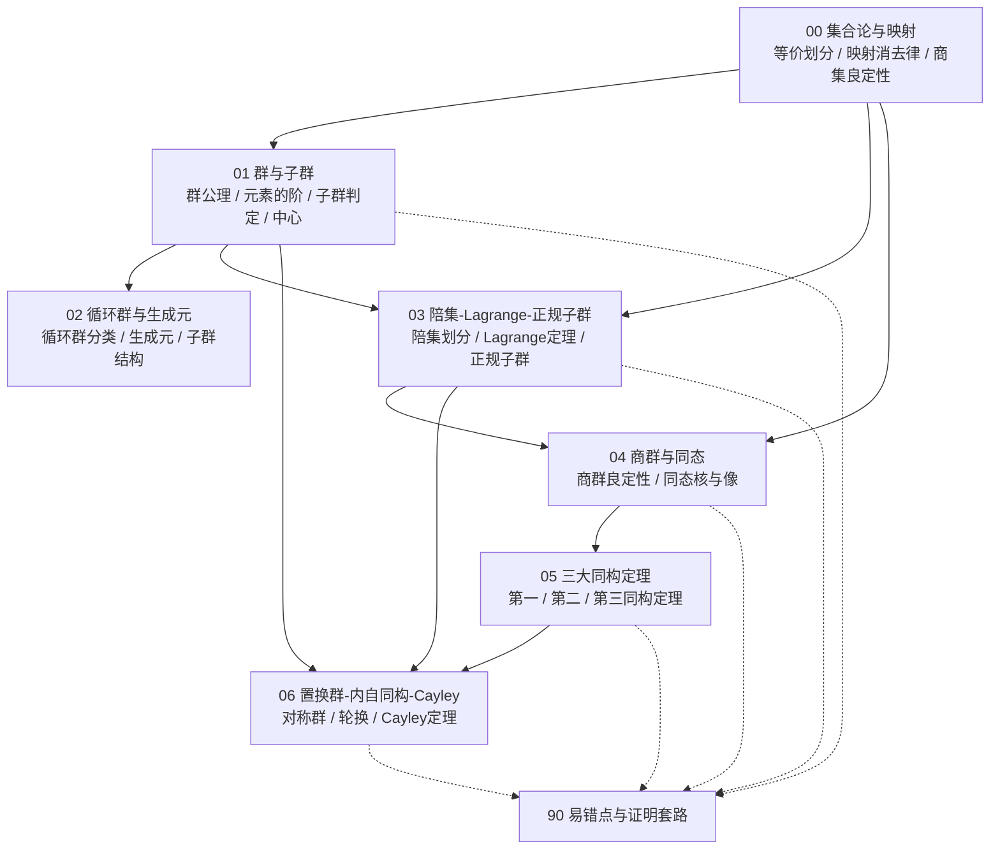

<!-- 由 scripts/sync-obsidian.mjs 从 Obsidian Vault 生成，请勿直接编辑。 -->

# 抽象代数索引

本索引包含群论笔记的章节目录、依赖关系、定理速查、概念索引与符号表。

---

## 1. 章节列表

| 编号 | 笔记文件 | 主要内容 | 涉及定理 |
|:---:|---|---|---|
| 00 | [00-集合论与映射](/posts/obsidian/00-%E9%9B%86%E5%90%88%E8%AE%BA%E4%B8%8E%E6%98%A0%E5%B0%84/) | 集合、等价关系、划分、映射、选择公理、商集与良定性 | 定理 0.1 ~ 0.8 |
| 01 | [01-群与子群](/posts/obsidian/01-%E7%BE%A4%E4%B8%8E%E5%AD%90%E7%BE%A4/) | 群公理、交换群判定、元素的阶、子群判定、中心 | 定理 1.1 ~ 1.14 |
| 02 | [02-循环群与生成元](/posts/obsidian/02-%E5%BE%AA%E7%8E%AF%E7%BE%A4%E4%B8%8E%E7%94%9F%E6%88%90%E5%85%83/) | 循环群分类、生成元判定、子群结构、自同构群 | 定理 2.1 ~ 2.10 |
| 03 | [03-陪集-Lagrange-正规子群](/posts/obsidian/03-%E9%99%AA%E9%9B%86-lagrange-%E6%AD%A3%E8%A7%84%E5%AD%90%E7%BE%A4/) | 陪集划分、Lagrange 定理、正规子群判据、群作用 | 定理 3.1 ~ 3.12 |
| 04 | [04-商群与同态](/posts/obsidian/04-%E5%95%86%E7%BE%A4%E4%B8%8E%E5%90%8C%E6%80%81/) | 商群构造、良定性、指数乘法、群同态、同态核与像 | 定理 4.1 ~ 4.8 |
| 05 | [05-三大同构定理](/posts/obsidian/05-%E4%B8%89%E5%A4%A7%E5%90%8C%E6%9E%84%E5%AE%9A%E7%90%86/) | 第一同构定理、第二同构定理、第三同构定理、正规性保持 | 定理 5.1, 第二同构, 第三同构, 定理 5.2 |
| 06 | [06-置换群-内自同构-Cayley](/posts/obsidian/06-%E7%BD%AE%E6%8D%A2%E7%BE%A4-%E5%86%85%E8%87%AA%E5%90%8C%E6%9E%84-cayley/) | 对称群 $S_n$、轮换分解、对换奇偶性、交代群 $A_n$、共轭型、内自同构、Cayley 定理 | 定理 6.1 ~ 6.15 |
| 90 | [90-易错点与证明套路](/posts/obsidian/90-%E6%98%93%E9%94%99%E7%82%B9%E4%B8%8E%E8%AF%81%E6%98%8E%E5%A5%97%E8%B7%AF/) | 概念易错点复盘、常用证明模板 | 易错点 1~10、模板 1~6 |

---

## 2. 章节依赖关系

主线发展脉络：
$$
\text{集合与等价划分}
\longrightarrow
\text{群与子群}
\longrightarrow
\text{陪集与正规子群}
\longrightarrow
\text{商群与同态}
\longrightarrow
\text{同构定理与变换群}.
$$

---

## 3. 定理速查

### 00 集合论与映射
- [定理 0.1（等价类相交即全同）](/posts/obsidian/00-%E9%9B%86%E5%90%88%E8%AE%BA%E4%B8%8E%E6%98%A0%E5%B0%84/#定理-0-1-等价类相交即全同)：$a \sim b \iff [a] \cap [b] \neq \emptyset \iff [a] = [b]$。
- [定理 0.2（等价划分对应定理）](/posts/obsidian/00-%E9%9B%86%E5%90%88%E8%AE%BA%E4%B8%8E%E6%98%A0%E5%B0%84/#定理-0-2-等价关系与集合划分的对应)：等价关系与集合划分一一对应。
- [定理 0.3（原像保持交并补）](/posts/obsidian/00-%E9%9B%86%E5%90%88%E8%AE%BA%E4%B8%8E%E6%98%A0%E5%B0%84/#定理-0-3-原像对集合运算的保持性质)：$f^{-1}$ 完全保持任意交、并、差与补。
- [定理 0.4（像保持交的充要条件）](/posts/obsidian/00-%E9%9B%86%E5%90%88%E8%AE%BA%E4%B8%8E%E6%98%A0%E5%B0%84/#定理-0-4-像的运算性质与单射判定)：$f(S_1 \cap S_2) = f(S_1) \cap f(S_2)$ 恒成立 $\iff f$ 是单射。
- [定理 0.5（单射等价定理）](/posts/obsidian/00-%E9%9B%86%E5%90%88%E8%AE%BA%E4%B8%8E%E6%98%A0%E5%B0%84/#定理-0-5-单射等价定理)：单射 $\iff$ 存在左逆 $\iff$ 映射左可消。
- [定理 0.6（满射等价定理）](/posts/obsidian/00-%E9%9B%86%E5%90%88%E8%AE%BA%E4%B8%8E%E6%98%A0%E5%B0%84/#定理-0-6-满射等价定理)：满射 $\iff$ 存在右逆（需选择公理） $\iff$ 映射右可消。
- [定理 0.7（双射与可逆性充要条件）](/posts/obsidian/00-%E9%9B%86%E5%90%88%E8%AE%BA%E4%B8%8E%E6%98%A0%E5%B0%84/#定理-0-7-双射与可逆性充要条件)：双射 $\iff$ 存在唯一双边逆映射；求逆反序 $(g \circ f)^{-1} = f^{-1} \circ g^{-1}$。
- [定理 0.8（商集诱导映射定理）](/posts/obsidian/00-%E9%9B%86%E5%90%88%E8%AE%BA%E4%B8%8E%E6%98%A0%E5%B0%84/#定理-0-8-商集诱导映射定理)：商集映射良定性与分解：$A \xrightarrow{\pi} A/{\sim} \xrightarrow{\bar{f}} \operatorname{Im} f \hookrightarrow B$。

### 01 群与子群
- [定理 1.1（单位元与逆元唯一性）](/posts/obsidian/01-%E7%BE%A4%E4%B8%8E%E5%AD%90%E7%BE%A4/#定理-1-1-单位元与逆元的唯一性)：群中单位元与任意元素逆元均唯一。
- [定理 1.2（群消去律）](/posts/obsidian/01-%E7%BE%A4%E4%B8%8E%E5%AD%90%E7%BE%A4/#定理-1-2-群的消去律)：$ab = ac \implies b = c$；$ba = ca \implies b = c$。
- [定理 1.3（求逆反序性质）](/posts/obsidian/01-%E7%BE%A4%E4%B8%8E%E5%AD%90%E7%BE%A4/#定理-1-3-求逆运算性质)：$(ab)^{-1} = b^{-1}a^{-1}$。
- [定理 1.4（平方乘积判定准则）](/posts/obsidian/01-%E7%BE%A4%E4%B8%8E%E5%AD%90%E7%BE%A4/#定理-1-4-平方乘积判定准则)：$G$ 交换 $\iff \forall a, b \in G, (ab)^2 = a^2 b^2$。
- [定理 1.5（高阶幂次判定准则）](/posts/obsidian/01-%E7%BE%A4%E4%B8%8E%E5%AD%90%E7%BE%A4/#定理-1-5-高阶幂次判定准则)：$G$ 交换 $\iff \forall t \in \mathbb{Z}^+, (ab)^t = a^t b^t$。
- [定理 1.6（阶整除引理）](/posts/obsidian/01-%E7%BE%A4%E4%B8%8E%E5%AD%90%E7%BE%A4/#定理-1-6-阶整除引理)：设 $\operatorname{ord}(a) = m$，则 $a^k = e \iff m \mid k$。
- [定理 1.7（子群两步判定法）](/posts/obsidian/01-%E7%BE%A4%E4%B8%8E%E5%AD%90%E7%BE%A4/#定理-1-7-两步判定法)：$H \le G \iff$ 运算封闭且求逆封闭。
- [定理 1.8（子群一步判定法）](/posts/obsidian/01-%E7%BE%A4%E4%B8%8E%E5%AD%90%E7%BE%A4/#定理-1-8-一步判定法)：$H \le G \iff \forall a, b \in H, ab^{-1} \in H$。
- [定理 1.9（有限子集判定法）](/posts/obsidian/01-%E7%BE%A4%E4%B8%8E%E5%AD%90%E7%BE%A4/#定理-1-9-有限子集的判定法)：$H$ 有限非空，则 $H \le G \iff H$ 运算封闭。
- [定理 1.10（子群交集性质）](/posts/obsidian/01-%E7%BE%A4%E4%B8%8E%E5%AD%90%E7%BE%A4/#定理-1-10)：$\bigcap_{i \in I} H_i \le G$。
- [定理 1.11（真子群并集定理）](/posts/obsidian/01-%E7%BE%A4%E4%B8%8E%E5%AD%90%E7%BE%A4/#定理-1-11)：若 $H_1, H_2 < G$，则 $G \neq H_1 \cup H_2$。
- [定理 1.12（子群乘积集封闭定理）](/posts/obsidian/01-%E7%BE%A4%E4%B8%8E%E5%AD%90%E7%BE%A4/#定理-1-12)：$H_1 H_2 \le G \iff H_1 H_2 = H_2 H_1$。
- [定理 1.14（中心子群性质）](/posts/obsidian/01-%E7%BE%A4%E4%B8%8E%E5%AD%90%E7%BE%A4/#定理-1-14)：群的中心 $Z(G) \le G$ 且为交换群。

### 02 循环群与生成元
- [定理 2.1（循环群交换性）](/posts/obsidian/02-%E5%BE%AA%E7%8E%AF%E7%BE%A4%E4%B8%8E%E7%94%9F%E6%88%90%E5%85%83/#定理-2-1)：任何循环群都是交换群。
- [定理 2.2（循环群分类定理）](/posts/obsidian/02-%E5%BE%AA%E7%8E%AF%E7%BE%A4%E4%B8%8E%E7%94%9F%E6%88%90%E5%85%83/#定理-2-2-循环群分类定理)：无限循环群同构于 $(\mathbb{Z}, +)$；$m$ 阶有限循环群同构于 $(\mathbb{Z}_m, +)$。
- [定理 2.3（元素阶公式）](/posts/obsidian/02-%E5%BE%AA%E7%8E%AF%E7%BE%A4%E4%B8%8E%E7%94%9F%E6%88%90%E5%85%83/#定理-2-3-元素阶公式)：设 $\operatorname{ord}(a) = m$，则 $\operatorname{ord}(a^k) = \frac{m}{\gcd(k, m)}$。
- [定理 2.4（有限循环群生成元）](/posts/obsidian/02-%E5%BE%AA%E7%8E%AF%E7%BE%A4%E4%B8%8E%E7%94%9F%E6%88%90%E5%85%83/#定理-2-4)：$a^k$ 是 $\langle a \rangle$ 生成元 $\iff \gcd(k, m) = 1$，共有 $\phi(m)$ 个生成元。
- [定理 2.5（无限循环群生成元）](/posts/obsidian/02-%E5%BE%AA%E7%8E%AF%E7%BE%A4%E4%B8%8E%E7%94%9F%E6%88%90%E5%85%83/#定理-2-5)：无限循环群 $\langle a \rangle$ 的生成元仅有 $a$ 与 $a^{-1}$。
- [定理 2.6（循环群子群性质）](/posts/obsidian/02-%E5%BE%AA%E7%8E%AF%E7%BE%A4%E4%B8%8E%E7%94%9F%E6%88%90%E5%85%83/#定理-2-6)：循环群的任意子群必为循环群。
- [定理 2.7（因数子群对应定理）](/posts/obsidian/02-%E5%BE%AA%E7%8E%AF%E7%BE%A4%E4%B8%8E%E7%94%9F%E6%88%90%E5%85%83/#定理-2-7)：设 $|G|=m$ 是循环群，对 $m$ 的每个正因数 $d$，$G$ 存在唯一的 $d$ 阶子群 $\langle a^{m/d} \rangle$。
- [定理 2.8（循环群同态像）](/posts/obsidian/02-%E5%BE%AA%E7%8E%AF%E7%BE%A4%E4%B8%8E%E7%94%9F%E6%88%90%E5%85%83/#定理-2-8)：循环群的同态像必为循环群。
- [定理 2.9（有限循环群满同态条件）](/posts/obsidian/02-%E5%BE%AA%E7%8E%AF%E7%BE%A4%E4%B8%8E%E7%94%9F%E6%88%90%E5%85%83/#定理-2-9)：存在 $\mathbb{Z}_m \to \mathbb{Z}_n$ 满同态 $\iff n \mid m$。
- [定理 2.10（循环群自同构群）](/posts/obsidian/02-%E5%BE%AA%E7%8E%AF%E7%BE%A4%E4%B8%8E%E7%94%9F%E6%88%90%E5%85%83/#定理-2-10)：$\operatorname{Aut}(\mathbb{Z}) \cong \mathbb{Z}_2$；$\operatorname{Aut}(\mathbb{Z}_m) \cong \mathbb{Z}_m^\times$。

### 03 陪集-Lagrange-正规子群
- [定理 3.1（代表元包含性）](/posts/obsidian/03-%E9%99%AA%E9%9B%86-lagrange-%E6%AD%A3%E8%A7%84%E5%AD%90%E7%BE%A4/#定理-3-1-代表元包含性与平凡陪集)：$a \in aH$；$aH = H \iff a \in H$。
- [定理 3.2（陪集相等判定）](/posts/obsidian/03-%E9%99%AA%E9%9B%86-lagrange-%E6%AD%A3%E8%A7%84%E5%AD%90%E7%BE%A4/#定理-3-2-陪集相等的充要判定准则)：$aH = bH \iff a^{-1}b \in H \iff b \in aH$。
- [定理 3.3（模 $H$ 同余与划分）](/posts/obsidian/03-%E9%99%AA%E9%9B%86-lagrange-%E6%AD%A3%E8%A7%84%E5%AD%90%E7%BE%A4/#定理-3-3-模-h-同余与等价划分)：左陪集族形成群 $G$ 的一个划分。
- [定理 3.4（陪集大小等势性）](/posts/obsidian/03-%E9%99%AA%E9%9B%86-lagrange-%E6%AD%A3%E8%A7%84%E5%AD%90%E7%BE%A4/#定理-3-4)：对任意 $a \in G$，$|aH| = |H| = |Ha|$。
- [定理 3.5（Lagrange 定理）](/posts/obsidian/03-%E9%99%AA%E9%9B%86-lagrange-%E6%AD%A3%E8%A7%84%E5%AD%90%E7%BE%A4/#定理-3-5-lagrange-定理)：若 $G$ 有限，$H \le G$，则 $|G| = [G : H] \cdot |H|$。
- [推论 3.6（元素阶整除群阶）](/posts/obsidian/03-%E9%99%AA%E9%9B%86-lagrange-%E6%AD%A3%E8%A7%84%E5%AD%90%E7%BE%A4/#推论-3-6-元素的阶整除群阶)：$\forall a \in G, \operatorname{ord}(a) \mid |G|$，且 $a^{|G|} = e$。
- [推论 3.7（素数阶群性质）](/posts/obsidian/03-%E9%99%AA%E9%9B%86-lagrange-%E6%AD%A3%E8%A7%84%E5%AD%90%E7%BE%A4/#推论-3-7-素数阶群必为循环群)：素数阶群必为循环群。
- [定理 3.8（Lagrange 逆命题反例）](/posts/obsidian/03-%E9%99%AA%E9%9B%86-lagrange-%E6%AD%A3%E8%A7%84%E5%AD%90%E7%BE%A4/#定理-3-8)：12 阶交错群 $A_4$ 没有 6 阶子群。
- [定理 3.9（正规子群判定条件）](/posts/obsidian/03-%E9%99%AA%E9%9B%86-lagrange-%E6%AD%A3%E8%A7%84%E5%AD%90%E7%BE%A4/#定理-3-9)：$N \triangleleft G \iff \forall g \in G, gNg^{-1} = N \iff \forall g \in G, gN = Ng$。
- [定理 3.10（指数为 2 的子群性质）](/posts/obsidian/03-%E9%99%AA%E9%9B%86-lagrange-%E6%AD%A3%E8%A7%84%E5%AD%90%E7%BE%A4/#定理-3-10)：若 $[G : H] = 2$，则 $H \triangleleft G$。
- [引理 3.11（稳定子子群性质）](/posts/obsidian/03-%E9%99%AA%E9%9B%86-lagrange-%E6%AD%A3%E8%A7%84%E5%AD%90%E7%BE%A4/#引理-3-11)：群作用下 $\operatorname{Stab}(x) \le G$。
- [定理 3.12（轨道-稳定子定理）](/posts/obsidian/03-%E9%99%AA%E9%9B%86-lagrange-%E6%AD%A3%E8%A7%84%E5%AD%90%E7%BE%A4/#5-2-轨道-稳定子定理-orbit-stabilizer-theorem)：$|G \cdot x| = [G : \operatorname{Stab}(x)]$。若 $G$ 有限，则 $|G| = |G \cdot x| \cdot |\operatorname{Stab}(x)|$。

### 04 商群与同态
- [定理 4.1（商群乘法良定性）](/posts/obsidian/04-%E5%95%86%E7%BE%A4%E4%B8%8E%E5%90%8C%E6%80%81/#定理-4-1-良定性充要定理)：$(aN)(bN) = (ab)N$ 良定 $\iff N \triangleleft G$。
- [定理 4.2（商群成群性质）](/posts/obsidian/04-%E5%95%86%E7%BE%A4%E4%B8%8E%E5%90%8C%E6%80%81/#定理-4-2)：若 $N \triangleleft G$，则 $(G/N, \cdot)$ 构成群。
- [定理 4.3（商群的阶）](/posts/obsidian/04-%E5%95%86%E7%BE%A4%E4%B8%8E%E5%90%8C%E6%80%81/#定理-4-3)：$|G/N| = [G : N] = \frac{|G|}{|N|}$。
- [定理 4.4（子群链指数公式）](/posts/obsidian/04-%E5%95%86%E7%BE%A4%E4%B8%8E%E5%90%8C%E6%80%81/#定理-4-4-子群链指数公式)：若 $K \le H \le G$，则 $[G : K] = [G : H][H : K]$。
- [定理 4.5（群同态基本性质）](/posts/obsidian/04-%E5%95%86%E7%BE%A4%E4%B8%8E%E5%90%8C%E6%80%81/#定理-4-5)：$f(e) = e'$，$f(a^{-1}) = f(a)^{-1}$，$\operatorname{ord}(f(a)) \mid \operatorname{ord}(a)$。
- [定理 4.6（同态核与像）](/posts/obsidian/04-%E5%95%86%E7%BE%A4%E4%B8%8E%E5%90%8C%E6%80%81/#定理-4-6)：$\operatorname{Ker}f \triangleleft G$，$\operatorname{Im}f \le G'$。
- [定理 4.7（单同态判定准则）](/posts/obsidian/04-%E5%95%86%E7%BE%A4%E4%B8%8E%E5%90%8C%E6%80%81/#定理-4-7)：同态 $f$ 是单同态 $\iff \operatorname{Ker}f = \{e\}$。
- [定理 4.8（自然同态性质）](/posts/obsidian/04-%E5%95%86%E7%BE%A4%E4%B8%8E%E5%90%8C%E6%80%81/#定理-4-8)：$\pi: G \to G/N, g \mapsto gN$ 是满同态，且 $\operatorname{Ker}\pi = N$。

### 05 三大同构定理
- [定理 5.1（第一同构定理）](/posts/obsidian/05-%E4%B8%89%E5%A4%A7%E5%90%8C%E6%9E%84%E5%AE%9A%E7%90%86/#1-群同态基本定理-第一同构定理)：设 $f: G \to G'$ 是群同态，则 $G/\operatorname{Ker}f \cong \operatorname{Im}f$。
- [第二同构定理（菱形同构）](/posts/obsidian/05-%E4%B8%89%E5%A4%A7%E5%90%8C%E6%9E%84%E5%AE%9A%E7%90%86/#2-第二同构定理-菱形同构定理-diamond-isomorphism-theorem)：设 $H \le G, N \triangleleft G$，则 $HN/N \cong H/(H \cap N)$。
- [第三同构定理（商群约分）](/posts/obsidian/05-%E4%B8%89%E5%A4%A7%E5%90%8C%E6%9E%84%E5%AE%9A%E7%90%86/#3-第三同构定理-商群约分定理)：设 $K \triangleleft G, N \triangleleft G$ 且 $K \le N$，则 $(G/K)/(N/K) \cong G/N$。
- [定理 5.2（正规性保持定理）](/posts/obsidian/05-%E4%B8%89%E5%A4%A7%E5%90%8C%E6%9E%84%E5%AE%9A%E7%90%86/#定理-5-2)：若 $f: G \to G'$ 是满同态，$N \triangleleft G$，则 $f(N) \triangleleft G'$。

### 06 置换群-内自同构-Cayley
- [定理 6.1（一一变换群）](/posts/obsidian/06-%E7%BD%AE%E6%8D%A2%E7%BE%A4-%E5%86%85%E8%87%AA%E5%90%8C%E6%9E%84-cayley/#定理-6-1)：集合 $A$ 上全体一一变换在复合下成群。
- [定理 6.2（不相交轮换交换性）](/posts/obsidian/06-%E7%BD%AE%E6%8D%A2%E7%BE%A4-%E5%86%85%E8%87%AA%E5%90%8C%E6%9E%84-cayley/#定理-6-2)：不相交循环置换乘积可交换。
- [定理 6.3（不相交轮换分解）](/posts/obsidian/06-%E7%BD%AE%E6%8D%A2%E7%BE%A4-%E5%86%85%E8%87%AA%E5%90%8C%E6%9E%84-cayley/#定理-6-3-不相交轮换分解定理)：有限置换可唯一分解为不相交轮换之积。
- [定理 6.4（置换求阶公式）](/posts/obsidian/06-%E7%BD%AE%E6%8D%A2%E7%BE%A4-%E5%86%85%E8%87%AA%E5%90%8C%E6%9E%84-cayley/#定理-6-4-置换求阶公式)：置换的阶等于各不相交轮换长度的最小公倍数。
- [定理 6.5（对换分解定理）](/posts/obsidian/06-%E7%BD%AE%E6%8D%A2%E7%BE%A4-%E5%86%85%E8%87%AA%E5%90%8C%E6%9E%84-cayley/#定理-6-5)：任一置换均可分解为对换之积；$r$-轮换可分解为 $r-1$ 个对换。
- [定理 6.6（对换奇偶性不变量）](/posts/obsidian/06-%E7%BD%AE%E6%8D%A2%E7%BE%A4-%E5%86%85%E8%87%AA%E5%90%8C%E6%9E%84-cayley/#定理-6-6-对换奇偶性不变量定理)：同一置换分解为对换之积时，对换个数的奇偶性不变。
- [定理 6.8（交代群性质与阶数）](/posts/obsidian/06-%E7%BD%AE%E6%8D%A2%E7%BE%A4-%E5%86%85%E8%87%AA%E5%90%8C%E6%9E%84-cayley/#定理-6-8-交代群的子群性质与阶数)：$A_n \triangleleft S_n$，且 $|A_n| = \frac{n!}{2}$（$n \ge 2$）。
- [定理 6.9（3-轮换生成交代群）](/posts/obsidian/06-%E7%BD%AE%E6%8D%A2%E7%BE%A4-%E5%86%85%E8%87%AA%E5%90%8C%E6%9E%84-cayley/#定理-6-9)：对任意 $n \ge 3$，$A_n$ 由全体 3-轮换生成。
- [定理 6.10（置换共轭公式）](/posts/obsidian/06-%E7%BD%AE%E6%8D%A2%E7%BE%A4-%E5%86%85%E8%87%AA%E5%90%8C%E6%9E%84-cayley/#定理-6-10-置换共轭公式)：$\tau (i_1\ i_2\ \dots\ i_r) \tau^{-1} = (\tau(i_1)\ \tau(i_2)\ \dots\ \tau(i_r))$。
- [定理 6.11（共轭类与循环型）](/posts/obsidian/06-%E7%BD%AE%E6%8D%A2%E7%BE%A4-%E5%86%85%E8%87%AA%E5%90%8C%E6%9E%84-cayley/#定理-6-11-共轭类与循环型充要条件)：$S_n$ 中两置换共轭 $\iff$ 具有相同的循环型。
- [结论 6.12（$A_5$ 单群性质）](/posts/obsidian/06-%E7%BD%AE%E6%8D%A2%E7%BE%A4-%E5%86%85%E8%87%AA%E5%90%8C%E6%9E%84-cayley/#结论-6-12)：$A_5$ 是最小的非交换单群。
- [定理 6.13（内自同构群性质）](/posts/obsidian/06-%E7%BD%AE%E6%8D%A2%E7%BE%A4-%E5%86%85%E8%87%AA%E5%90%8C%E6%9E%84-cayley/#定理-6-13)：共轭映射是群自同构，$\operatorname{Inn}(G) \le \operatorname{Aut}(G)$。
- [定理 6.14（内自同构与中心）](/posts/obsidian/06-%E7%BD%AE%E6%8D%A2%E7%BE%A4-%E5%86%85%E8%87%AA%E5%90%8C%E6%9E%84-cayley/#定理-6-14)：$G/Z(G) \cong \operatorname{Inn}(G)$。
- [定理 6.15（Cayley 定理）](/posts/obsidian/06-%E7%BD%AE%E6%8D%A2%E7%BE%A4-%E5%86%85%E8%87%AA%E5%90%8C%E6%9E%84-cayley/#定理-6-15-cayley-定理)：任何群均同构于某个集合上的置换群；$n$ 阶群可嵌入 $S_n$。

---

## 4. 概念索引

### 集合与映射
- **等价关系**：[定义](/posts/obsidian/00-%E9%9B%86%E5%90%88%E8%AE%BA%E4%B8%8E%E6%98%A0%E5%B0%84/#2-2-等价关系与等价类)、[划分对应定理 0.2](/posts/obsidian/00-%E9%9B%86%E5%90%88%E8%AE%BA%E4%B8%8E%E6%98%A0%E5%B0%84/#定理-0-2-等价关系与集合划分的对应)
- **等价类**：[定义](/posts/obsidian/00-%E9%9B%86%E5%90%88%E8%AE%BA%E4%B8%8E%E6%98%A0%E5%B0%84/#2-2-等价关系与等价类)、[相交即全同定理 0.1](/posts/obsidian/00-%E9%9B%86%E5%90%88%E8%AE%BA%E4%B8%8E%E6%98%A0%E5%B0%84/#定理-0-1-等价类相交即全同)
- **商集**：[定义](/posts/obsidian/00-%E9%9B%86%E5%90%88%E8%AE%BA%E4%B8%8E%E6%98%A0%E5%B0%84/#2-2-等价关系与等价类)、[诱导映射定理 0.8](/posts/obsidian/00-%E9%9B%86%E5%90%88%E8%AE%BA%E4%B8%8E%E6%98%A0%E5%B0%84/#定理-0-8-商集诱导映射定理)
- **单射 / 满射 / 双射**：[定义](/posts/obsidian/00-%E9%9B%86%E5%90%88%E8%AE%BA%E4%B8%8E%E6%98%A0%E5%B0%84/#4-1-基本定义与有限集合性质)、[单射判定定理 0.5](/posts/obsidian/00-%E9%9B%86%E5%90%88%E8%AE%BA%E4%B8%8E%E6%98%A0%E5%B0%84/#定理-0-5-单射等价定理)、[满射判定定理 0.6](/posts/obsidian/00-%E9%9B%86%E5%90%88%E8%AE%BA%E4%B8%8E%E6%98%A0%E5%B0%84/#定理-0-6-满射等价定理)、[可逆性定理 0.7](/posts/obsidian/00-%E9%9B%86%E5%90%88%E8%AE%BA%E4%B8%8E%E6%98%A0%E5%B0%84/#定理-0-7-双射与可逆性充要条件)
- **像与原像**：[定义](/posts/obsidian/00-%E9%9B%86%E5%90%88%E8%AE%BA%E4%B8%8E%E6%98%A0%E5%B0%84/#3-1-映射定义与基本概念)、[原像保持性质定理 0.3](/posts/obsidian/00-%E9%9B%86%E5%90%88%E8%AE%BA%E4%B8%8E%E6%98%A0%E5%B0%84/#定理-0-3-原像对集合运算的保持性质)、[像与单射定理 0.4](/posts/obsidian/00-%E9%9B%86%E5%90%88%E8%AE%BA%E4%B8%8E%E6%98%A0%E5%B0%84/#定理-0-4-像的运算性质与单射判定)
- **选择公理**：[表述](/posts/obsidian/00-%E9%9B%86%E5%90%88%E8%AE%BA%E4%B8%8E%E6%98%A0%E5%B0%84/#5-1-选择公理的三种等价表述)、[等价命题与 Zorn 引理](/posts/obsidian/00-%E9%9B%86%E5%90%88%E8%AE%BA%E4%B8%8E%E6%98%A0%E5%B0%84/#5-3-常见等价命题与-zorn-引理)
- **良定性**：[商集映射定义](/posts/obsidian/00-%E9%9B%86%E5%90%88%E8%AE%BA%E4%B8%8E%E6%98%A0%E5%B0%84/#6-1-良定性要求)、[商群乘法良定性定理 4.1](/posts/obsidian/04-%E5%95%86%E7%BE%A4%E4%B8%8E%E5%90%8C%E6%80%81/#1-3-商群乘法的良定性-well-definedness-证明)

### 群、子群与阶
- **群公理**：[四条公理](/posts/obsidian/01-%E7%BE%A4%E4%B8%8E%E5%AD%90%E7%BE%A4/#1-群的公理与初等性质)、[消去律与逆元唯一](/posts/obsidian/01-%E7%BE%A4%E4%B8%8E%E5%AD%90%E7%BE%A4/#定理-1-1-单位元与逆元的唯一性)
- **交换群（阿贝尔群）**：[定义](/posts/obsidian/01-%E7%BE%A4%E4%B8%8E%E5%AD%90%E7%BE%A4/#1-群的公理与初等性质)、[平方乘积判定](/posts/obsidian/01-%E7%BE%A4%E4%B8%8E%E5%AD%90%E7%BE%A4/#定理-1-4-平方乘积判定准则)、[高阶幂次判定](/posts/obsidian/01-%E7%BE%A4%E4%B8%8E%E5%AD%90%E7%BE%A4/#定理-1-5-高阶幂次判定准则)
- **元素的阶**：[定义](/posts/obsidian/01-%E7%BE%A4%E4%B8%8E%E5%AD%90%E7%BE%A4/#3-元素的阶-order)、[阶整除引理](/posts/obsidian/01-%E7%BE%A4%E4%B8%8E%E5%AD%90%E7%BE%A4/#定理-1-6-阶整除引理)、[幂元素求阶公式](/posts/obsidian/02-%E5%BE%AA%E7%8E%AF%E7%BE%A4%E4%B8%8E%E7%94%9F%E6%88%90%E5%85%83/#定理-2-3-元素阶公式)
- **子群判定**：[定义](/posts/obsidian/01-%E7%BE%A4%E4%B8%8E%E5%AD%90%E7%BE%A4/#4-子群-subgroup-及其判定)、[两步判定](/posts/obsidian/01-%E7%BE%A4%E4%B8%8E%E5%AD%90%E7%BE%A4/#定理-1-7-两步判定法)、[一步判定](/posts/obsidian/01-%E7%BE%A4%E4%B8%8E%E5%AD%90%E7%BE%A4/#定理-1-8-一步判定法)、[有限子群判定](/posts/obsidian/01-%E7%BE%A4%E4%B8%8E%E5%AD%90%E7%BE%A4/#定理-1-9-有限子集的判定法)
- **群中心**：[定义与性质](/posts/obsidian/01-%E7%BE%A4%E4%B8%8E%E5%AD%90%E7%BE%A4/#5-4-群的中心-center)、[中心商群同构](/posts/obsidian/06-%E7%BD%AE%E6%8D%A2%E7%BE%A4-%E5%86%85%E8%87%AA%E5%90%8C%E6%9E%84-cayley/#定理-6-14)
- **子群运算**：[交集仍为子群](/posts/obsidian/01-%E7%BE%A4%E4%B8%8E%E5%AD%90%E7%BE%A4/#定理-1-10)、[真子群并集不全覆](/posts/obsidian/01-%E7%BE%A4%E4%B8%8E%E5%AD%90%E7%BE%A4/#定理-1-11)、[乘积集成群充要条件](/posts/obsidian/01-%E7%BE%A4%E4%B8%8E%E5%AD%90%E7%BE%A4/#定理-1-12)

### 循环群
- **循环群与生成元**：[定义](/posts/obsidian/02-%E5%BE%AA%E7%8E%AF%E7%BE%A4%E4%B8%8E%E7%94%9F%E6%88%90%E5%85%83/#1-循环群的定义与表示)、[分类定理](/posts/obsidian/02-%E5%BE%AA%E7%8E%AF%E7%BE%A4%E4%B8%8E%E7%94%9F%E6%88%90%E5%85%83/#定理-2-2-循环群分类定理)、[生成元个数](/posts/obsidian/02-%E5%BE%AA%E7%8E%AF%E7%BE%A4%E4%B8%8E%E7%94%9F%E6%88%90%E5%85%83/#定理-2-4)
- **循环群子群**：[子群必为循环群](/posts/obsidian/02-%E5%BE%AA%E7%8E%AF%E7%BE%A4%E4%B8%8E%E7%94%9F%E6%88%90%E5%85%83/#定理-2-6)、[因数子群唯一性](/posts/obsidian/02-%E5%BE%AA%E7%8E%AF%E7%BE%A4%E4%B8%8E%E7%94%9F%E6%88%90%E5%85%83/#定理-2-7)
- **循环群自同构**：[自同构群结构](/posts/obsidian/02-%E5%BE%AA%E7%8E%AF%E7%BE%A4%E4%B8%8E%E7%94%9F%E6%88%90%E5%85%83/#定理-2-10)

### 陪集与正规子群
- **陪集**：[定义](/posts/obsidian/03-%E9%99%AA%E9%9B%86-lagrange-%E6%AD%A3%E8%A7%84%E5%AD%90%E7%BE%A4/#1-陪集的严格定义与性质)、[相等判定](/posts/obsidian/03-%E9%99%AA%E9%9B%86-lagrange-%E6%AD%A3%E8%A7%84%E5%AD%90%E7%BE%A4/#定理-3-2-陪集相等的充要判定准则)、[等势性](/posts/obsidian/03-%E9%99%AA%E9%9B%86-lagrange-%E6%AD%A3%E8%A7%84%E5%AD%90%E7%BE%A4/#定理-3-4)
- **Lagrange 定理**：[定理证明](/posts/obsidian/03-%E9%99%AA%E9%9B%86-lagrange-%E6%AD%A3%E8%A7%84%E5%AD%90%E7%BE%A4/#定理-3-5-lagrange-定理)、[阶整除群阶](/posts/obsidian/03-%E9%99%AA%E9%9B%86-lagrange-%E6%AD%A3%E8%A7%84%E5%AD%90%E7%BE%A4/#推论-3-6-元素的阶整除群阶)、[素数阶群](/posts/obsidian/03-%E9%99%AA%E9%9B%86-lagrange-%E6%AD%A3%E8%A7%84%E5%AD%90%E7%BE%A4/#推论-3-7-素数阶群必为循环群)、[逆命题反例](/posts/obsidian/03-%E9%99%AA%E9%9B%86-lagrange-%E6%AD%A3%E8%A7%84%E5%AD%90%E7%BE%A4/#定理-3-8)
- **正规子群**：[定义](/posts/obsidian/03-%E9%99%AA%E9%9B%86-lagrange-%E6%AD%A3%E8%A7%84%E5%AD%90%E7%BE%A4/#4-正规子群-normal-subgroup)、[判定条件](/posts/obsidian/03-%E9%99%AA%E9%9B%86-lagrange-%E6%AD%A3%E8%A7%84%E5%AD%90%E7%BE%A4/#定理-3-9)、[指数 2 必正规](/posts/obsidian/03-%E9%99%AA%E9%9B%86-lagrange-%E6%AD%A3%E8%A7%84%E5%AD%90%E7%BE%A4/#定理-3-10)
- **群作用**：[定义与稳定子](/posts/obsidian/03-%E9%99%AA%E9%9B%86-lagrange-%E6%AD%A3%E8%A7%84%E5%AD%90%E7%BE%A4/#5-群的作用与轨道-稳定子定理)、[轨道-稳定子定理](/posts/obsidian/03-%E9%99%AA%E9%9B%86-lagrange-%E6%AD%A3%E8%A7%84%E5%AD%90%E7%BE%A4/#5-2-轨道-稳定子定理-orbit-stabilizer-theorem)

### 商群与同态
- **商群**：[定义](/posts/obsidian/04-%E5%95%86%E7%BE%A4%E4%B8%8E%E5%90%8C%E6%80%81/#1-商群的构造与良定性)、[乘法良定性](/posts/obsidian/04-%E5%95%86%E7%BE%A4%E4%B8%8E%E5%90%8C%E6%80%81/#定理-4-1-良定性充要定理)、[商群的阶](/posts/obsidian/04-%E5%95%86%E7%BE%A4%E4%B8%8E%E5%90%8C%E6%80%81/#定理-4-3)
- **塔式法则**：[子群链指数公式](/posts/obsidian/04-%E5%95%86%E7%BE%A4%E4%B8%8E%E5%90%8C%E6%80%81/#定理-4-4-子群链指数公式)
- **群同态与同构**：[定义](/posts/obsidian/04-%E5%95%86%E7%BE%A4%E4%B8%8E%E5%90%8C%E6%80%81/#3-群同态与群同构)、[保持性质](/posts/obsidian/04-%E5%95%86%E7%BE%A4%E4%B8%8E%E5%90%8C%E6%80%81/#定理-4-5)
- **同态核与像**：[定义](/posts/obsidian/04-%E5%95%86%E7%BE%A4%E4%B8%8E%E5%90%8C%E6%80%81/#4-同态像-同态核与单同态判定)、[核正规性](/posts/obsidian/04-%E5%95%86%E7%BE%A4%E4%B8%8E%E5%90%8C%E6%80%81/#定理-4-6)、[单同态核判据](/posts/obsidian/04-%E5%95%86%E7%BE%A4%E4%B8%8E%E5%90%8C%E6%80%81/#定理-4-7)、[自然同态](/posts/obsidian/04-%E5%95%86%E7%BE%A4%E4%B8%8E%E5%90%8C%E6%80%81/#定理-4-8)

### 同构定理
- **第一同构定理**：[定理与证明](/posts/obsidian/05-%E4%B8%89%E5%A4%A7%E5%90%8C%E6%9E%84%E5%AE%9A%E7%90%86/#1-群同态基本定理-第一同构定理)、[应用实例](/posts/obsidian/05-%E4%B8%89%E5%A4%A7%E5%90%8C%E6%9E%84%E5%AE%9A%E7%90%86/#1-4-五大经典应用实例)
- **第二同构定理**：[定理与证明](/posts/obsidian/05-%E4%B8%89%E5%A4%A7%E5%90%8C%E6%9E%84%E5%AE%9A%E7%90%86/#2-第二同构定理-菱形同构定理-diamond-isomorphism-theorem)
- **第三同构定理**：[定理与证明](/posts/obsidian/05-%E4%B8%89%E5%A4%A7%E5%90%8C%E6%9E%84%E5%AE%9A%E7%90%86/#3-第三同构定理-商群约分定理)
- **正规性保持**：[满同态保持正规性](/posts/obsidian/05-%E4%B8%89%E5%A4%A7%E5%90%8C%E6%9E%84%E5%AE%9A%E7%90%86/#定理-5-2)

### 置换群与 Cayley 定理
- **对称群 $S_n$**：[定义](/posts/obsidian/06-%E7%BD%AE%E6%8D%A2%E7%BE%A4-%E5%86%85%E8%87%AA%E5%90%8C%E6%9E%84-cayley/#1-对称群-s-n-与一一变换群)、[运算方向](/posts/obsidian/06-%E7%BD%AE%E6%8D%A2%E7%BE%A4-%E5%86%85%E8%87%AA%E5%90%8C%E6%9E%84-cayley/#1-2-运算方向约定)
- **不相交轮换**：[定义](/posts/obsidian/06-%E7%BD%AE%E6%8D%A2%E7%BE%A4-%E5%86%85%E8%87%AA%E5%90%8C%E6%9E%84-cayley/#2-1-循环置换的定义)、[交换性](/posts/obsidian/06-%E7%BD%AE%E6%8D%A2%E7%BE%A4-%E5%86%85%E8%87%AA%E5%90%8C%E6%9E%84-cayley/#定理-6-2)、[分解定理](/posts/obsidian/06-%E7%BD%AE%E6%8D%A2%E7%BE%A4-%E5%86%85%E8%87%AA%E5%90%8C%E6%9E%84-cayley/#定理-6-3-不相交轮换分解定理)、[求阶](/posts/obsidian/06-%E7%BD%AE%E6%8D%A2%E7%BE%A4-%E5%86%85%E8%87%AA%E5%90%8C%E6%9E%84-cayley/#定理-6-4-置换求阶公式)
- **对换与奇偶置换**：[对换分解](/posts/obsidian/06-%E7%BD%AE%E6%8D%A2%E7%BE%A4-%E5%86%85%E8%87%AA%E5%90%8C%E6%9E%84-cayley/#定理-6-5)、[奇偶性不变量](/posts/obsidian/06-%E7%BD%AE%E6%8D%A2%E7%BE%A4-%E5%86%85%E8%87%AA%E5%90%8C%E6%9E%84-cayley/#定理-6-6-对换奇偶性不变量定理)
- **交代群 $A_n$**：[定义与阶数](/posts/obsidian/06-%E7%BD%AE%E6%8D%A2%E7%BE%A4-%E5%86%85%E8%87%AA%E5%90%8C%E6%9E%84-cayley/#3-3-奇偶置换与交代群-a-n)、[3-轮换生成](/posts/obsidian/06-%E7%BD%AE%E6%8D%A2%E7%BE%A4-%E5%86%85%E8%87%AA%E5%90%8C%E6%9E%84-cayley/#定理-6-9)
- **共轭与循环型**：[共轭计算](/posts/obsidian/06-%E7%BD%AE%E6%8D%A2%E7%BE%A4-%E5%86%85%E8%87%AA%E5%90%8C%E6%9E%84-cayley/#定理-6-10-置换共轭公式)、[循环型充要条件](/posts/obsidian/06-%E7%BD%AE%E6%8D%A2%E7%BE%A4-%E5%86%85%E8%87%AA%E5%90%8C%E6%9E%84-cayley/#定理-6-11-共轭类与循环型充要条件)
- **内自同构**：[定义](/posts/obsidian/06-%E7%BD%AE%E6%8D%A2%E7%BE%A4-%E5%86%85%E8%87%AA%E5%90%8C%E6%9E%84-cayley/#定理-6-13)、[商群同构](/posts/obsidian/06-%E7%BD%AE%E6%8D%A2%E7%BE%A4-%E5%86%85%E8%87%AA%E5%90%8C%E6%9E%84-cayley/#定理-6-14)
- **Cayley 定理**：[定理与证明](/posts/obsidian/06-%E7%BD%AE%E6%8D%A2%E7%BE%A4-%E5%86%85%E8%87%AA%E5%90%8C%E6%9E%84-cayley/#定理-6-15-cayley-定理)、[左乘右乘区别](/posts/obsidian/06-%E7%BD%AE%E6%8D%A2%E7%BE%A4-%E5%86%85%E8%87%AA%E5%90%8C%E6%9E%84-cayley/#8-3-左乘与右乘的区别)

---

## 5. 符号表

| 符号 | 含义 | 说明 |
|---|---|---|
| $a \in A, A \subseteq B$ | 属于、包含 | 集合基础记号 |
| $A \setminus B, A^c$ | 差集、补集 | $A^c = U \setminus A$ |
| $A \times B$ | 笛卡尔积 | 有序对集合 |
| $[a]$ | 等价类 | $\{x \mid x \sim a\}$ |
| $A/\sim$ | 商集 | 所有等价类构成的集合 |
| $f^{-1}(T)$ | 原像 | $\{x \mid f(x) \in T\}$ |
| $\operatorname{ord}(a)$ | 元素的阶 | 满足 $a^m = e$ 的最小正整数 $m$ |
| $|G|$ | 群的阶 | 集合的基数 |
| $H \le G, H < G$ | 子群、真子群 | $H$ 在原运算下成群 |
| $Z(G)$ | 群中心 | 与全群元素均交换的元素集 |
| $\langle a \rangle, \langle S \rangle$ | 生成子群 | 包含指定元素的最小子群 |
| $aH, Ha$ | 左陪集、右陪集 | $\{ah \mid h \in H\}$ 与 $\{ha \mid h \in H\}$ |
| $[G : H]$ | 子群指数 | 左陪集的个数 |
| $N \triangleleft G$ | 正规子群 | $\forall g \in G, gNg^{-1} = N$ |
| $G/N$ | 商群 | 陪集构成的群 |
| $\operatorname{Ker}f, \operatorname{Im}f$ | 同态核、同态像 | $\operatorname{Ker}f = f^{-1}(\{e'\})$，$\operatorname{Im}f = f(G)$ |
| $G \cong G'$ | 群同构 | 存在保持运算的双射 |
| $S_n, A_n$ | 对称群、交代群 | $n$ 元置换群与偶置换群 |
| $(i_1\ i_2\ \dots\ i_r)$ | 轮换（循环置换） | 长度为 $r$ 的置换 |
| $\operatorname{Aut}(G), \operatorname{Inn}(G)$ | 自同构群、内自同构群 | $G$ 到自身的同构映射构成的群 |
| $G \cdot x, \operatorname{Stab}(x)$ | 轨道、稳定子 | 群作用中的轨迹与保持元 |

---

## 6. 证明模板速查

参见 [90-易错点与证明套路](/posts/obsidian/90-%E6%98%93%E9%94%99%E7%82%B9%E4%B8%8E%E8%AF%81%E6%98%8E%E5%A5%97%E8%B7%AF/) 中的推导步骤：
1. [子群一步判定法](/posts/obsidian/90-%E6%98%93%E9%94%99%E7%82%B9%E4%B8%8E%E8%AF%81%E6%98%8E%E5%A5%97%E8%B7%AF/#模板-1-子群一步判定法)：验证非空，对任取元素算 $ab^{-1}$ 并在子集中。
2. [第一同构定理构建商群同构](/posts/obsidian/90-%E6%98%93%E9%94%99%E7%82%B9%E4%B8%8E%E8%AF%81%E6%98%8E%E5%A5%97%E8%B7%AF/#模板-2-第一同构定理构建商群同构)：构造满同态并求核。
3. [单同态核判据](/posts/obsidian/90-%E6%98%93%E9%94%99%E7%82%B9%E4%B8%8E%E8%AF%81%E6%98%8E%E5%A5%97%E8%B7%AF/#模板-3-单同态判定-通过同态核)：假设 $x \in \operatorname{Ker}f$ 推出 $x = e$。
4. [循环群子群证明](/posts/obsidian/90-%E6%98%93%E9%94%99%E7%82%B9%E4%B8%8E%E8%AF%81%E6%98%8E%E5%A5%97%E8%B7%AF/#模板-4-循环群子群证明-最小步长与带余除法)：良序公理取正指数最小元，带余除法证余数为 0。
5. [指数为 2 子群必正规](/posts/obsidian/90-%E6%98%93%E9%94%99%E7%82%B9%E4%B8%8E%E8%AF%81%E6%98%8E%E5%A5%97%E8%B7%AF/#模板-5-指数为-2-的子群必正规)：两块划分互补直接导出左右陪集相等。
6. [有限子群抽屉原理逆元构造](/posts/obsidian/90-%E6%98%93%E9%94%99%E7%82%B9%E4%B8%8E%E8%AF%81%E6%98%8E%E5%A5%97%E8%B7%AF/#模板-6-有限子群封闭性判定-抽屉原理构造逆元)：有限幂次必重合推导逆元存在。

---

## 7. 阅读建议

按章节顺序阅读：
[00-集合论与映射](/posts/obsidian/00-%E9%9B%86%E5%90%88%E8%AE%BA%E4%B8%8E%E6%98%A0%E5%B0%84/) → [01-群与子群](/posts/obsidian/01-%E7%BE%A4%E4%B8%8E%E5%AD%90%E7%BE%A4/) → [02-循环群与生成元](/posts/obsidian/02-%E5%BE%AA%E7%8E%AF%E7%BE%A4%E4%B8%8E%E7%94%9F%E6%88%90%E5%85%83/) → [03-陪集-Lagrange-正规子群](/posts/obsidian/03-%E9%99%AA%E9%9B%86-lagrange-%E6%AD%A3%E8%A7%84%E5%AD%90%E7%BE%A4/) → [04-商群与同态](/posts/obsidian/04-%E5%95%86%E7%BE%A4%E4%B8%8E%E5%90%8C%E6%80%81/) → [05-三大同构定理](/posts/obsidian/05-%E4%B8%89%E5%A4%A7%E5%90%8C%E6%9E%84%E5%AE%9A%E7%90%86/) → [06-置换群-内自同构-Cayley](/posts/obsidian/06-%E7%BD%AE%E6%8D%A2%E7%BE%A4-%E5%86%85%E8%87%AA%E5%90%8C%E6%9E%84-cayley/)。

复习与做题时结合 [90-易错点与证明套路](/posts/obsidian/90-%E6%98%93%E9%94%99%E7%82%B9%E4%B8%8E%E8%AF%81%E6%98%8E%E5%A5%97%E8%B7%AF/) 查阅易错点与模板。
